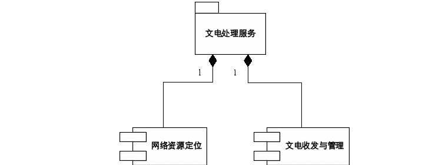
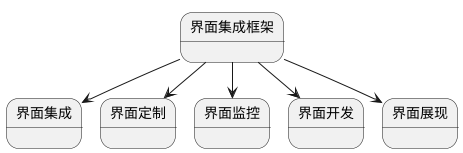
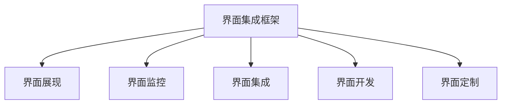
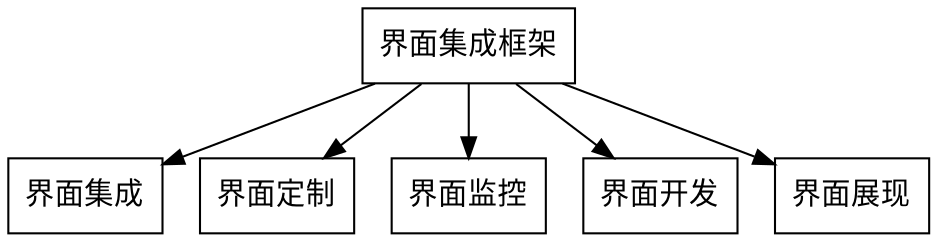

# 5_009 数据对档案

| 字段 | 值 |
|---|---|
| doc | 02界面集成框架软件需求规格说明-终稿 |
| section | 1.8 |
| image_caption | 图2 界面集成框架软件功能图 |
| table_caption | 表2 界面集成框架软件所有能力标识 |

## 原始图片

*图2 界面集成框架软件功能图*

## 结构图

*⚠ 结构经census重对齐: 旧锚点(oleObject1.bin:page1.xml)与图片不符, 已切换到与image.png内容一致的锚点(oleObject2.bin:page1.xml, align_score=1.0)*

*来源: born-digital导出(flowchart, 6节点/5边)*
*类型经几何启发式精化(Master类型识别失败的图, 投影层推断, canonical锚点不变)*

*状态图以PlantUML渲染(UML母语): [*]=起止 | 圆角框=状态 | 箭头标签=迁移事件*

Mermaid兼容投影(通用md渲染器可显示)

DOT源码(完整语义, graphviz可渲染)

### 锚点节点结构

| # | 文本 | 类型 |
|---|---|---|
| 1 | 界面集成框架 | process |
| 2 | 界面集成 | process |
| 3 | 界面定制 | process |
| 4 | 界面监控 | process |
| 5 | 界面开发 | process |
| 6 | 界面展现 | process |

## 表格内容

| 序号 | Use case名称 | 项目唯一标识符 | 需求描述 | 需求 重用 | 方式 名称 | 运行 方式 | 对应的任务书功能/性能 |
|---|---|---|---|---|---|---|---|
| 1 | 界面开发功能 | PZXQ-GN-JMKFKJ-JMKF | 提供包括界面开发模板、二次开发接口、公共 | 改进 | 桌面 | 开发阶段 | 4.1.1 |
| 2 | 界面集成功能 | PZXQ-GN-JMKFKJ-JMJC | 界面集成功能提供桌面、平板、手持版，包括 | 改进 | 平板、桌面、手持 | 集成阶段 | 4.1.2/4.2 a) |
| 3 | 界面定制功能 | PZXQ-GN-JMKFKJ-JMDZ | 提供依据用户身份的界面定制功能。界面定制 | 改进 | 平板、桌面、手持 | 集成阶段、运行阶段 | 4.1.3/4.2 c) |
| 4 | 界面监控功能 | PZXQ-GN-JMKFKJ-JMJK | 界面监控提供桌面、平板、手持版，为用户提 | 改进 | 平板、桌面、手持 | 运行阶段 | 4.1.4 |
| 5 | 界面展现功能 | PZXQ-GN-JMKFKJ-JMZX | 界面展现依据依据桌面、平板、手持终端的硬 | 改进 | 平板、桌面、手持 | 运行阶段 | 4.1.5/4.2 b) |

## 正文

界面集成框架部署在各级节点，提供桌面、平板、手持三种形态的软件，提供一个具备按需组装能力的多维信息可视化展现框架，是业务界面组件的宿主程序，为应用软件界面提供开发、集成、运行、定制、监控和展现的支撑，为用户提供统一的功能操作和信息展现。其中界面开发功能，支持开发人员在开发阶段使用，提供桌面版包括界面开发模板和公共组件库等功能；界面集成运行功能支持集成人员在集成阶段使用，提供桌面、平板、手持版，包括对界面进行统一集成、按需运行、组件管理、数据共享、服务请求等功能；界面定制功能满足集成人员和使用人员在集成阶段和运行阶段的使用需求，提供桌面、平板、手持版，为用户提供界面布局、快捷键、分屏状态、主题管理等功能；界面监控满足使用人员在运行阶段的使用需求，提供桌面、平板、手持版，为用户提供组件生命周期状态和资源占用情况的监控；界面展现满足使用人员在运行阶段的使用需求，依据桌面、平板、手持终端的硬件形态、尺寸大小和分辨率提供相应的界面展现风格和界面手段。
