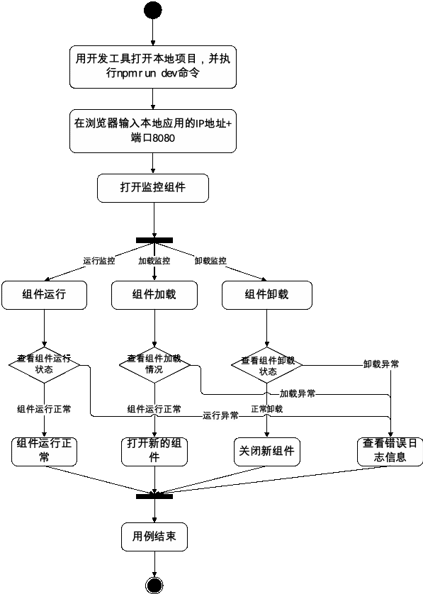

# 5_011 数据对档案

| 字段 | 值 |
|---|---|
| doc | 02界面集成框架软件需求规格说明-终稿 |
| section | 1.8.4.1 |
| image_caption | 图 34生命周期监控图 |
| table_caption | 表 27生命周期监控标识 |

## 原始图片

*图 34生命周期监控图*

## 结构图

*该对无Visio锚点(非Visio图, 无born-digital导出)*

## 表格内容

| 序号 | Use case名称 | 项目唯一标识符 | 需求描述 | 需求重用 | 方式名称 | 对应的任务书功能/性能 |
|---|---|---|---|---|---|---|
| 1 | 组件加载 | PZXQ-GN-JMJCKJ- JMJC | 提供组件加载的监控，记录组件从系统启动到 | 无 | 平板、桌面、手持 | 4.1.4 |
| 2 | 组件运行 | PZXQ-GN-JMJCKJ- JMDZ | 提供组件运行的监控，记录组件在加载完后运 | 无 | 平板、桌面、手持 | 4.1.4 |
| 3 | 组件卸载 | PZXQ-GN-JMJCKJ- JMDZ | 提供组件卸载监控，记录每个组件在停用之后 | 无 | 平板、桌面、手持 | 4.1.4 |

## 正文

生命周期监控包括组件加载、组件运行、组件卸载等功能的监控。
