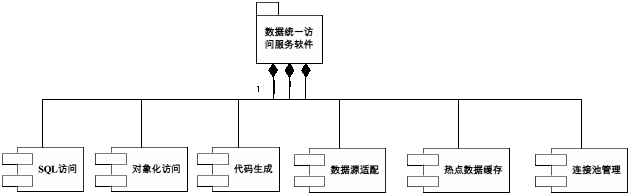
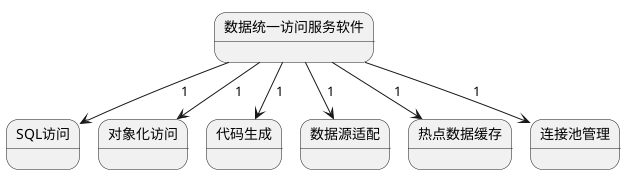
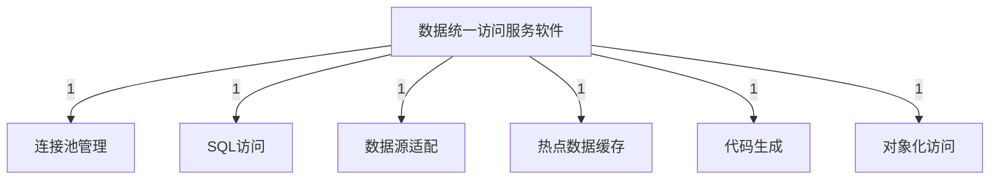

# 5_013 数据对档案

| 字段 | 值 |
|---|---|
| doc | 04数据统一访问服务软件需求规格说明-终稿 |
| section | 3.2 |
| image_caption | 图1 数据统一访问服务软件功能图（组件图） |
| table_caption | 表2 数据统一访问服务软件所有能力标识 |

## 原始图片


*图1 数据统一访问服务软件功能图（组件图）*

## 结构图

*来源: born-digital导出(flowchart, 7节点/6边)*
*类型经几何启发式精化(Master类型识别失败的图, 投影层推断, canonical锚点不变)*

*状态图以PlantUML渲染(UML母语): [*]=起止 | 圆角框=状态 | 箭头标签=迁移事件*



<details><summary>Mermaid兼容投影(通用md渲染器可显示)</summary>



</details>

<details><summary>DOT源码(完整语义, graphviz可渲染)</summary>

```dot
digraph G {
  rankdir=TB;
  node [fontname="Microsoft YaHei"];
  N1 [shape=box, label="数据统一访问服务软件"];
  N4 [shape=box, label="SQL访问"];
  N9 [shape=box, label="对象化访问"];
  N14 [shape=box, label="代码生成"];
  N34 [shape=box, label="数据源适配"];
  N39 [shape=box, label="热点数据缓存"];
  N54 [shape=box, label="连接池管理"];
  N1 -> N54, label="1";
  N1 -> N4, label="1";
  N1 -> N34, label="1";
  N1 -> N39, label="1";
  N1 -> N14, label="1";
  N1 -> N9, label="1";
}
```

</details>

### 锚点节点结构

| # | 文本 | 类型 |
|---|---|---|
| 1 | 数据统一访问服务软件 | process |
| 2 | SQL访问 | process |
| 3 | 对象化访问 | process |
| 4 | 代码生成 | process |
| 5 | 数据源适配 | process |
| 6 | 热点数据缓存 | process |
| 7 | 连接池管理 | process |

## 表格内容

| 序号 | Use case名称 | 项目唯一标识符 | 需求描述 | 需求重用 | 方式 名称 | 运行状态 | 对应的任务书功能/性能 |
|---|---|---|---|---|---|---|---|
| 1 | SQL访问功能 | PZXQ-GN-SQLFW | 提供原生SQL访问功能，提供数据库连接、 | 沿用 | 平板、桌面、手持 | 运行阶段 开发阶段 | 4.1.1；4.2 |
| 2 | 对象化访问功能 | PZXQ-GN-DXHFW | 提供对象化数据访问功能，支持应用软件通过 | 沿用 | 平板、桌面、手持 | 运行阶段 开发阶段 | 4.1.1 |
| 3 | 代码生成 | PZXQ-GN-DMSC | 提供代码自动生成功能，支持将关系型数据库 | 沿用 | 桌面 | 开发阶段 | 4.1.1 |
| 4 | 数据源适配 | PZXQ-GN-SJYSP | 提供数据源切换功能，支持访问数据源依据场 | 新研 | 平板 | 运行阶段 | 4.1.2；4.2 |
| 6 | 热点数据缓存 | PZXQ-GN-RDSJHC | 提供查询数据的缓存功能，支持对查询的结果 | 新研 | 桌面 | 运行阶段 | 4.1.2 |
| 7 | 连接池管理 | PZXQ-GN-LJCGL | 提供连接池管理功能，支持对达梦数据库 V | 新研 | 桌面 | 运行阶段 | 4.1.2 |

## 正文

数据统一访问服务按照其功能需求，包含SQL访问、对象化访问、代码生成、数据源适配、热点数据缓存以及连接池管理功能。
