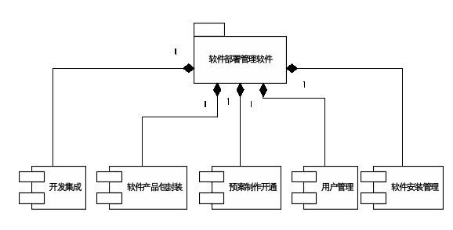
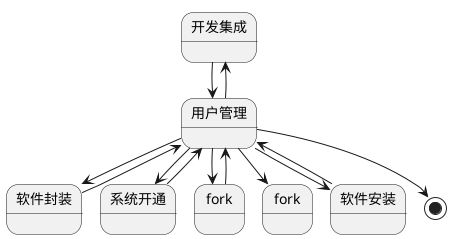
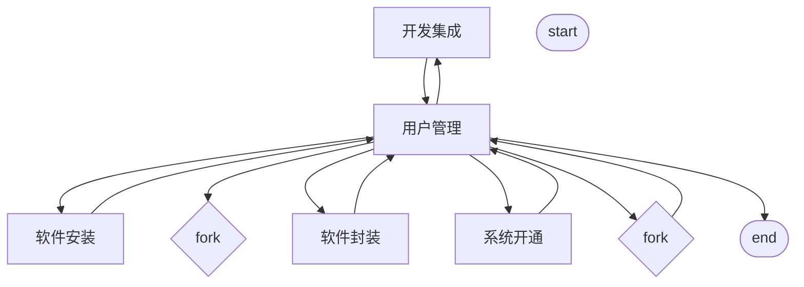
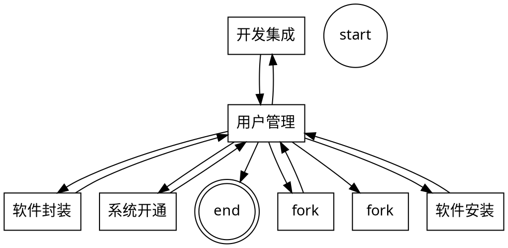

# 5_014 数据对档案

| 字段 | 值 |
|---|---|
| doc | 05软件部署管理软件需求规格说明-终稿 |
| section | 3.2 |
| image_caption | 图3 软件部署管理软件功能图 |
| table_caption | 表2 软件部署管理软件所有能力标识 |

## 原始图片

*图3 软件部署管理软件功能图*

## 结构图

*来源: born-digital导出(flowchart, 5节点/12边)*
*类型经几何启发式精化(Master类型识别失败的图, 投影层推断, canonical锚点不变)*

*状态图以PlantUML渲染(UML母语): [*]=起止 | 圆角框=状态 | 箭头标签=迁移事件*

Mermaid兼容投影(通用md渲染器可显示)

DOT源码(完整语义, graphviz可渲染)

### 锚点节点结构

| # | 文本 | 类型 |
|---|---|---|
| 1 | 开发集成 | process |
| 2 | 软件封装 | process |
| 3 | 系统开通 | process |
| 4 | 用户管理 | process |
| 5 |   | start |
| 6 |   | end |
| 7 |   | fork |
| 8 |   | fork |
| 9 | 软件安装 | process |

## 表格内容

| 序号 | Use case名称 | 项目唯一标识符 | 需求描述 | 需求重用 | 方式名称 | 运行状态 | 对应的任务书功能/性能 |
|---|---|---|---|---|---|---|---|
|   | 开发集成 | PZXQ-GN-RJBSGL-KFJC | a)提供软件开发项目工程的创建、编辑、封 | 新研 | 桌面 | 开发阶段 | 4.1.1 |
|   | 软件产品包封装 | PZXQ-GN-RJBSGL-RJFZ | a)提供软件包工程的新建、打开功能，支持 | 改进 | 桌面 | 开发阶段、集成阶段 | 4.1.2 |
|   | 预案制作开通 | PZXQ-GN--RJBSGL-YAZZ | a)提供任务数据包可视化管理功能，支持任 | 改进 | 桌面、平板、手持 | 集成阶段、运行阶段 | 4.1.3 |
|   | 用户管理 | PZXQ-GN--RJBSGL-YHGL | a)提供用户基本信息（用户ID、用户密码 | 改进 | 桌面、平板、手持 | 集成阶段、运行阶段 | 4.1.4 |
| f)提供用户功能菜单的编辑、导入、导出维 |
|   | 软件安装管理 | PZXQ-GN-RJBSGL-RJAZG | a)提供软件、数据发布管理功能，能够进行 | 改进 | 桌面、平板、手持 | 运行阶段 | 4.1.5 |

## 正文

软件部署管理软件按照其功能需求，包含开发集成、软件产品包封装、预案制作开通、用户管理、软件安装管理功能。
