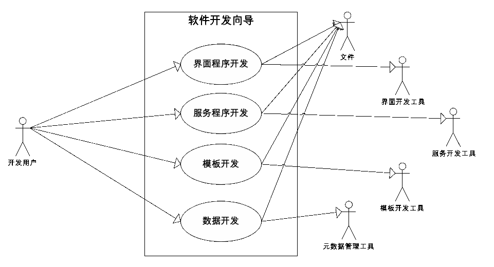
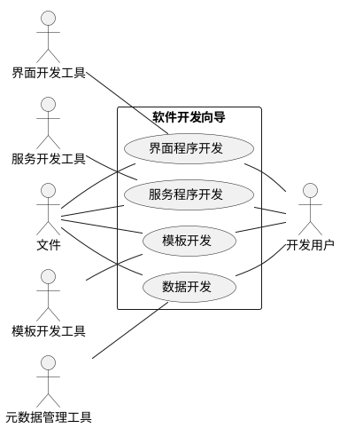
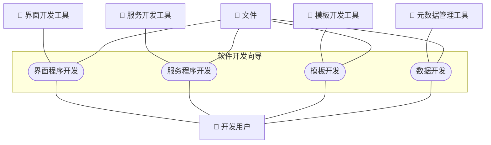
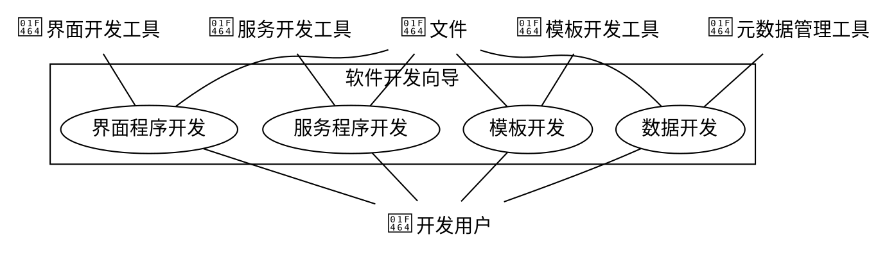

# 5_016 数据对档案

| 字段 | 值 |
|---|---|
| doc | 05软件部署管理软件需求规格说明-终稿 |
| section | 3.2.1.3 |
| image_caption | 图10 软件开发引导 |
| table_caption | 表11 软件开发引导所有能力标识 |

## 原始图片

*图10 软件开发引导*

## 结构图

*⚠ 结构经census重对齐: 旧锚点(oleObject11.bin:page1.xml)与图片不符, 已切换到与image.png内容一致的锚点(oleObject10.bin:page1.xml, align_score=1.0)*

*来源: born-digital导出(usecase, 11节点/12边)*
*类型经几何启发式精化(Master类型识别失败的图, 投影层推断, canonical锚点不变)*

*用例图以PlantUML渲染(UML母语): 小人=参与者 | 椭圆=用例 | 矩形框=系统边界 | 实线=关联 | 虚线=include/extend*

Mermaid兼容投影(通用md渲染器可显示)

DOT源码(完整语义, graphviz可渲染)

### 锚点节点结构

| # | 文本 | 类型 |
|---|---|---|
| 1 | 开发用户 | actor |
| 2 | 文件 | actor |
| 3 | 软件开发向导 | boundary |
| 4 | 模板开发 | usecase |
| 5 | 界面开发工具 | actor |
| 6 | 服务开发工具 | actor |
| 7 | 模板开发工具 | actor |
| 8 | 元数据管理工具 | actor |
| 9 | 界面程序开发 | usecase |
| 10 | 服务程序开发 | usecase |
| 11 | 数据开发 | usecase |
| 12 |   | other |

## 表格内容

| 序号 | Use case名称 | 项目唯一标识符 | 需求描述 | 需求重用 | 方式名称 | 运行状态 | 对应的任务书功能/性能 |
|---|---|---|---|---|---|---|---|
|   | 界面程序开发 | PZXQ-GN-RJBSGL-KFJC- | 能够引导用户进行界面类程序的编辑、编译、 | 新研 | 桌面 | 开发阶段 | 4.1.1 c) |
|   | 服务程序开发 | PZXQ-GN-RJBSGL-KFJC- | 能够引导用户进行服务类程序的代码编辑、编 | 新研 | 桌面 | 开发阶段 | 4.1.1 c) |
|   | 模板开发 | PZXQ-GN-RJBSGL-KFJC- | 能够引导用户进行模板的制作、编辑； | 新研 | 桌面 | 开发阶段 | 4.1.1 c) |
|   | 数据开发 | PZXQ-GN-RJBSGL-KFJC- | 能够引导用户进行数据库表编辑，生成指定格 | 新研 | 桌面 | 开发阶段 | 4.1.1 c) |

## 正文

软件开发引导能够引导用户进行界面类程序的编辑、编译、调试，生成指定格式的界面组件，能够引导用户进行服务类程序的代码编辑、编译、调试，生成指定格式的服务组件，能够引导用户进行数据库表编辑，生成指定格式的数据组件；能够引导用户进行模板的制作、编辑。
