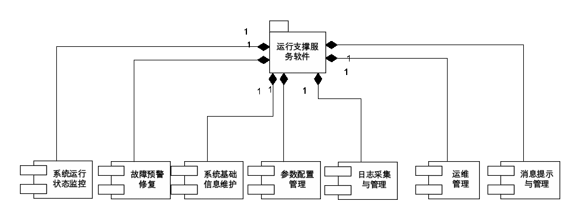
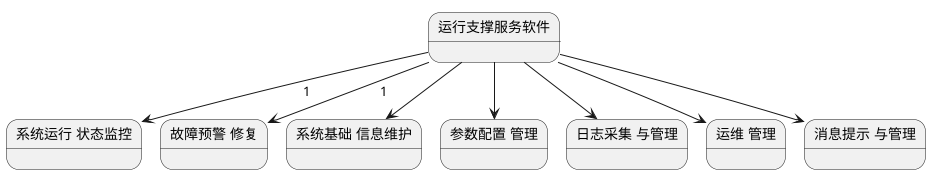
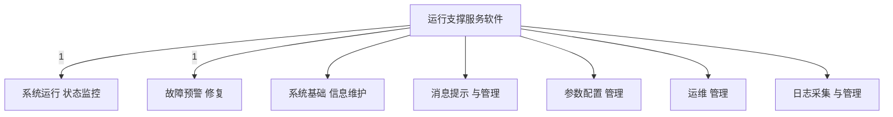

# 5_018 数据对档案

| 字段 | 值 |
|---|---|
| doc | 06运行支撑服务软件需求规格说明-终稿 |
| section | 3.2 |
| image_caption | 图2 运行支撑服务软件功能图 |
| table_caption | 表2 运行支撑服务软件所有能力标识 |

## 原始图片


*图2 运行支撑服务软件功能图*

## 结构图

*来源: born-digital导出(flowchart, 8节点/7边)*
*类型经几何启发式精化(Master类型识别失败的图, 投影层推断, canonical锚点不变)*

*状态图以PlantUML渲染(UML母语): [*]=起止 | 圆角框=状态 | 箭头标签=迁移事件*



<details><summary>Mermaid兼容投影(通用md渲染器可显示)</summary>



</details>

<details><summary>DOT源码(完整语义, graphviz可渲染)</summary>

```dot
digraph G {
  rankdir=TB;
  node [fontname="Microsoft YaHei"];
  N1 [shape=box, label="运行支撑服务软件"];
  N5 [shape=box, label="系统运行 状态监控"];
  N10 [shape=box, label="故障预警 修复"];
  N40 [shape=box, label="系统基础 信息维护"];
  N45 [shape=box, label="参数配置 管理"];
  N55 [shape=box, label="日志采集 与管理"];
  N60 [shape=box, label="运维 管理"];
  N65 [shape=box, label="消息提示 与管理"];
  N1 -> N5, label="1";
  N1 -> N10, label="1";
  N1 -> N40;
  N1 -> N65;
  N1 -> N45;
  N1 -> N60;
  N1 -> N55;
}
```

</details>

*锚点Connect重建存在5个悬空连线端点, 已几何恢复5条边(连线自由端吸附最近语义节点, 每条带距离证据, via=dangling_snap; canonical锚点不变)*

### 锚点节点结构

| # | 文本 | 类型 |
|---|---|---|
| 1 | 运行支撑服务软件 | process |
| 2 | 系统运行
状态监控 | process |
| 3 | 故障预警
修复 | process |
| 4 | 系统基础
信息维护 | process |
| 5 | 参数配置
管理 | process |
| 6 | 日志采集
与管理 | process |
| 7 | 运维
管理 | process |
| 8 | 消息提示
与管理 | process |

## 表格内容

| 序号 | Use case名称 | 项目唯一标识符 | 需求描述 | 需求重用 | 方式 名称 | 运行 状态 | 对应的任务书功能/性能 |
|---|---|---|---|---|---|---|---|
| 1 | 系统运行状态监控 | PZXQ-YXZCFW-GN- XTYX | a)能够对系统运行过程中的重要信息包括计 | 改进 | 桌面、平板、手持 | 运行阶段 | 4.1.1 |
| 2 | 故障预警修复 | PZXQ-YXZCFW-GN- GZYJ | a)提供故障策略库管理功能，支持用户录入 | 改进 | 桌面 | 开发阶段、运行阶段 | 4.1.2 |
| 3 | 系统基础信息维护 | PZXQ-YXZCFW-GN- XTJC | a)提供接口支持对当前登录的用户名、用户 | 改进 | 桌面、平板、手持 | 开发阶段、集成阶段、运行阶段 | 4.1.3 |
| 4 | 参数配置管理 | PZXQ-YXZCFW-GN- CSPZ | a)能够对界面集成框架的分屏、字体大小、 | 改进 | 桌面、平板、手持 | 开发阶段、运行阶段 | 4.1.4 |
| 5 | 日志采集与管理 | PZXQ-YXZCFW-GN- RZCJ | a)提供软件日志记录接口，支持应用软件记 | 新增 | 桌面 | 开发阶段、集成阶段、运行阶段 | 4.1.6 |
| 6 | 运维管理 | PZXQ-YXZCFW-GN- YWGL | a)提供运维管理统一集成框架，能够对用户 | 改进 | 桌面 | 运行阶段 | 4.1.7 |
| 7 | 消息提示与管理 | PZXQ-YXZCFW-GN- XXTS | a)提供消息提示功能，支持以弹框的形式对 | 改进 | 桌面 | 运行阶段 | 4.1.8 |

## 正文

运行支撑服务软件按照其功能需求，包含系统运行状态监控、故障探测预警、系统基础信息维护、参数配置管理、时间发布与同步、日志采集与管理、运维管理和消息提示与管理。
