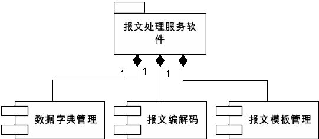
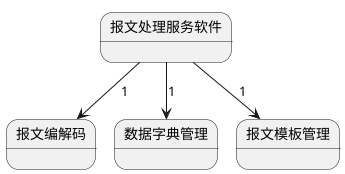
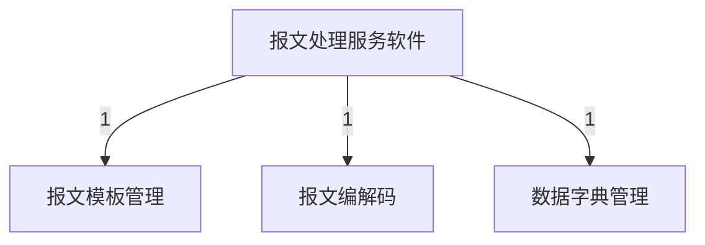

# 5_019 数据对档案

| 字段 | 值 |
|---|---|
| doc | 07报文处理服务软件需求规格说明-终稿 |
| section | 3.2 |
| image_caption | 图2 报文处理服务软件功能图 |
| table_caption | 表2 报文处理服务软件所有能力标识 |

## 原始图片


*图2 报文处理服务软件功能图*

## 结构图

*来源: born-digital导出(flowchart, 4节点/3边)*
*类型经几何启发式精化(Master类型识别失败的图, 投影层推断, canonical锚点不变)*

*状态图以PlantUML渲染(UML母语): [*]=起止 | 圆角框=状态 | 箭头标签=迁移事件*



<details><summary>Mermaid兼容投影(通用md渲染器可显示)</summary>



</details>

<details><summary>DOT源码(完整语义, graphviz可渲染)</summary>

```dot
digraph G {
  rankdir=TB;
  node [fontname="Microsoft YaHei"];
  N1 [shape=box, label="报文处理服务软件"];
  N4 [shape=box, label="报文编解码"];
  N9 [shape=box, label="数据字典管理"];
  N24 [shape=box, label="报文模板管理"];
  N1 -> N24, label="1";
  N1 -> N4, label="1";
  N1 -> N9, label="1";
}
```

</details>

### 锚点节点结构

| # | 文本 | 类型 |
|---|---|---|
| 1 | 报文处理服务软件 | process |
| 2 | 报文编解码 | process |
| 3 | 数据字典管理 | process |
| 4 | 报文模板管理 | process |

## 表格内容

| 序号 | Use case名称 | 项目唯一标识符 | 需求描述 | 需求 重用 | 方式 | 运行 状态 | 对应的任务书功能/性能 |
|---|---|---|---|---|---|---|---|
| 1 | 报文编解码服务 | PZXQ-GN-BWBJ | 提供应用程序接口； 提供日志记录功能 | 沿用 | 桌面、 平板、手持 | 开发、 运行 | 4.1.1 4.2 |
| 2 | 数据字典管理 | PZXQ-GN-SJZD | 支持数据字典中数据项的增加、删除、修改和 | 沿用 | 桌面 | 开发 | 4.1.2 |
| 3 | 报文模板管理 | PZXQ-GN-BWMB | 支持报文模板的编辑功能，能够对报文模板进 | 沿用 | 桌面 | 开发 | 4.1.3 |

## 正文

报文处理服务软件按照其功能需求，包含报文编解码服务、数据字典管理功能和报文模板管理功能。
