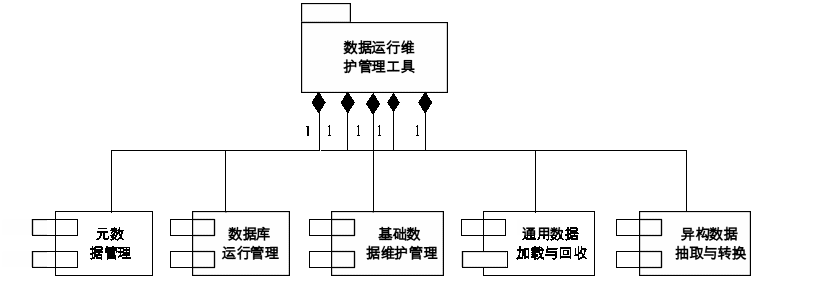
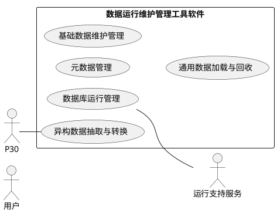
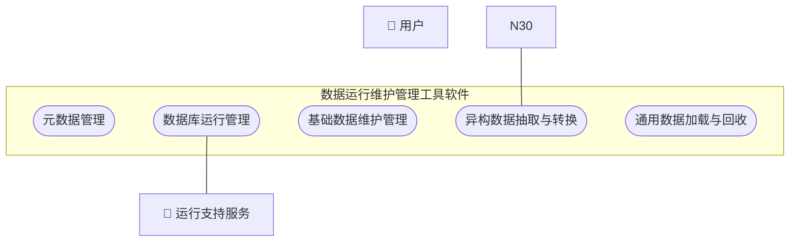
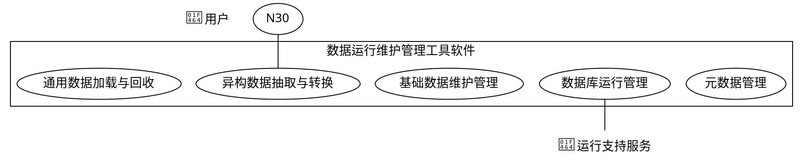

# 5_020 数据对档案

| 字段 | 值 |
|---|---|
| doc | 08数据运行维护管理工具软件需求规格说明-终稿 |
| section | 3.2 |
| image_caption | 图 1数据运行维护管理工具组件图 |
| table_caption | 表 2数据运行维护管理工具所有能力标识 |

## 原始图片

*图 1数据运行维护管理工具组件图*

## 结构图

*⚠ 结构经census重对齐: 旧锚点(oleObject6.bin:page1.xml)与图片不符, 已切换到与image.png内容一致的锚点(oleObject2.bin:page1.xml, align_score=0.75)*

*来源: born-digital导出(usecase, 8节点/2边)*
*类型经几何启发式精化(Master类型识别失败的图, 投影层推断, canonical锚点不变)*

*用例图以PlantUML渲染(UML母语): 小人=参与者 | 椭圆=用例 | 矩形框=系统边界 | 实线=关联 | 虚线=include/extend*

Mermaid兼容投影(通用md渲染器可显示)

DOT源码(完整语义, graphviz可渲染)

### 锚点节点结构

| # | 文本 | 类型 |
|---|---|---|
| 1 |   | other |
| 2 | 数据运行维护管理工具软件 | other |
| 3 |   | other |
| 4 |   | other |
| 5 | 元数据管理 | other |
| 6 |   | other |
| 7 |   | other |
| 8 | 数据库运行管理 | other |
| 9 |   | other |
| 10 |   | other |
| 11 | 基础数据维护管理 | other |
| 12 |   | other |
| 13 |   | other |
| 14 | 用户 | other |
| 15 |   | other |
| … | 共27个节点 | |

## 表格内容

| 序号 | Use case名称 | 项目唯一标识符 | 需求描述 | 需求重用 | 方式名称 | 运行状态 | 对应的任务书功能/性能 |
|---|---|---|---|---|---|---|---|
| 1 | 元数据管理 | PZXQ-GN-YSJGL | 提取指定数据库形成元数据库、支持维护库表 | 沿用 | 桌面 | 开发阶段 | 4.1.1 |
| 2 | 数据库运行管理 | PZXQ-GN-SJKYXGL | 支持数据库信息监控例如：监控会话、资源、 | 沿用 | 桌面 | 运行阶段 | 4.1.2 |
| 3 | 基础数据维护 | PZXQ-GN-JCSJWH | 提供数据库中基础数据维护管理、模板管理、 | 沿用、新研 | 桌面、平板 | 集成阶段 | 4.1.3 |
| 4 | 数据加载回收 | PZXQ-GN-SJJZHS | 提供数据库段的安装卸载功能、数据库备份恢 | 沿用 | 桌面、平板、手持 | 集成阶段 | 4.1.5 |
| 5 | 数据抽取转换 | PZXQ-GN-SJCQZH | 提供达梦到SQLITE3的数据抽取转换功 | 沿用 | 桌面 | 集成阶段 | 4.1.6 |

## 正文

数据运行维护管理工具由元数据管理、数据库运行管理、基础数据维护管理、通用数据加载回收、异构数据抽取转换。
