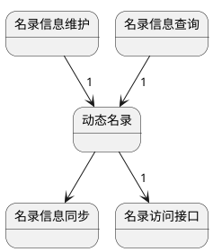
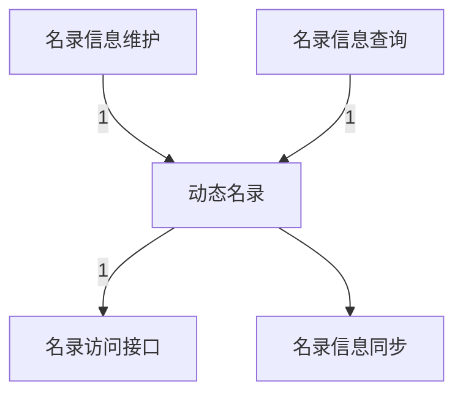

# 5_022 数据对档案

| 字段 | 值 |
|---|---|
| doc | 10动态名录软件需求规格说明-终稿 |
| section | 3.2 |
| image_caption | 图3 动态名录软件功能图（组件图） |
| table_caption | 表3 动态名录软件所有能力标识 |

## 原始图片


*图3 动态名录软件功能图（组件图）*

## 结构图

*来源: born-digital导出(flowchart, 5节点/4边)*
*类型经几何启发式精化(Master类型识别失败的图, 投影层推断, canonical锚点不变)*

*状态图以PlantUML渲染(UML母语): [*]=起止 | 圆角框=状态 | 箭头标签=迁移事件*



<details><summary>Mermaid兼容投影(通用md渲染器可显示)</summary>



</details>

<details><summary>DOT源码(完整语义, graphviz可渲染)</summary>

```dot
digraph G {
  rankdir=TB;
  node [fontname="Microsoft YaHei"];
  N1 [shape=box, label="动态名录"];
  N4 [shape=box, label="名录信息维护"];
  N9 [shape=box, label="名录信息查询"];
  N14 [shape=box, label="名录信息同步"];
  N29 [shape=box, label="名录访问接口"];
  N1 -> N29, label="1";
  N4 -> N1, label="1";
  N9 -> N1, label="1";
  N1 -> N14;
}
```

</details>

*锚点Connect重建存在1个悬空连线端点, 已几何恢复1条边(连线自由端吸附最近语义节点, 每条带距离证据, via=dangling_snap; canonical锚点不变)*

### 锚点节点结构

| # | 文本 | 类型 |
|---|---|---|
| 1 | 动态名录 | process |
| 2 | 名录信息维护 | process |
| 3 | 名录信息查询 | process |
| 4 | 名录信息同步 | process |
| 5 | 名录访问接口 | process |

## 表格内容

| 序号 | Use case名称 | 项目唯一标识符 | 需求描述 | 需求重用 | 方式名称 | 运行状态 | 对应的任务书功能/性能 |
|---|---|---|---|---|---|---|---|
| 1 | 名录信息维护 | PZXQ-GN-MLXXWH | 完成名录信息的生成、维护功能，并提供可视 | 改进 | 桌面版 平板版 | 集成阶段、运行阶段 | 4.1.1、4.2a、4.2b |
| 2 | 名录信息查询 | PZXQ-GN-MLXXCX | 完成名录节点信息查询能力，包括上级、下级 | 沿用 | 桌面版 平板版 手持版 | 运行阶段 | 4.1.2、4.2a、4.2b |
| 3 | 名录信息同步 | PZXQ-GN-MLXXTB | 完成更新节点信息、用户上下线信息、用户装 | 新研 | 桌面版 平板版 手持版 | 运行阶段 | 4.1.3 |
| 4 | 名录访问接口 | PZXQ-GN-MLFWJK | 提供应用软件访问查询名录信息的接口 | 改进 | 桌面版 平板版 手持版 | 开发阶段 | 4.1.4 |

## 正文

动态名录软件按照其功能需求，包含名录信息维护、名录信息查询、名录信息同步和名录访问接口功能，并提供名录辅助工具，操作人员可通过该工具进行名录相关功能的操作。
