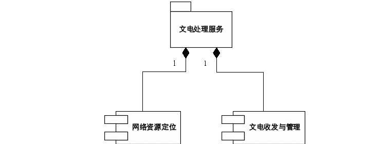
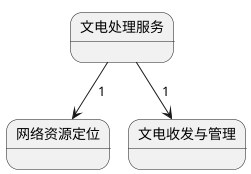
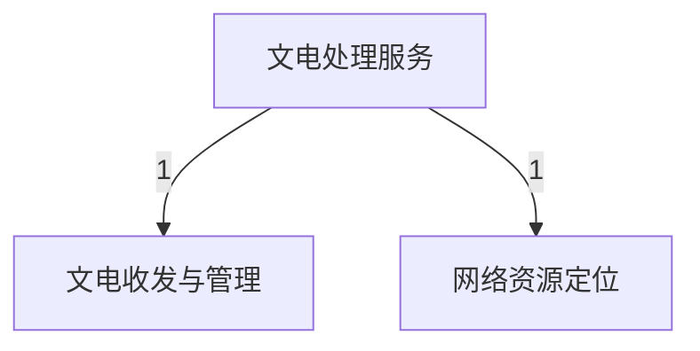

# 5_024 数据对档案

| 字段 | 值 |
|---|---|
| doc | 12文电处理需求规格说明-终端 |
| section | 3.2 |
| image_caption | 图 2  文电处理功能图 |
| table_caption | 表 2  文电处理所有能力标识 |

## 原始图片


*图 2  文电处理功能图*

## 结构图

*来源: born-digital导出(flowchart, 3节点/2边)*
*类型经几何启发式精化(Master类型识别失败的图, 投影层推断, canonical锚点不变)*

*状态图以PlantUML渲染(UML母语): [*]=起止 | 圆角框=状态 | 箭头标签=迁移事件*



<details><summary>Mermaid兼容投影(通用md渲染器可显示)</summary>



</details>

<details><summary>DOT源码(完整语义, graphviz可渲染)</summary>

```dot
digraph G {
  rankdir=TB;
  node [fontname="Microsoft YaHei"];
  N625 [shape=box, label="文电处理服务"];
  N628 [shape=box, label="网络资源定位"];
  N663 [shape=box, label="文电收发与管理"];
  N625 -> N663, label="1";
  N625 -> N628, label="1";
}
```

</details>

### 锚点节点结构

| # | 文本 | 类型 |
|---|---|---|
| 1 | 文电处理服务 | process |
| 2 | 网络资源定位 | process |
| 3 | 文电收发与管理 | process |

## 表格内容

| 序号 | Use case名称 | 项目唯一标识符 | 需求描述 | 需求重用 | 方式 | 运行状态 | 对应的任务书功能/性能 |
|---|---|---|---|---|---|---|---|
|   | 网络资源定位 | PZXQ-GN-ZYDW | 信息处理系统和用户可以快速、高效的按照名 | 新研 | 桌面版 | 运行阶段 |   |
|   | 文电收发与管理 | PZXQ-GN-SFGL | 在广域网环境下进行格式化文电的发送、加密 | 新研 | 桌面版、平板版 | 运行阶段 |   |

## 正文

文电处理按照其功能需求，提供网络资源定位功能和文电收发与管理功能，同时根据功能需求提供插件式和B/S架构的名录管理工具功能和文电管理工具。
