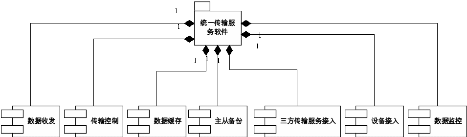
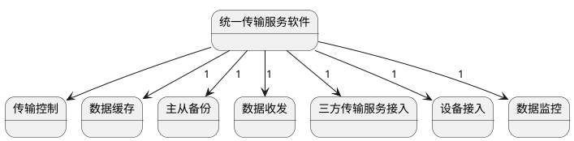
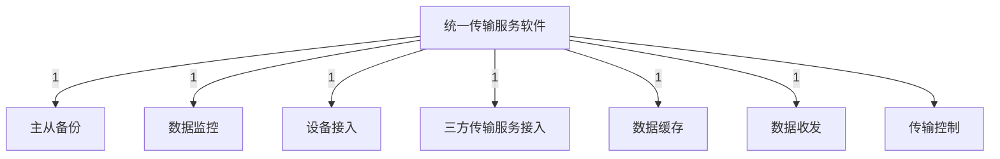

# 5_025 数据对档案

| 字段 | 值 |
|---|---|
| doc | 13统一传输服务软件需求规格说明-终端 |
| section | 3.2 |
| image_caption | 图1 统一传输服务软件功能图 |

## 原始图片


*图1 统一传输服务软件功能图*

## 结构图

*⚠ 结构经census重对齐: 旧锚点(oleObject7.bin:page1.xml)与图片不符, 已切换到与image.png内容一致的锚点(oleObject1.bin:page1.xml, align_score=1.0)*

*来源: born-digital导出(flowchart, 8节点/7边)*
*类型经几何启发式精化(Master类型识别失败的图, 投影层推断, canonical锚点不变)*

*状态图以PlantUML渲染(UML母语): [*]=起止 | 圆角框=状态 | 箭头标签=迁移事件*



<details><summary>Mermaid兼容投影(通用md渲染器可显示)</summary>



</details>

<details><summary>DOT源码(完整语义, graphviz可渲染)</summary>

```dot
digraph G {
  rankdir=TB;
  node [fontname="Microsoft YaHei"];
  N1 [shape=box, label="统一传输服务软件"];
  N4 [shape=box, label="传输控制"];
  N9 [shape=box, label="数据缓存"];
  N14 [shape=box, label="主从备份"];
  N34 [shape=box, label="数据收发"];
  N39 [shape=box, label="三方传输服务接入"];
  N44 [shape=box, label="设备接入"];
  N49 [shape=box, label="数据监控"];
  N1 -> N14, label="1";
  N1 -> N49, label="1";
  N1 -> N44, label="1";
  N1 -> N39, label="1";
  N1 -> N9, label="1";
  N1 -> N34, label="1";
  N1 -> N4;
}
```

</details>

*锚点Connect重建存在0个悬空连线端点, 已几何恢复1条边(连线自由端吸附最近语义节点, 每条带距离证据, via=dangling_snap; canonical锚点不变)*

### 锚点节点结构

| # | 文本 | 类型 |
|---|---|---|
| 1 | 统一传输服务软件 | process |
| 2 | 传输控制 | process |
| 3 | 数据缓存 | process |
| 4 | 主从备份 | process |
| 5 | 数据收发 | process |
| 6 | 三方传输服务接入 | process |
| 7 | 设备接入 | process |
| 8 | 数据监控 | process |

## 表格内容

| 序号 | Use case名称 | 项目唯一标识符 | 需求描述 | 需求重用 | 方式名称 | 运行状态 | 对应的任务书功能/性能 |
|---|---|---|---|---|---|---|---|
| 1 | 数据收发 | PZXQ-GN-SJSF | 提供话音业务数据的收发功能； 提供流媒体 | 沿用 | 桌面版、平板版、手持版 | 运行状态 | 4.1.1/4.2 a) |
| 2 | 传输控制 | PZXQ-GN-CSKZ | 提供根据应用需求选择传输策略（可靠性、优 | 沿用 | 桌面版、平板版、手持版 | 运行状态 | 4.1.2 |
| 3 | 数据缓存 | PZXQ-GN-SJHC | 提供非结构化数据的本地临时缓存功能，支持 | 改进 | 桌面版、平板版、手持版 | 运行状态 | 4.1.3/4.2b) |
| 4 | 主从备份 | PZXQ-GN-ZCBF | 提供主从服务器上传输服务之间互为备份的功 | 新研 | 桌面版、平板版、手持版 | 运行状态 | 4.1.4 |
| 5 | 三方传输服务接入 | PZXQ-GN-SFCSFWJR | 提供三方传输服务接入的功能，提供通用传输 | 改进 | 桌面版、平板版、手持版 | 运行状态 | 4.1.5 |
| 6 | 设备接入 | PZXQ-GN-SBJR | 提供网络设备物理接入的功能，支持以UDP | 沿用 | 桌面版、平板版、手持版 | 运行状态 | 4.1.6 |
| 7 | 数据监控 | PZXQ-GN-SJJK | 提供对局域网内传输服务状态信息的采集功能 | 沿用 | 桌面版、平板版 | 运行状态 | 4.1.7 |
