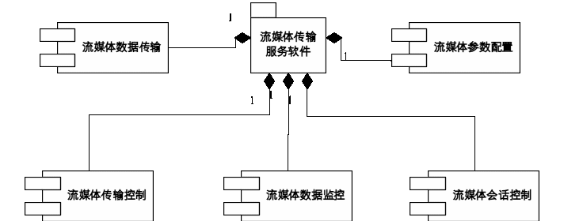
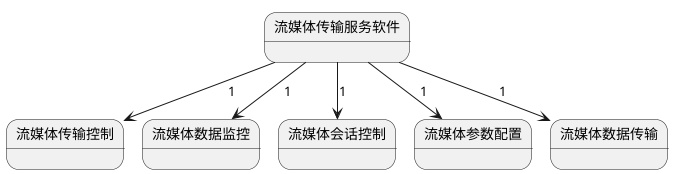
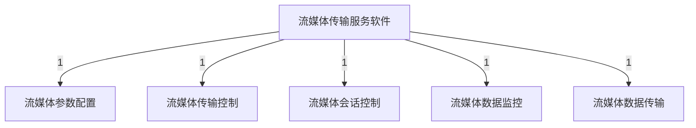

# 5_027 数据对档案

| 字段 | 值 |
|---|---|
| doc | 16流媒体传输服务软件需求规格说明-终稿 |
| section | 3.2 |
| image_caption | 图1 流媒体传输服务软件功能图 |
| table_caption | 表2 流媒体传输服务软件所有能力标识 |

## 原始图片


*图1 流媒体传输服务软件功能图*

## 结构图

*来源: born-digital导出(flowchart, 6节点/5边)*
*类型经几何启发式精化(Master类型识别失败的图, 投影层推断, canonical锚点不变)*

*状态图以PlantUML渲染(UML母语): [*]=起止 | 圆角框=状态 | 箭头标签=迁移事件*



<details><summary>Mermaid兼容投影(通用md渲染器可显示)</summary>



</details>

<details><summary>DOT源码(完整语义, graphviz可渲染)</summary>

```dot
digraph G {
  rankdir=TB;
  node [fontname="Microsoft YaHei"];
  N1 [shape=box, label="流媒体传输服务软件"];
  N4 [shape=box, label="流媒体传输控制"];
  N9 [shape=box, label="流媒体数据监控"];
  N14 [shape=box, label="流媒体会话控制"];
  N49 [shape=box, label="流媒体参数配置"];
  N54 [shape=box, label="流媒体数据传输"];
  N1 -> N49, label="1";
  N1 -> N4, label="1";
  N1 -> N14, label="1";
  N1 -> N9, label="1";
  N1 -> N54, label="1";
}
```

</details>

### 锚点节点结构

| # | 文本 | 类型 |
|---|---|---|
| 1 | 流媒体传输服务软件 | process |
| 2 | 流媒体传输控制 | process |
| 3 | 流媒体数据监控 | process |
| 4 | 流媒体会话控制 | process |
| 5 | 流媒体参数配置 | process |
| 6 | 流媒体数据传输 | process |

## 表格内容

| 序号 | Use case名称 | 项目唯一标识符 | 需求描述 | 需求重用 | 方式 | 运行状态 | 对应的任务书功能/性能 |
|---|---|---|---|---|---|---|---|
| 1 | 流媒体数据传输 | PZXQ-GN-LMTSJCS | （1）能够为上层应用提供流媒体同步信息； | 沿用 | 桌面版、平板版 | 运行阶段 | 4.1.1/4.2 a) |
| 2 | 流媒体会话控制 | PZXQ-GN-LMTHHKZ | 提供流媒体会话控制，支持点播、暂停、关闭 | 沿用 | 桌面版、平板版 | 运行阶段 | 4.1.2 |
| 3 | 流媒体参数配置 | PZXQ-GN-CSPZ | 提供配置信息输入能力，能够通过接口设置流 | 沿用 | 桌面版、平板版 | 运行阶段 | 4.1.3 |
| 4 | 流媒体传输控制 | PZXQ-GN-LMTCSKZ | (1)提供流媒体数据流的单播、组播能力； | 沿用 | 桌面版、平板版 | 运行阶段 | 4.1.4 |
| 5 | 流媒体数据监控 | PZXQ-GN-LMTSJJK | (1)能够检测流媒体传输服务运行过程中的 | 沿用 | 桌面版、平板版 | 运行阶段 | 4.1.5 |

## 正文

流媒体传输服务软件按照其功能需求，包含流媒体传输控制、流媒体数据监控、流媒体参数配置、流媒体会话控制、流媒体数据传输功能。
