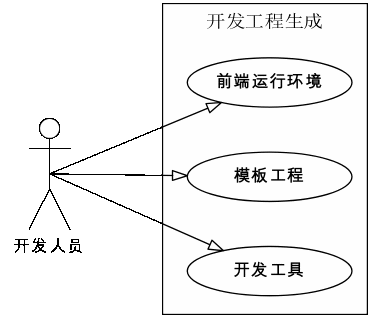
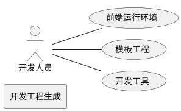
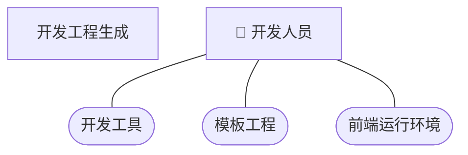
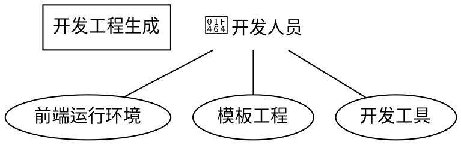

# 7_001 数据对档案

| 字段 | 值 |
|---|---|
| doc | 02界面集成框架软件需求规格说明-终稿 |
| section | 1.8.1.1 |
| image_caption | 图 6开发工程用例 |
| table_caption | 表4 开发工程生成用例描述 |

## 原始图片

*图 6开发工程用例*

## 结构图

*⚠ 结构经census重对齐: 旧锚点(oleObject7.bin:page1.xml)与图片不符, 已切换到与image.png内容一致的锚点(oleObject6.bin:page1.xml, align_score=1.0)*

*来源: born-digital导出(usecase, 5节点/3边)*
*类型经几何启发式精化(Master类型识别失败的图, 投影层推断, canonical锚点不变)*

*用例图以PlantUML渲染(UML母语): 小人=参与者 | 椭圆=用例 | 矩形框=系统边界 | 实线=关联 | 虚线=include/extend*

Mermaid兼容投影(通用md渲染器可显示)

DOT源码(完整语义, graphviz可渲染)

### 锚点节点结构

| # | 文本 | 类型 |
|---|---|---|
| 1 | 开发工程生成 | process |
| 2 | 前端运行环境 | usecase |
| 3 | 模板工程 | usecase |
| 4 | 开发工具 | usecase |
| 5 | 开发人员 | actor |

## 表格内容

| Use Case 名称：开发工程生成 | Actors：开发人员 |   |
|---|---|---|
| Use Case 名称：开发工程生成 | Actors：开发人员 |   |
| 概述：本用例是开发工程生成的扩展用例，描 |   |   |
| 前置条件：数据库连接正常。 |   |   |
| 主事件流 |   |   |
| Actor的动作 | 系统的动作 | 动作约束 （性能、可靠性、容错等） |
| 1.开发人员打开软件开发ide工具（包括 |   | 1．开发所用的运行环境内存需要大于等于4 |
| 2．在工程中找到package.json |   |
|   | 3. node将用户运行的软件加载到内存 |
| 4．在模板工程中新建组件 |   |
| 5．修改组件的内容和数据 |   |
|   | 6．用户修改界面后，浏览器里的组件会同步 |
|   | 7.用例结束 |
| 异常流E1：组件无法被正常加载，用例结束 |   |   |
| 后置条件：无。 |   |   |

## 正文

开发工程生成是提供用户进行基于界面框架二次开发的模板工程，提供界面组件开发模板生成功能，支持应用软件基于模板开发界面组件。
