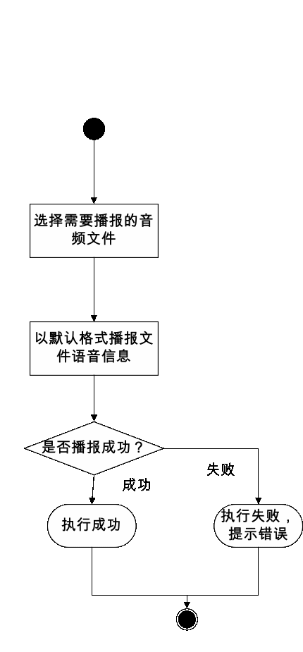
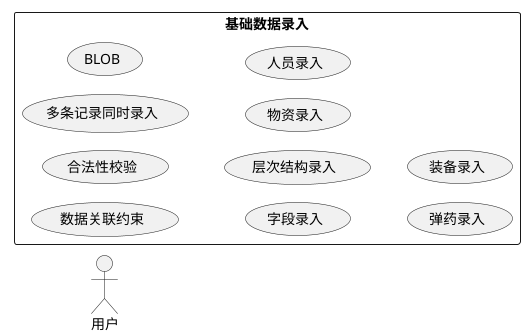
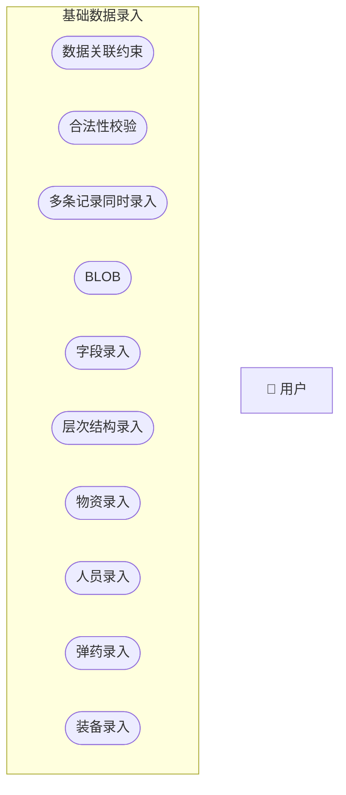
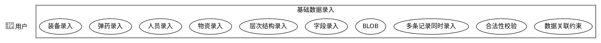

# 7_003 数据对档案

| 字段 | 值 |
|---|---|
| doc | 08数据运行维护管理工具软件需求规格说明-终稿 |
| section | 3.2.3.1.1 |
| image_caption | 图 7基础数据录入用例图 |
| table_caption | 表 22人员数据录入用例描述 |

## 原始图片

*图 7基础数据录入用例图*

## 结构图

*⚠ 结构经census重对齐: 旧锚点(oleObject6.bin:page1.xml)与图片不符, 已切换到与image.png内容一致的锚点(oleObject7.bin:page1.xml, align_score=0.917)*

*来源: born-digital导出(usecase, 12节点/0边)*
*类型经几何启发式精化(Master类型识别失败的图, 投影层推断, canonical锚点不变)*

*用例图以PlantUML渲染(UML母语): 小人=参与者 | 椭圆=用例 | 矩形框=系统边界 | 实线=关联 | 虚线=include/extend*

Mermaid兼容投影(通用md渲染器可显示)

DOT源码(完整语义, graphviz可渲染)

### 锚点节点结构

| # | 文本 | 类型 |
|---|---|---|
| 1 |   | other |
| 2 |   | other |
| 3 |   | other |
| 4 |   | other |
| 5 | 数据关联约束 | other |
| 6 |   | other |
| 7 |   | other |
| 8 | 合法性校验 | other |
| 9 |   | other |
| 10 |   | other |
| 11 | 多条记录同时录入 | other |
| 12 |   | other |
| 13 |   | other |
| 14 | BLOB | other |
| 15 | 字段录入 | other |
| … | 共47个节点 | |

## 表格内容

| Use Case 名称：人员数据录入 | Actors：用户 |   |
|---|---|---|
| Use Case 名称：人员数据录入 | Actors：用户 |   |
| 概述：本用例主要实现基础数据管理中人员信 |   |   |
| 前置条件：达梦数据库连接正常。 |   |   |
| 主事件流 |   |   |
| Actor的动作 | 系统的动作 | 动作约束 （性能、可靠性、容错等） |
| 1.用户在组织机构树中选择需要添加人员所 | 2．在前台界面中点击添加人员按钮； 4、 | 1.交互信息正确性校验，并在错误发生时， |
| 异常流E1：系统提示失败，用例结束。 |   |   |
| 后置条件：无。 |   |   |

## 正文

基础数据录入能力包括：人员录入、装备录入、物资录入、弹药录入、BLOB字段录入、层次结构录入、数据关联约束、合法性校验、多条记录同时录入，其功能用例如图 7所示。
