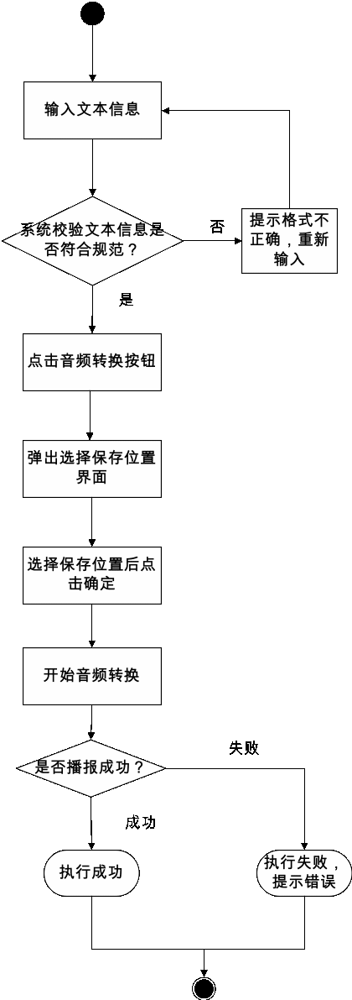
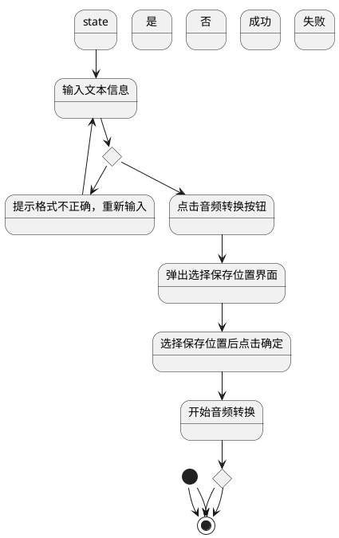
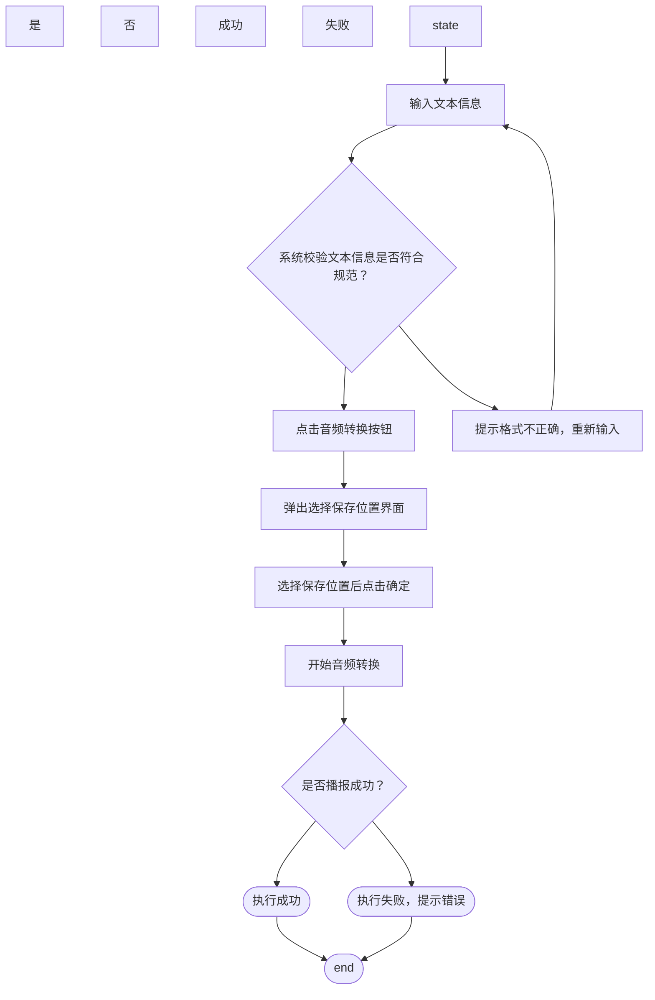
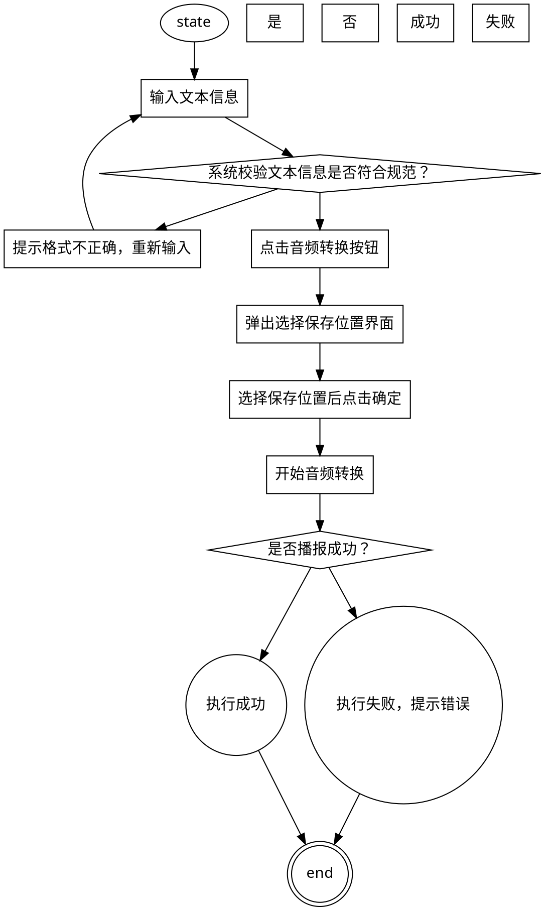

# 7_004 数据对档案

| 字段 | 值 |
|---|---|
| doc | 11语音综合处理软件需求规格说明-终稿 |
| section | 3.2 |
| image_caption | 图6 音频文件生成和存储用例流程图 |
| table_caption | 表 5音频文件生成和存储用例描述 |

## 原始图片

*图6 音频文件生成和存储用例流程图*

## 结构图

*来源: born-digital导出(flowchart, 14节点/13边)*
*类型经几何启发式精化(Master类型识别失败的图, 投影层推断, canonical锚点不变)*

*状态图以PlantUML渲染(UML母语): [*]=起止 | 圆角框=状态 | 箭头标签=迁移事件*

Mermaid兼容投影(通用md渲染器可显示)

DOT源码(完整语义, graphviz可渲染)

### 锚点节点结构

| # | 文本 | 类型 |
|---|---|---|
| 1 | 输入文本信息 | process |
| 2 | 系统校验文本信息是否符合规范？ | decision |
| 3 | 提示格式不正确，重新输入 | process |
| 4 | 是 | other |
| 5 | 否 | other |
| 6 | 点击音频转换按钮 | process |
| 7 | 弹出选择保存位置界面 | process |
| 8 | 选择保存位置后点击确定 | process |
| 9 | 开始音频转换 | process |
| 10 | 是否播报成功？ | decision |
| 11 | 执行成功 | start |
| 12 | 执行失败，提示错误 | start |
| 13 | 成功 | other |
| 14 | 失败 | other |
| 15 |   | state |
| … | 共16个节点 | |

## 表格内容

| Use Case 名称：音频文件生成和存 | Actors：使用人员 |   |
|---|---|---|
| Use Case 名称：音频文件生成和存 | Actors：使用人员 |   |
| 概述：本用例是语音综合处理的音频文件生成 |   |   |
| 前置条件：无。 |   |   |
| 主事件流 |   |   |
| Actor的动作 | 系统的动作 | 动作约束 （性能、可靠性、容错等） |
| 1.用户在界面上选择或输入格式化文本信息 | 2.系统接收格式化文本信息； 3.系统检 |   |
| 异常流E1：系统提示格式化文本不符合规范 |   |   |
| 异常流E2：系统提示音频文件转换失败，用 |   |   |
| 后置条件：生成wav格式的音频文件。 |   |   |

## 正文

语音合成的主要功能包括：格式化文本语音合成、音频文件生成和存储、语音播报、语音设置，功能用例如图4所示。
