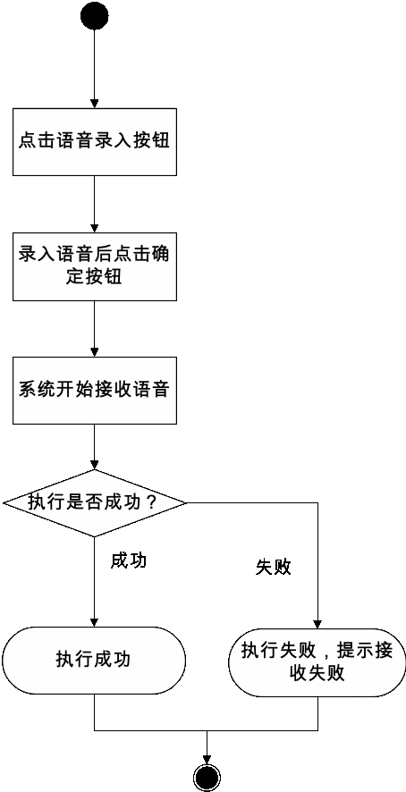
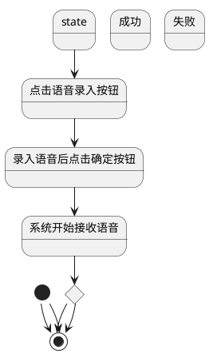
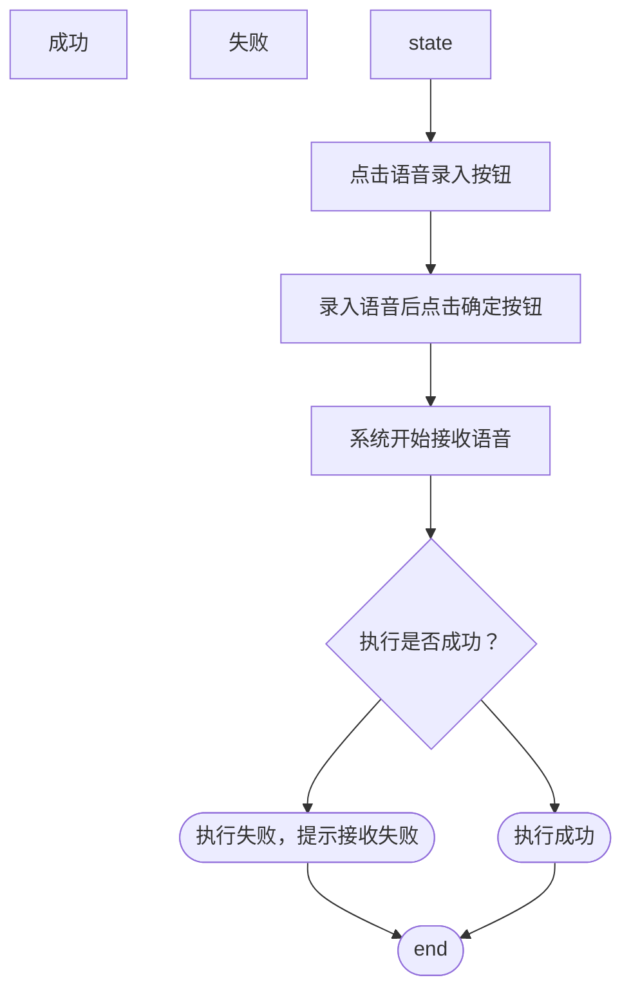
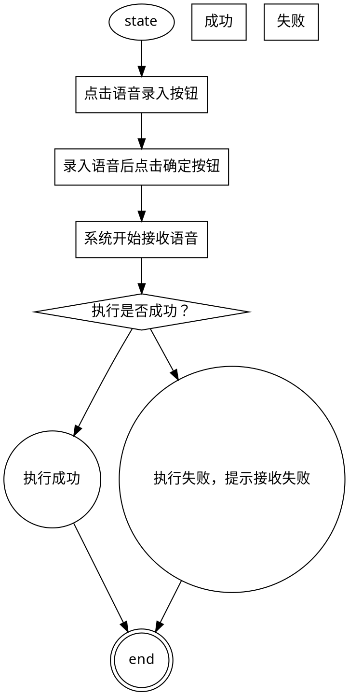

# 7_007 数据对档案

| 字段 | 值 |
|---|---|
| doc | 11语音综合处理软件需求规格说明-终稿 |
| section | 3.2 |
| image_caption | 图11 语音录入用例流程图 |
| table_caption | 表9 语音录入用例描述 |

## 原始图片

*图11 语音录入用例流程图*

## 结构图

*⚠ 结构经census重对齐: 旧锚点(oleObject10.bin:page1.xml)与图片不符, 已切换到与image.png内容一致的锚点(oleObject11.bin:page1.xml, align_score=0.75)*

*来源: born-digital导出(flowchart, 8节点/8边)*
*类型经几何启发式精化(Master类型识别失败的图, 投影层推断, canonical锚点不变)*

*状态图以PlantUML渲染(UML母语): [*]=起止 | 圆角框=状态 | 箭头标签=迁移事件*

Mermaid兼容投影(通用md渲染器可显示)

DOT源码(完整语义, graphviz可渲染)

### 锚点节点结构

| # | 文本 | 类型 |
|---|---|---|
| 1 | 点击语音录入按钮 | process |
| 2 | 录入语音后点击确定按钮 | process |
| 3 | 执行是否成功？ | decision |
| 4 | 执行成功 | start |
| 5 | 执行失败，提示接收失败 | start |
| 6 | 成功 | other |
| 7 | 失败 | other |
| 8 |   | state |
| 9 |   | end |
| 10 | 系统开始接收语音 | process |

## 表格内容

| Use Case 名称：语音录入 | Actors：使用人员 |   |
|---|---|---|
| Use Case 名称：语音录入 | Actors：使用人员 |   |
| 概述：本用例是语音综合处理的语音录入用例 |   |   |
| 前置条件：无。 |   |   |
| 主事件流 |   |   |
| Actor的动作 | 系统的动作 | 动作约束 （性能、可靠性、容错等） |
| 1.用户在界面点击语音录入按钮 |   |   |
|   | 2.系统出现开始接收语音的界面 |   |
| 3.用户对着话筒开始录入语音，完成后点击 |   |   |
|   | 4.系统提示接收成功；若接收失败，执行异 |   |
|   | 5.系统生成wav格式的音频文件保存到指 |   |
| 异常流E1：系统提示接收语音失败； |   |   |
| 后置条件：生成wav格式的音频文件。 |   |   |

## 正文

语音合成的主要功能包括：格式化文本语音合成、音频文件生成和存储、语音播报、语音设置，功能用例如图4所示。
