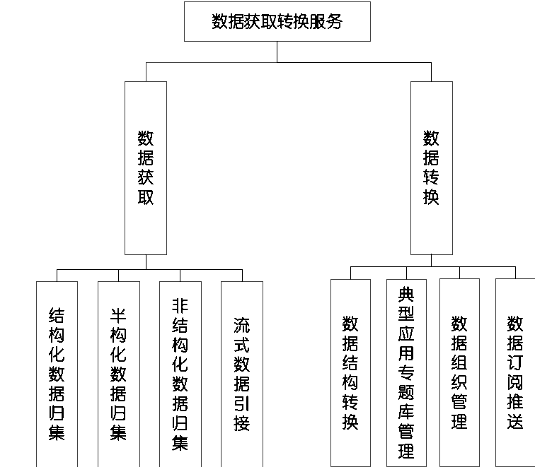

# 8_001 数据对档案

| 字段 | 值 |
|---|---|
| doc | 01数据获取转换分系统需求规格说明-终稿 |
| section | 3.2 |
| image_caption | 图 1 某分系统组成图 |

## 原始图片

*图 1 某分系统组成图*

## 结构图

*该对无Visio锚点(非Visio图, 无born-digital导出)*

## 表格内容

(无表格数据)
