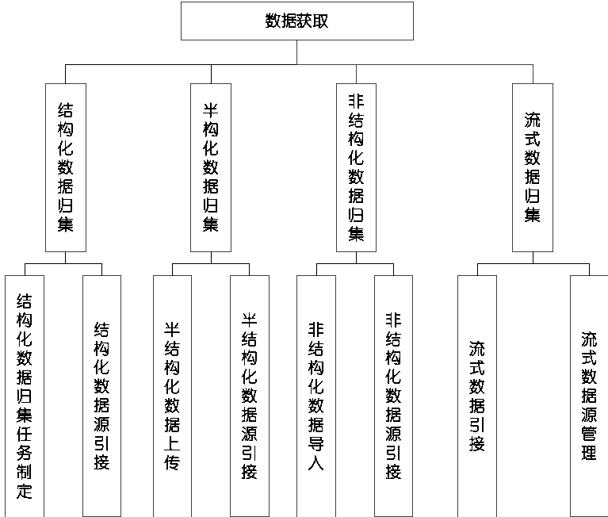

# 8_002 数据对档案

| 字段 | 值 |
|---|---|
| doc | 01数据获取转换分系统需求规格说明-终稿 |
| section | 3.2.1.1 |
| image_caption | 图 2 数据获取功能框架图 |

## 原始图片

*图 2 数据获取功能框架图*

## 结构图

*该对无Visio锚点(非Visio图, 无born-digital导出)*

## 表格内容

(无表格数据)
