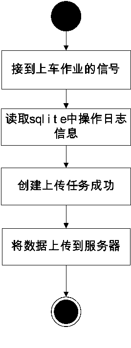

# 8_013 数据对档案

| 字段 | 值 |
|---|---|
| doc | 09数据同步共享服务软件需求规格说明-终稿 |
| section | 3.1.1.1 |
| image_caption | 图 3 数据同步服务上车状态时活动图 |

## 原始图片

*图 3 数据同步服务上车状态时活动图*

## 结构图

*该对无Visio锚点(非Visio图, 无born-digital导出)*

## 表格内容

(无表格数据)
