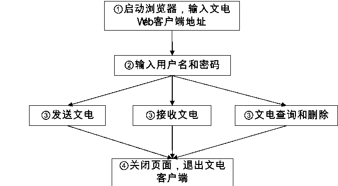

# 8_020 数据对档案

| 字段 | 值 |
|---|---|
| doc | 12文电处理需求规格说明-终端 |
| section | 3.1 |
| image_caption | 图 1  使用模式流程 |

## 原始图片

*图 1  使用模式流程*

## 结构图

*该对无Visio锚点(非Visio图, 无born-digital导出)*

## 表格内容

(无表格数据)
