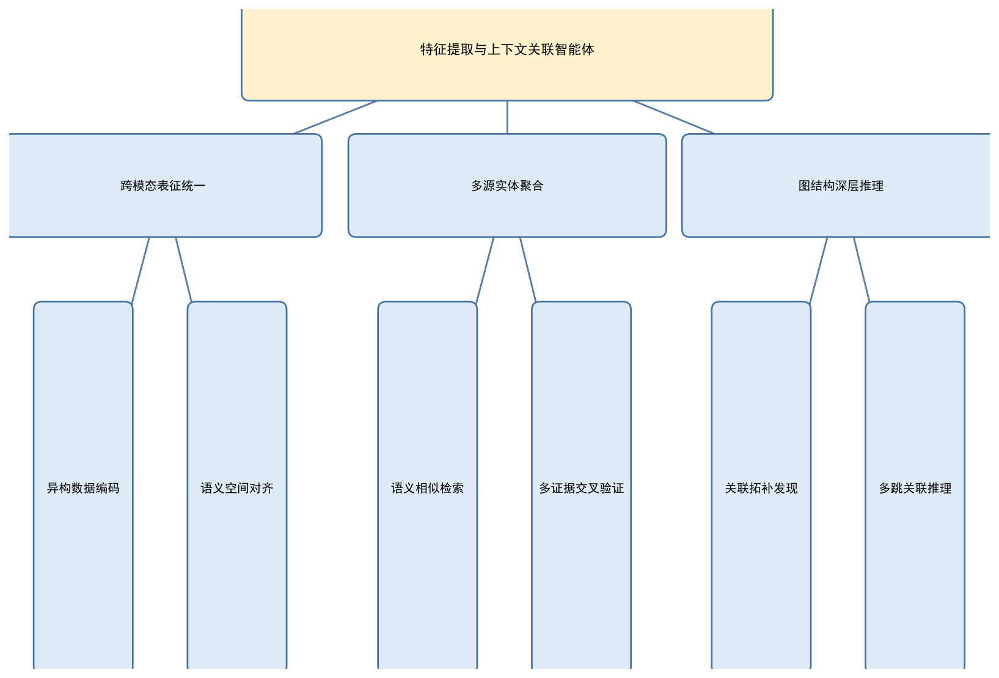

# 跨模态统一表征与上下文关联技术方案
## ——面向武器装备科研生产数据的场景化落地（航空发动机维护保障）

> **总体架构图**：图5「特征提取与上下文关联智能体」（原图不改）
> 
> 原始Visio文件：`C:\Users\12488\Downloads\visio_提取\05_特征提取与上下文关联智能体_原版.vsdx`
> 模型选型（定版）：**图文Chinese-CLIP / 文本BGE / 时序TS2Vec**；
> 多模态场景三者并用+**统一投影头**；单模态场景仅用对应单个编码器。
> 成文：2026-09-14

---

## 1 场景与问题定义

以**航空发动机维护保障任务**为例，需处理的源数据：

| 数据源 | 模态 | 形式 | 典型规模 |
|---|---|---|---|
| 故障工单/处置记录 | 文本 | 结构化+自由文本混合 | 数千条事件 |
| 故障曲线图 | 图像 | 参数随时间曲线渲染图 | 每事件1-N张 |
| 飞参回放截图 | 图像 | 软件界面截图（含告警区/参数显示/故障列表） | 每事件1-N张 |
| 飞参时序宽表 | 时序 | 数百量级通道×长时间步 | 大容量宽表 |

**三个核心差异**（问题本质）：
1. **结构形式差异**：自由文本/位图/数值矩阵三种异构形态
2. **时间基准不一致**：工单时间、图像RecTime、飞参采样时钟不完全对齐
3. **语义粒度不一致**：文本是处置级语义、图像是状态级证据、时序是参数级动态

**两个数据特性**（方法设计必须应对）：
- **一对多**：同一飞参文件可能对应多条故障切片（同飞段多事件）
- **锚点可循**：机号、发动机位置、故障名称、发生时间、进入时刻、
  飞参文件标识等关键字段可作**事件锚点**——这是全方案的地基

## 2 总体技术路线

```
多源数据解析 → 单模态特征提取 → 事件锚点构建 → 样例特征组织
     → 多视角上下文关联 → 跨模态证据聚合 → 下游(一致性校验/检索/微调样本筛选)
```

核心思想：**以故障事件为统一锚点，把文本、图像、时序特征组织到
"对象—时间—故障"上下文**，建立可追溯的跨模态关联基础。编码器选型：

| 模态 | 编码器 | 角色 |
|---|---|---|
| 文本 | **BGE**（bge-large-zh，1024维） | 故障语义/处置语义的检索级嵌入 |
| 图文 | **Chinese-CLIP**（图像768维/文本768维，共享对齐空间） | 曲线图+回放截图的视觉嵌入，天然图文对齐先验 |
| 时序 | **TS2Vec**（通用时序对比学习，通道无关） | 故障窗口/基线窗口的深层时序嵌入 |
| 跨模态 | **统一投影头**（§6，唯一可训练部件） | 三空间→统一语义空间 |

**选型原则**：不涉及跨模态的任务（纯文本检索/纯时序近邻）直接用
单编码器原生空间，不引入投影头（避免不必要的有损变换）；只有需要
**跨模态检索或证据关联强度计算**时才进入统一空间。

## 3 数据解析与事件锚点构建

### 3.1 事件锚点定义

**故障事件四元组**（身份标识，全流程贯穿）：
```
EventKey = (机号, 发动机位置, 故障名称, 进入时刻)
辅锚点: 发生时间 / 飞参文件标识 / 侧别
```

锚点解析来源：
- 工单/处置记录：实体识别抽取机号/位置/故障名称/时间（§4.1）
- 图像：OCR解析侧别/标题/RecTime/告警标记/故障列表（§4.2）
- 飞参：文件名/表头元数据+故障-参数映射的进入时刻（§4.3）

### 3.2 事件-切片-窗口的层级组织

```
飞参文件(飞段) ──包含──> 故障切片1..N(多条故障, 一对多特性)
故障切片 ──中心──> 故障窗口(进入时刻±W) + 基线窗口(故障前正常段)
EventKey ↔ {工单文本, 处置记录, 曲线图1..p, 回放截图1..q, 故障窗口, 基线窗口}
```

同飞段共现关系（同一飞参文件的多条故障切片）显式记录为图的边
（§7），**不混淆为同一事件**——这是训练负例设计的关键边界（§6.2）。

## 4 单模态特征提取

### 4.1 文本特征（BGE + 实体识别/信息抽取）

**双通道文本表征**（连续语义 + 结构化字段）：

```
文本输入: 故障名称 / 算法或判据说明 / 处置记录
  ├─ 连续通道: BGE语义嵌入(1024维) — 描述故障类型与维护处置语义
  │   · 检索指令前缀(如BGE推荐格式)提升领域检索质量
  └─ 结构化通道: 实体识别+信息抽取 — 机号/发动机位置/异常现象/
      故障原因/处置建议 关键业务要素(字段级)
```

设计理由：连续嵌入支撑**相似故障检索/案例归并/跨样例语义关联**；
结构化字段支撑**身份对齐/事件关联**（BGE嵌入对"机号"这类精确字段
不可靠——语义空间里"B-1012"和"B-1013"几乎无差异，身份必须走字段）。

### 4.2 图像特征（Chinese-CLIP双空间 + OCR）

**两类视觉证据独立特征空间**（降低形态互扰）：
```
故障曲线图:  CLIP图像编码 → 曲线视觉嵌入空间A
  侧重: 曲线形态/变化趋势/异常结构
飞参回放截图: CLIP图像编码 → 回放视觉嵌入空间B
  侧重: 界面布局/告警区域/参数显示/故障列表
```
实现层面：两类图共用CLIP图像编码器，但**索引与近邻检索分开建**
（空间A/空间B各自的近邻图），避免曲线与截图的视觉特征互相污染。

**OCR离散证据通道**：解析侧别/标题/RecTime/告警标记/故障列表等
符号信息——与CLIP连续嵌入并存，支撑**身份核验、时间对齐、
故障包含关系分析**（如回放截图的故障列表应包含工单故障名称——
这本身就是一条跨模态一致性校验规则）。

**曲线图的补充设计**（重要）：CLIP对曲线**细粒度形态**的判别力
有限（其预训练分布以自然图像为主）。方案：
- 曲线图**双路编码**：CLIP视觉嵌入（整体视觉相似）+ 曲线**数值化
  重采样→TS2Vec**编码（把曲线当一维时序信号，进时序空间与飞参
  窗口同构比较）——"曲线形态相似"在时序空间里比CLIP空间可靠
- 曲线参数化统计特征（峰值/斜率/过阈值次数）入特征包结构化通道

### 4.3 飞参时序特征（TS2Vec + 统计特征 + 偏离度）

**三步管线**：

```
①通道筛选: 故障-参数映射关系 → 标志通道/信号通道/上下文通道
②窗口构建: 以故障进入时刻为中心, 分析窗口(进入±W) + 基线窗口(故障前同飞段正常段)
③双重表征:
   可解释层: 窗口统计特征 — 均值/极值/离散程度/变化率/降采样序列摘要
   深层表征: TS2Vec故障窗口嵌入 + TS2Vec基线窗口嵌入
   衍生量: 相对偏离度 δ = dist(故障窗口嵌入, 基线窗口嵌入)
     —— 反映当前故障相对同飞段正常状态的变化程度
```

TS2Vec的通道无关（channel-independent）设计适配**数百量级通道
的宽表**；滑动窗口构造训练样本使模型学习窗口级模式（不用整段
长时序一次性编码——细粒度窗口对故障定位更有价值）。

## 5 样例级特征包（统一封装）

```python
SampleFeaturePack = {
    "event_key": {"机号", "发动机位置", "故障名称", "进入时刻"},  # 事件锚点
    "anchors":   {"发生时间", "飞参文件标识", "侧别"},
    "text":      {"bge_embed": vec(1024),          # 连续语义
                  "entities": {...},                # 结构化业务字段
                  "spans": {故障名称, 判据说明, 处置建议}},
    "image":     {"curve_clip": vec,                # 曲线视觉(空间A)
                  "replay_clip": vec,               # 回放视觉(空间B)
                  "curve_ts2vec": vec,              # 曲线数值化时序
                  "ocr": {侧别, 标题, RecTime, 告警标记, 故障列表}},
    "series":    {"fault_window_ts2vec": vec,       # 故障窗口嵌入
                  "baseline_window_ts2vec": vec,    # 基线窗口嵌入
                  "window_stats": {均值/极值/离散/变化率},
                  "downsample_digest": [...],
                  "baseline_deviation": δ},
    "provenance": {每特征→源文件/行号/帧号},        # 可追溯
}
```

特征包=**一次提取统一封装**，直接作为下游任务标准输入：
上下文构图 / 相似案例检索 / 一致性校验 / 微调样本筛选。

## 6 统一投影头与跨模态对齐（训练设计，核心章节）

### 6.1 架构

四个投影头把异构空间映射到**统一语义空间**（维度d=512）：

```
BGE文本(1024) ──── text_proj ────────┐
CLIP曲线图(768) ── clip_img_projA ───┤
CLIP回放图(768) ── clip_img_projB ───┼──→ L2归一化 → 统一空间(512维, cosine)
CLIP文本(768) ──── clip_txt_proj ────┤
TS2Vec时序(320) ── ts_proj ──────────┘
```

- 每头=两层MLP：`Linear(in→d) → LayerNorm → GELU → Linear(d→d)`，
  共约4×0.6M≈**2.4M可训练参数**
- **底座全部冻结**（BGE/CLIP/TS2Vec不微调）——理由：①故障领域
  样本量（数千级）不足以安全微调大底座（灾难性遗忘+过拟合）；
  ②冻结底座=各单模态原生空间不受损（单模态任务继续用原生空间，
  §2选型原则）；③训练开销仅投影头，单卡可训
- clip_txt_proj的作用：**文本桥**——CLIP的图文对齐先验通过
  "同一工单文本的BGE嵌入↔CLIP文本嵌入"对齐传导到BGE侧，让
  BGE文本与CLIP图像在训练前就处于"预对齐"邻域（冷启动加速）

### 6.2 训练数据构造（正负样本设计——最关键的设计）

**正样本对的定义**：同一EventKey（四元组完全一致）内的跨模态样本对。

| 正对类型 | 对 | 语义 |
|---|---|---|
| 文本↔曲线图 | text_proj(BGE) ↔ clip_imgA | 工单描述的故障对应这条曲线 |
| 文本↔回放图 | text_proj(BGE) ↔ clip_imgB | 工单故障对应这个回放界面 |
| 文本↔时序窗 | text_proj(BGE) ↔ ts_proj | 工单故障对应这个参数动态 |
| 曲线↔回放 | clip_imgA ↔ clip_imgB | 同一事件的两种视觉证据 |
| 曲线/回放↔时序 | clip_img ↔ ts_proj | 视觉证据对应参数动态 |
| 文本↔文本 | text_proj(BGE) ↔ clip_txt_proj | **文本桥**（同一文本双空间编码） |

**负样本的三级难度设计**：

```
一级(随机负例):  批内非同事件样本 — InfoNCE批内自动实现
二级(困难负例):  同故障类型·不同EventKey — 语义相近但非同一事件
                 ("相似故障"≠"同一故障", 模型须学会区分)
三级(最难负例):  同飞段共现·不同故障切片 — 同一飞参文件内时间
                 相邻的不同故障(机号/飞段全同, 仅故障与时刻不同)
```

**关键设计辨析——飞段共现的双重身份**：同飞段共现的故障切片
在**下游关联图**里是一条边（§7多视角关联），但在**投影头训练**里
是最难负例。边界清晰：投影头学的是"**同一事件锚点**"的对齐语义
（身份级），不是"相关事件"（关联级）——关联强度由下游在统一
空间里计算距离自然获得，而不是把关联对塞进训练正例（否则模型
学不出区分度，检索时同飞段所有故障互相挤占）。

**负例挖掘配比**（每batch 256对）：随机负例为主（InfoNCE批内
255个），二级困难负例按1:8比例显式采样混入，三级最难负例按1:32
（仅对文本↔时序与图像↔时序对启用——这两对最容易被"同飞段"捷径
特征欺骗）。

### 6.3 训练目标

**总损失**：
```
L = Σ_{(m1,m2)∈模态对} [InfoNCE(P_m1→P_m2) + InfoNCE(P_m2→P_m1)]
    + λ · L_uniform
```
- InfoNCE：对称双向（每个正对在两个方向各算一次softmax交叉熵），
  温度τ：可学习初始化0.07（CLIP惯例）；对称设计保证任一模态可
  作query（文本查时序、时序查文本都要通）
- **L_uniform（防塌缩正则）**：各模态投影在统一球面上的均匀性
  （Wang & Isola对齐-均匀性分解）——小数据下对比学习容易把所有
  样本投影到近邻区域（均匀性丧失→检索区分度崩），λ=0.01量级
- 曲线双路编码的附加项：`curve_ts2vec ↔ ts_proj(飞参窗口)`的
  InfoNCE（同一事件内曲线形态与飞参动态对齐，时序空间内部对齐）

### 6.4 训练协议

**三阶段渐进**（按数据量与先验强度排序）：

| 阶段 | 数据 | 目标 | 说明 |
|---|---|---|---|
| S1 文本桥 | 全量文本对 | text_proj↔clip_txt_proj | 收敛最快，给BGE侧CLIP对齐先验 |
| S2 图文 | 文本↔曲线/回放对 | +clip_imgA/B | 继承CLIP图文先验，中速收敛 |
| S3 时序 | +文本/图像↔时序对 | +ts_proj | 数据最少最谨慎：lr×0.3+λ加大 |

**防泄漏划分（评测有效性生命线）**：
```
按 (机号 × 时间季度) 分块划分 train/val/test
  —— 同一飞机的事件绝不跨集（否则模型靠"机号指纹"作弊）
  —— 同季度不同机号可跨集(需检查机型分布一致)
```

**小数据策略**（事件数N<5000时）：
- 冻结底座（已定）+ 投影头2.4M参数 + InfoNCE批内负例增强——
  数百事件即可启动；N<1000时追加：投影头降维（d=256）+Dropout 0.3
- 增量协议：新事件到来只做S3阶段的轻量增量（ts_proj在线适配）
- **评估驱动的数据预算**：先标注500事件做Pilot，验证跨模态
  Recall@10达标（≥0.7）再扩全量

### 6.5 工程细节

- **训练数据管线**（离线，一次构建）：特征包（§5）→按EventKey
  展开模态对→负例挖掘索引（按故障类型/飞段预分组）→TFRecords/
  预编码缓存（底座冻结=嵌入可预计算，训练时零编码开销）
- 优化：AdamW lr=1e-4（投影头）/cosine退火/warmup 5%；batch 256
  （梯度累积兜底）；fp16
- **可复现**：seed锁定+配置快照+数据版本号（沿用项目runs协议）
- 推理：投影后嵌入落盘统一索引（每模态一份+统一空间一份共五份
  FAISS/内存索引——单模态查原生空间，跨模态查统一空间）

### 6.6 质量评估（投影头专项）

| 评估 | 协议 | 达标线 |
|---|---|---|
| 跨模态检索Recall@K | 文本query→时序窗口/图像；图像query→文本 | R@10≥0.70（防泄漏集上） |
| 锚点对齐验证 | 同EventKey跨模态cos vs 不同EventKey分布 | 同事件分布显著高（AUC≥0.85） |
| 困难负例区分 | 二级负例（同故障类型）的区分率 | 准确率≥0.75 |
| 下游任务验证 | 相似故障检索命中率（人工标注200对金标） | 命中率≥基线（无投影头+拼接） |
| 塌缩检测 | 统一空间嵌入的有效秩/方差 | 训练全程监控，塌缩即回滚 |

## 7 上下文关联建模（多视角关系结构）

**五类关联边**（在特征包与统一空间上构建）：

| 边类型 | 构建方法 | 用途 |
|---|---|---|
| 语义相似 | BGE文本空间KNN（k=10） | 语义相近故障群体 |
| 行为相似 | TS2Vec故障窗口空间KNN | 飞参行为相似群体 |
| 视觉相似 | CLIP曲线/回放空间各自KNN | 曲线形态/告警界面相似 |
| 飞段共现 | 同飞参文件的多条故障切片 | 同飞段事件纳入统一上下文 |
| 跨模态证据 | 统一空间内事件内对（EventKey聚合） | 证据关联强度 |

**飞段演化结构**（长时序）：
``沿RecTime构建故障前后有序时间窗口：窗口时序嵌入+时间邻接边
（状态连续演化）+相似窗口边（非相邻时段的状态重现/回摆）+相对
偏离度（故障前后变化幅度）``

**通道联动关系**：故障相关+扩展共享通道上的相关性分析→传感器
联动边（协同/反向变化模式）。

**运行阶段归一**（关键的防伪相似设计）：基于油门/高压转子转速/
低压转子转速等典型参数的窗口统计量，对飞参窗口做**运行阶段划分**
（起飞/巡航/机动等），**同阶段内做时序近邻**——不同运行阶段的
数值接近是伪相似（地面怠速的高温报警窗口与巡航正常窗口可能欧氏
距离极小），阶段归一消解。

**双层上下文结构**：
```
事件内层: EventKey锚点 → {工单/处置文本, 曲线图, 回放截图, 飞参窗口}
          视觉-语言相似度(统一空间) + 时间对应关系(RecTime) +
          事件属性匹配(OCR字段) → 证据关联强度
事件间层: 五类关联边 → 相似样例邻域(语义/行为/视觉/飞段)
```

## 8 与下游任务的衔接

| 下游 | 消费 | 接口 |
|---|---|---|
| 语义一致性校验 | 事件内跨模态对（OCR故障列表vs工单名称、文本判据vs曲线行为） | 特征包+统一空间分数 |
| 逻辑一致性校验 | 时间邻接/飞段演化/通道联动结构 | 关系图 |
| 相似案例检索 | 事件间层各KNN边 | 原生/统一空间索引 |
| 微调样本筛选 | 特征包+关联图（难例挖掘/课程组织） | 特征包 |

## 9 落地路线

| 阶段 | 内容 | 产出 | 工作量 |
|---|---|---|---|
| P1 | 数据解析+事件锚点管线（工单NER+图像OCR+飞参窗口切分） | EventKey索引+切片对齐表 | 2周 |
| P2 | 单模态特征提取三件套（BGE/CLIP/TS2Vec推理管线+特征包封装） | 样例特征包全量 | 2周 |
| P3 | Pilot投影头训练（500事件标注+三阶段训练+评估） | 统一空间v1+评估报告 | 2周 |
| P4 | 上下文关联构图（五类边+飞段演化+阶段归一） | 多视角关联图 | 2周 |
| P5 | 下游校验/检索接入 | 端到端链路 | 按需 |

模型获取：Chinese-CLIP（OFA-Sys/chinese-clip-vit-base-patch16，约
600MB）需下载；BGE/TS2Vec开源轻量；全部本地GPU部署（与现有
BGE/NLI部署栈同构）。

## 10 风险与备选

| 风险 | 表现 | 缓解/备选 |
|---|---|---|
| CLIP对曲线形态判别弱 | 曲线检索区分度低 | 曲线双路编码（§4.2）已对冲；备选=曲线纯走TS2Vec |
| 事件锚点抽取噪声 | 机号/时刻抽取错→正负例污染 | 锚点字段双人抽检（Kappa≥0.8）后再训；模糊锚点样本进隔离池 |
| 小数据过拟合 | 防泄漏集上Recall不达标 | 降维+Dropout（§6.4）；数据增强=同工单多窗口/多截图扩充 |
| 飞段共现混淆 | 检索结果被同飞段事件挤占 | 三级负例已显式设计（§6.2） |
| 模态缺失（有图无飞参） | 事件对不完整 | 缺失模态不进该对的训练（非补零——补零引入假中心） |

---

## 附：与现有技术栈的关系

本方案的工程骨架与SRS项目的"多通道特征提取+黑板上下文"完全
同构（born-digital解析→编译器→统一IR→对齐→判决），可复用：
特征包schema设计思想、provenance溯源体系、投影头训练的runs协议
（config+seed+git_sha）、防泄漏评估协议。差异仅在模态构成
（SRS=文/表/图 vs 本场景=文/图/时序）与锚点语义
（EventKey vs GJB需求ID）——**上下文关联方法论可直接迁移**。
