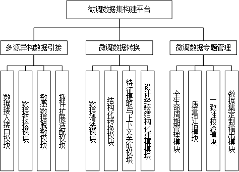

# 1 背景与需求（各单位补充）

## 1.1 任务来源

立项批复时间：2026年5月29日；

批复文号：科工三司[2026]588号文；

## 1.2 概念与内涵

针对xx问题，依据xx智能化的发展要求，开展xx技术研究。以xx为牵引，通过xxxx的技术路线，解决xx问题，使得xx效果。

## 1.3 研究背景、目的和意义

当前，国际局势与战争形态加速演变，人工智能驱动的数字化转型已成为武器装备高质量发展的必由之路，但我国国防科技工业在数智基础、数据驱动、智能模型研训及敏捷研发等方面仍存明显短板，垂域模型应用面临多源异构数据整合难、专家经验利用不足、业务数据质量参差等关键瓶颈。为此，亟需开展面向武器装备科研生产垂域模型应用的微调数据集增强技术研究，构建标准化、智能化的微调数据集构建平台及智能体，突破数据清洗、结构化转换与快速构建全链条技术，形成覆盖研发设计、生产制造、维修保障等典型场景的高质量微调数据集。该研究旨在将领域专家经验高效注入数据流水线，实现从“规模竞赛”到“质量深耕”的范式转变，并通过智能体驱动的数据飞轮效应持续提升数据集质量与模型性能，从而为武器装备科研生产数字化转型、智能决策升级及新质生产力培育提供安全、持续、高效的数据支撑，切实支撑军工典型场景智能化落地，助力中国特色武器装备数字化研发体系建设与国防科技工业自主可控能力跃升。

## 1.4 国内外研究情况与趋势（各单位补充，航发、北理、南开、中科大）

### 1.4.1 国外研究现状

#### 1.4.1.1 高质量数据集构建技术

#### 1.4.1.2 多模态数据预处理技术

#### 1.4.1.3 专家经验显性化技术

#### 1.4.1.4 科研生产数据一致性校验技术

国外在军事领域大模型数据集一致性校验方面的研究起步较早，技术路径更为多元，涵盖了本体验证、事实核查、对抗性校验及系统性评估框架等多个维度。在语义一致性验证方面，国外研究团队提出了一种基于能力问题的大语言模型本体验证框架，通过将能力问题转化为对本体的查询来验证本体元素的语义一致性，实验表明在提示中加入目的与范围信息能显著提升验证准确率，该框架可推广至大规模军事知识图谱的质量管理。在事实一致性校验方面，有研究构建了面向军事领域的事实核查数据集，利用领域本体模式信息和实例信息构建可解释且可靠的事实核查模型；IBM国防模型实验室开发了国防情报信息核查工具，利用国防模型对装备、库存、设施和作战序列等国防情报实体进行事实核查。在对抗性校验与自验证能力方面，有研究提出了验证引导梯度掩蔽技术，使模型仅在经过验证的推理步骤上进行选择性学习，从而获得自验证能力并防止训练过程中错误模式的传播；另有研究引入本地一致性验证和多尺度特征分析作为专门设计的任务来检测AI生成的军事图像。在系统化评估框架方面，DoRA框架针对国防领域专业文档，系统性地生成带可追溯证据的合成问答训练与评估数据集，并通过国防领域专家的人工评估来判定数据集质量。此外，TRUE工作对事实一致性评估指标进行了系统性的梳理与评估，整合了多个已有数据集为统一格式。总体而言，国外研究更注重方法论的系统性和评估框架的可复用性，在军事领域数据集一致性校验方面已形成从本体验证、事实核查到对抗性校验的较为完整的技术体系。

#### 1.4.1.5 面向科研生产领域微调数据集的质量评估技术

### 1.4.2 国内研究现状

#### 1.4.2.1 高质量数据集构建技术

#### 1.4.2.2 多模态数据预处理技术

#### 1.4.2.3 专家经验显性化技术

#### 1.4.2.4 科研生产数据一致性校验技术

国内在军事领域大模型数据集一致性校验方面的研究，主要围绕军事数据的多源异构特性展开，形成了从数据标注校验到语义一致性验证的多层次技术路径。在数据预处理与标注阶段，研究者针对军事文本中实体命名复杂、属性依赖紧密、语义表达高度隐含等特点，提出了基于生成式命名实体识别的结构化抽取方法，通过实体-属性-值三元组的直接生成来增强复杂军事实体及其属性关系的表征能力，并采用正负样本联合训练、属性验证模块和多路径纠错机制来减少属性错配和语义漂移。在语义一致性层面，有研究提出基于能力问题的大语言模型本体验证框架，通过嵌入相似度分析自动验证本体元素的语义一致性，并在海军领域的小规模本体上进行了实验验证。针对国防动员等特定领域高质量数据集匮乏的问题，研究者探索了基于大语言模型的问答对自动生成方法，通过对生成数据的验证评估来确保数据集质量。此外，针对错误标注、主观偏差、模糊样本及敌方干扰等带来的标签偏误问题，有研究采用元学习方法对标签噪声进行识别，确保样本分类与真实情况的一致性。在数据融合层面，业界实践强调加强多源异构数据的关联比对、交叉验证与一致性校验，着力提升数据的可信度与融合价值。整体来看，国内研究呈现出从基础数据校验向语义一致性验证、从单一模态向多源异构数据融合校验演进的特征，但针对军事领域数据集一致性校验的系统性框架和标准化评估体系仍有待进一步完善。

#### 1.4.2.5 面向科研生产领域微调数据集的质量评估技术

### 1.4.3 国内外研究现状总结

总体来看，国内外在xx等方面，仍存在很大的应用空间。国内外已xx，但还未实现xxxx。

<strong>在高质量数据集构建技术方面</strong>，（<em><u>一句话</u></em>总结国外情况。<em><u>一句话</u></em>总结国内情况。<em><u>一句话</u></em>总结国内外的差距，<u>一句话</u>总结如何通过技术缩短差距）。

<strong>在多模态数据预处理技术方面</strong>，（<em><u>一句话</u></em>总结国外情况。<em><u>一句话</u></em>总结国内情况。<em><u>一句话</u></em>总结国内外的差距，<u>一句话</u>总结如何通过技术缩短差距）。

<strong>在专家经验显性化技术方面</strong>，（<em><u>一句话</u></em>总结国外情况。<em><u>一句话</u></em>总结国内情况。<em><u>一句话</u></em>总结国内外的差距，<u>一句话</u>总结如何通过技术缩短差距）。

<strong>在科研生产数据一致性校验技术方面</strong>，（<em><u>一句话</u></em>总结国外情况。<em><u>一句话</u></em>总结国内情况。<em><u>一句话</u></em>总结国内外的差距，<u>一句话</u>总结如何通过技术缩短差距）。

在科研生产数据一致性校验技术方面，国外研究起步较早，已形成涵盖本体验证、事实核查、对抗性校验及系统性评估框架的完整技术体系，注重框架可复用性与评估标准化。国内研究聚焦于多源异构军事数据的标注校验、语义一致性验证和标签噪声处理，但尚未建立系统化的校验框架和统一的评估标准。国内外主要差距在于国内缺乏面向军事领域的系统性一致性校验框架和标准化评估指标，技术碎片化明显。为缩短差距，应借鉴国外系统性方法论，构建覆盖数据标注、语义融合、事实核查和对抗性校验的多层次校验体系，并制定军事领域专用的一致性评估标准与自动化验证工具。

<strong>在微调数据集的质量评估技术方面</strong>，（<em><u>一句话</u></em>总结国外情况。<em><u>一句话</u></em>总结国内情况。<em><u>一句话</u></em>总结国内外的差距，<u>一句话</u>总结如何通过技术缩短差距）。

## 1.5 需求分析

。

# 2 研究任务

## 2.1 研究目标

本项目围绕多源数据处理、专家经验转化、数据质量管控、数据质量评估等业务需求，开展微调数据集快速构建、专家经验显性化、科研生产数据一致性校验、面向科研生产领域微调数据集的质量评估等研究，重点突破异构数据的标准化预处理、特征提取与上下文关联和设计经验结构化建模等关键技术，解决武器装备科研生产面临的专业化数据多源异构、专家经验利用率低、业务数据参差不齐等问题，形成微调数据快速构建能力、专家经验显式建模能力、隐性知识结构建模、跨模态一致性校验等能力，能够有效支撑武器装备科研生产垂域模型应用的微调数据集快速构建，并依托项目实施过程中积累的成熟技术体系与示范经验，积极向国防科技工业其他重点行业拓展推广。

## 2.2 研究内容

### 2.2.1 科研生产领域微调数据集快速构建技术研究

### 2.2.2 专家经验驱动的微调数据知识化构建与自组织演进机制研究

### 2.2.3 面向武器装备科研数据的多层级跨模态一致性校验技术研究

面向武器装备科研数据的多层级跨模态一致性校验技术研究，剔除冗余、修正偏差，保障数据语义与格式统一。

本研究内容从规则推理驱动的多层级语法一致性校验方法、跨模态多粒度语义一致性与事实核验技术、融合业务知识的跨模态逻辑一致性校验技术三个方面展开。

1. 多层级语法一致性校验方法主要针对武器装备科研生产领域生成数据普遍存在语法缺陷、数据记录矛盾等问题，从基于规则约束建模的字段一致性校验、基于关联约束建模的多字段一致性校验、基于跨记录关联推理的记录一致性校验三个方面开展研究，形成从字段到记录全覆盖的语法一致性校验技术体系；
2. 跨模态多粒度语义一致性核验技术主要针对多模态生成数据表意复杂、易出现常识违背与事实冲突等问题，从跨模态数据语义表征与高效特征提取、基于领域先验知识的事实一致性校验、特征关联驱动的多粒度语义一致性校验等方面开展研究，实现多粒度一致性分析；
3. 融合业务知识的跨模态逻辑一致性校验技术主要针对生成数据易出现时序错乱、违背客观工艺规律等深层逻辑谬误问题，从任务驱动的专家知识形式化表征、跨模态数据时序逻辑结构挖掘、融合专家知识的逻辑一致性校验等方面展开，支撑垂域大模型微调语料在业务逻辑上的自洽与内生安全。

### 2.2.4 面向科研生产领域微调数据集的质量评估研究

## 2.3 技术指标

# 3 技术方案（各单位补充-采用什么技术路线实现研究内容）

## 3.1 总体技术方案

### 3.1.1 研究思路

### 3.1.2 总体设计

#### 3.1.2.1 设计原则

#### 3.1.2.2 总体架构

### 3.1.3 技术架构

### 3.1.4 部署架构

### 3.1.5 应用架构

### 3.1.6 运行机理

### 3.1.7 设计总结

## 3.2 研究内容与关键技术（各单位补充-采用什么技术路线实现）

### 3.2.1 研究内容

#### 3.2.1.1 科研生产领域微调数据集快速构建技术研究（航发）

##### 3.2.1.1.1 技术难点

##### 3.2.1.1.2 解决途径

#### 3.2.1.2 专家经验驱动的微调数据知识化构建与自组织演进机制研究（北理）

##### 3.2.1.2.1 技术难点

##### 3.2.1.2.2 解决途径

#### 3.2.1.3 面向武器装备科研数据的多层级跨模态一致性校验技术研究（南开）

##### 3.2.1.3.1 技术难点

武器装备科研生产数据具有多源异构、模态多样、业务逻辑复杂等特征，生成数据普遍存在语法缺陷、记录矛盾、语义歧义、事实冲突、时序错乱及违背客观工艺规律等深层逻辑谬误；同时，跨模态数据间缺乏统一的表征框架与关联校验机制，难以在字段、记录、特征、事件、语义及业务逻辑等多个层级上实现一致性校验，严重制约垂域大模型微调语料的质量可控性与内生安全性。

##### 3.2.1.3.2 解决途径

从三个层面构建多层级跨模态一致性校验技术体系：一是基于规则推理驱动，通过字段级、多字段级、跨记录级三层约束建模，形成从字段到记录全覆盖的语法一致性校验方法；二是开展跨模态多粒度语义一致性与事实核验，利用领域先验知识进行事实校验，并借助特征关联实现从特征层、事件层到语义层的多粒度一致性分析；三是融合业务知识进行跨模态逻辑一致性校验，通过任务驱动的专家知识形式化表征、跨模态时序逻辑结构挖掘及融合校验，确保生成数据在业务逻辑上的自洽与内生安全。

#### 3.2.1.4 面向科研生产领域微调数据集的质量评估研究（中科大）

##### 3.2.1.4.1 技术难点

##### 3.2.1.4.2 解决途径

### 3.2.2 关键技术（各单位补充-采用什么技术实现）

#### 3.2.2.1 多源异构数据规范化处理与基准时序重构技术（航发）

##### 3.2.2.1.1 技术内涵（一段话解释关键技术是什么，能够解决项目什么问题）

##### 3.2.2.1.2 关键难点分析（一段话解释目前存在的难点问题）

##### 3.2.2.1.3 解决措施（一段总结的画，一张Visio技术路线图，几段解释描述）

#### 3.2.2.2 专家隐性经验条件化表征与受控知识注入技术（北理）

##### 3.2.2.2.1 技术内涵（一段话解释关键技术是什么，能够解决项目什么问题）

##### 3.2.2.2.2 关键难点分析（一段话解释目前存在的难点问题）

##### 3.2.2.2.3 解决措施（一段总结的画，一张Visio技术路线图，几段解释描述）

#### 3.2.2.3 面向武器装备科研生产数据的跨模态统一表征与上下文关联技术（南开）

##### 3.2.2.3.1 技术内涵（一段话解释关键技术是什么，能够解决项目什么问题）

面向武器装备科研生产数据的跨模态统一表征与上下文关联技术，通过多模态特征提取与共享语义投影将文本、图像、时序等多模态数据映射到统一语义空间，并借助事件锚点对齐、时序建模及领域先验规则等，完成对多源异构数据的一致性校验，确保为微调垂域大模型提供高质量的数据集。

##### 3.2.2.3.2 关键难点分析（一段话解释目前存在的难点问题）

在装备科研生产场景中，数据一致性校验面临多源异构数据难以统一表达和上下文关系复杂等技术难题。多模态数据在信息表达形式与语义粒度上存在显著差异，这使得不同模态数据之间难以直接进行语义比较。此外此外，同一生产事件的数据之间存在时间与因果关联，但这些关联关系在原始数据中往往是隐式存在的，缺乏统一的上下文结构进行表达。

##### 3.2.2.3.3 解决措施（一段总结的画，一张Visio技术路线图，几段解释描述）

针对上述问题，本研究构建面向武器装备科研生产数据的跨模态统一表征与上下文关联技术。首先，通过多模态特征提取方法对文本、图像与时序数据进行语义编码：文本数据利用语言模型提取操作行为、装备状态与关键参数等语义特征；图像数据通过视觉特征提取网络获取装备结构、状态标识等视觉语义信息；时序数据通过时序建模方法提取装备运行参数变化模式与状态特征。随后构建共享语义投影层，将不同模态特征映射到统一语义空间，使异构数据能够在同一表示尺度下进行语义比较与关联分析。在上下文关联建模方面，对同构数据采用时间序列建模刻画数据之间的时序依赖关系；对跨模态数据，通过事件锚点识别与时间窗口对齐机制，将文本、图像与时序参数变化进行关联，构建统一的多模态事件上下文结构。在此基础上进一步引入领域先验知识，对关键事件、装备状态与参数变化建立规则约束与语义关系映射，从而实现面向事实层面的自动化一致性检测。

#### 3.2.2.4 垂域数据质量可解释诊断与自适应演进技术（中科大）

##### 3.2.2.4.1 技术内涵（一段话解释关键技术是什么，能够解决项目什么问题）

##### 3.2.2.4.2 关键难点分析（一段话解释目前存在的难点问题）

##### 3.2.2.4.3 解决措施（一段总结的画，一张Visio技术路线图，几段解释描述）

## 3.3 工程化方案

### 3.3.1 软件设计（各单位补充-注意增加了智能体成果集的内容）

#### 3.3.1.1 微调数据集构建平台（讯飞数码）

##### 3.3.1.1.1 系统概述

##### 3.3.1.1.2 体系架构

##### 3.3.1.1.3 功能组成

##### 3.3.1.1.4 运行逻辑

##### 3.3.1.1.5 软件部件设计（可以比建议书和任务书多，但不能比任务书少）

###### 3.3.1.1.5.1 多源异构数据引接

####### 3.3.1.1.5.1.1 软件功能描述

####### 3.3.1.1.5.1.2 软件模块设计

####### 3.3.1.1.5.1.3 业务流程

####### 3.3.1.1.5.1.4 软件界面设计

#### 3.3.1.2 智能体构建平台（航发）

##### 3.3.1.2.1 系统概述

##### 3.3.1.2.2 体系架构

##### 3.3.1.2.3 功能组成

##### 3.3.1.2.4 运行逻辑

##### 3.3.1.2.5 软件部件设计（可以比建议书和任务书多，但不能比任务书少）

###### 3.3.1.2.5.1 可视化编排与低代码引擎模块

####### 3.3.1.2.5.1.1 软件功能描述

####### 3.3.1.2.5.1.2 软件模块设计

####### 3.3.1.2.5.1.3 业务流程

####### 3.3.1.2.5.1.4 软件界面设计（列表即可，不需要放界面截图）

#### 3.3.1.3 智能体成果集（航发、北理、南开、中科大）

##### 3.3.1.3.1 系统概述

①异构数据的标准化预处理智能体能够剔除无效数据、补齐缺失值，将时序、文本、结构化等多模态数据统一转换为标准化特征格式；

②特征提取与上下文关联智能体完成数据的结构化解析、关键特征提取和语义关联；

③设计经验结构化建模智能体将专家经验转化为结构化数据；

④数据合成与增强智能体实现文本内容的合成和增强；

⑤数据一致性校验智能体能够识别数据语义、逻辑不一致；

⑥微调数据集质量评估智能体能够完成数据质量评估并形成质量报告。

##### 3.3.1.3.2 体系架构

##### 3.3.1.3.3 功能组成

###### 3.3.1.3.3.1 异构数据的标准化预处理智能体（一段话，一个爪子图Visio全部黑体10px，一张表）

异构数据的标准化预处理智能体能够剔除无效数据、补齐缺失值，将时序、文本、结构化等多模态数据统一转换为标准化特征格式。包括xx组件。

INCLUDEPICTURE "../xwechat\_files/wxid\_1k54h2jymo0022\_a344/msg/file/2026-08/UsersSANBU7\~1AppDataLocalTempksohtml6416wps3.png" \* MERGEFORMAT  INCLUDEPICTURE "../xwechat\_files/wxid\_1k54h2jymo0022\_a344/msg/file/2026-08/UsersSANBU7\~1AppDataLocalTempksohtml6416wps3.png" \* MERGEFORMAT  INCLUDEPICTURE "../xwechat\_files/wxid\_1k54h2jymo0022\_a344/msg/file/2026-08/UsersSANBU7\~1AppDataLocalTempksohtml6416wps3.png" \* MERGEFORMAT

<table><thead><tr><th>
序号
</th><th colspan="2">
部件名称
</th><th>
功能描述
</th></tr></thead><tbody><tr><td rowspan="4">
1
</td><td rowspan="4">
多源异构数据引接
</td><td></td><td></td></tr><tr><td></td><td></td></tr><tr><td></td><td></td></tr><tr><td></td><td></td></tr><tr><td rowspan="4">
2
</td><td rowspan="4">
数据转换
</td><td></td><td></td></tr><tr><td></td><td></td></tr><tr><td></td><td></td></tr><tr><td></td><td></td></tr><tr><td rowspan="4">
3
</td><td rowspan="4">
微调数据专题管理
</td><td></td><td></td></tr><tr><td></td><td></td></tr><tr><td></td><td></td></tr><tr><td></td><td></td></tr></tbody></table>
  
图 1 微调数据集构建平台部件组成图  
表 1 微调数据集构建平台部件组成表

###### 3.3.1.3.3.2 特征提取与上下文关联智能体（一段话，一个爪子图Visio全部黑体10px，一张表）

特征提取与上下文关联智能体面向SRS文档中分散在多章节、多模态（文字、图片、表格）的需求内容，提供多模态内容抽取、跨章节实体关联、条目聚合与语义角色标注能力，将同一需求/实体在不同位置的描述聚合为统一条目，为后续一致性校验提供明确的检测对象。包括多模态内容抽取、跨章节实体关联、条目聚合、语义角色标注、聚合力度判定等组件。

<table><tr><td>
序号
</td><td>
子功能名称
</td><td>
功能描述
</td></tr><tr><td>
1
</td><td>
多模态内容抽取
</td><td>
正文片段抽取、图表片段抽取，保留章节位置与模态信息
</td></tr><tr><td>
2
</td><td>
跨章节实体关联
</td><td>
语义感知配对与结构邻接分析，判断分散在多处的描述是否指向同一事物
</td></tr><tr><td>
3
</td><td>
条目聚合
</td><td>
片段组装与冲突预检，将同一实体的文字、图片、表格行聚合成统一条目
</td></tr><tr><td>
4
</td><td>
语义角色标注
</td><td>
角色识别与角色赋值，标注片段角色（参数值/接口描述/约束条件等）
</td></tr><tr><td>
5
</td><td>
聚合力度判定
</td><td>
粒度评分与多粒度选择，根据上下文判定聚合粒度（单参数/功能/接口）
</td></tr></table>

###### 3.3.1.3.3.3 设计经验结构化建模智能体（一段话，一个爪子图Visio全部黑体10px，一张表）

###### 3.3.1.3.3.4 数据合成与增强智能体（一段话，一个爪子图Visio全部黑体10px，一张表）

###### 3.3.1.3.3.5 数据一致性校验智能体（一段话，一个爪子图Visio全部黑体10px，一张表）

数据一致性校验智能体对聚合后的需求条目执行语法、语义、逻辑三层一致性检测。语法一致性校验通过规则引擎推理与结构模板比对，检测章节缺失、编号不连续、需求ID重复等结构缺陷；语义一致性校验基于NLI蕴含判定、跨模态语义对齐与实体链接对齐，检测同一参数/概念在不同位置、不同模态（文字、图片、表格）描述中的值或含义矛盾；逻辑一致性校验通过SMT约束求解与专家知识比对，检测子模块时间之和≤总预算、允许与禁止矛盾等约束不可满足问题，并区分合理差异与真实矛盾，生成可溯源校验报告。

<table><tr><td>
序号
</td><td>
校验层
</td><td>
技术方法
</td><td>
功能描述
</td></tr><tr><td>
1
</td><td>
语法一致性校验
</td><td>
规则引擎推理
</td><td>
将结构合规规则形式化为规则集，执行推理检测章节缺失、编号不连续、需求ID重复等缺陷
</td></tr><tr><td>
2
</td><td>
语法一致性校验
</td><td>
结构模板比对
</td><td>
将文档结构与GJB 438C标准模板比对，检测章节缺失与结构偏差
</td></tr><tr><td>
3
</td><td>
语义一致性校验
</td><td>
NLI蕴含判定
</td><td>
基于自然语言推理判定两处描述的矛盾/蕴含/中立关系
</td></tr><tr><td>
4
</td><td>
语义一致性校验
</td><td>
跨模态语义对齐
</td><td>
对齐文字、图片、表格等多模态描述中的同一概念，检测含义矛盾
</td></tr><tr><td>
5
</td><td>
语义一致性校验
</td><td>
实体链接对齐
</td><td>
跨章节关联同一实体（参数/接口/功能），比对值或含义一致性
</td></tr><tr><td>
6
</td><td>
逻辑一致性校验
</td><td>
SMT约束求解
</td><td>
将需求约束形式化为SMT公式，求解可满足性并生成反例
</td></tr><tr><td>
7
</td><td>
逻辑一致性校验
</td><td>
专家知识比对
</td><td>
借助领域专家知识比对约束间逻辑冲突（如允许与禁止矛盾）
</td></tr></table>

###### 3.3.1.3.3.6 微调数据集质量评估智能体（一段话，一个爪子图Visio全部黑体10px，一张表）

##### 3.3.1.3.4 运行逻辑（各自内部的处理逻辑）

###### 3.3.1.3.4.1 异构数据的标准化预处理智能体

集成开发模式时，完成软件的编译构建后，可通过集成开发环境启动联调联试环境构建组件，完成联调联试环境的构建与部署、测试用例的管理等操作后，通过故障定位组件和运行时监控组件进行监控，并将测试结果和监控结果反馈至集成开发环境；也可通过智能化在线升级组件将待测软件直接部署于生产环境运行，通过故障定位组件和运行时监控组件进行监控，并将结果反馈至集成开发环境。图15为集成开发模式下的联试验证环境构建软件信息流交互图。

  
图 2 集成开发模式联试验证环境构建软件信息流交互图

###### 3.3.1.3.4.2 特征提取与上下文关联智能体

特征提取与上下文关联智能体首先对输入数据进行标准化预处理，随后通过特征提取智能体提取多模态特征，并进行语义角色标注与实体连接，在此基础上分别建立章节内关联和跨章节关联，再经由上下文聚合完成多模态聚合，最终通过一致性智能体请求条目库并接收返回结果，实现数据一致性校验与关联信息整合。下图为特征提取与上下文关联智能体的信息流交互图。

###### 3.3.1.3.4.3 设计经验结构化建模智能体

###### 3.3.1.3.4.4 数据合成与增强智能体

###### 3.3.1.3.4.5 数据一致性校验智能体

上下文关联智能体将聚合条目对分别发送至语法层校验组件、语义层校验组件和逻辑层校验组件，进行多层级一致性校验，各组件返回对应的检测结果（语法检测结果、语义检测结果、逻辑结果）至差别判别组件，通过对比生成不一致清单及与事实矛盾的差异项，再由报告生成组件输出一致性报告，开发者可进行确认反馈并触发复检，复检结果回传至校验流程。下图为上下文关联智能体与多层级校验组件的信息流交互图。

###### 3.3.1.3.4.6 微调数据集质量评估智能体

### 3.3.2 系统集成验证

#### 3.3.2.1 验证目的

#### 3.3.2.2 验证思路

#### 3.3.2.3 验证场景

#### 3.3.2.4 验证环境

#### 3.3.2.5 验证科目

### 3.3.3 典型场景示范应用（各单位补充）

#### 3.3.3.1 软件需求规格辅助生成场景下微调数据集应用（兵器207）

##### 3.3.3.1.1 场景描述与数据基础

##### 3.3.3.1.2 场景数据需求

##### 3.3.3.1.3 场景业务流程

##### 3.3.3.1.4 软件运用流程

##### 3.3.3.1.5 预期效果

#### 3.3.3.2 引信领域科研生产方案设计场景下微调数据集应用（兵器212）

##### 3.3.3.2.1 场景描述与数据基础

##### 3.3.3.2.2 场景数据需求

##### 3.3.3.2.3 场景业务流程

##### 3.3.3.2.4 软件运用流程

##### 3.3.3.2.5 预期效果

#### 3.3.3.3 引信领域科研生产质量缺陷溯源场景下微调数据集应用（兵器212）

##### 3.3.3.3.1 场景描述与数据基础

##### 3.3.3.3.2 场景数据需求

##### 3.3.3.3.3 场景业务流程

##### 3.3.3.3.4 软件运用流程

##### 3.3.3.3.5 预期效果

#### 3.3.3.4 航空发动机维护保障场景下微调数据集应用（航发）

##### 3.3.3.4.1 场景描述与数据基础

##### 3.3.3.4.2 场景数据需求

##### 3.3.3.4.3 场景业务流程

##### 3.3.3.4.4 软件运用流程

##### 3.3.3.4.5 预期效果

#### 3.3.3.5 科研生产现场智能监管场景下微调数据集应用（兵器207）

##### 3.3.3.5.1 场景描述与数据基础

##### 3.3.3.5.2 场景数据需求

##### 3.3.3.5.3 场景业务流程

##### 3.3.3.5.4 软件运用流程

##### 3.3.3.5.5 预期效果

## 3.4 科学数据管理计划

# 4 考核方式

# 5 任务分工、进度及组织管理

## 5.1 任务分工及节点

## 5.2 整体进度安排及关键节点

## 5.3 组织管理与责任分解

## 5.4 成果转化与标准研制

# 6 安全保密方案

# 7 结论

。