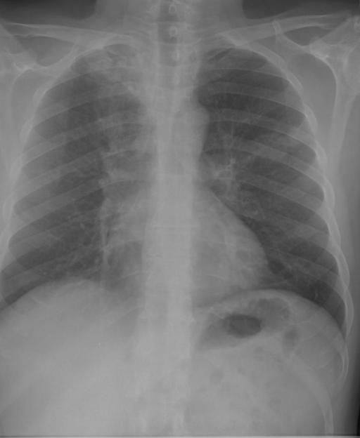
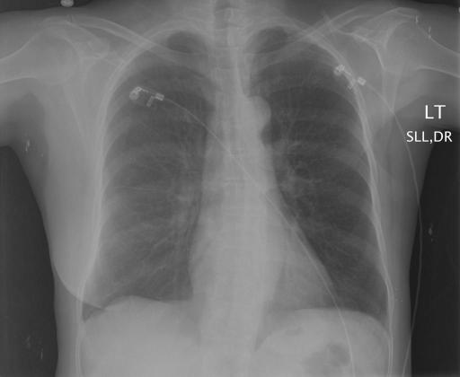
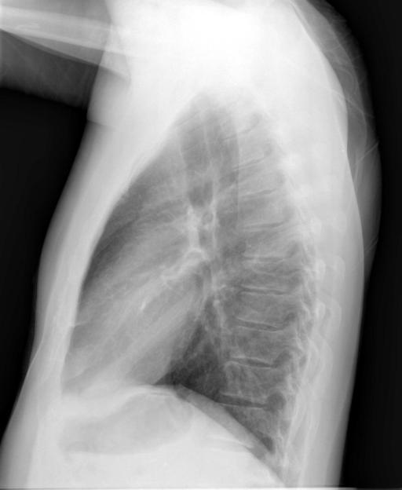
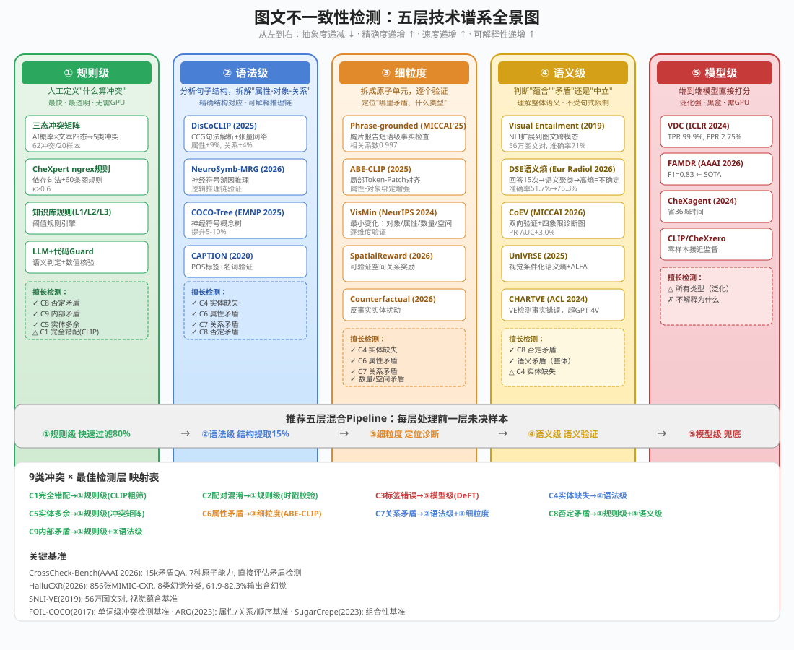
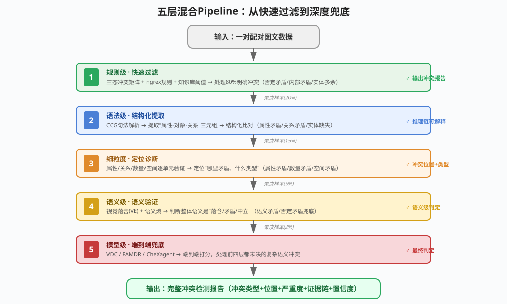
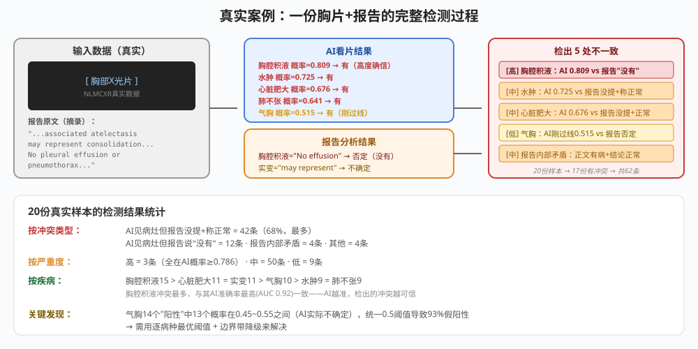

# 图文不一致性检测技术调研

> 这份报告讲的是：怎么用计算机自动发现"一张医学影像和它配对的文字报告之间对不上"的问题。不需要医学或AI背景也能看懂。

---

## 一、研究背景

### 1.1 什么是图文不一致性

医院里每次拍胸部X光片，都会产生两样东西：一张片子（图像）和一段放射科医生写的报告（文字）。理想情况下两者完全一致，但现实中经常**对不上**——医生漏写病灶、报告自相矛盾、用词含糊与片子不符。

**图文不一致性检测**就是让计算机自动发现这些"对不上"的问题。核心流程：
1. 用AI看片 → 搞清楚**片子里有什么病**
2. 用NLP读报告 → 搞清楚**报告怎么描述这些病**（有/没有/可能/没提）
3. 逐个疾病比对 → 找出**两边对不上的地方**

难点在第2步：报告里"No effusion"是"没有胸腔积液"，但纯关键词搜索会误判成"提到了胸腔积液"。

### 1.2 研究现状：框架性空白

通过arXiv 9组关键词检索（140条结果筛选30篇论文），核心发现：

| 维度 | 数据 | 说明 |
|------|------|------|
| 精确命中"多模态数据治理+冲突检测" | **0篇** | 这个方向尚未被学术界固化为独立研究领域 |
| 图文不一致检测相关论文 | ~30篇 | 分散在虚假信息检测、幻觉检测、标签噪声等不同框架下 |
| 以"数据治理"为框架做冲突检测 | **0篇** | 技术积木已存在，但无人组装成数据治理框架 |

**三大数据治理工具均不支持跨模态冲突检测**：

| 工具 | 能做什么 | 不能做什么 | 缺失根因 |
|------|---------|---------|---------|
| Data-Juicer 2.0（NeurIPS 2025） | 多模态数据处理，150+算子，CLIP图文对齐过滤 | 只做"分数低就丢弃"，不告诉你哪里矛盾、为什么矛盾 | Filter范式是keep/drop二值，不输出冲突报告 |
| CleanLab | 检测分类标签错误（标签↔预测不匹配） | 不做图文语义冲突，各模态独立处理 | 检测对象是label↔prediction，不是image↔text |
| Great Expectations | 表格数据质量验证 | 不支持图像、不支持多模态 | 纯规则断言框架，无ML模型、无语义理解 |

**最接近的已有工作**：

| 论文 | 出处 | 做了什么 | 与数据治理的差距 |
|------|------|---------|---------------|
| HalDec-Bench | 2025 | 10.4万标注句子，8类幻觉检测，明确"用幻觉检测筛选高质量图文对" | 最接近，但仍以"幻觉"为框架而非"数据治理" |
| DeFT | NeurIPS 2024 | 双重prompt学习检测标签噪声，7个数据集P/R 85.81/85.72 | 只做标签级，不做图文语义冲突 |
| CLIPCleaner | ACMMM 2024 | CLIP零样本离线清洗标签噪声，Clothing1M 74.83% | 标签清洗，非语义冲突 |
| FOIL-COCO | ACL 2017 | 最早系统化做"图文单点不一致"诊断 | 测试模型能力，非治理数据 |
| NewsCLIPpings | EMNLP 2021 | 检测图文来自不同场景的"错配" | 框架是虚假信息检测 |

**结论**：技术积木已存在（CLIP算相似度、NLI做蕴含、VLM检测幻觉、confident learning检测标签噪声），但没有人把它们组装成一个完整框架，定义"数据集中到底有哪些类型的图文矛盾、每种怎么检测、怎么评估"。

### 1.3 医疗领域已有的技术基础

| 能力 | 代表工具 | 关键指标 | 来源 |
|------|---------|---------|------|
| AI看片 | TorchXRayVision | 逐病种AUC 0.81–0.92 | MIDL 2022 |
| 报告标注 | CheXpert Labeler | 与放射科医生一致性κ>0.6 | AAAI 2019 |
| 通用脏数据清洗 | VDC | 检出率99.91%，误报率2.75% | ICLR 2024 |
| 医学去噪对齐 | FAMDR | F1=0.83 | AAAI 2026 |
| 图文对齐 | CLIP / CheXzero | 图文相似度 / 零样本分类 | ICML 2021 |
| 视觉蕴含 | SNLI-VE | 56万图文对，准确率71% | 2019 |
| 胸片报告事实检查 | Phrase-grounded | 相关系数0.997 | MICCAI 2025 |

---

## 二、数据与模态对齐挑战

### 2.1 真实数据长什么样

调研使用 **NLMCXR（IU X-Ray）**——印第安纳大学公开的真实胸部X光片及放射报告。三个真实样例：

**样例一：报告同时包含"有""没有""可能"三种说法**

| 报告原文 | 拆解 | 状态 |
|---------|------|------|
| "associated atelectasis" | 无否定词 | 肯定（有） |
| "No pleural effusion" | 否定词"No" | 否定（没有） |
| "may represent consolidation" | 不确定词"may represent" | 不确定（可能） |
| "No acute bone abnormality" | 否定词"No acute" | 否定（没有） |

→ 如果AI看到胸腔积液概率0.809，但报告说"No effusion"——构成**高严重度冲突**。

**样例二：报告很短只说"正常"**

| 报告原文 | 特征 |
|---------|------|
| *Status post left mastectomy. Heart size normal. Lungs are clear.* | 明确称心肺正常，但AI检出6种病全阳性——典型"AI见病灶但报告说正常"冲突 |

**样例三：报告正文和结论自相矛盾**

| 报告原文 | 矛盾点 |
|---------|--------|
| *No acute cardiopulmonary abnormalities... without evidence of effusion...* | 结论称"无异常"，但正文提到"effusion"——若AI检出积液则冲突；正文与结论也需检查一致性 |

### 2.2 数据规模与可信度

| 数据集 | 来源 | 规模 | 模态 | 特点 |
|--------|------|------|------|------|
| NLMCXR | 印第安纳大学 | 3,955报告+7,470胸片 | 胸片+报告 | 公开免费，图文天然配对 |
| MIMIC-CXR | MIT PhysioNet | 377,110图像+227,835报告 | 图像+报告+标签 | 需审批，行业最大 |
| CheXpert | Stanford | 224,316胸片，65,240患者 | 图像+14病种标签 | 标签经3名医生验证(κ>0.6) |

均为**真实临床数据**。但Rafferty et al.（2025）证实：CheXpert Labeler在不确定/否定场景下引入标签错误，跨数据集域偏移导致AUPRC和F1大幅下降——**数据集中的不一致问题需要检测**。

### 2.3 三大对齐挑战

**挑战一：报告有四种说法，AI只有两种**

| 报告怎么说 | 含义 | 例子 | AI说"有"时 | AI说"没有"时 |
|-----------|------|------|-----------|------------|
| 肯定 | 确认有 | "associated atelectasis" | 一致 | 冲突 |
| 否定 | 明确说没有 | "No pleural effusion" | **冲突** | 一致 |
| 不确定 | 医生拿不准 | "may represent consolidation" | 弱冲突 | 存疑 |
| 没提 | 报告没写 | （全文没出现edema） | 冲突（如果报告还称正常）| 一致 |

不能简单"AI说有∧报告也提了=一致"——报告提了但说"没有"也是"提了"，恰恰是冲突。必须区分四种状态。

**挑战二：怎么保证片子配的是对的报告**

| 场景 | 问题 | 检测方法 |
|------|------|---------|
| 同患者多次检查 | 随访报告配了入片子 | DICOM时戳校验 |
| 完全无关配对 | 图文来自不同患者 | CLIP粗筛分数极低→配对警报 |

**挑战三：要同时在"逐个疾病"和"整篇报告"两个层面比对**

| 层面 | AI输出 | 报告输出 | 对齐方式 |
|------|--------|---------|---------|
| 疾病级 | 每病概率（如积液0.809） | 每病状态（如否定/未提） | 逐病比对 |
| 报告级 | — | 全局结论（如"Lungs are clear"） | 正文vs结论一致性检查 |

---

## 三、图文不一致性检测方法

### 3.1 五层技术谱系全景图

通过对30篇论文的深度调研，我们发现图文不一致性检测是一个**五层技术谱系**——从最具体的规则匹配到最抽象的端到端模型：

| 层级 | 核心思路 | 通俗解释 | 代表方法 | 擅长检测 | 速度 | 可解释 |
|------|---------|---------|---------|---------|------|--------|
| **①规则级** | 人工定义"什么算冲突" | 像查规则手册 | 三态冲突矩阵、ngrex规则、知识库 | 否定矛盾、内部矛盾、实体多余 | 最快 | 最高 |
| **②语法级** | 分析句子结构提取"属性-对象-关系" | 像做语法分析 | CCG句法、符号推理、概念树 | 属性矛盾、关系矛盾、实体缺失 | 中 | 高 |
| **③细粒度** | 拆成原子单元逐个验证 | 像逐项检查清单 | 属性对齐、空间验证、反事实扰动 | 属性/关系/数量/空间矛盾 | 中 | 高 |
| **④语义级** | 判断"蕴含""矛盾""中立" | 像做阅读理解 | 视觉蕴含(NLI)、语义熵、双向验证 | 否定矛盾、语义矛盾 | 慢 | 中 |
| **⑤模型级** | 端到端模型直接打分 | 像找裁判判定 | VDC、FAMDR、CheXagent | 所有类型（泛化） | 慢 | 低 |

**关键发现**：五层是**互补关系**，每层处理前一层未决的样本。

### 3.2 五层混合Pipeline

每层处理前一层的"未决"样本：规则级处理80%明确冲突（最快），语法级和细粒度处理15%结构性冲突（精确），语义级和模型级处理5%复杂语义冲突（兜底）。

### 3.3 第一层（规则级）：三态冲突矩阵

**方法**：图像侧AI输出每疾病"有/没有"，文本侧NER输出每疾病"四种状态"，放入矩阵定义5类冲突：

**NLMCXR 20样本实测统计**：

| 统计项 | 数值 |
|--------|------|
| 有冲突样本 | 17/20（85%） |
| 总冲突数 | 62条 |
| 高严重度 | 3条（全在AI概率≥0.786） |
| 最主要冲突 | AI见病灶但报告没提+称正常 = 42条（68%） |
| 冲突最多疾病 | 胸腔积液15条（AUC 0.92最高，AI越准冲突越可信） |

**关键发现——统一0.5阈值导致93%假阳性**：

| 疾病 | AUC | 判阳数 | 边界带[0.45,0.55]内 | 边界占阳性比 |
|------|-----|--------|-------------------|-------------|
| Pneumothorax | 0.81 | 14/20 | 13 | **93%** |
| Consolidation | 0.91 | 11/20 | 11 | **100%** |
| Edema | 0.92 | 13/20 | 9 | 69% |
| Cardiomegaly | 0.88 | 16/20 | 3 | 19% |

解决：逐病种最优阈值(`model.op_threshs`，Youden's J) + 边界带降级（概率∈[θ±0.05]时严重度降一级）。

**规则级方法清单**：

| 方法 | 原理 | 关键指标 | 局限 |
|------|------|---------|------|
| 三态冲突矩阵 | AI概率×文本四态→5类冲突+严重度 | 62冲突/20样本 | 只匹配预定义模式 |
| CheXpert ngrex规则 | 依存句法+60条图规则做否定/不确定检测 | κ>0.6 | 只做否定/不确定，不做属性-关系 |
| 知识库规则(L1/L2/L3) | 人工阈值规则引擎 | 1444冲突/10k样本 | 规则覆盖面有限 |
| LLM+代码Guard | LLM语义判定+Python数值核验 | TP 90%，Guard后FP=0 | 依赖LLM质量 |

### 3.4 第二层（语法级）：句法结构分析

**为什么需要语法级？** 文本说"红色的车在蓝色房子左边"，规则级只看到四个词但不知道谁配谁、谁在哪。语法级通过句法分析提取：`属性(红,车) + 关系(左边,车,房) + 属性(蓝,房)`，然后验证图像中是否有对应结构。

| 方法 | 出处 | 技术原理 | 关键指标 |
|------|------|---------|---------|
| DisCoCLIP | 2025 | CCG句法解析器+张量网络编码句法结构，修复CLIP"词袋"问题 | 属性+9%，关系+4%，SVO-Swap 93.7% |
| NeuroSymb-MRG | 2026 | 神经符号溯因推理：图像→概率概念→逻辑推理链→报告 | 事实一致性持续提升 |
| COCO-Tree | EMNLP 2025 | 神经符号概念树，提供可解释推理路径 | Winoground/SugarCrepe提升5-10% |
| CAPTION | 2020 | POS标签+目标检测验证名词正确性 | FOIL-COCO接近人类 |

**与CheXpert Labeler的关系**：CheXpert的ngrex规则是语法级的简化版——只做否定/不确定检测，不做完整属性-对象-关系提取。

### 3.5 第三层（细粒度）：原子单元逐个验证

**核心思路**：不满足整体打分，把图文分解为属性/关系/数量/空间等原子单元，逐单元验证。

| 方法 | 出处 | 验证维度 | 技术原理 | 关键指标 |
|------|------|---------|---------|---------|
| **Phrase-grounded Fact-checking** | **MICCAI 2025** | **短语级** | **扰动疾病发现+位置，跨模态对比回归，同时预测真实性和定位** | **相关系数0.997** |
| ABE-CLIP | 2025 | 属性 | 局部Token-Patch对齐，验证"红色"是不是红色 | 超越需训练方法 |
| VisMin | NeurIPS 2024 | 对象/属性/数量/空间 | 最小变化：每次只改一个维度 | 揭示VLM空间/计数缺陷 |
| ComAlign | 2024 | 实体-关系 | 从文本提取组合结构，弱监督对齐 | 检索显著提升 |
| SpatialReward | 2026 | 空间 | Prompt分解→目标检测→VLM推理 | 空间一致性持续提升 |
| Counterfactual | 2026 | 反事实 | "如果实体不存在，模型是否仍grounding" | 多模态持续提升 |

**MICCAI 2025的Phrase-grounded Fact-checking与我们最相关**——直接做胸片报告事实检查，相关系数0.997。

### 3.6 第四层（语义级）：视觉蕴含与语义熵

**核心思路**：将图文一致性建模为自然语言推理——图像=前提，文本=假设，判断蕴含/矛盾/中立。

| 方法 | 出处 | 技术原理 | 关键指标 |
|------|------|---------|---------|
| Visual Entailment | 2019 | 奠基：NLI扩展到图文跨模态 | 56万图文对，准确率71% |
| CHARTVE | ACL 2024 | VE检测图表描述事实错误 | 超越GPT-4V |
| DSE语义熵 | Eur Radiol 2026 | AI回答15次→语义等价聚类→高熵=不确定 | 准确率51.7%→76.3% |
| UniVRSE | 2025 | 视觉条件化语义熵+ALFA原子事实对齐 | 6个医学数据集显著超越 |
| CoEV | MICCAI 2026 | 双向验证：文本→视觉+视觉→文本，四象限诊断图 | PR-AUC+3.0%，ROC-AUC+3.9% |

**语义熵的直觉**：AI对同一张图回答15次，15个回答一致→低熵→可信；各不相同→高熵→可能冲突。

**CoEV四象限诊断图**：把每条断言按"文本事实性×视觉接地性"分四象限——"真实+接地"=一致，"虚假+未接地"=冲突。

### 3.7 第五层（模型级）：端到端模型

| 方法 | 出处 | 核心机制 | 关键指标 | 角色 |
|------|------|---------|---------|------|
| VDC | ICLR 2024 | VQG→VQA→VAE，ChatGPT+InstructBLIP | TPR 99.91%, FPR 2.75% | 通用兜底 |
| FAMDR | AAAI 2026 | 噪声对齐+检索增强+像素/短语定位+不确定性 | F1=0.83 | SOTA深度复核 |
| CheXagent | 2024 | 视觉-语言基础模型，端到端联合推理 | 住院医生省36%时间 | 端到端判定 |
| CLIP/CheXzero | ICML 2021 | 图文向量余弦相似度 | 零样本接近监督 | 粗筛 |

### 3.8 冲突类型分类体系：9类5层

基于7篇A类论文+30篇技术方法论文提炼的统一分类体系：

| 层级 | 冲突类型 | 通俗解释 | 最佳检测层 | 现有覆盖 |
|------|---------|---------|----------|---------|
| 配对级 | C1 完全错配 | 图文来自完全不同场景 | ①规则级(CLIP粗筛) | NewsCLIPpings |
| | C2 配对混淆 | 图文各自真实但来自不同时间/患者 | ①规则级(时戳校验) | NewsCLIPpings |
| 标签级 | C3 标签错误 | 分类标签和图片不匹配 | ⑤模型级(DeFT) | DeFT, CLIPCleaner |
| 实体级 | C4 该有的没有 | 报告提到的病灶片子上找不到 | ②语法级+③细粒度 | HalDec-Bench, ComAlign |
| | C5 有但没写 | AI看到的病灶报告没提 | ①规则级(冲突矩阵) | **我们的工作** |
| 属性级 | C6 属性矛盾 | 报告说"左边"但片子是右边 | ③细粒度(ABE-CLIP) | HalDec-Bench, FOIL-COCO |
| | C7 关系矛盾 | 报告说"A在B旁"但片子不是 | ②语法级+③细粒度 | HalDec-Bench, SpatialReward |
| 语义级 | C8 否定矛盾 | AI看到了，报告明确说"没有" | ①规则级+④语义级(VE) | **我们的工作** |
| | C9 内部矛盾 | 报告正文有病，结论说正常 | ①规则级+②语法级(符号推理) | **我们的工作** |

**没有一篇论文覆盖全部9类。** HalDec-Bench最多(4类)但只做生成幻觉；我们独占C5/C8/C9三类。

**各层检测能力矩阵**：

| 冲突类型 | ①规则级 | ②语法级 | ③细粒度 | ④语义级 | ⑤模型级 |
|---------|:------:|:------:|:------:|:------:|:------:|
| C8 否定矛盾 | ✓ | ✓ | ✗ | ✓ | △ |
| C9 内部矛盾 | ✓ | ✓ | ✗ | △ | △ |
| C5 实体多余 | ✓ | △ | ✗ | △ | △ |
| C4 实体缺失 | △ | ✓ | ✓ | △ | ✓ |
| C6 属性矛盾 | △ | ✓ | ✓ | △ | △ |
| C7 关系矛盾 | △ | ✓ | ✓ | △ | △ |
| 语义矛盾 | ✗ | △ | △ | ✓ | △ |

### 3.9 行业基准汇总

| 方法/工具 | 出处 | 层级 | 关键指标 | 数据集 |
|-----------|------|------|---------|--------|
| TorchXRayVision | MIDL 2022 | ① | AUC 0.81–0.92 | MIMIC-CXR |
| CheXpert Labeler | AAAI 2019 | ① | κ>0.6 | 200例 |
| VDC | ICLR 2024 | ⑤ | TPR 99.91%, FPR 2.75% | CIFAR-10 |
| FAMDR | AAAI 2026 | ⑤ | F1=0.83 | MIMIC-CXR |
| CheXagent | 2024 | ⑤ | 省36%时间 | CheXbench |
| Visual Entailment | 2019 | ④ | 准确率71% | 56万图文对 |
| DSE语义熵 | Eur Radiol 2026 | ④ | 51.7%→76.3% | 放射学VLM |
| CoEV | MICCAI 2026 | ④ | PR-AUC+3.0% | 医学VLM |
| DisCoCLIP | 2025 | ② | 属性+9%, 关系+4% | ARO |
| Phrase-grounded | MICCAI 2025 | ③ | 相关系数0.997 | 胸片报告 |
| DeFT | NeurIPS 2024 | ⑤ | P/R 85.81/85.72 | 7数据集 |
| HalDec-Bench | 2025 | ③④ | AUROC 79.8 | 10.4万句 |
| CrossCheck-Bench | AAAI 2026 | 基准 | 15k矛盾QA, 7种原子能力 | 图文配对 |
| HalluCXR | 2026 | 基准 | 61.9-82.3%含幻觉 | 856张MIMIC-CXR |
| FOIL-COCO | ACL 2017 | 基准 | 人类≈100% | MSCOCO扩展 |
| ARO | ICLR 2023 | 基准 | 属性/关系/顺序 | 50k用例 |
| SugarCrepe | 2023 | 基准 | 组合性 | 硬负样本 |

---

## 参考文献

| 论文 | 出处 |
|------|------|
| CheXpert | AAAI 2019, arXiv:1901.07031 |
| TorchXRayVision | MIDL 2022, arXiv:2111.00595 |
| VDC | ICLR 2024, arXiv:2309.16211 |
| FAMDR | AAAI 2026, DOI:10.1609/aaai.v40i9.37623 |
| CheXagent | 2024, arXiv:2401.12208 |
| CLIP | ICML 2021, arXiv:2103.00020 |
| Visual Entailment (SNLI-VE) | 2019, arXiv:1901.06706 |
| DSE语义熵 | Eur Radiol 2026, arXiv:2510.09256 |
| UniVRSE | 2025, arXiv:2503.20504 |
| CoEV | MICCAI 2026, arXiv:2606.18609 |
| DisCoCLIP | 2025, arXiv:2509.21287 |
| NeuroSymb-MRG | 2026, arXiv:2603.01756 |
| COCO-Tree | EMNLP 2025, arXiv:2510.11012 |
| ABE-CLIP | 2025, arXiv:2512.17178 |
| VisMin | NeurIPS 2024, arXiv:2407.16772 |
| Phrase-grounded Fact-checking | MICCAI 2025, arXiv:2509.21356 |
| DeFT | NeurIPS 2024, arXiv:2409.19696 |
| CLIPCleaner | ACMMM 2024, arXiv:2408.10012 |
| HalDec-Bench | 2025, arXiv:2511.20515 |
| FOIL-COCO | ACL 2017, arXiv:1705.01359 |
| ARO | ICLR 2023, arXiv:2210.01936 |
| SugarCrepe | 2023, arXiv:2306.14610 |
| CrossCheck-Bench | AAAI 2026, arXiv:2511.21717 |
| HalluCXR | 2026, arXiv:2605.20469 |
| NewsCLIPpings | EMNLP 2021, arXiv:2104.05893 |
| Data-Juicer 2.0 | NeurIPS 2025, arXiv:2501.14755 |
| Rafferty et al. | 2025, arXiv:2509.15107 |
