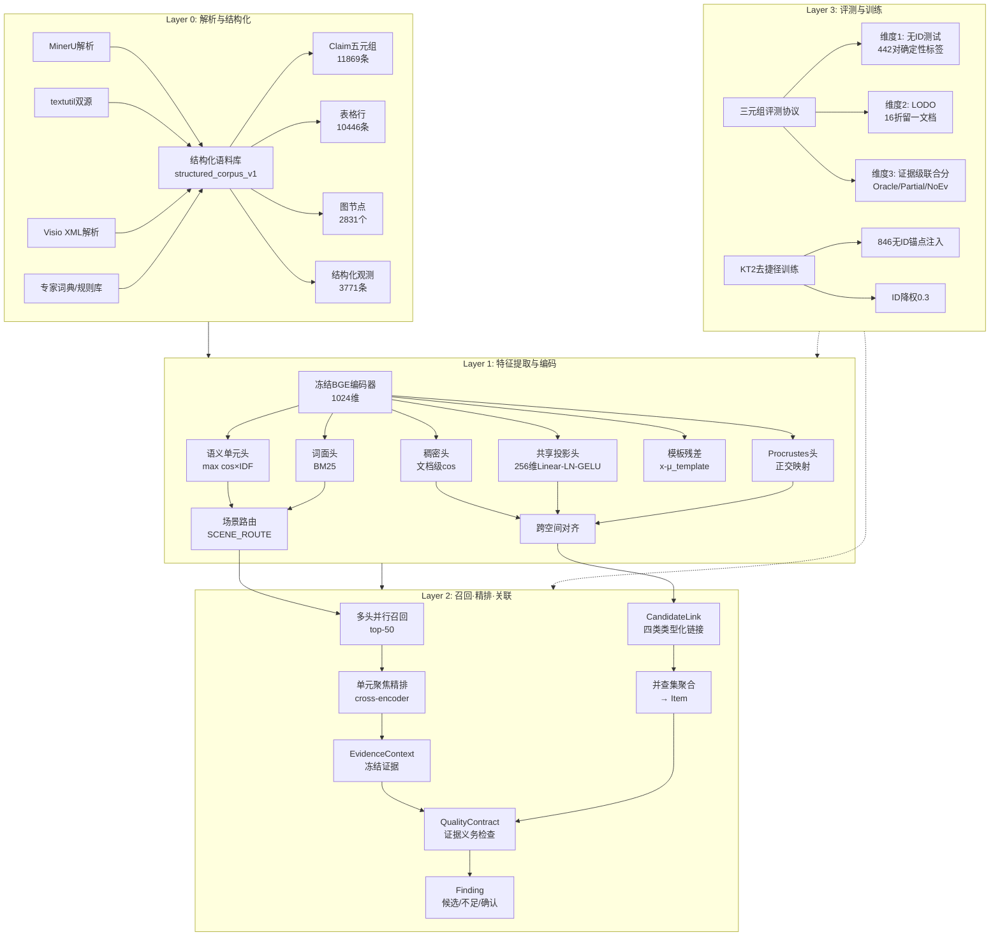
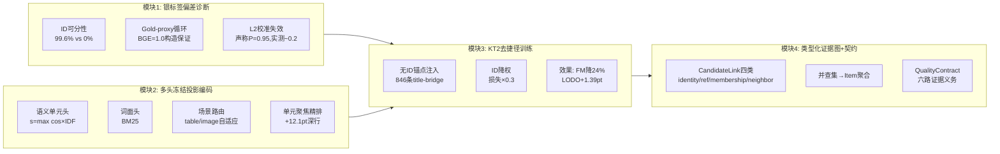

# 61 统一架构框架图：特征提取与上下文关联系统

## 一、全局架构（三层串联）



---

## 二、模块化视图：4个科研模块（非工程堆叠）



---

## 三、数据流视图：从原始文档到最终结论

```text
[输入] 16份GJB SRS (.doc)
  │
  ├─ MinerU → content_list.json (5423块)
  ├─ textutil → dual_source HTML
  └─ Visio OLE → anchors_v3.json (373图/5165节点/2557边)
  │
  ▼ [解析联邦: build_structured_corpus.py]
  │
  27,473个结构化对象
  ├── 11,869条Claim (含谓词/数值/单位/模态词)
  ├── 10,446条表格行 (含行角色/合并单元格)
  ├── 2,831个图节点 (含类型/bbox)
  └── 2,331条需求条目 (含ID/章节)
  │
  ▼ [特征提取: build_feature_snapshot.py + BGE]
  │
  27,473×1024维冻结向量 (feature_snapshot_v1)
  ├── 语义单元头: max cos(q,u)×IDF(u)
  ├── 词面头: BM25 (k1=1.5, b=0.75)
  └── 共享投影: Linear(1024→256) + InfoNCE
  │
  ▼ [训练: train_full_pipeline.py]
  │
  27,691对训练数据
  ├── T0: raw投影 (AUC=0.9743)
  ├── T1: +模板残差 (AUC=0.9628)
  ├── T2: +去捷径 (AUC=0.9753, FM=0.0267)
  └── T3: 最终配置 (AUC=0.9757, F1=0.8449)
  │
  ▼ [评测: 三元组协议]
  │
  ├── 维度1: 无ID测试 (442对确定性)
  │   ├── Raw: 0.9114
  │   ├── Residual: 0.8950 (负结果)
  │   └── Fusion: 0.9110
  │
  ├── 维度2: LODO 16折
  │   ├── raw: 0.8993 ± 0.1350
  │   ├── raw+debias: 0.9132 ± 0.1319
  │   ├── residual: 0.8470 ± 0.1832
  │   └── Levene p=0.495 (方差不显著)
  │
  └── 维度3: 证据级
      ├── Oracle: 1.0
      ├── Partial: 0.656
      └── NoEv: 0.0
  │
  ▼ [关联: build_evidence_graph_v2.py]
  │
  408个silver Item
  ├── 4,969条silver链接
  └── 3,732条Finding (227候选+3505不足)
```

---

## 四、Baseline对照矩阵

| Baseline | 方法 | GJB v4 R@1 | GJB深行 R@1 | WTQ R@1 | 说明 |
|---|---|---:|---:|---:|---|
| BM25-doc | 文档级词面 | — | — | 0.282 | 传统IR |
| BM25-unit | 单元级词面 | — | 0.183 | — | — |
| B1-dense | 冻结BGE余弦 | — | — | 0.324 | 常规dense |
| M3-dense | LightRAG混合 | — | — | 0.324 | 图+向量 |
| Token-MaxSim | ColBERT式token级 | — | — | — | 晚交互 |
| **O1-unit** | **语义单元级** | **0.403** | **0.365** | **0.409** | **我们的方法** |
| **O1+Rerank** | **两阶段精排** | **0.608** | **0.486** | — | **+12.1pt(p=6.7e-08)** |
| LLM-listwise | GLM列表级 | — | — | — | 待完成 |

---

## 五、每个模块对应的代码与实验

| 科研模块 | 代码入口 | 关键实验 | 核心数字 |
|---|---|---|---|
| **多头冻结投影** | `evidence_recall/heads.py` | S7(438q)/S8(4数据集)/S10(Qwen3) | 深行+12.1pt, p=6.7e-08 |
| **场景路由** | `evidence_recall/recall.py` | S4图片场景 | 词面头0.702 vs 语义头0.583 |
| **单元聚焦精排** | `evidence_recall/rerank.py` | S7两阶段 | GJB v4: 0.403→0.608 |
| **KT2去捷径** | `train_full_pipeline.py` | T0-T3全量 | FM 0.0352→0.0267(-24%) |
| **模板残差假设** | `eval_residual_redesign.py` | 无ID+LODO+跨模态 | 0.8950<0.9114(负结果) |
| **类型化链接** | `build_evidence_graph_v2.py` | B2 v4 | 408 items, ID召回0.988 |
| **锚点扩展** | `expand_diagram_anchoros.py` | 三层锚点 | 846 L1 + 16332 L2 |
| **三元组协议** | `eval_*.py`系列 | 11个评测实验 | 详见60号文档 |
| **证据级评测** | `eval_evidence_level.py` | Oracle/Partial/NoEv | 1.0/0.656/0.0 |
| **统计检验** | `eval_statistical_tests.py` | Holm校正 | 三比较均不显著 |

---

## 六、科研贡献与模块的映射

| 贡献 | 来源模块 | 证据强度 |
|---|---|---|
| **发现：银标签ID可分性** | 模块1(偏差诊断) | ★★★（99.6% vs 0%，构造保证） |
| **发现：gold-proxy循环** | 模块1 | ★★★（0.9026>0.6784） |
| **发现：L2校准失效** | 模块1 | ★★☆（20条人工抽检P~0.2） |
| **方法：KT2去捷径** | 模块3 | ★★☆（FM-24%, LODO+1.39pt, Holm不显著） |
| **方法：O1-unit语义单元级检索** | 模块2 | ★★★（深行+12.1pt, p=6.7e-08, 4数据集） |
| **协议：三元组评测** | 模块4 | ★★☆（框架完备，RQ6待真实QA） |
| **负结果：模板残差** | 模块2假设+模块3否证 | ★★★（三独立场景一致否证） |
| **发现：旧+2.34pt是伪影** | 模块1 | ★★★（代码级根因追溯） |
