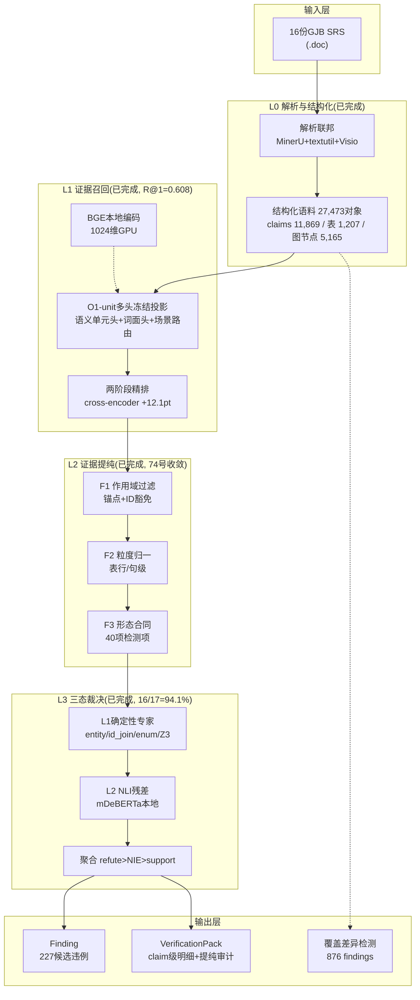

# 82 上下文关联算法框架总图与代码整合进度

日期：2026-10-31 | 仓库清理完成（根目录13文件/22目录全核心）

---

## 一、上下文关联算法框架（一张图）



## 二、算法代码整合进度

| 层 | 模块 | 代码位置 | 测试 | 状态 |
|---|---|---|---|---|
| L0 | 解析联邦 | tools/build_structured_corpus.py | MANIFEST保护 | ✅ |
| L1 | O1-unit召回 | algorithms/context_linking/evidence_recall/ | 5测试 | ✅ |
| L1 | 精排 | evidence_recall/rerank.py | 已验证+12.1pt | ✅ |
| L2 | 原子化 | context_linking/atomizer.py | 15测试 | ✅ |
| L2 | 打分器族 | context_linking/pair_scorers.py | 8测试 | ✅ |
| L2 | 提纯门面 | consistency/evidence_purifier.py | 7+2测试 | ✅ |
| L2 | 覆盖检测 | consistency/coverage_detector.py | 7测试 | ✅ |
| L3 | 三态裁决 | consistency/qa_module.py | 20测试 | ✅ |
| L3 | NLI客户端 | consistency/nli_local.py | GPU就绪 | ✅ |
| 服务 | 算法服务 | srs_verify_package/service/ | 联调12/12 | ✅ |
| 服务 | 后端接入 | deploy/.../services/algo_client.py+verify.py | 联调通过 | ✅ |
| 服务 | 前端接线 | frontend/index.html loadRealQA+cstStartCheck | 浏览器验证 | ✅ |

**核心数字**: 召回R@1=0.608 / 违例查全16/17 / gold保留35/35 / 
L2提纯-17.8%无损 / 参数校准3项(81号)

## 三、清理后的仓库结构

```text
data_clean/
├── algorithms/          ★核心算法(141文件)
│   ├── context_linking/ 召回+原子化+打分
│   └── consistency/     提纯+裁决+覆盖
├── tools/               ★工具脚本(278个, 含archive/)
├── tests/               ★测试(144文件, 1486+通过)
├── data/gjb_438c/       ★数据资产(MANIFEST保护)
├── knowledge/           GJB词典+规则库
├── srs_verify_package/  ★分发包(41模块+服务+Docker)
├── deploy/nkuDataProject/ ★平台(前后端+四服务编排)
├── docs/srs_project/    ★项目文档(81号系列)
├── models/              BGE+mDeBERTa(GPU)
├── config/              证据合同+场景配置
├── scenario5/           并行会话场景5工作
├── references/          文献
└── literature/          调研笔记
```

## 四、本轮清理执行记录

- 根目录一次性脚本/PNG/解压目录: **全部清除**(并行会话同步执行)
- 保留: 全部核心目录+平台+分发包
- 未动: scenario5(并行活跃), easy-dataset(gitignored外部工具)
