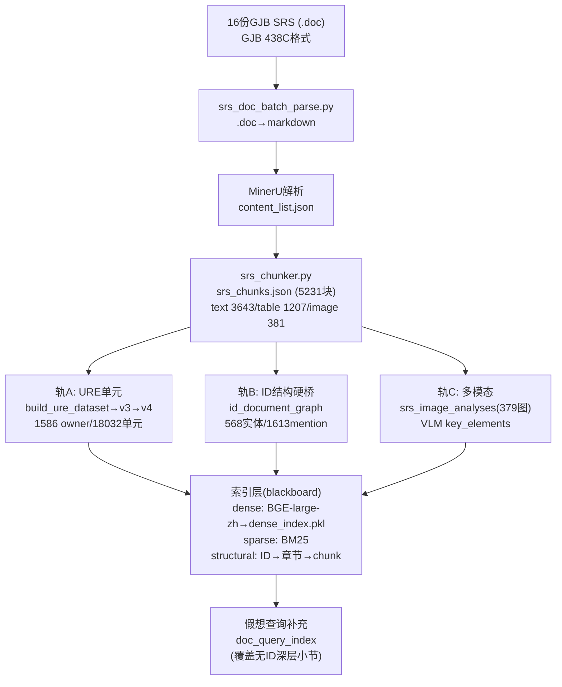
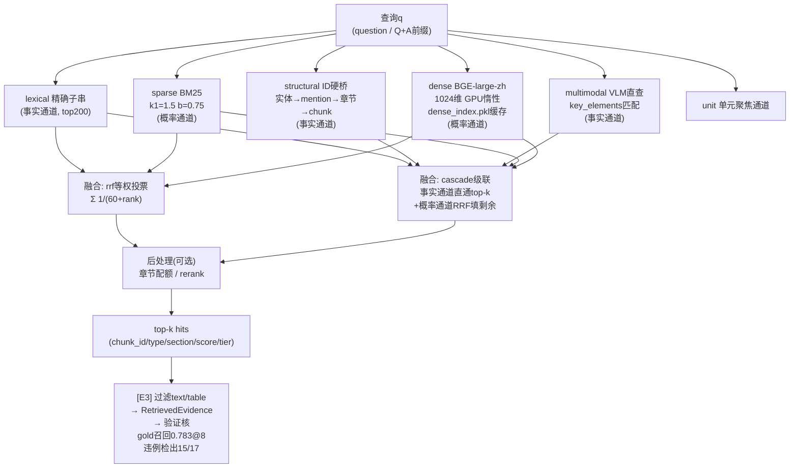

# 87 数据预处理链路与上下文召回链路架构图（v1.0, 2026-11-11）

> 全部节点经代码核实（文件路径/规模数字来自实际数据资产）。
> ASCII版供终端阅读，Mermaid版供文档渲染。

---

## 1. 数据预处理链路（.doc → 可召回证据资产）

### 1.1 ASCII

```text
┌─────────────────────────────────────────────────────────────────────────┐
│ 输入层: 16份真实GJB格式SRS (.doc, data/软件需归样例数据集)               │
│   (GJB 438C格式: 6章+3.1~3.18, 13份结构完整)                            │
└──────────────────────────┬──────────────────────────────────────────────┘
                           ▼
┌─────────────────────────────────────────────────────────────────────────┐
│ 解析层                                                                   │
│  tools/srs_doc_batch_parse.py   .doc→markdown(目录映射恢复编号)          │
│  MinerU标准解析                 → content_list.json(blocks: text/table/  │
│                                  image, 带block_id/section/page)         │
└──────────────────────────┬──────────────────────────────────────────────┘
                           ▼
┌─────────────────────────────────────────────────────────────────────────┐
│ 分块层  tools/srs_chunker.py                                             │
│  → data_assets/chunks/srs_chunks.json (5231块 / 16文档)                 │
│     text 3643 + table 1207 + image 381                                  │
│     chunk_id = {doc}_T{block号:04d}  ↔ 冻结证据block-XXXXXX (35/35对齐) │
└──────┬────────────────┬───────────────────┬─────────────────────────────┘
       ▼                ▼                   ▼
┌──────────────┐ ┌──────────────────┐ ┌────────────────────────────────┐
│ 轨A: URE单元 │ │ 轨B: ID结构硬桥  │ │ 轨C: 多模态图片资产            │
│ build_ure_   │ │ id_document_     │ │ srs_image_analyses.json        │
│ dataset.py   │ │ graph.json       │ │ (379图, VLM key_elements       │
│ → ure_v2     │ │ 568实体节点      │ │  + caption富化)                │
│ build_gjb_   │ │ 1613 mention节点 │ │                                │
│ v3(S1-S4修复)│ │ = 2181节点       │ │                                │
│ build_gjb_   │ │ (跨文档同名消歧) │ │                                │
│ v4_expansion │ │                  │ │                                │
│ ↓            │ └────────┬─────────┘ └───────────┬────────────────────┘
│ gjb_ure_v4   │          │                       │
│ 1586 owner   │          │                       │
│ 18032 单元   │          │                       │
└──────┬───────┘          │                       │
       └──────────┬───────┴───────────────────────┘
                  ▼
┌─────────────────────────────────────────────────────────────────────────┐
│ 索引层 (algorithms/blackboard, 全部惰性+磁盘缓存)                        │
│  dense: BGE-large-zh(1024维, GPU) → dense_index.pkl (5231块向量缓存)     │
│         图片chunk用caption+VLM key_elements富化文本建索引               │
│  sparse: BM25(k1=1.5, b=0.75; CJK 2字滑窗, ASCII token)                 │
│  structural: ID→mentions→全部出现章节→章节chunks                         │
│  假想查询: gen_hypothetical_queries.py 离线生成, 覆盖无ID的深层小节      │
│  (doc_query_index: 词法+BM25双路打分, λ=0.3)                            │
└─────────────────────────────────────────────────────────────────────────┘
```

### 1.2 Mermaid



---

## 2. 上下文召回链路（查询 → top-k证据块）

### 2.1 ASCII

```text
查询 q (E3用法: question + answer前400字符; doc范围可限定)
   │
   ▼
┌────────────────────────── 并行五+一通道 (algorithms/blackboard/hybrid_recall.py) ──────────────────────────┐
│                                                                                                             │
│  lexical      精确子串/双关键词全命中(确定性)  top-200全收获, 高精度           ── 事实通道                 │
│  structural   ID-Graph硬桥: 实体ID→mentions→全部出现章节→章节chunks            ── 事实通道                 │
│               (跨文档同名消歧; 命中=存在性证明而非排序信号)                                                 │
│  multimodal   VLM图片分析直查: query关键词 vs 图片key_elements→image chunk    ── 事实通道                 │
│  sparse       BM25(k1=1.5, b=0.75; CJK 2字滑窗)                              ── 概率通道                 │
│  dense        BGE-large-zh语义向量1024维(GPU惰性; dense_index.pkl缓存;        ── 概率通道                 │
│               图片chunk用caption+key_elements富化文本)                                                     │
│  unit         单元聚焦通道(URE owner/单元对齐)                                                            │
│                                                                                                             │
│  降级: dense不可用 → 四通道优雅降级; 每路结果带provenance(rank=通道名次)                                    │
└──────────────────────────────┬──────────────────────────────────────────────────────────────────────────────┘
                               ▼
┌────────────────────────── 融合 (fusion二选一, 消融对比) ────────────────────────────────────────────────────┐
│  rrf       Reciprocal Rank Fusion (Cormack SIGIR'09): score(d)=Σ 1/(k+rank_c(d)), k=60, 通道等权民主投票    │
│  cascade   级联融合: 事实通道(lexical精确/structural硬桥/multimodal元素命中)直通top-k                        │
│            + 概率通道(sparse/dense)RRF填充剩余配额 —— 异构通道强度悬殊时的标准处理                          │
└──────────────────────────────┬──────────────────────────────────────────────────────────────────────────────┘
                               ▼
┌────────────────────────── 可选后处理 ──────────────────────────────────────────────────────────────────────┐
│  章节配额: 每章节≤quota (防同章节垄断top-k损害覆盖)                                                        │
│  rerank:   cross-encoder精排 top-k*2.5→top-k (事实直通席位受保护, tier=factual)                            │
└──────────────────────────────┬──────────────────────────────────────────────────────────────────────────────┘
                               ▼
┌─────────────────────────────────────────────────────────────────────────────────────────────────────────────┐
│ 输出: hits[{chunk_id, type(text/table/image), section, doc, snippet, rrf_score, channels, rank, tier}]      │
│                                                                                                             │
│ [E3验证核接入] 过滤type∈{text,table} → 剥[表格标题]前缀 → RetrievedEvidence                                 │
│               (evidence_id/section/block_id=chunk_id) → CascadeVerify验证核                                │
│ 实测(04号, k=8): gold块召回0.783, 端到端违例检出15/17(冻结基线16/17)                                        │
└─────────────────────────────────────────────────────────────────────────────────────────────────────────────┘
```

### 2.2 Mermaid



---

## 3. 与验证核的拼接（完整端到端，84号审计§5-6）

```text
(Q, A) ──► hybrid_recall(上图) ──► top-k证据 ──► 输入规约层 ──► 全量检测层(L0/L1) ──► 残差裁决(L2 NLI) ──► 融合聚合 ──► 三态verdict
                                              (claim分解+证据线性化)   (9专家+typed通道并行)   (distilled_v1)   (per-claim+strict∀)
```

数据资产对照表（核实于2026-11-11）：

| 资产 | 路径 | 规模 |
|------|------|------|
| srs_chunks | data/gjb_438c/data_assets/chunks/srs_chunks.json | 5231块/16文档 |
| id_document_graph | data/gjb_438c/data_assets/graph/id_document_graph.json | 2181节点(568实体+1613mention) |
| gjb_ure_v4 | data/gjb_438c/data_assets/evalsets/V3/gjb_ure_v4.json | 1586 owner/18032单元/2996查询 |
| dense索引 | data/gjb_438c/blackboard/dense_index.pkl | 5231块×1024维 |
| 图片分析 | data/gjb_438c/data_assets/chunks/srs_image_analyses.json | 379图 |
| 假想查询 | tools/gen_hypothetical_queries.py → data/gjb_438c/data_assets/doc_queries/doc_queries.json | 覆盖无ID深层小节 |
