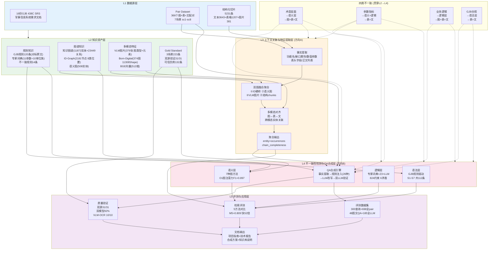

# SRS一致性校验项目生态图

> 以知识资产和上下文关联为核心，不突出数据预处理工具

## 分层说明

### L1 数据源层

项目的数据基础，不强调解析工具，强调数据本身：

- **16份真实GJB 438C SRS**：军事信息系统需求规格说明，涵盖数据获取、传输、处理、部署等子系统
- **Pair Dataset**：366个图+表+文配对实例，7种场景（用例图+能力表/流程图+用例表/接口图+接口表等），每个实例含真实图片+表格CSV+正文TXT
- **结构化切片**：5231条（文本3643+表格1207+图片381），每条带章节号/类型/可溯源

### L2 知识资产层（核心）

项目的知识基础，分4类资产：

**规则知识**（`knowledge/`目录）：
- GJB规则库：120条，每条有source（标准章节号）+original_text（标准原文），已逐条对标GJB 438C标准原文（98/120精确匹配，22条为省略号/格式差异）
- 专家词典：11参数（同义词全部文档验证）+10单位族（79换算，与国际单位制一致）+5操作符（34同义词）+3冲突规则+3表格schema
- 不一致规则：14条四类不一致，每条8字段（rule_id/type/description/check_method/inject_methods/applies_to/severity/example），全部HIGH可信度

**图谱知识**：
- 知识图谱：11872实体+23449关系（LightRAG+kimi-k2.6抽取，中文领域适配实体类型）
- ID-Graph：2181节点（568实体+1613 mention），8类位置锚定（正文/能力表/接口表/合格性表/追溯表/用例表），GJB需求ID作为全局唯一锚点
- 语义图：508实体，7种图方法（连通分量/Louvain/谱聚类/LR/GCN/图注意力/双空间）

**多模态特征**：
- VLM图片特征：379张SRS图片分析（用例图158/流程图138/架构图28），每张含图类型+关键元素+摘要，kimi-k2.6视觉API
- Born-Digital特征：374图/11308 Shape（Visio OLE对象提取，含坐标+文本），100%精确
- BGE向量特征：bge-small-zh-v1.5（512维中文embedding），用于语义相似度检索

**Gold Standard**：
- 3场景223条（名称不一致122+异常流28+接口属性20+正例53），双源验证31/31=100%，双模型标注92%一致，可信负例132条

### L3 上下文关联与特征提取层（方向A）

从知识资产和数据源中提取事实，跨模态聚合同一实体的所有出现位置：

**事实提取**（确定性，5类）：
- 功能名：正则匹配中文字符串+ID关联，标注来源（表格第N行）
- 接口属性：从接口表提取发送方/接收方/接口类型
- 数值参数：正则"数字+单位"+专家词典参数名匹配
- 表头字段：表格第一行筛选含"标识/描述/名称/类型"的字段
- 正文功能列表：正则"包括：A、B、C"格式提取

**双图融合聚合**（4通道互补召回）：
- 通道①ID-Graph硬桥：ID→8类位置mention，零误报确定性关联
- 通道②LightRAG语义图：实体名→所在chunks+关系邻居，语义泛化
- 通道③VLM图片匹配：实体名∈图片key_elements，图文对齐
- 通道④结构化chunks：实体名/ID/关键词三层匹配，精确位置

**多模态对齐**：图↔表（用例图用例名 vs 表格功能名）、表↔文（表格功能列表 vs 正文功能列表）、图↔文（图片元素 vs 正文描述）

**聚合输出**：每个实体产出聚合条目（entity+entity_id+occurrences[{location,section,snippet,doc}]+chain_completeness），chain_completeness=|{正文表格,图片,追溯}∩实际召回|/3

### L4 不一致性检测与QA合成层（方向B）

基于L2知识资产和L3聚合条目，检测四类不一致并合成QA：

**语法层检测**（GJB规则驱动，112条）：S1章节连续性、S2 ID重复定义（15条，与Gold Standard交叉印证8/15）、S4图表引用完整性（90条）、S5章节结构完整性（5条）、S7交叉引用完整性

**语义层检测**（7种图方法）：B1连通分量F1=0.857、B2 Louvain F1=0.815、B3谱聚类F1=0.625、B4学习型LR F1=0.727、B5 GCN F1=0.667、O1图注意力F1=0.897（最优）、O2双空间F1=0.857

**逻辑层检测**（专家知识+Z3+LLM）：L1参数约束冲突（Z3求解器，824约束/73组/6真实矛盾如256GB vs 56GB）、L2允许/禁止矛盾（规则初筛+kimi语义验证，零误报）、L3阈值越界（专家词典值域对照）

**QA合成引擎**（四段式）：
1. 事实提取（确定性，从Pair提取5类事实）
2. 规则注入（26种方法：术语T1-T7+参数P1-P6+逻辑L1-L6+GJB G1-G7，seed=42可复现，答案由规则确定）
3. LLM改写（kimi-k2.6，核心事实不变，只改写语言表达）
4. 双LLM验证（kimi+claude交叉，只保留两者都判正确的）

### L5 评测与应用层

**检索评测**：300查询对（100实体×3问法），5方法对比（M1纯向量0.577 / M2图谱邻域0.652 / M3图+向量混合0.654 / M4 ID硬桥0.000 / M5双图融合0.809），M5领先+15.5pp，快52倍

**质量验证**：双源交叉验证31/31=100%、双模型标注92%一致、VLM-OCR验证10/10无幻觉、LLM-as-Judge双LLM交叉验证

**评测数据集**：300查询对（检索评测）、696条全pair覆盖（按sc1-sc8组织）、48条图文QA（含真实图片）、185条全LLM生成（验证86%）

**文档输出**：project_guide.md(v3.0) + 07完整技术报告 + 09合成方案设计 + 知识库完整说明 + 7篇调研报告

### 横向维度：四类不一致（贯穿L2→L4）

| 类型 | 检测层 | 模态 | 知识来源 | 注入方法 |
|------|--------|------|---------|---------|
| 术语层面 | 语义层 | 图+表+文 | pair的功能名+ID+GJB规则 | T1错字/T2截断/T3字序/T4多名/T5同义词/T6缩写/T7中英混用 |
| 参数指标 | 语义+逻辑 | 表+文 | 表格属性+正文数值+专家词典 | P1数值翻倍/P2单位替换/P3属性交换/P4操作符矛盾/P5值域越界/P6精度不一致 |
| 业务逻辑 | 逻辑层 | 图+表+文 | 流程图+用例表+正文 | L1步骤交换/L2异常流悬挂/L3功能缺失/L4前置条件/L5死异常流/L6时序矛盾 |
| GJB合规 | 语法层 | 表+文 | GJB规则库+表头+ID格式 | G1字段缺失/G2章节缺失/G3图表引用缺失/G4追溯链断裂/G5合格性缺失/G6占位符未替换/G7编号不连续 |
