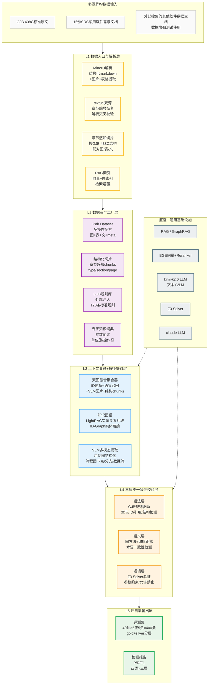
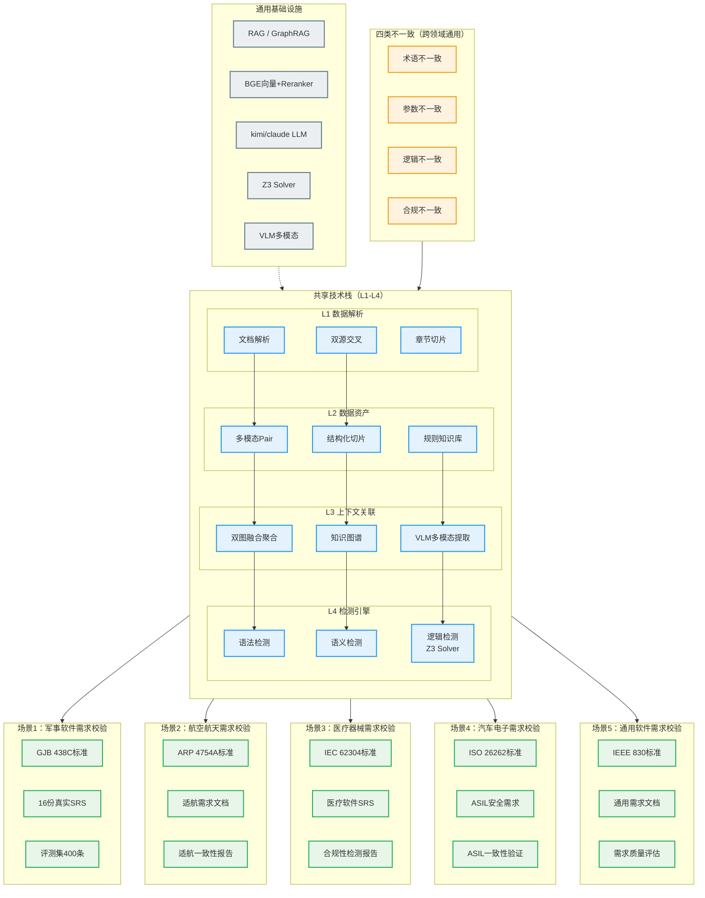
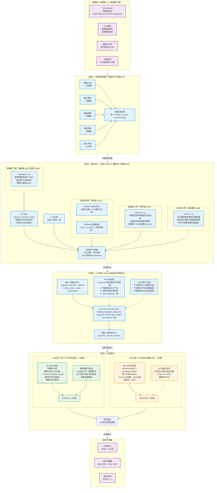

# SRS一致性校验：技术路线与数据集合成方法

> **状态：历史合成方法描述（2026-10-20）。** 文中40项全覆盖、400条及“位置A/位置B”注入流程属于旧pair比较任务，不能作为当前benchmark已实现能力或生成协议。复用算子前须按answer-evidence契约重新定义gold和证据来源。

> 本文档包含三个架构图：
> 1. SRS技术通用路线架构图（5层，模仿DataFlow生态）
> 2. 通用五场景架构图（跨领域应用）
> 3. 检测数据集合成流程图（继承L2数据资产，四段式流水线）

---

## 图一：SRS技术通用路线架构图



**层级说明**：

| 层 | 名称 | 核心组件 | 说明 |
|---|------|---------|------|
| **L5** | 评测集输出层 | 评测集 + 检测报告 | 40项×5正5负=400条，gold+silver分层，P/R/F1报告 |
| **L4** | 三层校验层 | 语法层 / 语义层 / 逻辑层 | GJB规则驱动 + 图方法+编辑距离 + Z3 Solver验证 |
| **L3** | 上下文关联层 | 双图融合 / 知识图谱 / VLM提取 | 多模态条目聚合，实体链接，用例图/流程图结构化 |
| **L2** | 数据资产层 | Pair Dataset / 切片 / GJB规则库 / 词典 | 多模态配对 + 章节切片 + 外部注入规则 + 参数定义 |
| **L1** | 数据入口层 | MinerU / textutil / 章节切片 / RAG索引 | 双源解析交叉校验 + GJB 438C结构感知 + 检索增强 |
| **底座** | 通用基础设施 | RAG / BGE / kimi / Z3 / claude | 向量检索 + LLM推理 + 形式化验证 |

---

## 图二：通用五场景架构图



**核心论点**：四类不一致（术语/参数/逻辑/合规）是跨领域通用的。任何结构化需求文档都存在这四类不一致，技术栈（L1-L4）可以适配到不同领域，只需替换L1的数据源和L2的规则库。

---

## 图三：检测数据集合成流程图

### 设计理念

图三是图一的**L2→L5段的细化**。数据源直接继承图一L2层产出的四类数据资产（Pair Dataset / VLM提取 / 结构化切片 / 专家知识），不重复L1的MinerU解析过程。四段式流水线将数据资产转化为可信评测集。

### Mermaid代码



### 方案设计详解

#### 数据源（继承图一L2层数据资产）

图三的起点是图一L2层产出的四类数据资产，不需要重复L1的MinerU解析过程：

| 数据资产 | 内容 | 来源（图一哪一层产出） |
|---------|------|-------------------|
| **Pair Dataset** | 366个多模态配对实例，每个含meta.json+table.csv+text.txt+image.png | L1章节感知切片配对产出 |
| **VLM提取** | 用例图136条（usecases/actors/system_boundary）+ 流程图163张（nodes/edges/branches/data_flow_direction） | L3 VLM多模态提取产出 |
| **结构化切片** | 5231条chunks，每条含doc/section/text/type/page | L1章节感知切片产出 |
| **专家知识** | GJB规则库120条 + 专家词典11参数+10单位族 + 不一致规则14条 | L2外部注入 |

#### 阶段1：检测对象提取

这一步的目标是从上述四类数据资产中，提取出**需要做一致性校验的检测对象**。每个检测对象 = 一个实体在文档中所有出现位置的聚合。

**为什么需要这一步？** 一致性校验的前提是知道"同一个事物在不同位置分别是什么"。比如功能"数据获取"在表格中叫"数据获取"，在正文中也叫"数据获取"，在用例图中还叫"数据获取"——这三个位置的内容构成了一个检测对象，校验它们是否一致。

**5类检测对象的提取方案**：

**类型1：功能名+ID实体（服务于术语层8项校验）**

这是最核心的检测对象。一个软件功能在SRS文档中会出现在多个位置：能力标识表里有一行记录它的名称和需求ID，正文章节里会描述这个功能，用例图里会有对应的用例节点。我们需要把这三个位置的"功能名"聚合到同一个检测对象下。

具体做法是三源聚合：
- 从Pair Dataset的table.csv中用正则`[A-Z]{2,8}(-[A-Z0-9]+){2,}`提取需求ID，同时取同行的功能名列
- 从text.txt中用正则匹配"创建/实现/完成+功能名"模式提取正文中的功能名
- 从VLM用例图提取结果中取usecases[]列表作为图片中的功能名

三个来源的功能名按**精确字符串匹配**聚合——如果table.csv和text.txt中的功能名完全相同，就认为它们是同一个实体在不同位置的出现。只保留在≥2个位置出现的实体（只有1个位置无法做跨位置校验）。

**类型2：接口属性实体（服务于参数层接口属性校验）**

接口在SRS文档中以接口需求表的形式存在，每行记录一个接口的名称、发送方、接收方、类型。我们从sc3场景（接口图+接口表）的table.csv中，先解析表头确定哪列是名称、哪列是发送方/接收方/类型，然后每行提取为一个`{name, sender, receiver, type}`四元组。同一接口名在不同位置（不同章节的接口表）的出现聚合到一起。

**类型3：数值参数实体（服务于参数层10项校验）**

SRS文档中有大量数值约束，如"存储容量≥256GB""响应时间≤200ms""采集周期100ms"等。我们用正则`(\d+\.?\d*)\s*(GB|MB|GHz|ms|秒|%)`匹配数值+单位，然后在数值前±20字的上下文窗口中识别操作符（"不小于"→≥，"不大于"→≤，"大于"→>，"小于"→<，默认=）。提取后按参数类型（时间/周期/阈值/资源/值域/存储/精度/降级/故障）分类。

**当前问题**：这一类只从Pair Dataset的text.txt提取了3个实体，远不够。需要从5231条chunks中补充提取（按14_strict_40_items_design.md的设计，预计可提取870个）。

**类型4：流程步骤实体（服务于逻辑层11项校验）**

一个业务流程在SRS文档中以两种形式存在：流程图（图片）和步骤描述（正文）。流程图通过VLM提取为nodes[](节点序列)+edges[](边关系)+branches[](分支条件)+data_flow_direction(数据流方向)。正文通过正则匹配"步骤/第一/首先/然后/最后+步骤名"提取为步骤序列。同一流程的图文步骤按文档名+章节号配对。

**类型5：表头字段实体（服务于GJB合规层11项校验）**

GJB 438C标准规定了各种表格的必填字段（能力标识表须含序号/需求标识符/需求描述/需求优先级，接口需求表须含接口名称/发送方/接收方/接口类型等）。我们从table.csv第一行提取表头字段列表，按table_caption判断表格类型，校验表头是否包含标准规定的必填字段。

#### 阶段2：规则注入

这一步的目标是对5类检测对象执行**确定性的不一致注入**，制造出正例（一致）和负例（不一致）两类样本。所有注入操作都是确定性的字符串/数值/序列操作，不依赖LLM，使用固定随机种子seed=42保证可复现。

**为什么不用LLM做注入？** Korn等人在2026年的研究表明"LLM无法可靠生成requirement smells"——LLM自由生成的注入可能不符合真实文档中的不一致模式，也可能注入了检测器无法识别的模式。我们的方案是规则注入，确保注入什么、怎么改、正确答案是什么全部由规则确定。

**40种注入方法按四层组织**：

**术语层8种（字符级操作，silver置信度）**：

| 注入ID | 校验项 | 注入操作 | 示例 |
|--------|--------|---------|------|
| TERM-01 | 同义异名 | 位置A用名称X，位置B用近义词Y | 表格"目标捕捉" vs 正文"目标捕获" |
| TERM-02 | 同名异义 | 同名在不同位置定义不同概念 | "安全模式"在3.2节指"低功耗"，在3.5节指"故障保护" |
| TERM-03 | 枚举集合 | 文本说N种模式，图中只画N-1种 | 正文"支持手动、自动、应急3种" vs 用例图只画2个 |
| TERM-04 | 状态告警 | 同一状态在位置A叫X，位置B叫Y | 接口表"通信异常告警" vs 正文"链路故障标志" |
| TERM-05 | 指令名称 | 同一指令在位置A叫X，位置B叫Y | 表格"启动指令" vs 流程图"开启命令" |
| TERM-06 | 量纲单位 | 位置A"≤0.2s"，位置B"≤20ms"（冲突非等效） | 正文"响应≤0.2秒" vs 接口表"响应≤20ms" |
| TERM-07 | 信号接口 | 同一接口在位置A叫X，位置B叫Y | 正文"数据接口A" vs 接口表"数据通道A" |
| TERM-08 | 缩写代号 | 位置A用全称，位置B用缩写 | 正文"结构化数据归集" vs 表格"SDDC" |

关键设计：TERM-02同名异义必须在occurrences中显示不同definition（而非相同content不同entity_id）；TERM-06量纲单位必须区分"等效不冲突"（0.2秒=200ms→正例）和"冲突"（≤0.2s vs ≤20ms→负例）。

**参数层10种（数值级操作，全部Z3 gate验证，gold置信度）**：

每种参数类型专门设计注入，不再用"数值翻倍"泛化覆盖全部10项。注入的核心是制造**数值约束矛盾**——两个位置的约束不可能同时成立。

| 注入ID | 参数类型 | 注入操作 | Z3验证 | 示例 |
|--------|---------|---------|:---:|------|
| PARAM-01 | 时间约束 | 文本≤200ms，表格300ms | ✅unsat | "≤200ms" vs "300ms" |
| PARAM-02 | 周期参数 | 位置A周期100ms，位置B50ms | ✅unsat | "100ms" vs "50ms" |
| PARAM-03 | 阈值边界 | 位置A阈值≥80%，位置B≥90% | ✅unsat | "≥80%" vs "≥90%" |
| PARAM-04 | 融合对齐 | 位置A对齐≤1ms，位置B≤10ms | ✅unsat | "≤1ms" vs "≤10ms" |
| PARAM-05 | 资源占用 | 位置A内存≤512MB，位置B≤256MB | ✅unsat | "≤512MB" vs "≤256MB" |
| PARAM-06 | 值域范围 | 位置A值域[0,100]，位置B[0,1000] | ✅unsat | "0-100" vs "0-1000" |
| PARAM-07 | 存储容量 | 位置A存储≥256GB，位置B≥56GB | ✅unsat | "≥256GB" vs "≥56GB" |
| PARAM-08 | 守时精度 | 位置A精度≤1μs，位置B≤10μs | ✅unsat | "≤1μs" vs "≤10μs" |
| PARAM-09 | 降级阈值 | 位置A降级≥80%，位置B≥60% | ✅unsat | "≥80%" vs "≥60%" |
| PARAM-10 | 故障时长 | 位置A故障≤5s，位置B≤30s | ✅unsat | "≤5s" vs "≤30s" |

**Z3 gate的工作原理**：创建Z3的Solver对象，声明实数变量x代表参数值，添加原始约束和注入约束，调用`s.check()`。如果返回`unsat`（不可满足），说明两个约束矛盾，注入有效。操作符方向自适应确保100%返回unsat：`≥/>`方向→注入值×0.5+冲突op=`<`；`≤/<`方向→注入值×2+冲突op=`>`。

**逻辑层11种（序列级操作，silver置信度）**：

| 注入ID | 校验项 | 注入操作 | 数据来源 |
|--------|--------|---------|---------|
| LOGIC-01 | 模式切换优先级 | "应急最高" vs "自动可夺回" | VLM流程图branches |
| LOGIC-02 | 异常处置策略 | "切换备用" vs "重试3次" | 跨位置文本 |
| LOGIC-03 | 事件时序 | 交换前两个步骤 | VLM流程图nodes |
| LOGIC-04 | 数据流流向 | "单向" vs "双向" | VLM流程图direction |
| LOGIC-05 | 工况分支完备 | 删除最后一个分支 | VLM流程图branches |
| LOGIC-06 | 互斥控制 | "互斥执行" vs "并行执行" | chunks提取 |
| LOGIC-07 | 任务切换原子性 | "不可中断" vs "可中断" | chunks提取 |
| LOGIC-08 | 数据冗余仲裁 | "主用优先" vs "备用优先" | chunks提取 |
| LOGIC-09 | 权限访问控制 | "仅管理员" vs "普通用户可进入" | 文本vs流程图 |
| LOGIC-10 | 故障恢复 | "自动恢复" vs "手动恢复" | chunks提取 |
| LOGIC-11 | 追踪重搜 | "全库重搜" vs "增量搜索" | chunks提取 |

**GJB合规层11种（内容缺失/模糊注入，gold置信度）**：

GJB层注入方式不是"字符替换"，而是"内容缺失/模糊"——注入的是缺失条款或模糊表述：

| 注入ID | 校验项 | 注入操作 | 示例 |
|--------|--------|---------|------|
| GJB-01 | 可测试性 | 注入模糊需求 | "系统应运行稳定"（无量化指标） |
| GJB-02 | 故障容错完备 | 缺失容错条款 | 删除"系统应具备N+1冗余" |
| GJB-03 | 安全访问控制 | 缺失安全条款 | 删除"基于角色的访问控制" |
| GJB-04 | 审计日志 | 缺失审计条款 | 删除"记录所有关键操作日志" |
| GJB-05 | 需求可追溯 | 追溯链断裂 | "需求A→测试A"→"需求A→(空)" |
| GJB-06 | 异常报警要素 | 缺失报警级别 | 删除"报警级别"字段 |
| GJB-07 | 软件自检 | 缺失自检条款 | 删除"系统启动时应执行自检" |
| GJB-08 | 掉电数据保护 | 缺失保护条款 | 删除"掉电时应保护关键数据" |
| GJB-09 | 输入数据防护 | 缺失防护条款 | 删除"应对输入数据进行合法性校验" |
| GJB-10 | 版本升级安全 | 缺失回退机制 | 删除"版本升级应支持回滚" |
| GJB-11 | 降级运行 | 缺失降级模式 | 删除"系统应支持降级运行模式" |

**关键设计：注入值回写occurrences**。注入后，位置A的content保持原始值，位置B的content替换为注入值。这样检测器/LLM基于occurrences内容就能看到不一致。之前的bug是注入值只写在injection元数据中、未回写到occurrences，导致检测器看不到——已修复。

**正例构造**：从检测对象中选取未被注入的实体，确认其在各位置的表述一致，标注为label=consistent。正例的gold label由规则确定性验证（字符串精确匹配确认一致）。

**可复现性**：固定seed=42 + 确定性规则 + 固定prompt，同样输入永远产生同样输出。每条注入记录method字段，可以追溯到具体改了什么。

#### 阶段3：LLM改写

这一步的目标是将阶段2产出的**结构化注入信息**改写为**自然语言问答对**。LLM在这里的角色是"翻译器"——把结构化的数据变成人类可读的中文问答。

**为什么需要LLM改写？** 阶段2的输出是结构化的JSON（original值、injected值、method、occurrences列表），这种格式对机器友好但人类难以直接阅读。评测集需要呈现为自然语言问答，让检测器/人类能理解"问的是什么、答的是什么"。

**API配置**：

| 参数 | 值 | 说明 |
|------|-----|------|
| URL | `https://api.moonshot.cn/v1/chat/completions` | moonshot直接API |
| Model | kimi-k2.6 | 支持JSON输出 |
| temperature | 0.6 | 文本模式必须为0.6（VLM模式为1） |
| thinking | `{type: disabled}` | 禁用思考模式，否则输出为空 |
| response_format | `{type: json_object}` | 强制JSON输出 |
| max_tokens | 500 | 足够生成QA对 |

**输入（结构化注入信息）**：

```
- 实体类型: function_name
- 原始值: 识别短语生成
- 注入值: 识别短诮生成
- 注入位置: table
- 注入方法: T1_char_replace
- 检测项: TERM-01
- 标签: inconsistent
```

**Prompt设计约束**：

1. question必须询问"图/表/文之间是否一致"
2. 不要直接说出"注入了什么"，用自然方式呈现
3. 保持军事软件需求文档的术语风格
4. answer必须与标签一致（inconsistent/consistent）
5. 如果是consistent，question应问"是否一致"，answer应说明"一致"
6. 如果是inconsistent，question应问"是否存在不一致"，answer应指出具体不一致

**输出（自然语言QA）**：

```json
{
  "question": "表中所列功能名称与系统术语定义是否存在不一致？",
  "answer": "存在不一致。表中功能名称为'识别短诮生成'，与标准术语'识别短语生成'不符，'诮'为错误用字，属于字符替换导致的术语不一致。",
  "reason": "位置A(table)显示'识别短诮生成'，位置B(text)显示'识别短语生成'，第4字'语'被替换为'诮'"
}
```

**LLM不做三件事**：

1. **不决定改什么**——注入什么、怎么改由阶段2的规则决定，LLM只接收已经确定好的注入结果
2. **不判断对不对**——答案（consistent/inconsistent）由注入操作直接确定，LLM不需要判断
3. **不编造事实**——所有事实（功能名、数值、步骤）从文档提取，LLM只负责语言表达

这种设计的核心思想是"事实层用规则保证可控，语言层用LLM保证自然"——规则决定内容和结论，LLM只负责把结构化数据翻译成自然中文。

#### 阶段4：分层验证

这一步的目标是**保证每条评测数据的标签可信**。不同类型的注入用不同层级的验证方式，形成gold（零人工）和silver（LLM验证）两层置信度。

**Gold层（零人工·形式化验证）~200条**

Gold层的核心思想是：**用数学证明和规则确定性来保证标签可信，完全不需要人工判断**。

**Z3 Solver验证（参数层10项×5条=50条）**：

参数层注入制造的是数值约束矛盾——比如原始约束"存储容量≥256GB"，注入后变成"存储容量<128GB"。这两个约束在数学上不可能同时成立（没有任何数既≥256又<128），Z3 Solver可以证明这一点。

具体做法：创建Z3的`Solver()`对象，声明一个实数变量x代表参数值，添加原始约束`x>=256`和注入约束`x<128`，调用`s.check()`——如果返回`unsat`（不可满足），说明约束矛盾成立，这条评测数据的gold标签"inconsistent"是数学证明的结论，不需要任何人判断。

关键设计是**操作符方向自适应**：如果原始约束是`≥`方向，注入值要往小了改（×0.5），冲突操作符选`<`；如果原始是`≤`方向，注入值要往大了改（×2），冲突操作符选`>`。这样确保Z3永远返回unsat。

学术先例：arXiv:2511.11954用Prolog做形式化验证作为零人工ground truth。

**规则确定性验证（GJB层11项+量纲单位=~150条）**：

GJB层注入制造的是"内容缺失/模糊"——比如GJB-02是缺失容错条款，GJB-07是缺失开机自检条款。这些注入的操作本身就是规则违反（你删掉了一个标准要求的条款），所以答案直接由注入操作确定——删了就是缺失，不需要判断。

量纲单位TERM-06特殊处理：区分"等效不冲突"（0.2秒=200ms→正例）和"冲突"（≤0.2s vs ≤20ms→负例），通过单位换算表确定。

学术先例：CrossCheck-Bench的规则注入天然确定gold label。

**Silver层（LLM验证·延期人工audit）~200条**

Silver层的核心思想是：**用多个独立LLM的共识来近似人工判断，并承诺后期补充人工audit**。

**双LLM交叉验证（术语层8项+逻辑层11项）**：

术语层和逻辑层的注入制造的是"语义不一致"——比如T1错字（"数据获取"→"发据获取"）、L1步骤交换（[A,B,C]→[A,C,B]）。这些不一致无法用数学证明，需要语义理解来判断。

具体做法是CoVe（Chain-of-Verification）范式：
1. kimi起草判定：基于注入信息生成自然语言QA
2. claude隔离验证：不看kimi的答案，只看原始occurrences数据，独立判断QA是否正确
3. 合并判定：两个LLM都通过才标记verified=True

**关键设计**：kimi通过moonshot直接API调用，claude通过wanqing API调用——两个URL不同，两个模型不同，消除了单LLM的系统性偏误。

**3LLM独立标注（验证区分度）**：

为了让审稿人相信评测集不是trivial的（不是LLM轻松能100%判断的），我们让3个LLM在不提供注入信息的情况下独立标注：

只给LLM看question + occurrences（注入后的，某个位置已被修改），不给method/original/injected/label。LLM需要独立判断这些位置之间是否一致。

结果：kimi准确率79.87%，claude 65.84%，glm 78.91%，多数投票79.50%。Cohen's κ平均0.6567（中等一致）。这证明评测集有区分度——LLM不能100%检测到所有不一致。

学术先例：alt-test（arXiv:2501.10970）用LLM替代人工标注的统计验证，MCHR（Multi-LLM Consensus + human review）。

**Threats to Validity**：Silver层存在LLM标注偏差风险，承诺camera-ready前完成10%人工audit并报告agreement。

### 四段式流程总结

| 阶段 | 名称 | 核心方法 | 输入 | 输出 | 质量保证 |
|------|------|---------|------|------|---------|
| **阶段1** | 检测对象提取 | 5类确定性提取+跨pair聚合 | L2数据资产（Pair+VLM+chunks+专家知识） | 5类检测对象 | 可复现·不依赖LLM |
| **阶段2** | 规则注入 | 40种确定性操作+Z3 gate | 5类检测对象 | 400条注入(200正+200负) | seed=42·Z3验证unsat |
| **阶段3** | LLM改写 | kimi结构化→自然语言 | 400条结构化注入 | 400条自然语言QA | 只改语言·不改结论 |
| **阶段4** | 分层验证 | Gold(Z3+规则) + Silver(双LLM) | 400条QA | 400条可信评测集 | gold零人工·silver延期audit |

### 各阶段核心要点

**阶段1（检测对象提取）**做的是"把同一个事物在不同位置的出现聚合到一起"。一个软件功能在SRS中会出现在能力表的某一行、正文的某一段、用例图的某一个节点——这三个位置的内容构成一个检测对象。我们从Pair Dataset的table.csv/text.txt、VLM用例图的usecases[]、VLM流程图的nodes[]、结构化chunks等多个数据源中，用正则和规则确定性提取5类检测对象，按实体名跨pair聚合，只保留在≥2个位置出现的实体。整个过程不依赖LLM，可复现。

**阶段2（规则注入）**做的是"在检测对象上确定性地制造不一致"。40种注入方法严格对应40项校验：术语层8种做字符级操作（错字/截断/字序/同义词/缩写等），参数层10种做数值级操作并全部通过Z3 Solver验证约束矛盾（unsat），逻辑层11种做序列级操作（步骤交换/异常悬挂/分支删除/数据流反转等，数据来自VLM流程图和chunks），GJB层11种做内容缺失注入（删除标准要求的条款或注入模糊需求）。所有操作使用固定seed=42，每条注入记录method字段可追溯。关键设计是注入值必须回写到occurrences——位置A保持原始值，位置B替换为注入值，确保检测器基于内容能看到不一致。正例从未注入的实体中选取，字符串精确匹配确认一致。

**阶段3（LLM改写）**做的是"把结构化注入翻译成自然语言问答"。阶段2的输出是JSON格式的结构化数据（original值/injected值/method/occurrences），对机器友好但人类难以阅读。用kimi-k2.6（thinking=disabled, temperature=0.6, response_format=json_object）将结构化注入改写为{question, answer, reason}格式的自然语言QA。Prompt约束LLM：question必须询问"图/表/文是否一致"，不直接说出注入了什么，保持军事术语风格，answer与标签一致。LLM不做三件事——不决定改什么（规则决定）、不判断对不对（答案确定）、不编造事实（从文档提取）。核心思想是"事实层用规则保证可控，语言层用LLM保证自然"。

**阶段4（分层验证）**做的是"保证每条评测数据的标签可信"。Gold层（~200条）用Z3 Solver验证参数层约束矛盾（数学证明unsat，零人工）和规则确定性验证GJB层（注入操作本身=规则违反），先例是arXiv:2511.11954和CrossCheck-Bench。Silver层（~200条）用双LLM交叉验证（kimi via moonshot + claude via wanqing，两个不同endpoint，CoVe范式：kimi起草→claude隔离验证→合并），并用3LLM独立标注验证区分度（不给注入信息，独立判断，κ=0.6567，准确率79.5%），先例是MCHR和alt-test。Threats to Validity主动披露Silver层存在LLM偏差风险，承诺camera-ready前完成10%人工audit。

---

## 附：AI绘图提示词

### 图三提示词

```
设计一个从左到右的四段式流水线流程图。

数据源（左侧，标注"继承L2数据资产"）：
- Pair Dataset（多模态配对：meta+table.csv+text.txt+image.png）
- VLM提取（用例图结构化+流程图结构化）
- 结构化切片（章节感知chunks）
- 专家知识（GJB规则库+词典）
注意：数据源不画MinerU，直接从L2数据资产开始

阶段1（中等大小，5个框简化）：
5类检测对象提取（确定性·不依赖LLM）：
- 功能名+ID → 术语层
- 接口属性 → 参数层
- 数值参数 → 参数层
- 流程步骤 → 逻辑层
- 表头字段 → GJB层
输出：5类检测对象，每个={entity_id, type, occurrences[]}

阶段2（小框简化）：
40种注入（术语8+参数10★Z3+逻辑11+GJB 11）+ 50正例 → 400条

阶段3（小框简化）：
kimi结构化→自然语言QA

阶段4（大框，详细展开两层）：
Gold层（绿色·零人工·~200条）：
  - Z3 Solver验证：Solver().check()==unsat，操作符方向自适应
  - 规则确定性验证：注入操作=规则违反
Silver层（橙色·LLM验证·~200条）：
  - 双LLM交叉验证：kimi(moonshot)+claude(wanqing)，CoVe范式，两个不同endpoint
  - 3LLM独立标注：不给注入信息，κ=0.6567，准确率79.5%

输出：400条评测集

风格：从左到右流程，阶段1中等大小（5个框），阶段2/3小框简化
阶段4大框详细展开Gold/Silver两层
Z3用红色高亮，Gold绿色，Silver橙色
数据源标注"继承L2数据资产"
```
