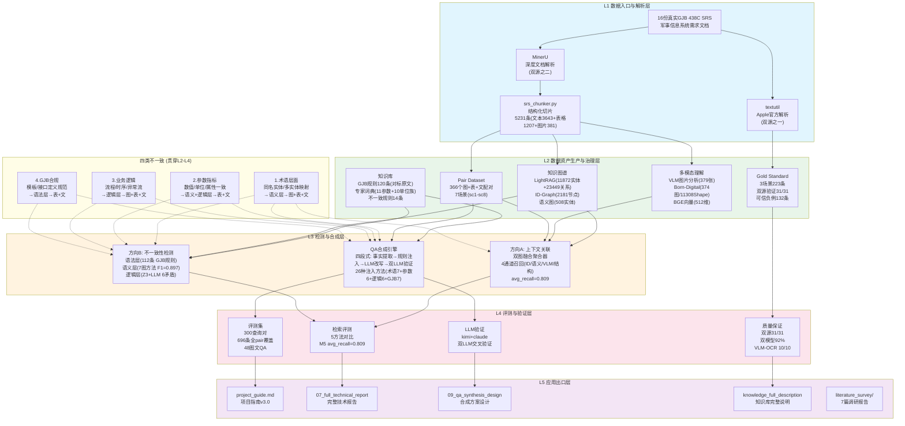

# SRS一致性校验项目生态图

> 参考DataFlow生态图设计，将项目分为5层+1个横向维度

## 分层说明

### L1 数据入口与解析层
**数据源**：16份真实GJB 438C格式SRS文档（军事信息系统需求规格说明），涵盖数据获取、传输、处理、部署等子系统。

**双源解析**：
- textutil（Apple官方命令行工具）→ HTML文本，作为独立验证源
- MinerU（深度文档解析）→ content_list.json（结构化条目流：文本/表格/图片）+ 381张真实图片

**结构化切片**：srs_chunker.py按章节边界切片（表格整体保留），产出5231条（3643文本+1207表格+381图片），每条带章节号/类型/可溯源。

### L2 数据资产生产与治理层

**知识库**（3个文件，166条记录全部HIGH可信度）：
- GJB规则库：120条，每条有source（标准章节号）+original_text（标准原文），已逐条对标GJB 438C标准原文（98/120精确匹配）
- 专家词典：11参数（同义词全部文档验证）+10单位族（79换算）+5操作符+3冲突规则+3表格schema
- 不一致规则：14条四类不一致，每条有8字段（含真实文档example）

**知识图谱**：
- LightRAG图谱：11872实体+23449关系（kimi-k2.6抽取，中文领域适配）
- ID-Graph：2181节点（568实体+1613 mention），8类位置锚定
- 语义图：508实体，7种图方法评测

**多模态理解**：
- VLM图片分析：379张SRS图片（用例图158/流程图138/架构图28），kimi-k2.6视觉API
- Born-Digital：374图/11308 Shape（Visio OLE对象提取，含坐标+文本）
- BGE向量：bge-small-zh-v1.5（512维中文embedding）

**Gold Standard**：
- 3场景223条（名称不一致122+异常流28+接口属性20+正例53）
- 双源验证31/31=100%（MinerU+textutil独立确认）
- 双模型标注92%一致（kimi+claude）
- 可信负例132条

**Pair Dataset**：366个图+表+文配对实例，7场景（sc1用例图+能力表141 / sc2流程图+用例表90 / sc3接口图+接口表30等）

### L3 检测与合成层

**方向A（上下文关联）**：
- 双图融合聚合器：4通道召回（ID-Graph硬桥+LightRAG语义图+VLM图片+结构化chunks）
- 评测：300查询对，5方法对比，M5双图融合avg_recall=0.809（领先M3 mix +15.5pp，快52倍）

**方向B（不一致性检测）**：
- 语法层：112条检测（S1章节连续/S2 ID重复定义/S4图表引用/S5结构完整/S7交叉引用），基于GJB 120条规则
- 语义层：7种图方法（连通分量F1=0.857/图注意力F1=0.897/双空间F1=0.857），S2与Gold Standard交叉印证
- 逻辑层：专家词典+Z3求解器（824约束/73组/6真实矛盾如256GB vs 56GB）+LLM语义验证（零误报）

**QA合成引擎**（四段式）：
1. 事实提取（确定性，5类事实从pair提取）
2. 规则注入（26种方法，seed=42可复现，答案由规则确定）
3. LLM改写（kimi-k2.6，核心事实不变）
4. 双LLM验证（kimi+claude交叉，只保留两者都通过的）

### L4 评测与验证层

**评测集**：
- 检索评测：300查询对（100实体×3问法），5方法对比
- 全LLM测试集：185条（四类均衡，验证86%）
- 全pair覆盖：696条（366pair全覆盖，按sc1-sc8组织）
- 多模态QA：48条（含真实图片，48/48图片存在）

**质量保证**：
- 双源交叉验证：31/31=100%（MinerU+textutil独立确认）
- 双模型标注：92%一致（kimi+claude）
- VLM-OCR验证：10/10无幻觉（tesseract独立OCR）
- LLM-as-Judge：双LLM交叉验证

### L5 应用出口层

**文档**：project_guide.md(v3.0) + 07完整技术报告 + 09合成方案设计 + 知识库完整说明 + 7篇调研报告

**代码**：algorithms/（syntax/semantic/scene1-3/logic模块化）+ tools/（15+脚本）

### 横向维度：四类不一致（贯穿L2-L4）

| 类型 | 检测层 | 模态 | 数据来源 | 注入方法 |
|------|--------|------|---------|---------|
| 术语层面 | 语义层 | 图+表+文 | pair的功能名+ID | T1-T7（7种） |
| 参数指标 | 语义+逻辑 | 表+文 | 表格属性+正文数值+专家词典 | P1-P6（6种） |
| 业务逻辑 | 逻辑层 | 图+表+文 | 流程图+用例表+正文 | L1-L6（6种） |
| GJB合规 | 语法层 | 表+文 | GJB规则库+表头+ID | G1-G7（7种） |
