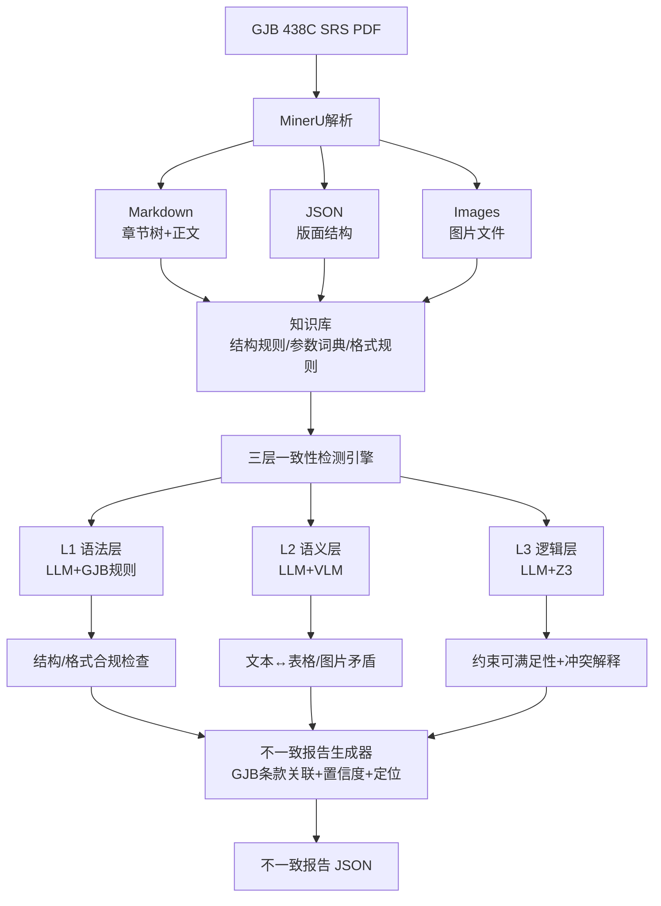
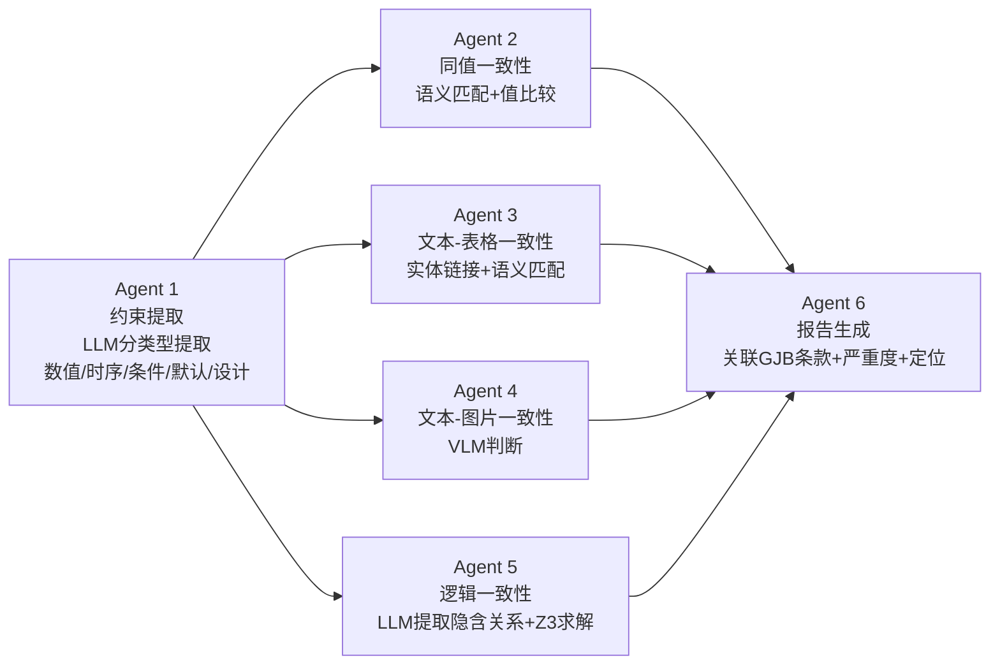

# GJB 438C SRS一致性检测系统 — 架构设计与方案选型

> 版本: 2.0 (合并版)
> 日期: 2026-07-28
> 依据: 128篇论文调研 + 5篇精读 + 3份GJB SRS数据分析

---

## 1. 系统概述与核心问题

### 1.1 问题定义

**一句话**: 给定一份GJB 438C格式的SRS文档，自动检测文档内部的不一致。

关键词是**内部**——不是与外部标准比对，而是**文档自己跟自己矛盾**。检测覆盖三个层次：语法层（结构/格式是否符合GJB 438C）、语义层（文本↔表格、文本↔图片之间是否存在矛盾）、逻辑层（约束集合在逻辑上能否同时满足）。每条结果关联到具体GJB条款，输出带置信度的报告。

### 1.2 设计目标与约束

| 约束 | 说明 |
|---|---|
| 数据 | 3份GJB格式SRS（编译器/电池仿真/调度器），中文 |
| 计算资源 | Mac M4 Pro，无CUDA，Python 3.12 + 3.14 |
| API | GLM-5（文本）、Kimi-K2.6（多模态） |
| 解析工具 | MinerU（已验证可用） |
| 求解器 | Z3（Python API，pip安装） |
| 论文产出 | 论文初稿，需明确novelty |

### 1.3 核心架构总览

GJB SRS PDF经MinerU解析为Markdown（章节树+正文）、JSON（版面结构）、Images（图片文件）三类输出，喂入统一知识库；其后由三层检测引擎（L1语法/L2语义/L3逻辑）并行处理，最终汇入不一致报告生成器，关联GJB条款、标注置信度并精确定位。



---

## 2. 难点剖析（从真实数据出发）

调度器SRS是分析基准，其约束、表格、图片的真实形态揭示了五个核心难点。

### 2.1 约束的多样性

从该SRS提取的真实约束覆盖7种类型，远超"参数≤数值"的简单模式：

| 原文 | 类型 | 难点 |
|---|---|---|
| "默认25ms" | 默认值 | 不是硬约束，是配置参数 |
| "以25ms固定周期驱动" | 设计参数 | 多处出现，需确认一致 |
| "单次定时误差不超过±2ms" | 对称容差 | ±2ms = |error| ≤ 2，不是error ≤ 2 |
| "连续运行1000个周期后总时间误差不超过50ms" | 累积约束 | 含时间维度(1000周期)和累积量(总误差) |
| "单循环执行时间不超过5ms（含电池模型计算）" | 复合约束 | "含"表示包含子项，需要分解 |
| "前10秒恒流10A，接着5秒脉冲50A" | 时序约束 | 时间序列，不是单值 |
| "当执行时间超过25ms时进入超时告警" | 条件约束 | if-then结构，不是简单≤ |

每种类型都需要不同的解析策略。之前正则仅提取39条约束（49/62文档为0），故改用LLM分类型提取。

### 2.2 文本-表格关系的复杂性

调度器SRS有5个表格，内容和用途完全不同，与正文的关系也各异：

| 表格 | 内容 | 与正文的关系 |
|---|---|---|
| 修改页 | 空模板 | 无关系 |
| 引用文档 | GJB 438C、电池SRS | 无直接约束关系 |
| 合格性规定 | REQ-3.2.1→单元测试→关键 | **需求名称需与正文章节标题一致** |
| 正向追踪 | "25ms周期驱动"→REQ-3.2.4 | **指标值需与正文约束一致** |
| 逆向追踪 | REQ-3.2.4→"25ms周期驱动电池模型" | 同上，反向 |

真正的矛盾不是"正文说X、表格说Y"的字面差异，而是：合格性表的需求名"高精度定时器"须与正文3.2.1标题一致；追踪表"25ms周期驱动"须与正文"25ms固定周期"语义匹配；合格性表标"关键"级别但正文未提及级别，属于信息缺失而非矛盾。

### 2.3 图片引用的缺失

调度器SRS有7张图片，但正文中**未找到"如图X所示"的引用**（grep "图"无结果）。这带来三重困境：图片可能没有文字引用；图片类型未知（流程图/架构图/界面截图）；没有引用就无法建立文本-图片配对。因此需先分类图片、再判断是否有对应文字描述，而非直接做图文一致性判断。

### 2.4 逻辑约束的隐含关系

正文约束并非独立，存在4类未显式写出的隐含关系：

```
显式约束:
  C1: 周期 = 25ms
  C2: 单循环执行时间 ≤ 5ms
  C3: 补偿计算时间 ≤ 0.01ms
  C4: 查询时间 ≤ 0.01ms
  C5: 超时阈值 = 25ms (执行时间>25ms时告警)

隐含关系:
  R1: 执行时间 = 补偿时间 + 查询时间 + 模型计算 + 其他开销
  R2: 执行时间 < 周期 (否则超时)
  R3: C2中"含电池模型计算" → 模型计算 ⊆ 执行时间
  R4: C5的超时阈值 = C1的周期 (同一值25ms)
```

R1–R4都未在文档中显式写出，需领域知识推理。Z3只能检查显式约束的矛盾，无法发现隐含关系的违反——让LLM提取隐含关系是关键挑战。

### 2.5 同值多现的一致性

"25ms"在文档中出现至少6次：系统概述"以25ms固定周期驱动"、初始化"设定25ms周期"、正常运行"主循环以25ms周期执行"、3.2.1"确保平均周期为25ms"、3.2.1输入"定时周期（默认25ms）"、追踪表"25ms周期驱动电池模型"。这6处指同一参数吗？应当是。但若其中一处为"30ms"，是矛盾还是有意为之（如不同模式的不同周期）？需要上下文理解，不能简单值比较。

---

## 3. 方案选型

### 3.1 五种设计角度对比

| 角度 | 思路 | 可控性 | Novelty | 难度 | 适配数据 |
|---|---|:---:|:---:|:---:|:---:|
| A: LLM端到端 | 整篇SRS扔给LLM找不一致 | ★☆☆ | ★☆☆ | ★☆☆ | ★★★ |
| B: 结构化提取+规则 | LLM提取约束→JSON，确定性规则检查 | ★★★ | ★★☆ | ★★☆ | ★★★ |
| C: 多Agent协作 | 各Agent分管一类检查，汇总报告 | ★★☆ | ★★★ | ★★★ | ★★☆ |
| D: 对比学习 | 建模为文本对consistent/contradictory/neutral | ★★☆ | ★★★ | ★★★ | ★☆☆ |
| E: 知识图谱推理 | SRS→知识图谱，图查询做一致性推理 | ★★☆ | ★★☆ | ★★★ | ★★☆ |

A不可控且novelty不足（仅prompt engineering）；D需大量标注数据但只有3份SRS；E对时序/条件等复杂约束表达力不足。B+C混合是最优解。

### 3.2 推荐方案：B+C混合

用B的结构化提取保证可控性，用C的多Agent架构处理不同类型检查。Novelty集中在三点：针对中文GJB SRS的约束提取方法、多Agent协作的一致性检测框架、隐含逻辑关系的LLM推理。

约束提取层（Agent 1）从正文提出数值/时序/条件/默认值/设计参数5类约束，并同步提取表格中的需求结构（名称/ID/章节号/方法/级别）和追踪关系；一致性检测层（Agent 2–5）分管同值、文本-表格、文本-图片、逻辑四类检查；报告生成层（Agent 6）汇总发现并关联GJB条款、标注严重度置信度、精确定位。

### 3.3 关键决策点

| # | 问题 | 选项 | 影响 |
|---|---|---|---|
| 1 | 约束提取方式 | A纯LLM / B纯规则 / **C: LLM+规则后处理** | 决定可控性 |
| 2 | 逻辑层实现 | A纯Z3 / B纯LLM / **C: LLM提取+Z3验证** | 决定可解释性 |
| 3 | 图片检测是否首版做 | A做 / **B先不做**（3份SRS无引用） | 影响工作量和novelty |
| 4 | 评测gold standard | **A人工标注3份SRS** / B合成SRS植入错误 | 决定评测质量 |
| 5 | 论文core novelty | A约束提取 / B三层框架 / C GJB应用 / **D多Agent协作** | 决定论文定位 |

---

## 4. 知识库设计

知识库是三层检测的共同基础，分三部分：`gjb_structure.json`（GJB 438C结构规则，语法层用）、`gjb_parameters.json`（参数词典，语义/逻辑层用）、`gjb_format_rules.json`（格式规则，语法层用）。

### 4.1 结构规则（gjb_structure.json）

从GJB 438C附录J系统化提取，层次化组织章节、子章节、必需内容字段与约束提示：

```json
{
  "standard": "GJB 438C-2021",
  "target_doc_type": "SRS",
  "chapters": [
    {
      "number": "1", "title": "范围", "required": true,
      "sub_sections": [
        {"number": "1.1", "title": "标识", "required": true,
         "must_contain": ["标识号", "名称", "版本号", "发布号"]},
        {"number": "1.2", "title": "系统概述", "required": true,
         "must_contain": ["用途", "一般特性", "运行现场"]}
      ]
    },
    {
      "number": "3", "title": "需求", "required": true,
      "sub_sections": [
        {"number": "3.2", "title": "CSCI能力需求", "required": true,
         "constraint_hints": ["响应时间", "吞吐量", "精度", "容量", "优先级"]},
        {"number": "3.3", "title": "CSCI外部接口需求", "required": false,
         "constraint_hints": ["数据传送速率", "带宽", "协议"]}
      ]
    }
  ]
}
```

### 4.2 参数词典（gjb_parameters.json）

从GJB 438C与公开SRS自动+手工构建，含中英文名、同义词、单位、取值范围、GJB条款与类别：

```json
{
  "parameters": [
    {"name_cn": "响应时间", "name_en": "response_time",
     "synonyms": ["反应时间", "应答时间", "延迟", "时延", "latency"],
     "unit": "ms", "value_range": {"min": 0.001, "max": 600},
     "gjb_clause": "附录J 3.2.X", "category": "performance"},
    {"name_cn": "周期", "name_en": "cycle_period",
     "synonyms": ["循环周期", "调度周期", "定时周期"],
     "unit": "ms", "value_range": {"min": 0.1, "max": 10000},
     "gjb_clause": "附录J 3.2.X", "category": "performance"}
  ]
}
```

---

## 5. 三层检测引擎

### 5.1 L1 语法层

逐章节检查SRS是否符合GJB 438C结构要求，参考Okamoto(2025)的Peach模式：从Markdown提取章节树→对照GJB规则检查必需章节→检查必需内容字段（关键词匹配+LLM语义判断）。检查项含章节完整性、子章节完整性、内容字段完整性、章节编号格式、需求标识符唯一性、合格性方法标注、可追踪性章节。

| 检查项 | 说明 | GJB来源 |
|---|---|---|
| 章节完整性 | 6个必需章节是否齐全 | 附录J |
| 子章节完整性 | 每章必需子章节 | 附录J |
| 内容字段完整性 | 子章节必需字段 | 附录J |
| 章节编号格式 | X.Y.Z格式 | 4.3.7.2 |
| 需求标识符 | 每条需求唯一ID(REQ-X.Y.Z) | 附录J 3章 |
| 合格性方法 | 每条需求注明方法 | 附录J 4章 |
| 可追踪性 | 需求可追踪性章节 | 附录J 5章 |

输出缺失章节/字段列表，每条关联GJB条款。此层较straightforward，属可选做项。

### 5.2 L2 语义层 — 文本↔表格

流程为五步：LLM从正文提取所有参数约束（{参数名,运算符,数值,单位,位置}）→ 从MinerU的HTML表格提取表头与行数据→ 实体链接将正文约束与表格行配对（参数名同义词匹配）→ 对每对(正文值,表格值)用NLI或直接比较判断矛盾→ 输出矛盾对含正文位置和表格位置。

中文约束模式多样，需LLM而非正则处理："不超过±2ms"→{op:"≤",value:2,unit:"ms"}、"默认25ms"→{op:"=",value:25}、"前10秒恒流10A"→{op:"=",value:10,unit:"A"}。表格解析以合格性规定表为例：`{headers:["需求名称","唯一标识","章节号","合格性方法","合格性级别"], rows:[["高精度定时器","REQ-3.2.1","3.2.1","单元测试+精度测量","关键"]]}`。

配对与判断的关键不是字面值比较，而是语义匹配：正文"高精度定时器"须与表格REQ-3.2.1的需求名称一致；追踪表"25ms周期驱动"须与正文"25ms固定周期"语义匹配；合格性表的级别信息若正文缺失，属信息缺失非矛盾。

### 5.3 L2 语义层 — 文本↔图片

流程为五步：从正文提取图片引用（"如图X所示"等4种pattern）→ MinerU图片文件按顺序或标题匹配到引用→ VLM(Kimi-K2.6)分类图片类型→ 将引用上下文+图片发给VLM判断一致性→ 输出不一致对。

不同图片类型需不同策略：流程图/状态图提取节点边与文字步骤对比（FloCA图表示）；架构图VLM直接判断组件数量名称（ChartVE思路）；界面截图VLM判断元素匹配（Visual Entailment）；数据图表走图→表格→比较路径（ChartVE）。

**关键发现**: 调度器SRS的7张图片正文无引用，该Agent在3份SRS上可能无活可干。首版可暂缓，待确认其他SRS是否有图片引用后再做。

### 5.4 L3 逻辑层

检查文档约束在逻辑上能否同时满足。示例：周期=25ms、单循环执行时间≤5ms、补偿≤0.01ms、查询≤0.01ms，逻辑检查5+0.01+0.01=5.02ms<25ms✓可满足；若存在电池模型≤3ms且总时间≤2ms，则3>2矛盾✗不可满足。

参考Chen(2025)的LLM→SMT架构，扩展到数值约束，四步走：复用L2提取的约束→LLM将自然语言约束+隐含关系转为Z3表达式→Z3求解→若UNSAT则提取unsat core定位矛盾约束。LLM形式化需同时提取显式约束与隐含关系（R1–R4）：

```python
from z3 import *
cycle_period = Real('cycle_period')
execution_time = Real('execution_time')
compensation_time = Real('compensation_time')
total_drift = Real('total_drift')

constraints = [
    cycle_period == 25,
    execution_time <= 5,
    compensation_time <= 0.01,
    total_drift <= 50,
    # 隐含关系 R2: 执行时间 < 周期 (否则超时)
    execution_time < cycle_period,
]
```

Z3求解与冲突解释：用`assert_and_track`给每条约束打标签，UNSAT时`unsat_core()`返回矛盾约束集合，据此定位正文中的冲突位置。

### 5.5 多Agent协作架构



各Agent核心挑战：Agent 1需处理2.1节的7种约束类型，按类型分类提取并人工标注gold standard评测P/R/F1；Agent 2需对同参数多处出现用LLM判断是否指同一事物再比值（如6个"25ms"是否同一定时周期）；Agent 3需提取正文需求结构{章节号,标题,约束}与表格需求结构{ID,名称,章节号,方法,级别}按章节号配对，检查标题语义匹配与追踪表指标值匹配；Agent 4面临无图片引用的困境，需先判断GJB是否要求引用；Agent 5两步走——LLM提取显式约束+推理隐含关系，Z3检查可满足性。

---

## 6. 不一致报告格式

统一JSON结构，含文档ID、检测日期、按层和按严重度统计的summary、issues列表。每条issue含层、类型、严重度、GJB条款、描述、置信度、定位（文本行号/表格行列/约束列表），逻辑层附加z3_result与unsat_core。

```json
{
  "doc_id": "scheduler_srs",
  "check_date": "2026-07-28",
  "summary": {
    "total_issues": 15,
    "by_layer": {"syntax": 5, "semantic": 7, "logic": 3},
    "by_severity": {"HIGH": 8, "MEDIUM": 5, "LOW": 2}
  },
  "issues": [
    {
      "issue_id": "ISSUE-001", "layer": "syntax", "type": "missing_chapter",
      "severity": "HIGH", "gjb_clause": "附录J 第4章",
      "description": "缺少必需章节: 4 合格性规定",
      "confidence": 1.0, "location": {"section": null, "line": null}
    },
    {
      "issue_id": "ISSUE-006", "layer": "semantic", "type": "text_table_contradiction",
      "severity": "HIGH", "gjb_clause": "附录J 3.2.X",
      "description": "正文说定时周期=25ms, 表格中写30ms",
      "confidence": 0.95,
      "location": {"text": {"section": "3.2.1", "line": 143},
                   "table": {"section": "4", "table_index": 2, "row": 1}}
    },
    {
      "issue_id": "ISSUE-013", "layer": "logic", "type": "constraint_unsatisfiable",
      "severity": "HIGH", "gjb_clause": "附录J 3.2.X",
      "description": "约束矛盾: 执行时间≤5ms 且 电池模型计算≤3ms 且 补偿≤0.01ms, 但总时间≤2ms",
      "confidence": 1.0,
      "location": {"constraints": [
        {"section": "3.2.4", "line": 191, "text": "单循环执行时间不超过5ms"},
        {"section": "3.2.1", "line": 147, "text": "单次定时误差不超过±2ms"}]},
      "z3_result": "UNSAT",
      "unsat_core": ["execution_time <= 5", "total_time <= 2"]
    }
  ]
}
```

---

## 7. 评测设计

| 数据集 | 用途 | 数量 |
|---|---|---|
| 公开GJB SRS | 开发+测试 | 3 |
| 合成GJB SRS | 扩充测试 | 5–10（LLM生成，植入已知不一致） |

| 层 | 指标 | 说明 |
|---|---|---|
| 语法 | P/R/F1 | 章节/字段缺失检测 |
| 语义 | P/R/F1 | 文本-表格/图片矛盾检测 |
| 逻辑 | P/R | UNSAT检测（UNSAT即矛盾） |
| 整体 | 报告质量评分 | 人工评估GJB条款关联与定位准确性 |

基线方法：语法层用纯规则匹配（正则+关键词，即之前实现）；语义层用纯NLI（SumMaC）；逻辑层用纯Z3（正则提取参数，之前实现全假阳性）。

---

## 8. 论文Novelty与差异化

核心贡献四点：①**首个GJB 438C SRS一致性检测系统**——Google Scholar搜"GJB 438"返回0条结果，全新研究领域；②**文档内文本↔表格矛盾检测**——现有工作(TabFact等)验证外部声明，无人做文档内部正文与表格矛盾；③**三层联合检测框架**——首次整合语法+语义+逻辑三层到统一系统；④**LLM+Z3混合逻辑检测**——扩展Chen(2025)的字符串方法到数值约束，解决ReqV的手工形式化瓶颈。

| 维度 | 现有工作 | 我们 |
|---|---|---|
| 标准 | ISO 29148 (Okamoto) | GJB 438C (中文军工) |
| 检测层 | 单层(语法或语义) | 三层联合 |
| 表格检测 | 外部声明验证(TabFact) | 文档内部正文↔表格 |
| 图片检测 | 数据图表(ChartVE) | SRS技术图(架构/流程/状态) |
| 逻辑检测 | 手工形式化(ReqV)或字符串(Chen) | LLM自动形式化+数值约束 |

---

## 9. 实现计划与任务清单

**必须做**：①约束提取（3份SRS提取所有约束+人工标注gold standard）；②同值一致性检测；③文本-表格一致性检测（正文需求 vs 合格性表/追踪表）；④逻辑一致性检测（约束集合可满足性）。

**可选做**：⑤文本-图片一致性检测（取决于SRS是否有图片引用）；⑥语法层检测（较straightforward）；⑦合成SRS生成（扩充测试数据）。

**不做**：⑧跨文档一致性（无同一系统多份文档）；⑨与GJB标准合规性检查（非"内部一致性"）；⑩需求质量评估（非"一致性"）。

**时间线**：

| Phase | 内容 | 周期 |
|---|---|---|
| 1 | 知识库构建（结构规则/参数词典/格式规则） | 1周 |
| 2 | L1语法层（章节树提取+GJB规则匹配） | 1周 |
| 3 | L2语义层（LLM约束提取+表格配对+VLM图片检测） | 2周 |
| 4 | L3逻辑层（LLM→Z3形式化+unsat core提取） | 1周 |
| 5 | 集成与评测（三层联合+统一报告+人工评估） | 1周 |
| 6 | 论文撰写（方法/实验/案例/相关工作） | 2周 |

**总计: ~8周**
