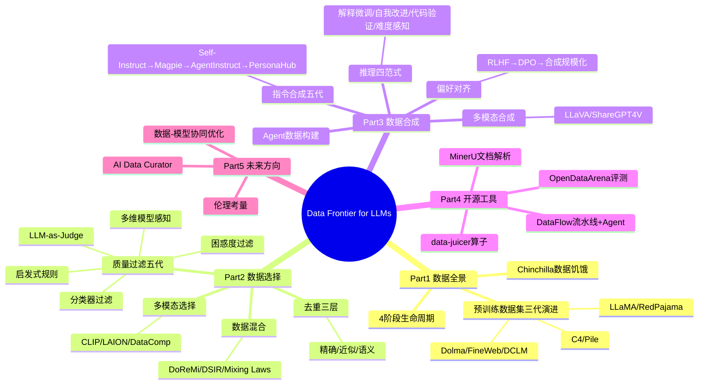
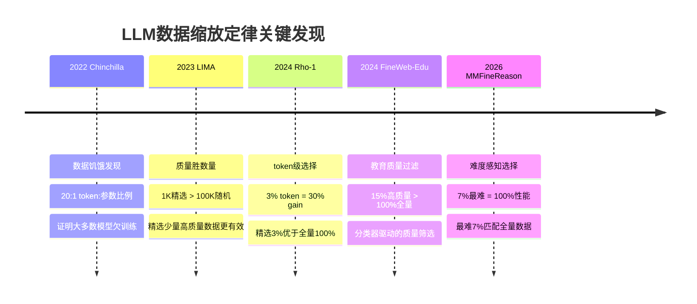
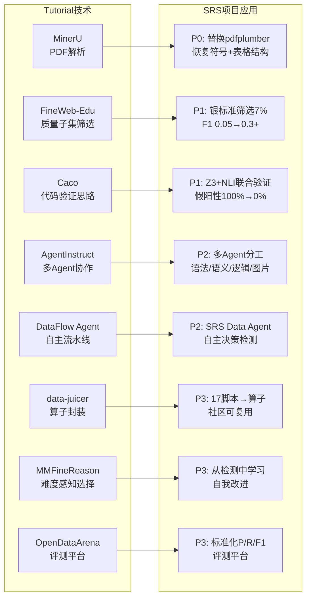
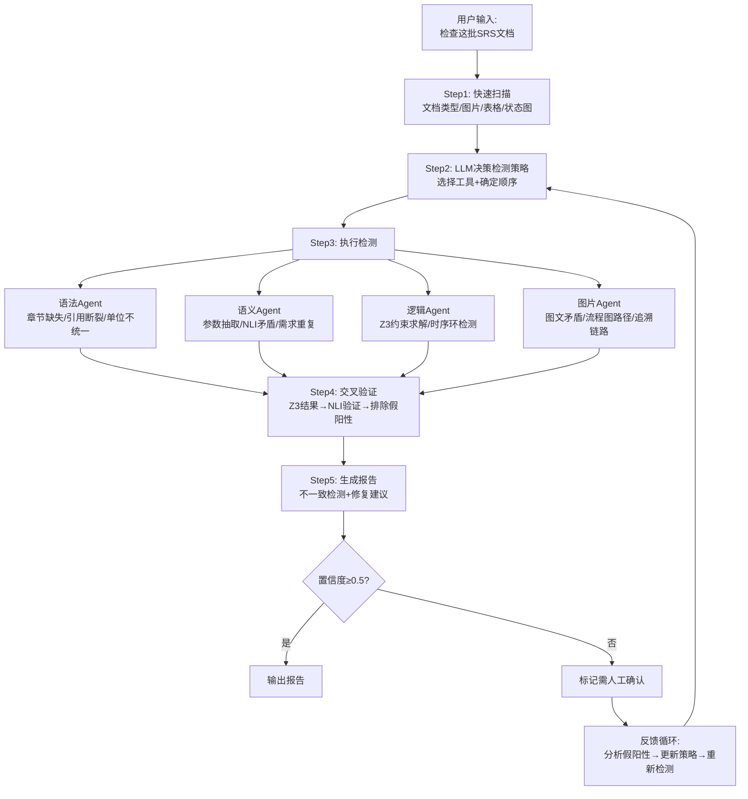

# ACL 2026 Tutorial深度解读：Data Frontier for LLMs — 教程内容与SRS项目应用

> **教程**: Data Frontier for Large Language Models: Selection, Synthesis, and Tools
> **作者**: Lijun Wu, Wentao Zhang, Conghui He (上海AI实验室/北京大学)
> **会议**: ACL 2026 | 122页 | 3小时
> **解读人**: 葛宣成 | 2026-07-22
> **本文档**: 三份报告段落级融合（Full Report + Reading Report + Data Agent Analysis）

---

## 目录

1. [教程全景与核心论点](#1-教程全景与核心论点)
2. [Part 1: 预训练数据集三代演进](#2-part-1-预训练数据集三代演进)
3. [Part 2: 数据选择与策展](#3-part-2-数据选择与策展)
4. [Part 3: 数据合成](#4-part-3-数据合成)
5. [Part 4: 开源工具与平台](#5-part-4-开源工具与平台)
6. [Part 5: 结论与未来方向](#6-part-5-结论与未来方向)
7. [★ SRS项目系统化关联](#7--srs项目系统化关联)
8. [★ SRS Data Agent设计](#8--srs-data-agent设计)
9. [论文索引](#9-论文索引)
10. [总结](#10-总结)

---

## 1. 教程全景与核心论点

本教程是OpenDataLab团队在ACL 2026上组织的3小时深度Tutorial，系统梳理了LLM数据工程从"手工收集"到"Agent自主管理"的完整演进路径。

### 1.1 从模型中心到数据中心

2018-2022年间，GPT-3（175B参数）、PaLM（540B）等大模型让"把模型做大+用更多算力"成为主导策略。2022年DeepMind的Chinchilla论文（5K+引用）成为转折点——它证明：在给定计算预算下，**最优策略是训练更小的模型在更多数据上**，具体比例约20个token per参数。GPT-3（175B参数）应该用3.5T token训练，但实际只用了300B，严重欠训练。

讲师在Slide 5点明了范式转变的核心：

> "The question shifted from 'how do we build better models?' to 'how do we build better data?'"

这一转变催生了后续一系列工作：LIMA（1K精选>100K随机）、Rho-1（3%token=30%提升）、FineWeb-Edu（15%高质量>100%全量）、MMFineReason（7%最难=100%性能）。这些工作反复证明同一结论：**数据质量、多样性、组合方式比原始规模更重要**。

### 1.2 LLM数据生命周期4阶段

教程（Slide 8）将LLM数据分为4个阶段，每个阶段有不同的数据需求：

| 阶段 | 数据量 | 质量要求 | 代表数据集 |
|---|---|---|---|
| 预训练 | 万亿token | 中（去重+基础过滤） | FineWeb(15T)/Dolma(3T) |
| SFT | 10万-100万条 | 高（指令遵循） | Alpaca(52K)/FLAN(1.8M) |
| 对齐 | 5万-50万对 | 极高（偏好准确） | UltraFeedback(64K) |
| RAG | 文档库 | 检索相关性 | 领域文档 |

4个贯穿所有阶段的挑战（Slide 10）：规模-质量权衡、数据污染、多语言差距、多模态扩展。

### 1.3 教程5-Part结构

| Part | 主题 | 时长 | 核心问题 |
|---|---|---|---|
| 1 | 数据全景与动机 | 25min | 为什么数据成为瓶颈？ |
| 2 | 数据选择与策展 | 60min | 如何从海量噪声数据中选出高质量的？ |
| 3 | 数据合成 | 70min | 如何创造我们想要但不存在的高质量数据？ |
| 4 | 开源工具与平台 | 20min | 有哪些工具能把这些方法变成可复现的流水线？ |
| 5 | 结论与未来方向 | 5min | 下一步走向哪里？ |

### 1.4 Tutorial知识图谱



---

## 2. Part 1: 预训练数据集三代演进

教程（Slide 12-30）详细梳理了预训练数据集的演进，核心趋势清晰可见：**数据集从"尽量大"（C4的750GB）到"尽量精"（FineWeb-Edu保留15%）**。

### 2.1 第一代（2020）：C4 + The Pile + CCNet

**C4**（Raffel et al., JMLR 2020, 20K+引用）：从Common Crawl清洗的750GB英文文本。清洗规则包括去HTML标签、去短行、去重复行、去乱码、去脏词、去JavaScript/CSS。讲师评价其根本局限——基于统计规则，不理解内容语义："A page can satisfy all the rules and still be useless, misleading, or low value."

**The Pile**（Gao et al., 2020）：825GB多源混合数据，22个子集（PubMed/ArXiv/GitHub/StackExchange/FreeLaw/USPTO等），强调领域多样性。

**CCNet**（Meta, 2019）：首次引入语言模型困惑度作为质量信号，低困惑度=可能高质量，但存在风格偏好偏差。

### 2.2 第二代（2023）：LLaMA + RedPajama

**LLaMA**（Touvron et al., 2023）：首次证明开源数据可以训练出强模型。数据配方为CommonCrawl(67%)+C4(15%)+GitHub(4.5%)+Wikipedia(4.5%)+Books(4.5%)+ArXiv(2.5%)+StackExchange(2%)。

**RedPajama**（2024）：复现LLaMA配方，开源1T+ token。关键创新是"信号优先"设计——为每条文档提供40+质量信号（困惑度、语言模型得分、重复率、字符分布等），让用户自己决定用哪些信号过滤，而非预设哪些数据是"好"的。

讲师强调（Slide 30）："The important point is not to memorize every number. The important point is the pattern: better data design changes the training outcome, often without changing the model architecture."

### 2.3 第三代（2024）：Dolma + FineWeb + DCLM

**Dolma**（AI2, ACL 2024）：3T token，1.6T来自Common Crawl，强调透明性——每条数据的来源、清洗步骤都可追溯。

**FineWeb**（HuggingFace, NeurIPS 2024）：15T token。核心创新是**FineWeb-Edu**——用教育内容分类器给每条文档打分，保留top 15%，得到1.3T token高质量子集。实验结果极为震撼：用15%数据训练的模型**优于**用100%全量数据训练的模型。

**DCLM**（NeurIPS 2024）：数据感知模型过滤。用小模型预测"这条数据对大模型训练有用吗？"——用模型反馈驱动数据选择，从1T候选中选出240B高质量token，在7个基准任务上优于FineWeb-Edu。

> 📌 **SRS项目启示**: 银标准质量>规模。我们的银标准（4070句，~70%精度）正面临"规模-质量权衡"——4070句看起来不少，但30%是噪声。按FineWeb-Edu的逻辑，如果只保留高质量子集（像FineWeb-Edu保留15%），效果可能更好。不是数据不够，而是数据不够精。

### 2.4 数据缩放定律时间线



---

## 3. Part 2: 数据选择与策展

这是教程中篇幅最大的部分（60分钟），系统梳理了数据质量过滤的五代演进、去重方法、数据混合策略和多模态数据选择。

### 3.1 质量过滤五代演进

#### 第1代：启发式规则（2020-2022）

C4规则（去短行/去重复/去乱码/去HTML）和Gopher规则（DeepMind, 2022，在C4基础上增加词数过滤、标点比例、重复n-gram检测）。优点是便宜，可在网页规模运行；缺点是不理解语义。讲师指出前两代仍然重要，因为"they are cheap enough to run at web scale"。

#### 第2代：困惑度过滤（2022-2023）

用语言模型计算每条数据的困惑度，低困惑度=模型"熟悉"=可能高质量。**AlpaGasus**（Chen et al., 2023）是这一代的标志性实验：52K Alpaca指令→ChatGPT给每条打分(1-5)→保留top 9K（丢弃83%）→用9K训练。结果：9K模型更好+训练快5.7倍。83%的数据不仅无用，反而有害——这是"质量>数量"最直接的证据。

#### 第3代：分类器过滤（2023-2024）

用高质量数据源（如维基百科）训练二分类器，对每条数据打分"像不像维基百科"。**DEITA**（Liu et al., 2023）进一步引入三维评分：复杂度（指令有多复杂）、质量（回答有多好）、多样性（与已有数据的差异度），在多个基准上超越单维方法。

#### 第4代：LLM-as-Judge（2024-2025）

用GPT-4等强模型直接评分数据质量。**LLM-as-Judge**（Zheng et al., NeurIPS 2023, 5K+引用）证明了LLM可以替代人工做质量评判。**UltraFeedback**（Cui et al., ICML 2024, 500+引用）：64K提示×4个LLM回答×GPT-4四维评分（指令遵循/真实性/诚实性/有用性），成为2024年开源对齐的标准数据。**Meta-rater**（ACL 2025 Best Theme Paper）引入多维评分+模型反馈联合。

#### 第5代：多维模型感知评分（2025-2026）

**Multi-Actor**（ACL 2025）：每个数据选择方法作为独立的"演员"，从自己的视角评分数据，然后动态协作优先排序，平均提升10.5%。讲师总结："The key trend: static curation is giving way to dynamic, model-informed selection."

#### SRS项目质量过滤映射表

| Tutorial的第N代 | SRS项目中的对应 | 差距 |
|---|---|---|
| 第1代（启发式规则） | 正则模式匹配（12组） | ✅ 已实现 |
| 第2代（困惑度过滤） | — | ❌ 未实现 |
| 第3代（分类器过滤） | Span分类器（embedding+LR） | ✅ 已实现 |
| 第4代（LLM-as-Judge） | NLI矛盾检测（GLM-5） | ✅ 已实现 |
| 第5代（多维+模型感知） | — | ❌ 未实现（最大差距） |

### 3.2 去重：从精确到语义

教程（Slide 26-28）介绍了三层去重：

- **精确去重**：MD5/SHA哈希，完全相同的文本。速度快O(n)但只去完全重复。
- **近似去重**：MinHash + LSH。FineWeb去重删除了约50%的数据。代表工具：text-dedup。
- **语义去重**：embedding相似度。语义相同但表述不同。最强但计算成本高O(n²)。

讲师指出：去重不仅仅节省计算，更直接提升模型质量——FineWeb实验显示去重后验证集loss显著降低。

### 3.3 数据混合：从手动到自动

教程（Slide 35-38）介绍了4种领域比例控制方法：

| 方法 | 核心思路 | 效果 |
|---|---|---|
| **DoReMi**（2023） | RL自动调整领域权重，参考模型loss作为奖励 | 提升2-6% |
| **DSIR**（2023） | KL散度匹配目标分布 | 理论保证 |
| **Data Mixing Laws**（2024） | 数学模型预测混合效果，不需训练 | 预测误差<2% |
| **IDEAL**（2025, 他们的工作） | 动态权重调整+在线学习 | 训练中根据反馈调整 |

### 3.4 多模态数据选择

**CLIP**（Radford et al., ICML 2021, 20K+引用）：4亿图文对对比学习，cosine相似度=图文对齐度，成为多模态数据的通用质量过滤器。**LAION-5B**（NeurIPS 2022, 3.8K+引用）：58.5亿CLIP过滤的图文对，阈值cosine > 0.28。**DataComp**（NeurIPS 2023 Oral, 800+引用）：开创"固定模型变数据"实验范式，DataComp-1B达79.2% ImageNet零样本。**OmniCorpus**（ICLR 2025 Spotlight, 他们的工作）：86亿图片交错1696B token。**ShareGPT4V**（ECCV 2024, 他们的工作）：100K GPT-4V种子→Share-Captioner→1.2M，核心发现是**描述质量是主要瓶颈**（不是数量）。

> 📌 **SRS项目启示**: 多方法信号融合。我们的参数抽取有多种方法（正则/Span/BERT-CRF/LLM），每种方法的输出应该作为一个"信号"，让下游（冲突检测）决定用哪些，而不是像现在这样只用一种方法的结果。RedPajama-v2的"信号优先"设计哲学直接适用。此外，我们用Kimi-K2.6做图文一致性检测，本质是CLIP评分的变体——CLIP判断"图文是否对齐"，我们判断"图文是否矛盾"。

---

## 4. Part 3: 数据合成

这是教程中最前沿的部分（70分钟），也是最具创新性的内容。教程给出了三个动机（Slide 50）：数据稀缺（高质量人工数据昂贵）、知识蒸馏（从强模型转移到弱模型）、精确控制（生成恰好需要的难度和主题）。

### 4.1 指令合成五代演进

#### 第1代：Self-Instruct（ACL 2023, 3K+引用）

175个人工种子指令→LLM生成52K指令→迭代扩展。流水线：生成新指令→分类类型→生成输入输出→过滤低质量（ROUGE>0.7去重）。历史意义：证明了LLM可以自己生成训练数据。**Alpaca**（Stanford, 2023, 5K+引用）以<$600成本从text-davinci-003生成52K指令微调LLaMA-7B。**FLAN Collection**（ICML 2023, 830+引用）系统消融指令调优数据设计。**Cosmopedia**（HuggingFace, 2024）用Mixtral-8x7B生成30M+合成教科书（25B+ token）。

#### 第2代：Evol-Instruct / WizardLM（ICLR 2024, 1.1K+引用）

在Self-Instruct基础上迭代增加复杂度。深度演化（加约束、加深推理）和广度演化（多样化主题），从52K Alpaca种子演化出520K指令。

#### 第3代：Magpie（ICLR 2025, 300+引用）

**零种子！** 给对齐LLM只发预查询模板（如`<|im_start|>user\n`），不发任何用户提示，LLM从自回归先验分布自动生成多样化用户指令。匹配官方Llama-3-8B-Instruct。

#### 第4代：AgentInstruct（Microsoft, 2024, 200+引用）

多Agent流水线：内容转换→种子指令生成→指令精炼。建议者-编辑者Agent对通过反思循环迭代改进，从原始文档生成25M高质量指令对。关键洞察：**多Agent协作+反思循环比单次生成质量更高**。

#### 第5代：PersonaHub（Tencent, 2024, 300+引用）

10亿个人格作为LLM生成条件，每个人格从一个独特视角生成数据。

五代演进趋势：**需要种子→零种子→多Agent协作→十亿级条件化**。

### 4.2 推理数据合成四范式

讲师指出（Slide 61）："Reasoning data is the hardest to synthesize because correctness verification is critical."

#### 范式1：解释微调

**Chain-of-Thought**（Wei et al., NeurIPS 2022, 10K+引用）：在prompt中加入逐步推理示例，推理是大模型的涌现能力。**Orca**（Microsoft, 2023, 800+引用）：在GPT-4解释轨迹上训练13B模型，不只蒸馏答案，蒸馏**推理过程**。Orca 2进一步引入定制课程——模型学习**何时**使用不同推理策略。

#### 范式2：自我改进

**STaR/ReST**：模型自己生成推理链→验证→保留正确的→迭代训练，形成"生成-验证-选择-训练-重复"闭环。

#### 范式3：代码验证

**Phi系列**（Microsoft, 2023-2024, 1.2K+引用）：教科书质量合成数据。Phi-1（1.3B）50.6% HumanEval，Phi-3（3.8B）匹敌Mixtral 8x7B和GPT-3.5。讲师称其为"data-centric thesis的最强证据"。

**MetaMath**（ICLR 2024, 600+引用）：四种增强策略，关键发现是**问题多样性**（r=0.972）是主导缩放因素。**MathFusion**（ACL 2025, 他们的工作）：融合成对数学问题为更丰富变体，18分准确率提升。

**Caco**（NeurIPS 2025, 他们的工作）：代码辅助CoT合成。三阶段——统一代码CoT→代码CoT过滤（可执行性+逻辑一致性+输出正确性）→规模化。92.6% GSM8K，82.4% MATH。关键洞察：代码执行提供**自动验证**机制——不需要人工标注就能判断推理链是否正确。

#### 范式4：难度感知选择

**MMFineReason**（2026, 他们的工作）：1.8M多模态推理样本，三阶段——数据收集+CoT蒸馏（从Qwen3-VL-235B）+难度感知选择。**最难7%（123K样本）匹配全量数据性能**。MMFineReason-4B击败Qwen3-VL-8B-Thinking，MMFineReason-8B击败30B版本。这与Rho-1和LIMA一致——精选少量高难度数据比海量简单数据更有效。

讲师总结（Slide 74）："The overarching trend is a self-improvement loop. Generate, verify through code execution or other signals, select based on difficulty and diversity, train, and repeat."

### 4.3 偏好与对齐数据

演进路线（Slide 76）：Human RLHF(2022) → RLAIF/Constitutional AI(2022) → DPO(2023) → 合成规模化(2024)。

**DPO**（NeurIPS 2023, 4K+引用）：去掉奖励模型，直接用偏好对训练，把RL问题变成简单二分类。**UltraFeedback**（ICML 2024, 500+引用）成为2024年开源对齐的标准数据。**Zephyr**（HuggingFace, 2023, 1.2K+引用）：在UltraFeedback上做蒸馏DPO，Mistral-7B击败Llama2-Chat-70B。**Tulu 3**（AI2, ICLR 2025）：完整开源配方（SFT+DPO+RLVR），超越Llama 3.1-Instruct。**Nemotron-4**（NVIDIA, 2024）：**98%对齐数据是合成生成的**，仍达到顶级RewardBench分数——"最强的工业证据证明合成对齐可行"。**PRISM**（NeurIPS 2024 Best Paper）：揭示标准对齐数据集系统性忽略多元文化视角。

### 4.4 多模态数据合成

**LLaVA**（NeurIPS 2023 Oral, 5K+引用）：首次用纯文本GPT-4生成多模态指令，生成150K视觉指令。**ShareGPT4V**（ECCV 2024, 他们的工作）：100K GPT-4V种子→Share-Captioner→1.2M，证明描述质量是瓶颈。**Cambrian-1**（NeurIPS 2024 Oral, 300+引用）：系统评测20+视觉编码器，发现视觉编码器选择和数据平衡同样重要。**InternVL3**（2025, 他们的工作）：原生多模态预训练+RL对齐，数据质量是关键差异化因素。

### 4.5 合成数据质量挑战

| 挑战 | 表现 | 解法 | 对应论文 |
|---|---|---|---|
| 模式坍缩 | LLM生成重复低多样性数据 | 人格条件化 | PersonaHub |
| 幻觉 | 生成错误事实 | 代码验证 | Caco |
| 难度不平衡 | 大部分太简单 | 难度感知选择 | MMFineReason |
| 分布偏移 | 合成≠真实分布 | 域适应+混合 | — |
| 污染 | 含测试集 | 污染检测+去重 | text-dedup |

### 4.6 Agent数据构建

教程（Slide 72-74）介绍了Agent化数据构建——新兴前沿：**AgentInstruct**的建议者-编辑者Agent对+反思循环，**DataFlow Agent**自动设计+执行数据处理流水线。多Agent实践的核心优势是角色专业化（生成器/批评者/编辑器/验证器），通过反馈循环提升质量、多视角提升多样性、并行提升可扩展性。

讲师指出（Slide 72）："The emerging paradigm is an AI Data Curator that autonomously assesses data gaps, designs generation strategies, executes, verifies, and iterates."

> 📌 **SRS项目启示**: Caco验证→Z3+NLI联合验证。Caco的"代码验证"思路直接对应我们的"Z3+NLI联合验证"——Z3做形式化验证（像代码执行），NLI做语义验证（像人工确认）。Caco证明了"验证"是合成数据质量的关键，我们的项目也证明了"验证"是冲突检测的关键（NLI精度90% vs Z3精度0%）。此外，MMFineReason的7%发现提示我们：银标准4070句中可能只有~280句（7%）是高质量的，如果用金标准训练质量分类器筛选这7%，训练效果可能远超用全量4070句（F1可能从0.05提升到0.3+）。AgentInstruct的多Agent协作思路直接启发了我们的Data Agent设计——不同Agent负责不同检测层（语法/语义/逻辑/图片），通过反思循环改进。

---

## 5. Part 4: 开源工具与平台

### 5.1 工具生态5层

教程（Slide 100）将工具生态分为5层：

1. **文档解析**：MinerU(64K stars)、PDF-Extract-Kit、Marker
2. **数据流水线**：DataFlow、data-juicer(Alibaba)、datatrove(HF)、Dolma Toolkit
3. **数据集管理**：HuggingFace datasets(20K stars)、OpenDataLab
4. **数据选择**：text-dedup、cleanlab(10K stars)、DCLM tools
5. **评测**：DataComp、DCLM、OpenDataArena

### 5.2 MinerU（64K stars）

世界领先的文档解析工具，支持PDF/DOCX/PPTX/XLSX/图片→Markdown/JSON。技术架构：

```
输入 → 预处理(文档分类+元数据提取) → 模型层(DocLayout-YOLO版面+UniMERNet公式+PP-OCR文字+StructTable表格)
  → 流水线(阅读序排序+后处理) → 输出(Markdown/JSON) → 验证(质量检查)
```

MinerU 2.5：解耦VLM架构（1.2B参数），在OmniDocBench上SOTA，支持109种语言，10亿+ API调用，100+企业采用。**PDF-Extract-Kit**是其模型后端。

### 5.3 DataFlow

统一数据准备框架：PyTorch风格API、50+配置方案、**DataFlow Agent**（LLM驱动，从自然语言描述自动组装流水线）、DataFlow-WebUI（可视化拖拽）、DataFlow-MM（多模态扩展）、DataFlex（2026，统一样本选择+领域混合+样本重加权）。

讲师强调（Slide 104）："For practitioners, the key takeaway is that this is not just a research idea. It is part of the infrastructure needed to make data-centric development repeatable."

### 5.4 data-juicer（NeurIPS 2025 Spotlight）

100+算子，云规模。算子类型：过滤器（语言/长度/困惑度/重复/NSFW）、去重器（精确/MinHash/SimHash）、映射器（清洗/格式化/增强）、选择器（频率/范围/标签/TopK）、格式化器（JSON/CSV/TSV/Parquet）。

### 5.5 OpenDataArena

首个系统评测后训练数据集价值的平台。统一训练-评估流水线、多维评分（指令复杂度/回答质量/多样性/污染检测）、数据血缘可视化、10M+样本已评分。**Closing the Data Loop**（Slide 85）：用ODA排名作为反馈指导数据构建。ODA-Math-460k聚合20个顶级数学数据源，在AIME和HMMT上SOTA。

讲师总结："Evaluate your datasets, identify gaps, construct better data, re-evaluate. This closed loop transforms data engineering from trial-and-error to principled science."

### 5.6 OpenDataLab

中国最大的开放AI数据平台。7,700+数据集，300K+开发者，6B+图片、800M+视频片段、1T+文本token。集成MinerU(解析)+LabelU/LabelLLM(标注)+OmniDocBench(评测)。

### 5.7 端到端流水线

```
原始数据(PDF/Web/Code) → MinerU(解析) → DataFlow(流水线) → text-dedup/data-juicer(去重+过滤)
  → DoReMi/Data Mixing Laws(领域混合) → OpenDataArena(评测) → 训练就绪语料

合成: 种子数据 → Evol-Instruct/Magpie(扩展) → DEITA/Meta-rater(评分)
  → Caco/代码验证(验证) → 基准评测
```

---

## 6. Part 5: 结论与未来方向

### 6.1 六个核心结论（Slide 112）

1. **数据是瓶颈**：质量、多样性、组合>原始规模
2. **选择已五代演进**：启发式→多维评分，静态→动态
3. **合成是主要策略**：多Agent、自改进、代码验证
4. **多模态需专门方法**：CLIP评分→美学→DataComp
5. **开源工具民主化**：MinerU/DataFlow/data-juicer
6. **未来是数据-模型协同**：动态选择在训练中适应

### 6.2 六个未来方向（Slide 113）

1. **AI Data Curator**：自主Agent评估数据缺口→设计生成策略→执行→验证→迭代
2. **自我改进系统**：模型评估→筛选→训练→重复闭环
3. **大规模多Agent合成**：专业化生成Agent团队
4. **多模态前沿**：视频/音频/3D/交错模态
5. **数据归因**：追踪每条数据对模型性能的贡献
6. **伦理考量**：偏见/隐私/版权/透明性

### 6.3 数据-模型协同优化

教程提出下一个范式：**数据-模型协同优化（Data-Model Co-optimization）**——数据选择在训练过程中动态适应，而非训练前静态决定。开放问题包括：最优质量-数量比？能否从数据属性预测性能？合成数据的极限？能否构建完全自主的数据引擎？

### 6.4 开放vs封闭生态与伦理

**开放生态**（FineWeb/Dolma/RedPajama/UltraFeedback/Cosmopedia + MinerU/DataFlow/data-juicer）正快速缩小差距，Tulu 3(开源)已与GPT-4o-mini(封闭)竞争。伦理层面需关注偏见与公平（网络数据放大社会偏见）、隐私与版权（Common Corpus——2T合法授权token）、透明性（数据决策文档化）。

---

## 7. ★ SRS项目系统化关联

> 本节整合Reading Report的独特内容：项目定位、可借鉴技术、差距分析、行动建议。

### 7.1 项目定位图

```
Tutorial数据工程全景:
  预训练数据 ─→ 质量过滤 ─→ 数据合成 ─→ 评测 ─→ Agent
     │            │            │          │        │
     ▼            ▼            ▼          ▼        ▼
  FineWeb     Meta-rater   AgentInstruct  ODA   DataFlow Agent
  Dolma       data-juicer  Magpie       CleanLab AI Data Curator

SRS项目:
  [PDF解析] ─→ [参数抽取] ─→ [矛盾检测] ─→ [评测] ─→ [Agent]
     │            │            │            │        │
     ▼            ▼            ▼            ▼        ▼
  pdfplumber  Span分类器     NLI+Z3      金标准    未来工作
  (待升级     (F1=0.54)    (1真矛盾)   (100句)   (Data Agent)
   MinerU)
```

### 7.2 SRS技术借鉴路线图



### 7.3 可借鉴技术表（8项）

| Tutorial技术 | SRS项目怎么用 | 优先级 | 预期效果 |
|---|---|:---:|---|
| MinerU（PDF解析） | 替换pdfplumber | P0 | 恢复≤≥符号+表格结构化 |
| FineWeb-Edu思路 | 从银标准筛选高质量7% | P1 | F1可能从0.05→0.3+ |
| Caco验证思路 | Z3+NLI联合验证 | P1 | Z3假阳性从100%→0% |
| LLM-as-Judge | NLI矛盾检测（已实现） | ✅ | 精度~90% |
| AgentInstruct多Agent | 多Agent协作检测 | P2 | 语法/语义/逻辑/图片分工 |
| DataFlow Agent | SRS Data Agent | P2 | 自主决策检测策略 |
| data-juicer算子 | 17脚本封装为算子 | P3 | 社区可复用 |
| OpenDataArena | SRS检测评测平台 | P3 | 标准化P/R/F1评估 |

### 7.4 关键差距分析（7维度）

| 维度 | Tutorial水平 | SRS项目水平 | 差距分析 |
|---|---|---|---|
| 数据规模 | 10B+样本 | 62文档 | 5个数量级（但SRS是领域数据，不需要那么大） |
| 质量过滤 | 第5代（多维+模型感知） | 第1-4代混合 | 缺第5代：多工具置信度融合 |
| 数据合成 | 多Agent+自生成 | 无（银标准是规则合成） | 银标准质量差(70%)，需LLM重新合成 |
| 评测 | 统一平台(ODA) | 100句金标准 | 评测不充分，无标准化平台 |
| 工具化 | 64K stars开源 | 17脚本未封装 | 缺工程化 |
| Agent | DataFlow Agent | 无 | 完全缺失，是未来方向 |
| 知识库 | 数据驱动+自动更新 | 手工23参数 | 无自动化构建流水线 |

### 7.5 行动建议（P0-P3）

#### P0（立即）：MinerU升级

- **做什么**：用MinerU替换pdfplumber重新解析62个PDF
- **为什么**：pdfplumber丢失≤≥符号（导致参数提取率低）、表格None率38%、无版面理解
- **预期效果**：参数提取率3-5倍提升，表格结构化质量大幅提升

#### P1（近期）：高质量子集筛选 + 置信度传播

- **做什么**：用金标准（100句）训练质量分类器，从银标准（4070句）中筛选高质量7%（~280句）；每个工具输出带置信度，多工具结果通过置信度传播做决策
- **为什么**：FineWeb-Edu证明15%高质量>100%全量；MMFineReason证明7%最难=100%性能；Caco证明"验证"是质量关键，Z3的8个UNSAT全假阳性因为没验证
- **预期效果**：BERT-CRF F1可能从0.05提升到0.3+；Z3假阳性从100%→0%（NLI验证后）

#### P2（中期）：构建SRS Data Agent

- **做什么**：LLM驱动的Agent，自主决定检测策略+多工具协作+自我改进
- **为什么**：DataFlow Agent是Tutorial描述的未来方向
- **预期效果**：自动化检测流程，减少人工干预

#### P3（长期）：data-juicer集成 + 评测平台

- **做什么**：17个脚本封装为data-juicer算子；构建SRS不一致检测评测平台
- **为什么**：data-juicer是NeurIPS 2025 Spotlight，社区广泛使用
- **预期效果**：工具被社区复用；标准化P/R/F1评估

---

## 8. ★ SRS Data Agent设计

> 本节整合DATA_AGENT_ANALYSIS的独特内容：Data Agent定义、已有工具与缺失组件、五大难点、五阶段路线、三个最难开发点。

### 8.1 Data Agent定义与定位

PPT中提到的Data Agent有两层含义：

**DataFlow Agent**（Slide 104）：LLM-powered assistant that auto-assembles data pipelines from descriptions——用户用自然语言描述需求，Agent自动组装数据处理流水线。

**AI Data Curator**（Slide 113）：Autonomous agents for data pipeline management——Agent自主管理数据质量：检测问题→诊断原因→修复数据→验证修复。

基于SRS项目，我们构建一个**SRS文档质量Data Agent**：

```
用户: "检查这批SRS文档有没有不一致"
  ↓
Agent自主决策:
  1. 用MinerU解析PDF → 结构化文本
  2. 检测语法不一致(章节缺失/引用断裂)
  3. 提取参数约束(正则+Span+LLM)
  4. 检测语义矛盾(NLI)
  5. 检测图文不一致(VLM)
  6. 生成报告
  ↓
输出: 不一致检测报告 + 修复建议
```

### 8.2 Data Agent架构



### 8.3 已有工具与缺失组件

#### 已有的工具（Agent可调用的）

| 工具 | 功能 | 代码 | 对标PPT中的 |
|---|---|---|---|
| PDF解析 | PDF→文本+表格 | pdfplumber | MinerU(Slide 102) |
| 章节抽取 | 文档→结构化章节 | srs_rexcl.py | DataFlow算子 |
| 参数抽取 | 句子→{参数,运算符,数值,单位} | srs_keie_pipeline.py | 质量过滤(Slide 48) |
| NLI矛盾检测 | 句子对→矛盾/中立 | 内嵌 | LLM-as-Judge(Slide 48) |
| Z3约束求解 | 约束集→SAT/UNSAT | 内嵌 | — |
| 图文检测 | 页面截图→图文一致性 | srs_image_text_check.py | 多模态(Slide 40-47) |
| 知识库 | 23参数/374实体 | srs_kb.json | — |
| 知识图谱 | 1580节点/4800边 | knowledge_graph.json | — |

#### 缺失的组件

| 缺失 | 说明 | PPT中的参考 |
|---|---|---|
| **Agent决策层** | LLM决定调用哪些工具、按什么顺序 | DataFlow Agent(Slide 104) |
| **工具注册机制** | 把现有工具注册为Agent可调用的函数 | data-juicer算子框架 |
| **反馈循环** | Agent从检测结果中学习，改进后续检测 | Self-improving(Slide 74) |
| **多Agent协作** | 不同Agent负责不同检测层 | AgentInstruct(Slide 58) |
| **报告生成** | Agent自动生成人类可读的检测报告 | — |
| **主动学习** | Agent标注不确定的检测结果，请求人工确认 | cleanlab(Slide 106) |

### 8.4 五大难点与解法

#### 难点1：工具选择与编排（核心难点）

62个文档，每个可能需要不同的检测策略。Agent需要决定：文档有图片吗？有表格吗？有状态图吗？参数抽取结果可信吗？

**为什么难**：工具间有依赖关系（参数抽取→NLI→Z3），输出质量不确定（Span分类器F1=0.54），不同文档特征不同不能用固定流程。

**解法**：快速扫描文档特征→LLM决策策略→执行检测→评估可信度（置信度<0.5标记"需人工确认"）→动态调整。

#### 难点2：不确定性管理

检测结果有大量假阳性（Z3的8个UNSAT全是假的）。Agent需要知道每个工具的精度和局限，在多个工具结果矛盾时做决策。

**解法——多工具交叉验证**：
```
Z3说UNSAT → 不直接报告，先让NLI验证
NLI说contradiction → 高置信度报告
NLI说neutral → 标记为"Z3假阳性，已排除"
NLI说不确定 → 标记为"需人工确认"
```

#### 难点3：多模态推理

SRS文档同时包含文本、表格、图片。需要理解表格结构与正文的关系、图片内容与文字描述的关系、三种模态间的一致性。

**为什么难**：图文检测完全依赖VLM API成本高，表格结构化质量差（pdfplumber的None率38%），没有跨模态关联图谱。

**解法**：构建多模态知识图谱——节点为正文段落+表格行+图片区域，边为引用关系+参数关联+位置邻近，Agent在图谱上做多跳推理发现跨模态矛盾。

#### 难点4：知识库自动化

当前知识库是手工构建的23个参数。Agent需要自动发现新参数类型、挖掘同义词、估计值范围、持续更新。

**解法**：Agent遇到未识别参数→用embedding聚类找相似参数→用LLM判断是否新参数→自动生成同义词+值范围→标记"待人工确认"加入知识库。

#### 难点5：与data-juicer集成

data-juicer有100+算子和成熟的流水线框架。需要封装为Operator、支持配置驱动模式、与现有算子协同。

### 8.5 五阶段开发路线

#### Phase 1：工具封装（2周）

把现有17个脚本封装为统一工具接口：

```python
class SRSToolRegistry:
    """注册所有SRS检测工具"""
    tools = {
        "parse_pdf": pdfplumber_parse,
        "extract_sections": rexcl_extract,
        "extract_params": keie_extract,
        "check_syntax": syntax_check,
        "check_nli": nli_check,
        "check_z3": z3_check,
        "check_image_text": vlm_check,
        "check_duplicate": duplicate_check,
        "build_graph": build_knowledge_graph,
    }
    def call(self, tool_name, **kwargs):
        return self.tools[tool_name](**kwargs)
```

#### Phase 2：Agent决策层（3周）

用LLM实现决策逻辑：快速扫描→LLM决策策略→执行检测→交叉验证→生成报告。

```python
class SRSDataAgent:
    def run(self, document):
        doc_features = self._scan_document(document)
        strategy = self.llm.decide_strategy(doc_features)
        results = {t: self.tools.call(t, document) for t in strategy}
        validated = self._cross_validate(results)
        report = self.llm.generate_report(validated)
        return report
```

#### Phase 3：多Agent协作（4周）

```
Orchestrator Agent (协调)
  ├── Syntax Agent (语法: 章节缺失/引用断裂/单位不统一)
  ├── Semantic Agent (语义: 参数抽取/NLI矛盾/需求重复)
  ├── Logic Agent (逻辑: Z3约束求解/时序环检测)
  └── Visual Agent (图片: 图文矛盾/流程图路径/追溯链路)
```

#### Phase 4：反馈循环（3周）

检测→发现假阳性→分析原因→更新策略→重新检测。

例：Z3报告"response_time=238矛盾"→NLI验证"238是文档编号"→Agent学习"response_time>200时可能是文档编号"→下次自动过滤。

#### Phase 5：data-juicer集成（2周）

```yaml
- name: srs_syntax_check
  type: mapper
  parameters:
    check_items: [chapter_missing, broken_reference, unit_inconsistency]

- name: srs_semantic_check
  type: mapper
  parameters:
    extraction_method: keie
    nli_verification: true
    z3_verification: true
    cross_validate: true

- name: srs_image_text_check
  type: mapper
  parameters:
    vlm_model: kimi-k2.6
    detectors: [floca, ve, chartve, tracellm]
```

### 8.6 三个最难开发点

#### 1. 工具编排的可靠性（最难）

Agent决定调用哪些工具，但工具输出可能不可靠。核心挑战是**不确定性传播**：

```
参数抽取(F1=0.54) → 52%的约束是错的
  → Z3基于错误约束求解 → 100%假阳性
    → Agent需要知道"Z3的UNSAT不可信，因为输入不可信"

解法: 置信度传播
  参数抽取置信度=0.54 → Z3结果置信度=0.54×0.5=0.27
  → 低于阈值0.5 → 标记"低置信度，需NLI验证"
  → NLI验证通过 → 置信度提升到0.9 → 报告
```

#### 2. 跨模态关联推理

```
正文: "response time ≤ 50ms" (第3.2节)
表格: "response time ≤ 100ms" (表格4)
图片: 折线图显示响应时间在80ms左右

→ Agent需要推理: 三者不一致 → 但是否是同一参数？同一工况？
→ 需要知识图谱关联 + 多模态推理
```

#### 3. 主动学习与知识库更新

```
Agent遇到"jitter budget = 5ms"
  → 知识库中没有"jitter budget"
  → 用embedding聚类: "jitter budget" ≈ "jitter"(0.82) → 可能是同义词
  → 自动添加到知识库，标记"待确认"
  → 下次遇到时自动识别
```

### 8.7 与PPT的对应关系

| PPT中的概念 | SRS项目中的对应 | 开发阶段 |
|---|---|---|
| DataFlow Agent(Slide 104) | SRS Data Agent决策层 | Phase 2 |
| 多Agent合成(Slide 58/72) | 多Agent协作检测 | Phase 3 |
| Self-improving(Slide 74) | 反馈循环 | Phase 4 |
| data-juicer算子(Slide 106) | 工具封装为算子 | Phase 5 |
| Meta-rater多维评分(Slide 48) | 多工具置信度融合 | 难点1 |
| LLM-as-Judge(Slide 48) | NLI矛盾检测 | ✅ 已实现 |
| 多模态数据(Slide 40-47) | 图文不一致检测 | ✅ 已实现 |
| MinerU(Slide 102) | PDF解析 | ✅ 已实现(pdfplumber) |
| OpenDataArena(Slide 84) | 评测结果 | ✅ 已实现 |

---

## 9. 论文索引

### 9.1 必读论文（10篇）

| # | 论文 | 会议 | 引用 | 为什么必读 |
|:---:|---|---|:---:|---|
| 1 | Chinchilla | 2022 | 5K+ | 数据饥饿的发现，一切数据工程的起点 |
| 2 | LIMA | 2023 | 1K+ | 1K精选>100K随机，质量胜数量的证据 |
| 3 | FineWeb-Edu | NeurIPS 2024 | — | 15%高质量>100%全量的实践证据 |
| 4 | UltraFeedback | ICML 2024 | 500+ | LLM-as-Judge的标准范式 |
| 5 | Caco | NeurIPS 2025 | — | 代码验证思路，对应我们的Z3+NLI验证 |
| 6 | MMFineReason | 2026 | — | 7%最难=100%性能，难度感知选择 |
| 7 | AgentInstruct | 2024 | 200+ | 多Agent协作的范式 |
| 8 | DPO | NeurIPS 2023 | 4K+ | 偏好数据的里程碑 |
| 9 | Rho-1 | 2024 | — | 3%token=30%gain，token级选择 |
| 10 | Meta-rater | ACL 2025 | — | 多维评分（最佳论文） |

### 9.2 推荐阅读（10篇）

| # | 论文 | 会议 | 引用 | 为什么推荐 |
|:---:|---|---|:---:|---|
| 11 | Self-Instruct | ACL 2023 | 3K+ | 指令合成的起点 |
| 12 | WizardLM/Evol-Instruct | ICLR 2024 | 1.1K+ | 复杂度演化 |
| 13 | Magpie | ICLR 2025 | 300+ | 零种子自生成 |
| 14 | PersonaHub | 2024 | 300+ | 十亿级人格条件化 |
| 15 | Phi系列 | 2023-2024 | 1.2K+ | 教科书质量合成数据 |
| 16 | LLaVA | NeurIPS 2023 | 5K+ | 多模态指令调优 |
| 17 | ShareGPT4V | ECCV 2024 | 400+ | 描述质量是瓶颈 |
| 18 | Nemotron-4 | 2024 | 200+ | 98%合成对齐数据 |
| 19 | Orca | 2023 | 800+ | 解释微调，蒸馏推理过程 |
| 20 | OpenDataArena | 2025 | — | 数据集评测平台 |

### 9.3 完整论文索引

#### Part 1-2 论文（预训练+数据选择）

| 论文 | 会议 | 引用 | 核心贡献 |
|---|---|:---:|---|
| C4/T5 | JMLR 2020 | 20K+ | 首个大规模清洗的网页文本 |
| The Pile | 2020 | — | 多源混合825GB |
| CCNet | 2019 | — | 引入困惑度过滤 |
| LLaMA | 2023 | — | 开源数据训练强模型 |
| RedPajama | 2024 | — | 1T+token, 40+质量信号 |
| Dolma | ACL 2024 | — | 3T token, 透明可追溯 |
| FineWeb | NeurIPS 2024 | — | 15T token; FineWeb-Edu 15%>100% |
| DCLM | NeurIPS 2024 | — | 数据感知模型过滤 |
| Chinchilla | 2022 | 5K+ | 数据饥饿发现 |
| LIMA | 2023 | 1K+ | 1K精选>100K随机 |
| Rho-1 | 2024 | — | 3%token=30%gain |
| AlpaGasus | 2023 | — | 丢弃83%数据更好 |
| DEITA | 2023 | — | 三维评分(复杂度/质量/多样性) |
| LLM-as-Judge | NeurIPS 2023 | 5K+ | LLM作为裁判 |
| UltraFeedback | ICML 2024 | 500+ | 64K×4×GPT-4多维评分 |
| Meta-rater | ACL 2025 | — | 多维+模型反馈(最佳论文) |
| Multi-Actor | ACL 2025 | — | 多演员协作选择+10.5% |
| DoReMi | 2023 | — | RL自动调整领域权重 |
| DSIR | 2023 | — | KL散度匹配目标分布 |
| Data Mixing Laws | 2024 | — | 数学预测混合效果 |
| CLIP | ICML 2021 | 20K+ | 图文对齐评分基础 |
| LAION-5B | NeurIPS 2022 | 3.8K+ | 5.85B CLIP过滤图文对 |
| DataComp | NeurIPS 2023 Oral | 800+ | 固定模型变数据范式 |
| OmniCorpus | ICLR 2025 Spotlight | — | 8.6B图文交错(他们) |
| ShareGPT4V | ECCV 2024 | 400+ | 描述质量是瓶颈(他们) |
| MMBench | ECCV 2024 | 1K+ | 多模态评测框架(他们) |

#### Part 3-4 论文（数据合成+工具）

| 论文 | 会议 | 引用 | 核心贡献 |
|---|---|:---:|---|
| Self-Instruct | ACL 2023 | 3K+ | LLM自生成指令(起点) |
| Alpaca | 2023 | 5K+ | <$600指令微调 |
| WizardLM/Evol-Instruct | ICLR 2024 | 1.1K+ | 复杂度演化 |
| FLAN Collection | ICML 2023 | 830+ | 数据设计消融 |
| Cosmopedia | 2024 | — | 30M合成教科书 |
| Magpie | ICLR 2025 | 300+ | 零种子自生成 |
| AgentInstruct | 2024 | 200+ | 多Agent协作25M对 |
| PersonaHub | 2024 | 300+ | 10亿人格条件化 |
| CoT | NeurIPS 2022 | 10K+ | 逐步推理革命 |
| Orca | 2023 | 800+ | 解释微调蒸馏推理 |
| Phi系列 | 2023-2024 | 1.2K+ | 教科书质量合成数据 |
| STaR | NeurIPS 2022 | — | 自我改进推理 |
| MetaMath | ICLR 2024 | 600+ | 问题多样性r=0.972 |
| MathFusion | ACL 2025 | — | 成对问题融合+18分(他们) |
| Caco | NeurIPS 2025 | — | 代码验证CoT 92.6%(他们) |
| MMFineReason | 2026 | — | 7%最难=100%(他们) |
| ChartVerse | 2026 | — | 图表推理合成(他们) |
| HH-RLHF | 2022 | 3K+ | RLHF流水线 |
| Constitutional AI | 2022 | 2.5K+ | AI反馈替代人工 |
| DPO | NeurIPS 2023 | 4K+ | 去掉奖励模型 |
| UltraFeedback | ICML 2024 | 500+ | 合成偏好标准数据 |
| SPIN | ICML 2024 | 400+ | 自博弈对齐 |
| Zephyr | 2023 | 1.2K+ | 7B击败70B |
| Tulu 3 | ICLR 2025 | — | 完整开源配方 |
| Nemotron-4 | 2024 | 200+ | 98%合成对齐 |
| PRISM | NeurIPS 2024 Best | — | 多元文化反馈 |
| LLaVA | NeurIPS 2023 Oral | 5K+ | 视觉指令调优 |
| Cambrian-1 | NeurIPS 2024 Oral | 300+ | 视觉编码器基准 |
| InstructBLIP | NeurIPS 2023 | 2K+ | 指令感知视觉特征 |
| InternVid | ICLR 2024 | — | 700万视频文本(他们) |
| InternVL3 | 2025 | — | SOTA开源MLLM(他们) |
| MinerU | — | 64K stars | 文档解析(他们) |
| DataFlow | — | — | 数据流水线+Agent(他们) |
| data-juicer | NeurIPS 2025 Spotlight | — | 100+算子 |
| OpenDataArena | 2025 | — | 数据集评测(他们) |
| OpenDataLab | — | — | 7700+数据集(他们) |
| text-dedup | — | — | 全去重算法合一 |
| cleanlab | — | 10K stars | 自动标签错误检测 |

### 9.4 OpenDataLab团队工作列表

教程中标注为"OUR WORK"的15项工作覆盖了完整的数据工程栈，形成自闭合的数据生态系统：

| 层 | 工作 | 会议 | 贡献 |
|---|---|---|---|
| 数据集 | OmniCorpus/InternVid/Cosmopedia | ICLR 2025/2024 | 最大规模多模态数据 |
| 质量评分 | Meta-rater/Multi-Actor | ACL 2025 | 多维+协作评分 |
| 数据合成 | MathFusion/Caco/MMFineReason/ChartVerse | ACL/NeurIPS 2025-2026 | 验证驱动的推理合成 |
| 描述质量 | ShareGPT4V | ECCV 2024 | 质量是瓶颈 |
| 评测 | MMBench/OpenDataArena | ECCV 2024/2025 | 标准化评测 |
| 工具 | MinerU/DataFlow/OpenDataLab | — | 完整开源栈 |
| 应用 | InternVL3 | 2025 | SOTA多模态模型 |

---

## 10. 总结

### 10.1 核心脉络

本教程讲述了一个清晰的演进故事：

**数据收集**（C4/Pile）→ **数据筛选**（5代质量过滤）→ **数据合成**（Self-Instruct→多Agent）→ **数据评测**（OpenDataArena）→ **数据Agent**（DataFlow Agent/AI Data Curator）

每一步的驱动力都是同一个：**数据质量比规模更重要**。这个结论被反复验证——Chinchilla(20:1)、LIMA(1K>100K)、AlpaGasus(丢弃83%更好)、Rho-1(3%=30%)、FineWeb-Edu(15%>100%)、MMFineReason(7%=100%)。

### 10.2 关键转折点

1. **2022 Chinchilla**：证明模型数据饥饿，重心从模型转向数据
2. **2022 CoT**：推理链催生合成推理数据
3. **2023 DPO**：简化对齐，偏好数据成为关键
4. **2023 AgentInstruct**：多Agent协作生成超越单模型
5. **2025 DataFlow Agent**：Agent自主管理数据流水线

### 10.3 最深刻的方法论洞察

讲师反复强调的核心模式：

> "The important point is not to memorize every number. The important point is the pattern: better data design changes the training outcome, often without changing the model architecture."

> "The story is straightforward: first identify the bottleneck, then explain the data intervention, and finally look at the performance gain."

这揭示了数据工程的核心方法论：**找到瓶颈→设计数据干预→衡量性能提升**。不是盲目收集更多数据，而是精准定位什么数据缺失、什么数据有害、什么数据需要合成。

### 10.4 五个SRS项目启示

1. **质量>规模**：银标准4070句(F1=0.05)不如金标准精选100句(F1=0.54)。FineWeb-Edu保留15%更好，MMFineReason保留7%匹配全量——少而精的数据胜过多而杂。

2. **验证是关键**：Z3不验证→8假阳性；NLI验证→1真矛盾。Caco证明代码执行提供自动验证，我们的项目证明NLI验证是冲突检测的关键——精度90% vs 0%。

3. **Agent是方向**：多Agent协作检测>单工具检测。AgentInstruct的多Agent协作+反思循环直接启发Data Agent设计，不同Agent负责不同检测层（语法/语义/逻辑/图片）。

4. **MinerU是基础**：PDF解析质量决定一切下游效果。pdfplumber丢失≤≥符号、表格None率38%、无版面理解——MinerU能解决这三个问题，是P0优先级。

5. **data-juicer是归宿**：工具应该封装为算子融入生态。17个SRS脚本封装为data-juicer算子后，可被社区复用，符合NeurIPS 2025 Spotlight的标准化方向。

### 10.5 最重要的一句话

> "The question shifted from 'how do we build better models?' to 'how do we build better data?'"

对我们SRS项目：从"怎么调Span分类器超参数"转向"怎么构建更好的训练数据"——从调参(F1从0.48到0.54)转向改善银标准质量，效果可能远超调参。

---

> **文档说明**: 本文由三份报告段落级融合而成：
> - ACL2026_Data_Frontier_Full_Report.md（659行，教程全景解读）
> - ACL2026_Data_Frontier_Reading_Report.md（742行，含SRS项目注释）
> - DATA_AGENT_ANALYSIS.md（396行，SRS Data Agent设计）
>
> 融合策略：Full Report为骨架，Reading Report补充SRS项目系统化关联（§7）和论文清单，Data Agent Analysis作为独立章节（§8）。重复内容（~70%）已消除，新增4个Mermaid图表和📌启示标注。
