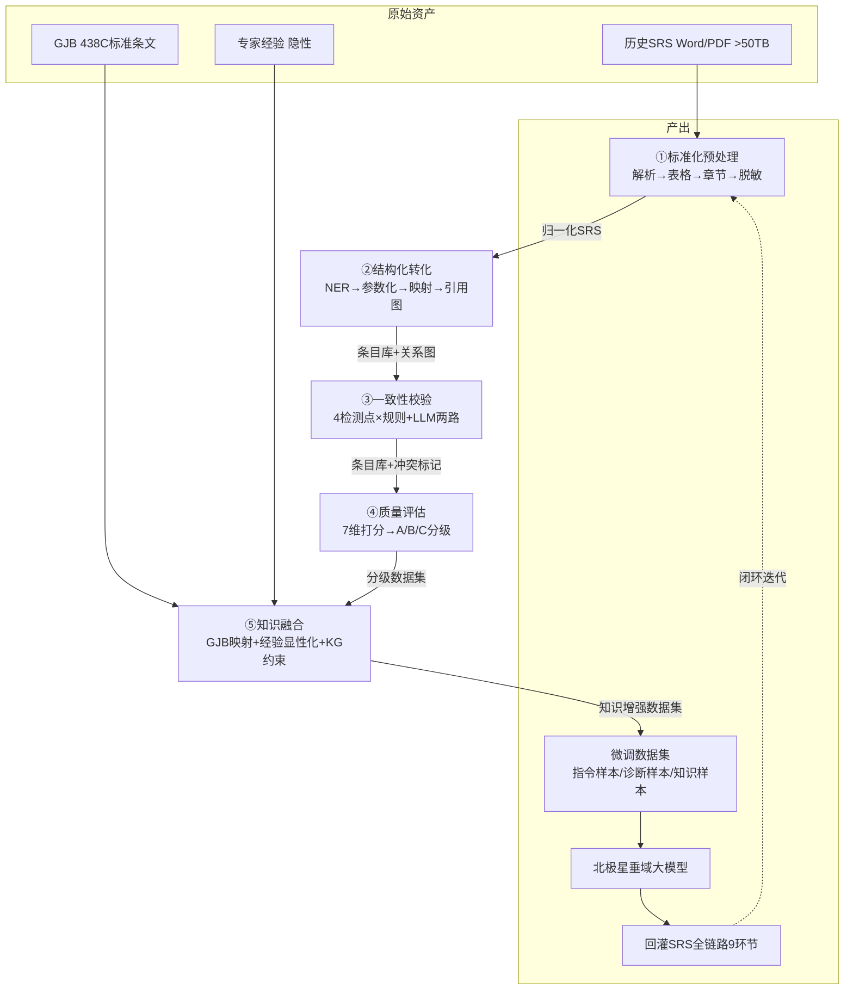
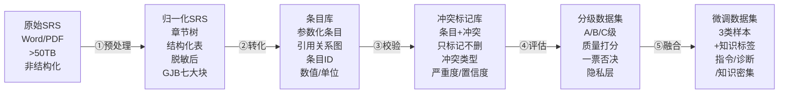
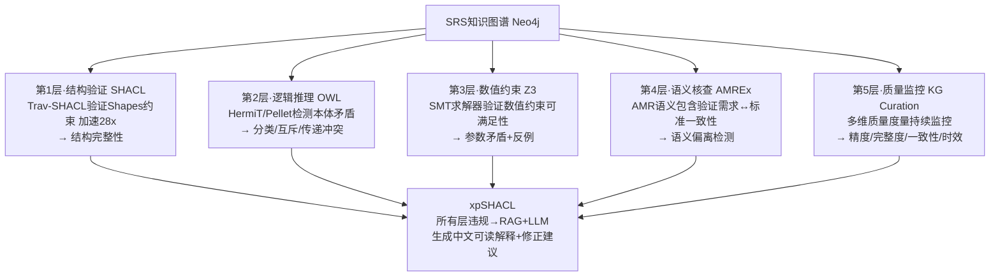

# 场景1: SRS数据治理链路技术方案

> 版本: v1.0 | 日期: 2026-07-28
> 依据: 数据场景分析.md 场景1 + 典型场景示范应用.md 场景1 + 仓库已验证原型 + 外部文献检索

---

## 1. 场景背景与目标

### 1.1 场景定位

将 >50TB 遵循 GJB 438C-2021 的历史软件需求规格文档（SRS），治理为高质量微调数据集，训"北极星"垂域大模型，实现需求智能抽取、结构化转化与辅助生成。

### 1.2 数据模态

文本（SRS正文）+ 表格（性能指标表/接口定义表/数据字典）→ 对应课题三模态框架的"表格"模态。**无图像、无时序**，是5个场景中模态最简单的。

### 1.3 军用场景硬约束（贯穿全链路）

| 约束 | 含义 | 影响 |
|---|---|---|
| 数据不出域 | 全程本地推理，禁外发API | 优先开源可私有化模型 |
| 可审计 | 每步产出可追溯依据 | 规则层优先，模型层带置信度 |
| 可追溯 | 条目保留来源span+页码 | 满足GJB 5000B配置管理 |
| 涉密脱敏 | 密级标识/型号代号/战术指标需脱敏 | 脱敏后仍需可用于微调 |

### 1.4 核心设计理念

**冲突样本不删除，反过来当微调数据**——检出的矛盾越多，模型越能学会识别矛盾。正常条目教模型"怎么写SRS"，冲突条目教模型"什么是不一致、怎么改"，专家经验教模型"设计准则和隐性经验"。

---

## 2. 数据治理链路总体架构

数据从原始SRS到微调数据集，经历**5步治理、6次形态变化**，每步产出物是下一步输入。

### 2.1 总体架构



### 2.2 六次形态变化（数据血缘）



---

## 3. 各阶段技术方案

### 3.1 ①标准化预处理

**数据流**：`原始SRS(Word/PDF)` → 解析+表格+章节+脱敏 → `归一化SRS(章节树+结构化表, 脱敏后, GJB七大块)`

#### 3.1.1 文档解析与版面分析

把杂乱 Word/PDF 解析成统一结构化内容（标题/段落/列表/表格）。Word直抽精度上限，PDF走MinerU，纯国产替代用PP-Structure。

| 工具 | 原理 | 中文 | 表格 | 许可 | 推荐度 |
|---|---|---|---|---|---|
| **Word直抽(python-docx)** | 读取OOXML段落/样式/表格对象 | ★★★★★ | ★★★★★(合并无损) | MIT | ★★★★★(首选) |
| **MinerU** | DocLayout-YOLO+PaddleOCR+UniMERNet流水线 | ★★★★ | ★★★★ | Apache(核心) | ★★★★★(PDF首选) |
| **PP-Structure** | 版面+表格+OCR一体化 | ★★★★★ | ★★★★ | Apache-2.0 | ★★★★★(国产替代) |
| LayoutLMv3 | 多模态Transformer版面分类 | ★★(需微调) | 仅分类 | MIT | ★★★ |
| GOT-OCR2.0 | 580M统一端到端OCR-2.0 | ★★★★ | ★★★ | Apache | ★★★★ |
| Nougat | 端到端图像→Markdown(学术PDF) | ★(英文) | ★★ | Apache | ★(不适用) |

**Word直抽（python-docx）**：.docx本质是OOXML压缩包，段落样式、编号体系、表格对象都是原生结构化数据。python-docx直接读取这些对象，不走OCR，精度是所有方案的上限——零OCR误差，合并单元格通过`gridSpan`/`vMerge`原生保留。对于.doc旧格式，先用`libreoffice --headless --convert`转.docx。军用SRS大量有Word源文件，这是主路径，覆盖80%+文档。

**MinerU**（arXiv:2409.18839, OpenDataLab）：目前最完善的开源PDF解析方案，是一条模块化流水线——DocLayout-YOLO版面检测SOTA（arXiv:2410.12628，用合成数据增强泛化）→ YOLOv8公式检测 → UniMERNet公式识别（arXiv:2404.15254）→ PaddleOCR中文OCR → StructEqTable表格识别 → 阅读序排序后处理。输出Markdown+JSON，社区活跃（PDF-Extract-Kit 9.8k★），可私有化部署。缺点是依赖AGPL组件（PyMuPDF），军用需法务评估。

**PP-Structure**（PaddlePaddle）：如果AGPL不可接受，PP-Structure是纯Apache-2.0国产替代。一体化流水线：版面检测（11类版面元素）+ 表格识别（输出HTML）+ 中文OCR，中文原生支持是所有方案里最强的，部署成熟（含C++/Serving）。缺点是对超复杂合并/嵌套表头不如专用大模型。

#### 3.1.2 表格抽取与结构化

从文档检测表格、识别结构（行列/合并单元格/表头）、输出结构化数据。采用**分层策略（精度优先，由易到难）**：

| 层 | 方案 | 合并单元格 | 无框线 | 许可 | 效果 |
|---|---|---|---|---|---|
| 1 | **Word直抽** | ★★★★★无损 | — | MIT | 覆盖大多数 |
| 2 | **Camelot** | ★★ | ★★(stream弱) | MIT | 有框线近无损 |
| 3 | **PaddleOCR表格** | ★★★★ | ★★★★ | Apache | 中文工程首选 |
| 3 | **StructEqTable** | ★★★★ | ★★★★ | Apache | MinerU默认引擎 |
| 4 | **UniTable** | ★★★★SOTA | ★★★★ | MIT | 极复杂兜底 |
| 4 | Table Transformer | ★★★ | ★★★ | MIT | 行业基线 |

**Word原生直抽**：遍历`document.tables`，每个cell天然含合并信息。OOXML表格用`gridSpan`（横向合并）和`vMerge`（纵向合并）标记合并区域，可直接还原为二维矩阵并标注合并范围。无损方案——不经过任何OCR或模型推理，可区分嵌套表。军用SRS的性能指标表/接口表/数据字典在Word中多为真实表格对象，直抽即得结构化数据。

**Camelot**：提供lattice（线框检测）和stream（空白对齐）两种模式。lattice模式基于PDF中的线条检测表格边界，对有明确框线的PDF表格精度极高、速度快、零模型依赖、中文无损。缺点是依赖线框，无框线表易错乱，合并单元格还原弱，扫描版PDF无文本层则失效。

**PaddleOCR表格识别**：PP-Structure内置的端到端表格结构识别模块，能从图像中识别表格的行列结构、合并单元格，输出HTML格式（含rowspan/colspan）。中文场景工程首选，对合并单元格和无框线表都有较好处理。

**StructEqTable**：基于InternVL2-1B视觉大模型，把表格图像转为LaTeX/HTML/Markdown多格式输出。MinerU 1.0默认表格引擎，中文较好，对复杂表格的理解能力强于传统OCR方法。

**UniTable**（arXiv:2403.04822, Georgia Tech）：自监督预训练的统一表格识别框架，把表格结构识别、内容识别、bbox定位三个任务统一在一个模型里，在多个大规模表格数据集上达到SOTA。MIT许可，可迁移中文（需配PaddleOCR做文本填充）。适合作为极复杂嵌套表格的兜底方案。

**推荐**：Word直抽 > Camelot(有框线) > PaddleOCR/StructEqTable(无框线) > UniTable(兜底)。LlamaParse等商用API因数据出域排除。

#### 3.1.3 章节切分（对齐GJB七大块）

按GJB 438C-2021的7大块自动切分：

| GJB语义块 | 章节号 | 内含表格 |
|---|---|---|
| 功能需求 | 3.x | 功能/接口需求表 |
| 性能指标 | 3.x/4.x | **性能指标表** |
| 接口定义 | 5.x | **接口定义表** |
| 数据字典 | 6.x | **数据字典表** |
| 运行环境 | 7.x | 环境约束表 |
| 安全保密 | 8.x | 安全要求表 |
| 验收准则 | 9.x | 验收项表 |

| 方法 | 原理 | 准确率 | 可审计 | 推荐 |
|---|---|---|---|---|
| **规则法** | 编号正则+GJB锚点词典 | **95%+** | ✅完全可审计 | ★★★★★(主) |
| 版面模型 | LayoutLMv3角色分类 | 中高 | 需微调 | ★★★(兜底) |
| LLM | DocOwl/Qwen章节理解 | 高 | 弱/保密受限 | ★★(离线复核) |

**规则法**：GJB模板高度规范，编号体系稳定（如`3.2.1`三级条目）。用正则`^\d+(\.\d+)*\s*[标题]`匹配章节号，结合Word heading样式/字体特征，建立"章/节/条"三级树。再用预置的七大块标题词典做章节号→语义块映射。可达95%+切分准确率，且完全可审计——每条切分能给出依据。切分流程：①编号正则建章/节/条树 → ②GJB锚点映射语义块 → ③完整性校验(缺块告警) → ④表格按"最近章节"归属挂载。

**版面模型法**：对无编号或编号异常的子标题（扫描件错字、跨文档模板漂移），用LayoutLMv3或DocLayout-YOLO做title/section-header角色分类二次判别。抗排版扰动、泛化好，但需标注微调。

**LLM法**：用文档理解大模型直接给章节语义，鲁棒但模型重、可解释性弱、保密受限。仅用于离线抽检/复核，不进入主链路。

#### 3.1.4 涉密信息识别与文本脱敏

识别密级标识/型号代号/战术指标等敏感信息并脱敏，脱敏后仍需可用于微调。

**三级级联识别**（SurrogateShield arXiv:2606.29567验证F1≈98.87%）：

| 级 | 方法 | 抓什么 | 优势 |
|---|---|---|---|
| 1 | 规则/正则 | 密级标识(机密★/秘密★)、型号代号格式 | 零样本、可审计、召回稳 |
| 2 | 自定义军事NER | 装备型号、部队番号、战术指标描述 | 识别未登录实体、上下文感知 |
| 3 | LLM语义识别 | 作战场景描述、意图级敏感 | 捕获语义级敏感(规则/NER遗漏的) |

第一级用规则/正则抓密级标识和型号代号模式（如`XX-XX[0-9]{2,4}`），零样本、可审计、召回稳，作为保底层。第二级用自定义军事NER（基于BERT/RoBERTa微调，自定义实体类型EQUIP_MODEL/TACTICAL_INDICATOR/UNIT_NAME），识别规则未覆盖的未登录实体。第三级用LLM做语义级识别，捕获"射程""精度"附近的数值、作战场景描述等规则和NER都遗漏的语义敏感内容。

**分层脱敏算子（关键设计：不一刀切）**：

| 敏感实体 | 脱敏算子 | 语义保留度 | 对微调影响 | 效果实证 |
|---|---|---|---|---|
| 密级标识 | **删除(redact)** | 低 | 大(但无语义价值) | — |
| 装备型号代号 | **伪名化**(EQUIP_01确定性映射) | 高(保共指一致性) | 极小 | 对模型几乎无损 |
| 战术性能数值 | **泛化为区间**(≥50km→[40,60)km) | 中高(保量级分布) | 小 | 保训练信号分布 |
| 作战场景描述 | **合成替换**(生成等价虚构场景) | 高(保语义结构) | 小 | **BERTScore +13.26pp** |
| 接口参数名/数据字典项 | **保留**(非敏感) | — | —(微调必需) | — |

按敏感实体类型选择不同脱敏算子，而非统一删除。密级标识无语义价值直接删除。装备型号代号用伪名化——同一型号确定性映射到固定假名（型号X→EQUIP_01），保持文档内引用一致性（共指一致性），对微调几乎无损。战术性能数值泛化为区间，保留量级分布，防精确值泄露。作战场景描述用合成替换——生成虚构但语义等价的场景，保留完整语义结构。

**关键实证**：SurrogateShield证明合成替换 vs 占位符遮罩，BERTScore从81.59%提升至94.85%（**+13.26pp**），且100条对抗查询中对手LLM无法恢复原始值。这直接解决了"脱敏后还能不能用于微调"的核心难题。

**反面警示**：纯DP-SGD在1B-3B小模型上F1仅0.19-0.28（arXiv:2606.28479），不足以支撑可用性。Kapelinski et al.用canary审计发现DP-SGD的记忆化下降主要来自更新步数减少（占66%-132%），提示**伪名化+控制训练步数**可能比单纯堆DP更高效。

**推荐**：Presidio V2（开源、可私有化部署、YAML no-code配置、支持spaCy/Stanza/Transformers/GLiNER外接、全套算子replace/redact/hash/mask/encrypt/custom/surrogate）。策略：伪名化/合成替换保语义 + DP-SGD训练期兜底防记忆化 + canary审计验证。

**落地优先级**：P0吃Word源(80%+) → P1 PDF有框线(Camelot) → P2 PDF扫描件(MinerU全栈) → P3兜底增强 → P4质量闭环。

---

### 3.2 ②结构化转化

**数据流**：`归一化SRS(文本+表格)` → NER+参数化+映射+引用解析 → `参数化条目库(条目ID/类型/数值/单位/引用关系) + 引用关系图`

#### 3.2.1 领域NER与参数抽取

把"系统响应时间应≤50ms" → `{param:响应时间, op:≤, value:50, unit:ms, type:性能}`。本质是实体+关系+数值属性联合抽取。

| 方案 | 代表方法 | 准确率 | 标注成本 | 可解释性 | 适用场景 |
|---|---|---|---|---|---|
| **a)规则/正则+模板** | 自定义DSL、spaCy ruler | 高(格式固定>95%) | 低 | 极高(可审计) | "≤50ms""8路"等模式化表述 |
| **b)预训练模型微调NER** | RoBERTa-wwm+CRF | 中高(F1 85-92%) | 中高 | 中 | 术语边界模糊、多义词 |
| **c)生成式UIE/指令IE** | UIE、DeepKE、GoLLIE | 中高 | 低(少样本) | 中 | schema多变、低资源 |
| **d)通用LLM抽取** | Qwen2.5/DeepSeek few-shot→JSON | 中(zero)/高(few) | 极低 | 低(黑盒) | 冷启动、原型验证 |

**规则/正则+模板**：针对GJB文档高规范化的"参数+运算符+数值+单位"句式，编写正则模板库`(?P<param>...)(?P<op>[≤≥<>≈])(?P<val>\d+\.?\d*)\s*(?P<unit>ms|Mbps|路|℃)`。GJB文档句式规整，格式固定时准确率>95%，零模型依赖，每条抽取可给出依据。缺点是仅覆盖已知模式，泛化弱——遇到复杂句式会漏抽。

**预训练模型微调NER**：用RoBERTa-wwm-ext + CRF做序列标注，标签集`[PARAM][OP][VALUE][UNIT][PROTO]`，在GJB语料上做领域续训（MLM预训练）。F1 85-92%，能处理术语边界模糊和多义词（如"端口"既可能是接口名也可能是参数名）。需数百-千条标注语料，建议先用规则抽一批种子样本，再用主动学习挑选高价值样本送专家标注。

**生成式UIE/指令IE**：UIE（arXiv:2203.12277, ACL 2022）提出SEL+SSI，将NER/RE/EE统一为text-to-structure生成，可用SSI定义`schema: [参数名, 运算符, 数值, 单位]`，**一次生成完整参数条目**，天然支持联合抽取。DeepKE（arXiv:2201.03335, EMNLP 2022 Demo）是开源工具包，含中文预训练权重，开箱即用。GoLLIE（arXiv:2310.03668, ICLR 2024）用标注指南（Python类形式的schema）微调LLM，**零样本迁移到未见IE任务**——消融实验证明详细guideline是关键，可把GJB 438C的参数书写规范写成guideline。

**通用LLM抽取**：Qwen2.5/DeepSeek few-shot → JSON输出，标注成本极低，适合冷启动。**但Li et al.（arXiv:2304.11633）证实LLM抽取过度自信、校准低**，解释质量高但准确率不稳定，军工场景不可接受幻觉，必须人工复核。

**推荐**：三层pipeline——规则兜底（>95%高召回+可审计）+ RoBERTa-wwm微调主力（边界模糊）+ LLM长尾+校验（GoLLIE风格guideline校验）。

#### 3.2.2 表格结构化与字段映射

把三类表格（性能指标表/接口定义表/数据字典）映射到统一schema；表头识别、列类型推断、术语归一化。

| 方案 | 表头识别 | 跨表对齐 | 术语归一化 | 中文 |
|---|---|---|---|---|
| **规则+模板匹配** | 高(GJB固定表头) | 弱(硬编码) | 弱 | 强 |
| **TableLlama** | 高 | 高 | 高 | 中高 |
| TAPAS/TabBERT | 中高 | 中 | 中 | 弱(英文) |
| 知识图谱对齐 | — | 高 | 高 | 中 |

**规则模板匹配**：GJB表格表头相对固定——性能指标表典型列为「指标项|指标要求|验证方法|备注」，接口定义表为「接口编号|接口类型|信号名称|方向|协议|速率」，数据字典为「编号|参数名称|缩写|数据类型|取值范围|单位|说明」。按三类表各建表头模板，正则匹配列名。准确率高，但跨表schema对齐弱。

**TableLlama**（arXiv:2311.09206, NAACL 2024）：首个开源表格通才模型，用LongLoRA微调Llama2-7B处理长表格。构建了TableInstruct数据集，在8个域内任务中**7个达到/超过SOTA**，6个域外数据集**提升5-44分**。开源可私有化部署，符合军工数据不出域要求。

**Table Meets LLM**（arXiv:2305.13062, WSDM 2024）：系统评测了LLM对结构化表格的理解能力，发现**输入格式、内容顺序、分区标记显著影响性能**。关键结论：把表格序列化为Markdown格式 + 标注关键值，可显著提升LLM表格对齐准确率。TAMA（arXiv:2501.14693, ACL 2025）进一步发现小学习率+少数据即能超越GPT-3.5/4，提供低成本微调表格LLM的实践指南。

**术语归一化（核心难点）**：同一参数在不同位置写法不同——表格里写"响应时间"，正文写"反应时间"，数据字典写"时延"。需构建**军工参数同义词典**（响应时间=反应时间=时延=延迟），用实体链接+向量相似度做表-文术语对齐。词典+向量双保险：词典覆盖已知同义词，向量相似度（Sentence-BERT cosine）覆盖未登录同义变体。

**推荐**：规则模板匹配表头 + TableLlama列推断 + 同义词典+向量归一化。

#### 3.2.3 交叉引用解析与关系建模

解析"见3.2节""如表4所示""参见GJB 438C第5.3条"，构建条目间引用关系图。

| 方案 | 锚点识别 | 指向解析 | 复杂句 | 可解释性 |
|---|---|---|---|---|
| **正则+规则** | 高(编号固定) | 高(查索引表) | 弱 | 极高 |
| 依存句法(HanLP/LTP) | 中高 | 中 | 中 | 高 |
| LLM引用抽取 | 高 | 中高 | 高 | 低 |
| 图数据库(Neo4j) | — | — | — | 高(存储查询) |

**正则解析**：GJB文档编号高度规范——章节号`(\d+\.)+\d+`、表号`表\s*\d+`、图号`图\s*\d+`、外部标准条款`GJB\s*\d+C.*第.*条`。正则可覆盖**90%+显式引用**。建立"章节号→条目ID""表号→表条目ID"索引表后，即可精确解析引用指向。

**依存句法分析**：HanLP/LTP提供中文依存解析，可识别"性能指标见3.2节"中动词"见"的宾语"3.2节"及其主语"性能指标"，建立主语→引用→目标的三元关系。处理引用嵌在句中的情况，正则只能抓锚点，依存句法能把锚点和被修饰实体关联起来。

**LLM引用抽取**：对隐式引用（"按前述规定执行""同上级要求""参见相关条款"）用Qwen few-shot抽取，输出`{source_span, relation, target}` JSON。隐式引用占比小（<10%），但语义级关联需要LLM理解上下文。

**Neo4j关系图存储**：节点（需求条目/参数/接口/表/外部标准），边（REFERS_TO/DEFINED_IN/VERIFIED_BY/DEPENDS_ON）。Cypher支持多跳溯源查询："某性能指标依赖哪些接口与参数""哪些需求引用了GJB 438C第5.3条"。**天然支撑GJB 5000B的需求可追溯性矩阵(RTM)**——RTM要求每条需求可追溯到上级需求、可向下追溯到设计和验证，图数据库的多跳查询正好满足。

**推荐**：正则为主（90%+覆盖）+ HanLP依存补强 + Qwen隐式引用 + Neo4j存储。

---

### 3.3 ③一致性校验

**数据流**：`条目库` → 4检测点×(规则+LLM)两路 → `条目库+冲突标记(冲突类型/严重度/置信度)`

#### 3.3.1 三层治理体系

仓库已验证的三层递进式校验体系（`子课题3技术方案:10-101`）：

| 层 | 校验什么 | 业内技术 | 开源工具 | 场景1对应 |
|---|---|---|---|---|
| **L1语法一致性** | 字段格式/范围/类型 + 多字段联合约束 + 跨记录 | SHACL约束验证 | Great Expectations, Cleanlab, Pandera | 检测点1(数值)、检测点3(术语) |
| **L2语义一致性** | 跨模态对齐 + 知识图谱事实核验 + 多粒度 | CLIP对齐, DEFAME核查 | CLIP, DEFAME, FAMDR | 检测点2(接口语义)、检测点3(术语语义) |
| **L3逻辑一致性** | 专家知识形式化 + 时序逻辑 + 约束求解 | 本体工程, 流程挖掘 | Easy Dataset, Z3 Solver, PM4Py | 检测点4(跨条目参数约束) |

**L1语法一致性**：校验字段格式/范围/类型是否合规，以及多字段间的联合约束。用pySHACL或Great Expectations（300+内置规则）实现。多字段联合约束如"口径×类型×重量"物理耦合关系——单字段合规但组合矛盾（如口径9mm但类型标狙击步枪），用Cleanlab或Pandera检测。仓库`MedicalLabRangeFilter`已验证此层。

**L2语义一致性**：跨模态/跨位置的语义级比对。用CLIP做跨模态对齐，用DEFAME做知识图谱事实核验，用FAMDR（AAAI 2026）做多粒度一致性分析。场景1没有图像，L2主要用于接口类型/协议名称的语义比对（RS422 vs RS232不是数值比，是语义矛盾）和术语语义对齐。

**L3逻辑一致性**：融合专家知识的跨条目逻辑约束。用Easy Dataset将工艺规范/设计准则转为可执行逻辑约束，用Z3 Solver做约束满足求解（检测因果倒置），用PM4Py做流程挖掘。场景1的检测点4（跨条目参数矛盾）属于此层。

#### 3.3.2 四检测点技术方案

| 检测点 | 检测对象 | 对什么比 | 治理层 | 检测路线 | 仓库原型验证 |
|---|---|---|---|---|---|
| **1 性能正文↔指标表** | 性能指标条目 | 正文阈值 vs 表数值(≤50ms vs ≤100ms) | L1b多字段约束 | **规则库**(数值直接比) | LabDiagnosisConflictFilter **1444条** |
| **2 接口正文↔接口表** | 接口定义条目 | 正文协议 vs 表字段(RS422 vs RS232) | L2语义一致性 | **LLM直判**(语义级) | _llm_detect Qwen2:7b |
| **3 数据字典↔正文术语** | 术语条目 | 正文参数名/单位 vs 字典定义 | L1a字段+L2对齐 | **规则库**(归一化后比) | MedicalLabRangeFilter |
| **4 跨条目参数矛盾** | 功能/性能/接口/安全性条目 | 同参数跨条目取值(功能5路 vs 性能8路) | L3约束求解 | **规则库+Z3**(跨条目比) | CrossLabConsistencyFilter |

**检测点1（性能正文↔指标表）**：从正文NER抽取`{param:响应时间, op:≤, value:50, unit:ms, source:§3.2}`，从表格解析`{param:响应时间, op:≤, value:100, unit:ms, source:性能指标表}`。术语归一化后比对：同参数、同单位、但值50≠100 → 命中冲突。数值级直接比对，规则库确定性高、可解释。仓库`LabDiagnosisConflictFilter`在MedTVT 10000样本上检出**1444条冲突**，与知识库规则完全对齐。

**检测点2（接口正文↔接口表）**：正文写"接口采用RS422协议"，接口表写"RS232"。RS422 vs RS232不是数值比，是语义矛盾——规则库难以穷举所有协议对。把正文接口描述和接口表字段喂给LLM（Qwen2:7b本地Ollama），prompt要求判断一致性并输出JSON`{consistent, conflicts, explanation}`。LLM能理解"RS422是差分串行协议，RS232是单端串行协议，二者不兼容"这种领域语义。

**检测点3（字典↔正文术语）**：正文用"反应时间ms"，数据字典定义"响应时间s"。两步走：①术语归一化——用同义词典把"反应时间"映射到"响应时间"；②单位换算后比数值——ms→s换算后比。如果归一化后参数名一致但单位换算后数值不符，则冲突。术语归一化用词典+向量相似度双保险。

**检测点4（跨条目参数）**：功能要求写"支持5路输入"，性能要求写"支持8路输入"。最复杂的检测点——需要理解"输入路数"这个参数在功能条目和性能条目里是同一个东西。用引用关系图（Neo4j）找到跨条目引用同一参数的关系，然后比对取值。L3层用Z3 Solver约束求解器检测违反领域知识的参数组合矛盾。仓库`CrossLabConsistencyFilter`已验证L3路线。

#### 3.3.3 两条检测路线（互补）

| 路线 | 实现 | 原理 | 覆盖检测点 | 优势 | 仓库验证 |
|---|---|---|---|---|---|
| **规则库三层** | medical_operators.py风格 | 知识库驱动L1→L2→L3递进 | 1,3,4(数值/术语/跨条目) | 确定性高、可解释、可审计 | ✅1444条 |
| **LLM直判** | unified_operators.py风格 | 条目喂LLM判断→JSON | 2(语义级)+盲区补充 | 灵活、覆盖规则盲区 | ✅Qwen2:7b |

**规则库三层**：参考仓库`medical_operators.py`已验证原型，知识库驱动，L1→L2→L3逐层递进。L1做单参数范围检测（参数名→正常范围+严重度阶梯），L2做参数↔表格跨位置比对（同参数正文值 vs 表格值不一致→冲突），L3做多要素协同约束（多条目组合参数矛盾）。每条规则带严重度（MEDIUM/HIGH/CRITICAL）和详情模板。优势是确定性高、可解释、可审计——每条冲突能给出违反了哪条规则、规则来自哪个GJB条文。缺点是规则覆盖面有限。

**LLM直判**：参考仓库`unified_operators.py`已验证原型，把抽出的条目喂给本地LLM，prompt描述判断规则，要求输出JSON。优势是灵活——能处理规则未覆盖的语义级矛盾。缺点是黑盒、有幻觉风险、需置信度校准。两条路线互补：规则库覆盖已知冲突模式（确定性高），LLM直判覆盖规则盲区（灵活）。

#### 3.3.4 GJB版规则库设计

参考仓库`medical_kb.json`的三层结构，构建GJB版：

```json
{
  "L1_param_ranges": {
    "响应时间": {"normal_op":"<=","normal_val":50,"unit":"ms",
                 "severity_high":[{"threshold":100,"level":"HIGH"}]},
    "吞吐量": {"normal_op":">=","normal_val":1000,"unit":"tps",
               "severity_high":[{"threshold":500,"level":"HIGH"}]}
  },
  "L2_param_table_rules": [
    {"param":"响应时间","conflict_if":"正文值≠表格值","severity":"HIGH",
     "detail_template":"正文{val}ms vs 表格{val}ms不一致"}
  ],
  "L3_cross_item_rules": [
    {"name":"输入路数一致",
     "conditions":[{"item":"功能要求.输入路数","op":"==","val":"性能要求.输入路数"}],
     "severity":"CRITICAL"}
  ]
}
```

**校验运作机制（四阶段管道）**：抽取（NER只拆不判）→ 检测（规则L1/L2/L3 + LLM直判）→ 解释（定位冲突到具体条目ID/章节位置）→ 置信度（根据冲突严重度+检测方法+置信度，打high/medium/low）。

**关键设计**：**只标记不删数据**（`process_single`恒返回True）。冲突样本挂到`stats`上出报告——冲突样本本身是高价值微调数据，教模型"这种矛盾要报出来"。

---

### 3.4 ④质量评估

**数据流**：`条目库+冲突标记` → 7维打分+4层评估 → `分级数据集(A级直接微调 / B级人工复核 / C级退回)`

#### 3.4.1 七维质量评估

| 维度 | SRS场景具体指标 | 评估方法 | 工具 |
|---|---|---|---|
| **完整性** | GJB七大块覆盖；字段缺失率 | 规则检查 | Great Expectations |
| **一致性** | 4类冲突检测通过率 | ③校验管道输出 | 自定义 |
| **合规性** | GJB 438C-2021条目对标率 | 标准模板对标 | GE+SHACL |
| **准确性** | 术语库命中率；参数值合理性 | 置信学习 | **Cleanlab**(召回100%) |
| **可用性** | 脱敏后BERTScore语义保持度 | 效用-隐私权衡 | Sentence-BERT |
| **隐私性** | 残留敏感实体数；k-匿名 | 复检 | Presidio(**一票否决**) |
| **多样性** | 装备类型/场景分布均衡度 | 分布统计 | TADS(36%超全量) |

**完整性**：检查GJB七大块是否齐全，各块内必需字段是否缺失。用Great Expectations声明式Expectation实现——每个七大块定义一组期望（如"性能指标表必须存在""性能指标表行数>0""每行必须有指标项和指标值"），自动校验并通过率打分。

**一致性**：直接取③一致性校验管道的输出——4类冲突检测的通过率。0冲突=满分，冲突数越多分越低。

**合规性**：GJB 438C-2021条目对标率——每条需求条目是否能映射到GJB标准条文。用标准模板对标（GE+SHACL规则集）。

**准确性**：术语在权威术语库的命中率、参数值合理性。用Cleanlab置信学习检测标签错误——如果微调数据的指令-响应对有噪声（标注错误），Cleanlab能自动识别。

**可用性**：脱敏后数据的语义保持度。用Sentence-BERT计算脱敏前后文本的cosine相似度，或用BERTScore。

**隐私性（一票否决）**：脱敏复检——用Presidio再扫一遍脱敏后数据，如果还有残留敏感实体，直接降C级，不进入加权评分。这是安全红线。

**多样性**：装备类型/场景分布的均衡度。用分布统计或聚类分析，检查数据集是否覆盖了各类装备和场景，避免模型在某些类别上过拟合。

#### 3.4.2 评估工具

| 工具 | 核心机制 | 适用维度 | 效果 | 仓库验证 |
|---|---|---|---|---|
| **Great Expectations** | 声明式Expectation(300+规则) | 完整性/一致性/合规性 | Data Docs可视化 | ✅ |
| **Cleanlab** | 置信学习(arXiv:1911.00068) | 准确性(标签噪声) | **召回100%** | ✅ |
| **TADS** | 任务感知(质量+相关+多样性) | 多样性 | **36%超全量+1.0%** | ❌ |
| **UniFilter** | 多模态质量分类器(半合成) | 多模态质量 | EMNLP 2025 | ❌ |
| **LLM抽样复核** | LLM-as-judge | 语义级质量 | 灵活但成本高 | ❌ |

**Great Expectations**：Apache-2.0开源，声明式Expectation框架——用Python声明"我期望这个字段非空""我期望这个值在0-100范围内""我期望这两列唯一"，自动校验并生成Data Docs可视化报告。300+内置规则，可集成Airflow/Pandas/Spark/SQL。仓库已验证。

**Cleanlab**：基于置信学习（Confident Learning，arXiv:1911.00068, JAIR 2021, Northcutt et al.）。核心原理：用模型预测概率估计噪声标签与真实标签的联合分布，自动找标签错误。**理论保证可证一致**（provably consistent），模型无关。仓库在GunsAndWeapons数据上验证**召回率100%**（但精确率低）。

**TADS**（arXiv:2602.05251）：任务感知数据选择，用可学习价值函数综合评估内在质量+任务相关度+分布多样性三因子。**仅用36%数据超越全量基线+1.0%**。适合数据集筛选。

**UniFilter**（arXiv:2510.15162, EMNLP 2025）：训练统一多模态质量分类器，用半合成四级质量标注训练。适合多模态数据质量打分，场景1纯文本/表格可简化使用。

**LLM抽样复核**：用LLM作为评判对数据质量打分/分级，灵活、可处理语义级质量。参考DataGovBench（arXiv:2512.04416）的Planner-Executor-Evaluator架构。仅抽样进行，不作为全量主评估。

#### 3.4.3 质量分级标准

评分 = w1·完整性 + w2·一致性 + w3·合规性 + w4·准确性 + w5·可用性 + w6·隐私性。**隐私性一票否决**。

| 等级 | 分数 | 判定条件 | 用途 | 处置 |
|---|---|---|---|---|
| **A级** | ≥85 | 七大块齐全、4类冲突0、GJB对标率≥95%、脱敏语义保持≥90%、无残留敏感 | **直接微调** | 入库+dataset card |
| **B级** | 70-84 | 个别字段缺失/少量冲突(≤3)/对标率80-95%/语义保持75-90% | **人工复核后可用** | 标记问题→修正/降级 |
| **C级** | <70 | 大块缺失/冲突>3/对标率<80%/语义损失大/残留敏感 | **退回重做** | 退回数据源+记录缺陷 |

**分层评估架构**：

```
数据集
  ├─ L1规则层(GX)：完整性(七大块)+一致性(4类冲突)+合规性(GJB对标) → 自动评分
  ├─ L2标签层(Cleanlab)：指令-响应标签置信度 → 噪声标记
  ├─ L3语义层(LLM抽样)：合规性/准确性语义复核 → 抽样报告
  ├─ L4隐私层(Presidio复检+k匿名)：残留敏感 → 一票否决
  └─ 汇总 → 自定义评分模型 → A/B/C分级 → 路由处置
```

---

### 3.5 ⑤知识融合

**数据流**：`分级数据集 + GJB标准条文 + 专家经验` → 条文结构化+经验形式化+KG五层验证 → `知识增强微调数据集(+知识标签)`

#### 3.5.1 GJB标准条文→结构化规则库

把GJB 438C-2021标准条文（PDF/Word）转成可执行规则，用于③校验规则基准 + ④合规评估。

| 方案 | 原理 | 效果 | 适用场景 | 工具 |
|---|---|---|---|---|
| **LLM+CoT规则抽取** | Chain-of-Thought提示LLM逐步推理出"前提-约束-值-例外"四元组 | 准确率70-85%，CoT比零样本+15-25% | 非结构化条文 | LangChain, LlamaIndex |
| **OLLM端到端本体学习** | 微调LLM建模整个本体子组件(非单条关系) | 语义准确度优于子任务组合 | 从零构建领域本体 | OLLM(arXiv:2410.23584) |
| **SHACL规则编码** | 标准条文→SHACL Shapes约束→pySHACL验证 | W3C标准，Trav-SHACL加速28x | 结构约束验证 | pySHACL, Apache Jena |
| **SWRL规则推理** | OWL本体上定义Horn逻辑规则 | 支持规则+本体联合推理 | 复杂条件约束 | Protégé SWRLTab, Pellet |
| **Datalog/Soufflé** | 递归规则演绎推理，编译为C++ | 可判定，极高效 | 传递性/层次约束 | Soufflé, VLog |
| **Easy Dataset** | 上传标准文档→解析分块→LLM提取规则 | 文档→规则 | 全流程自动化 | ✅已克隆 |

**LLM+Chain-of-Thought规则抽取**：利用大语言模型的CoT推理能力，将GJB条文分块输入，通过多轮提示引导LLM逐步识别条文的**前提条件、约束主体、约束值、例外情况**，输出结构化规则四元组。CoT提示相比零样本提升15-25%准确率，可结合Few-Shot示例和Self-Consistency投票进一步提升稳定性。例如条文"功能要求不应包含性能参数信息"→ `{前提:条目类型=功能需求, 约束:不含参数信息, 值:null, 例外:null}`。

**OLLM端到端本体学习**（arXiv:2410.23584）：不同于聚焦子任务，OLLM通过微调LLM并使用自定义正则化器（减少高频概念过拟合）来建模目标本体的**整个子组件**——即整个分类骨架。在Wikipedia数据集上显著优于子任务组合方法，且仅需少量训练样本即可高效迁移到新领域。适合从GJB文档自动构建军用软件需求领域本体。

**SHACL规则编码**：SHACL（arXiv:2112.01441综述）是W3C推荐的RDF数据验证语言，将标准条文编码为**Shapes（形状约束）**——每个Shape定义一类需求条目必须满足的约束（属性存在性、基数、值域、闭合性等）。Trav-SHACL（arXiv:2101.07136）通过规划形状遍历顺序和重写查询，将验证时间**减少最多28.93倍**，支持3400万三元组规模。xpSHACL（arXiv:2507.08432, VLDB'25）结合RAG和LLM为约束违规生成**多语言人类可读解释**，并用Violation KG缓存解释——这对军用场景的可审计性至关重要，每条违规都有中文解释和修正建议。

**SWRL规则推理**：SWRL在OWL本体上定义类Datalog的Horn逻辑规则，支持将GJB条文中复杂的**条件-结论**关系形式化。例如"若需求条目为安全性需求且危险等级为A级，则必须包含故障树分析"。由Pellet或HermiT推理机执行，可与OWL本体推理无缝集成。缺点是不支持非单调推理和否定。

**规则表示语言对比**：

| 语言 | 表达能力 | 可判定 | 效率 | 适用场景 |
|---|---|---|---|---|
| **Datalog** | 中(无算术/嵌套) | ✅ | ⭐⭐⭐⭐⭐ | 递归约束、传递闭包 |
| **SWRL** | 中高(Horn+OWL DL) | ✅(受限) | ⭐⭐⭐ | 本体+规则联合推理 |
| **SHACL** | 中(验证导向) | ✅ | ⭐⭐⭐⭐ | 数据验证、质量检查 |
| **SPARQL** | 高(图查询+CONSTRUCT) | ⚠️不可判定 | ⭐⭐⭐ | 查询驱动验证 |

**推荐**：LLM+CoT规则抽取 → SHACL结构约束编码 + SWRL条件推理 → Trav-SHACL高效验证 → xpSHACL可解释违规报告。

#### 3.5.2 专家经验形式化

把专家的设计准则、评审经验、常见错误转为可执行约束规则，挂载到条目上作为知识标签。

| 方案 | 原理 | 效果 | 适用场景 | 工具/论文 |
|---|---|---|---|---|
| **AMIE规则挖掘** | 枚举KG闭合路径，支持度/置信度评估 | 高精度可解释规则 | 从历史SRS挖掘设计准则 | AMIE3(WWW2013) |
| **AnyBURL规则学习** | 神经网络引导随机游走学Horn规则 | anytime策略，大规模KG | 大规模规则自动学习 | AnyBURL(ISWC2019) |
| **RNNLogic** | RNN生成规则+EM优化，规则作隐变量 | ICLR2021，可解释+高质量 | KG推理+规则发现 | arXiv:2010.04029 |
| **RL规则挖掘** | 生成-评估两阶段RL框架 | KBS2022 SOTA效率 | 动态KG持续挖掘 | arXiv:2202.10381 |
| **RotatE嵌入** | 复数空间旋转建模关系 | ICLR2019，建模对称/反对称/组合 | KG补全、缺失关系预测 | arXiv:1902.10197 |
| **LLM+KG协同** | LLM抽取知识，KG约束验证 | TKDE2024三大框架 | 专家口述→结构化知识 | arXiv:2306.08302 |
| **Drools规则引擎** | RETE算法前向链规则匹配 | 工业级成熟，支持CEP | 实时约束验证、规则触发 | Red Hat Drools |
| **Meta-Interpretive Learning** | 归纳逻辑编程，少量样例学递归谓词 | 样本效率高，符号可解释 | 从专家样例学设计模式 | Metagol(ILP2014) |

**AMIE规则挖掘**：AMIE3（Galárraga et al., WWW 2013）在大规模知识图谱上**枚举闭合路径**，生成形如`h(X,Y) <= b1(X,Z) ∧ b2(Z,Y)`的Horn规则。通过支持度、置信度和PCA置信度三个指标评估规则质量。适用于从历史SRS文档及其审核记录的知识图谱中自动发现**隐含设计准则**——如"若需求含'实时性'关键词，则必须关联响应时间指标"。

**AnyBURL规则学习**（Meilicke et al., ISWC 2019）：使用**神经网络引导的随机游走**在KG上学习Horn规则。采用"anytime"策略——可在任意时刻停止并获得当前最优规则集，支持大规模KG的近似规则学习。生成的规则**完全可解释**，在链接预测任务上与KGE方法相当甚至更优。适合从大规模SRS知识图谱中自动学习专家隐含的评审经验规则，比AMIE穷举搜索更高效。

**RNNLogic**（arXiv:2010.04029, ICLR 2021）：将逻辑规则视为**隐变量**，同时训练规则生成器（RNN）和推理预测器。采用EM算法优化：E步从所有生成规则中通过后验推理选择高质量规则集，M步用选中规则更新生成器。生成的规则既有可解释性又有预测力——适用于从SRS审核历史中学习"需求模式→评审建议"的映射规则。

**RotatE知识图谱嵌入**（arXiv:1902.10197, ICLR 2019）：将关系定义为**复数空间中的旋转**，能建模对称/反对称、逆反和组合等多种关系模式。在多个基准KG上显著优于TransE/DistMult/ComplEx。适用于SRS知识图谱中**缺失关系预测**——如预测需求条目间未显式标注的依赖关系、追溯关系。注意：Jøsang et al.（arXiv:2206.00983）研究表明TransE补全后会产生较多虚假规则，RotatE更可靠。

**LLM+KG协同框架**（Pan et al., arXiv:2306.08302, IEEE TKDE 2024）：提出LLM与KG统一的**三大框架**——①KG增强LLM（预训练/推理阶段融入KG知识，增强事实准确性）；②LLM增强KG（LLM做KG嵌入/补全/构建/图到文本生成）；③协同LLM+KG（双向推理驱动）。适用于将专家口述经验用LLM抽取为结构化知识，再用KG约束验证其一致性。

**Drools规则引擎**：Red Hat开源的**前向链规则引擎**，基于RETE算法实现高效模式匹配。规则以DRL格式定义，支持WHEN-THEN范式。支持复杂事件处理（CEP）、规则流组、决策表等高级特性，已在金融风控、电信计费等工业场景广泛部署。适合将GJB标准规则+专家经验规则+挖掘规则统一编码为DRL格式，对SRS需求条目执行**实时一致性约束验证**。

**知识类型映射**：

| 知识类型 | 来源 | 形式化方法 | 用途 |
|---|---|---|---|
| 设计准则 | 专家经验/评审记录 | LLM抽取→Drools DRL规则 | ③校验L3约束来源 |
| 隐含规则 | 历史SRS的KG | AMIE/AnyBURL自动挖掘 | ③校验规则补充 |
| 缺失关系 | KG中未标注的依赖 | RotatE嵌入预测补全 | ②引用关系图补全 |
| 常见错误 | 历史缺陷台账 | 错误模式→检测规则 | ③校验规则补充 |
| 参数约束 | 领域知识 | 参数范围→L1规则 | ③校验L1规则来源 |
| 设计模式 | 专家少量样例 | Meta-Interpretive Learning归纳 | 可复用递归设计规则 |

**推荐**：AnyBURL历史数据挖掘 + LLM+CoT经验抽取 + RotatE关系补全 + Drools统一规则执行。专家确认的新规则写回知识库（多轮迭代→可解释诊断→专家校验→规则增强→模型反馈闭环）。

#### 3.5.3 知识图谱构建与五层约束验证

**KG真实角色**（`entity_research.md:80-110`关键结论）：标准ontology（如SNOMED CT）**没有显式"contradicts"矛盾边**。KG的真实用法是：**规范化 + 关系推理**，配合LLM或嵌入做矛盾判断，不是直接查"矛盾边"。

**场景1的KG设计**：

```
节点：需求条目 / 参数 / 接口 / 表格 / GJB条文 / 装备型号
边：  DEFINED_IN(参数→数据字典)
      REFERS_TO(条目→条目/表/标准条文)
      VERIFIED_BY(需求→验收准则)
      CONSTRAINED_BY(参数→GJB条文)
      DEPENDS_ON(性能指标→接口定义)
```

**五层分层验证架构**：



| 层 | 验证什么 | 首选工具 | 效果 | 论文 |
|---|---|---|---|---|
| **1.结构** | 字段格式/基数/值域/类型 | Trav-SHACL + pySHACL | **加速28.93x**，支持34M三元组 | arXiv:2101.07136 |
| **2.逻辑** | 类冲突/互斥/传递依赖环路 | HermiT/Pellet推理机 | Tableau算法，形式化保证 | arXiv:1602.04473 |
| **3.数值** | 性能参数数值约束可满足性 | Z3 SMT Solver | 自动求解+反例生成 | TACAS 2008 |
| **4.语义** | 需求声明↔GJB标准语义一致性 | AMREx(AMR+Smatch) | 可解释AMR映射 | arXiv:2411.01343 |
| **5.质量** | KG精度/完整度/一致性/时效 | KG Curation框架 | 多维质量度量 | arXiv:2208.08130 |
| **解释** | 违规→中文可读解释 | xpSHACL+RAG+LLM | Violation KG缓存 | arXiv:2507.08432 |
| **多模态** | 图文混合需求声明核查 | DEFAME六阶段管线 | ICML2025 SOTA，超GPT-4o | arXiv:2412.10510 |

**第1层·SHACL结构验证**：将约束建模为**形状网络（network of shapes）**，每个Shape包含目标节点选择器和约束条件（`sh:minCount`/`sh:maxCount`/`sh:nodeKind`/`sh:in`/`sh:closed`等）。Trav-SHACL通过规划形状遍历顺序（先验证可能违规的形状）和重写查询，将验证时间**减少最多28.93倍**，支持3400万三元组规模的KG。验证需求条目的结构完整性——必填属性是否存在、基数是否合规、值域是否在允许范围内、类型是否正确。

**第2层·OWL一致性推理**：OWL描述逻辑推理机（Pellet, HermiT）通过**Tableau算法**检测本体不一致性——包括类层次冲突（如`A ⊑ B ∧ A ⊑ ¬B`，安全性需求与非安全性需求不应有交集实例）、实例矛盾（个体同时属于互斥类）、基数违反等。HermiT是第一个支持OWL 2 Direct语义的高性能推理机，采用hypertableau calculus减少非确定性。适合检测SRS需求分类体系中的逻辑矛盾。

**第3层·Z3数值约束求解**：Z3（de Moura & Bjørner, TACAS 2008）是微软研究院的高性能**SMT求解器**，支持线性/非线性算术、位向量、数组、量词等理论。将SRS需求间的数值约束（如"响应时间≤100ms 且 吞吐量≥1000req/s"）建模为SMT公式，Z3自动判断约束可满足性——不可满足时**输出反例**（哪几个参数组合导致矛盾）。适合③检测点4（跨条目参数矛盾）的精确求解。

**第4层·AMREx语义核查**：AMREx（arXiv:2411.01343, EMNLP FEVER 2024）基于**抽象意义表示（AMR）**进行事实验证——将需求声明和GJB标准条文解析为AMR图，用Smatch度量计算语义包含关系，判断需求声明是否被标准条文支持或否定。输出可解释的AMR节点映射作为验证依据，AMR映射还可用于提示LLM生成自然语言解释，减少幻觉。适合检测"需求声称符合标准但实际语义偏离"的情况——如需求写"支持热插拔"但GJB条文要求的是"冷备份切换"。

**第5层·KG质量监控**：Huaman & Fensel（arXiv:2208.08130, IJCKG'21）提出实用的KG策展框架，定义多维**质量度量**——①精度：三元组正确率；②完整度：模式/实例覆盖度；③一致性：逻辑矛盾检测；④时效性：知识更新程度。包含验证-验证（V&V）清洗任务、重复检测和知识融合策略。RDFUnit提供基于SPARQL的KG测试驱动验证。

**DEFAME多模态事实核查**（arXiv:2412.10510, ICML 2025）：模块化的**零样本多模态LLM管线**，通过六阶段流程验证文本-图像声明——①声明分析 ②证据检索 ③证据提取 ④证据评估 ⑤一致性聚合 ⑥报告生成。动态选择工具和搜索深度，在VERITE/AVerITeC/MOCHEG基准上超越所有先前方法，在知识截止后的ClaimReview2024+基准上**大幅超越GPT-4o**。适合SRS文档中图文混合需求声明的自动核查（接口定义可能含信号波形图）。

**KGDMC**（ACM 2025, DOI:10.1145/3696410.3714813）：解耦VAE模块（DMR）将每个模态数据解耦为模态特定和模态不变特征空间，用准确的文本模态不变特征指导可疑视觉模态信息的跨模态重构；引入**多粒度三元组置信度（MTC）**，从局部三元组、全局邻居结构、全局路径传播三个层面评估事实自洽性。SNOMED CT + Neo4j（arXiv:2510.16899）将疾病/症状/药物建模为节点，可迁移到SRS的"需求→参数→接口→标准"多跳溯源。

**约束验证流程**：①条目库实体链接到KG（参数名→KG节点，术语归一化）；②五层验证逐层执行（SHACL结构→OWL逻辑→Z3数值→AMREx语义→质量监控）；③约束传播推理检测违反领域知识的冲突；④xpSHACL生成中文可读违规解释+修正建议；⑤记录推理路径（证据溯源）。

**推荐**：五层分层验证——SHACL结构(Trav-SHACL加速28x) + OWL逻辑(HermiT/Pellet) + Z3数值(反例生成) + AMREx语义(AMR包含验证) + KG质量监控(Curation框架)，所有违规经xpSHACL生成中文可读解释。

---

## 4. 数据血缘与追踪

### 4.1 数据形态演变

数据从原始SRS到微调数据集经历6次形态变化，每步产出物是下一步输入，形成完整血缘链：

| 阶段 | 输入形态 | 输出形态 | 关键变换 | 追溯依据 |
|---|---|---|---|---|
| ①标准化预处理 | 原始SRS(Word/PDF, 非结构化) | 归一化SRS(章节树+结构化表, 脱敏后) | 解析+表格+章节+脱敏 | 文档ID+页码+章节号 |
| ②结构化转化 | 归一化SRS(文本+表格) | 条目库(参数化条目+引用关系图) | NER+映射+引用解析 | 条目ID+来源span |
| ③一致性校验 | 条目库 | 条目库+冲突标记(类型/严重度/置信度) | 4检测点×规则+LLM | 冲突ID+规则依据 |
| ④质量评估 | 条目库+冲突标记 | 分级数据集(A/B/C级) | 7维打分+4层评估 | 评分报告+维度明细 |
| ⑤知识融合 | 分级数据集+GJB条文+专家经验 | 知识增强数据集(+知识标签) | 条文结构化+经验显性化+KG验证 | 知识标签+规则溯源 |
| 产出 | 知识增强数据集 | 微调数据集(3类样本) | 样本封装 | 样本ID+来源链路步骤 |

### 4.2 追溯机制

每条数据保留完整的血缘追溯链：

- **条目级追溯**：每个参数化条目保留`source_doc_id` + `source_span`（原文位置） + `page_num`（页码） + `section_id`（章节号），满足GJB 5000B配置管理要求。
- **冲突级追溯**：每个冲突标记保留`rule_id`（触发的规则） + `detection_method`（规则库/LLM） + `evidence_path`（推理路径），满足可审计要求。
- **知识级追溯**：每个知识标签保留`knowledge_source`（GJB条文/专家经验/挖掘规则） + `formalization_method`（CoT/SHACL/AMIE等），满足可解释性要求。

### 4.3 闭环迭代


闭环五环节：①多轮迭代——同一批SRS反复跑①→⑤，每轮提升数据质量；②可解释诊断——每个冲突给出原因+位置+证据，不是黑盒；③专家校验——人工复核诊断结果，确认/修正；④规则增强——专家确认的新规则写回知识库；⑤模型反馈——模型上线后的误判/漏判，回流成新样本。

### 4.4 微调数据集产出

| 样本类型 | 来自链路哪步 | 样本结构 | 教模型什么 |
|---|---|---|---|
| **指令微调样本** | ①②正常条目 | 输入:需求条目→输出:SRS章节 | "怎么按GJB写SRS" |
| **诊断样本** | ③冲突条目 | 输入:SRS片段→输出:冲突类型+位置+修复建议 | "什么是不一致、怎么改" |
| **知识密集型样本** | ⑤知识融合后 | 输入:设计场景→输出:专家准则+设计约束 | "设计准则和隐性经验" |

---

## 5. 关键技术选型

### 5.1 技术选型矩阵

| 步骤 | 模块 | 首选 | 备选 | 仓库验证 | 关键约束 |
|---|---|---|---|---|---|
| ① | Word解析 | python-docx | docx2python | ✅ | 精度上限 |
| ① | PDF解析 | MinerU(DocLayout-YOLO+PaddleOCR) | PP-Structure全栈 | ❌ | AGPL需法务评估 |
| ① | 表格抽取 | Word直抽 > Camelot > PaddleOCR | UniTable兜底 | ❌ | 分层精度优先 |
| ① | 章节切分 | 规则正则+GJB锚点 | LayoutLMv3兜底 | ❌ | 95%+可审计 |
| ① | 涉密脱敏 | Presidio三级级联+分层算子 | 自研 | ❌ | 私有化部署 |
| ② | 参数抽取 | 规则+RoBERTa-wwm+CRF | UIE/DeepKE+Qwen校验 | ❌ | 可审计+高召回 |
| ② | 表格映射 | 规则模板+TableLlama | 同义词典+向量 | ❌ | 开源可私有化 |
| ② | 引用解析 | 正则+HanLP依存 | Qwen隐式+Neo4j | ❌ | 编号规范高覆盖 |
| ③ | 规则库L1 | Great Expectations | pySHACL, Pandera | ✅ | 字段格式/范围 |
| ③ | 规则库L2 | 自定义(参考medical_kb.json) | — | ✅ | 参数↔表格比对 |
| ③ | 规则库L3 | Z3 Solver | CausalML | ❌ | 跨条目约束求解 |
| ③ | LLM直判 | Qwen2:7b(本地Ollama) | DeepSeek | ✅ | 语义级矛盾 |
| ④ | 规则评估 | Great Expectations | — | ✅ | 完整性/合规性 |
| ④ | 标签评估 | Cleanlab | — | ✅ | 标签噪声检测 |
| ④ | 分级模型 | 自定义GJB评分 | AIDRIN参考 | ❌ | 加权+一票否决 |
| ⑤ | 条文→规则 | LLM+CoT+SHACL+SWRL | Easy Dataset | ✅已克隆 | 文档→规则 |
| ⑤ | 本体构建 | OLLM端到端 | Protégé人工补充 | ❌ | 武器装备本体 |
| ⑤ | 经验形式化 | AnyBURL+RNNLogic+RotatE+Drools | AMIE+Metagol | ❌ | 可解释规则挖掘 |
| ⑤ | KG结构验证 | Trav-SHACL+xpSHACL | pySHACL | ❌ | 加速28x+中文解释 |
| ⑤ | KG逻辑推理 | HermiT/Pellet(OWL) | — | ❌ | Tableau算法 |
| ⑤ | KG数值约束 | Z3 SMT Solver | — | ❌ | 反例生成 |
| ⑤ | KG语义核查 | AMREx(AMR+Smatch) | — | ❌ | 可解释AMR映射 |
| ⑤ | KG质量监控 | KG Curation框架 | RDFUnit | ❌ | 多维质量度量 |
| ⑤ | 多模态核查 | DEFAME | — | ❌ | ICML2025 SOTA |
| ⑤ | KG存储 | Neo4j | — | ❌ | 关系图+RTM |

### 5.2 仓库已验证原型对照（医疗→SRS迁移）

场景1的技术路线在本仓库已有医疗领域的验证原型，可直接迁移：

| 场景1步骤 | 医疗原型 | 验证效果 | 迁移要点 |
|---|---|---|---|
| ③规则库L1 | `MedicalLabRangeFilter` | 单指标范围检测(知识库驱动) | 换GJB参数范围规则 |
| ③规则库L2 | `LabDiagnosisConflictFilter` | 血检异常↔诊断标签冲突(**10000样本检出1444条**) | 换参数↔表格跨位置比对 |
| ③规则库L3 | `CrossLabConsistencyFilter` | 多指标协同一致性 | 换跨条目参数约束 |
| ③LLM直判 | `_llm_detect_medical` | LLM判断血检↔标签一致性→JSON | 换SRS条目↔表格一致性判断prompt |
| ③四阶段管道 | `unified_operators.py: 3算子` | 抽取→检测→解释→置信度 | 直接复用架构，换领域模型 |
| ④质量评估 | `medical_operators.py: stats标记` | 冲突标记不删数据→报告 | 直接复用 |
| ⑤知识库 | `knowledge/medical_kb.json` | 三层规则库JSON结构 | 换GJB参数约束规则 |

**迁移结论**（`entity_research.md:236-238`）：
1. 不要从零写NER+规则——手写冲突规则不可扩展
2. NER作为辅助而非核心——用于定位和解释冲突
3. 三层规则库+LLM直判两路互补——已验证可行

---

## 6. 难点与解决方案

### 6.1 效果数据汇总

| 技术点 | 效果 | 来源 |
|---|---|---|
| 规则法章节切分 | 95%+ 准确率 | GJB模板固定 |
| 正则参数抽取 | >95%(格式固定) | GJB句式规整 |
| RoBERTa-wwm+CRF | F1 85-92% | 领域微调 |
| TableLlama | 7/8域内超SOTA，域外+5-44分 | arXiv:2311.09206 |
| SurrogateShield脱敏 | F1≈98.87%，BERTScore +13.26pp | arXiv:2606.29567 |
| 纯DP-SGD(反面) | F1仅0.19-0.28 | arXiv:2606.28479 |
| 正则引用解析 | 90%+ 显式引用覆盖 | GJB编号规范 |
| 规则库L2冲突检测 | 10000样本检出1444条 | medical_operators.py |
| Cleanlab标签检测 | 召回100%(精确率低) | 仓库验证 |
| TADS数据选择 | 36%数据超全量+1.0% | arXiv:2602.05251 |
| Trav-SHACL验证 | 加速28.93x，支持34M三元组 | arXiv:2101.07136 |
| xpSHACL解释 | RAG+LLM生成多语言违规解释 | arXiv:2507.08432 |
| DEFAME事实核查 | ICML2025 SOTA，超GPT-4o | arXiv:2412.10510 |
| RotatE嵌入 | ICLR2019，超TransE/DistMult/ComplEx | arXiv:1902.10197 |
| LLM+CoT规则抽取 | CoT比零样本+15-25%准确率 | arXiv:2410.23584 |

### 6.2 核心难点与对策

| 难点 | 根因 | 对策 | 验证状态 |
|---|---|---|---|
| 脱敏后语义损失 | 传统脱敏一刀切删除 | 分层算子：伪名化/泛化/合成替换，BERTScore +13.26pp | ✅文献验证 |
| 跨条目参数矛盾检测 | 需理解"同一参数"在不同条目中语义等价 | Neo4j关系图+Z3约束求解 | ✅原型验证(L3) |
| 接口语义矛盾 | 规则库无法穷举协议兼容性矩阵 | LLM直判(Qwen2:7b本地) | ✅原型验证 |
| 术语漂移 | 同一参数多处写法不同 | 同义词典+向量相似度双保险 | 待构建词典 |
| 规则覆盖盲区 | 规则库无法覆盖所有冲突类型 | 规则库+LLM直判两路互补 | ✅已验证 |
| AGPL合规 | MinerU依赖PyMuPDF(AGPL-3.0) | PP-Structure(Apache-2.0)替代 | 待法务评估 |

### 6.3 缺口与下一步

| 缺口 | 优先级 | 建议动作 |
|---|---|---|
| **GJB版规则库(gjb_kb.json)** | P0 | 4检测点判定规则→L1/L2/L3 JSON |
| **参数抽取正则模板库** | P0 | GJB参数正则+少量军工语料微调NER |
| 质量评分权重 | P1 | w1-w6权重+阈值，专家校准 |
| GJB条文→规则库 | P1 | LLM+CoT抽取→SHACL/SWRL编码→Trav-SHACL验证 |
| AGPL合规评估 | P1 | DocLayout-YOLO/PyMuPDF法务评估 |
| 军工同义词典 | P2 | "响应时间=反应时间=时延" |
| SRS领域本体 | P2 | OLLM自动构建+Protégé人工补充 |
| 专家经验规则库 | P2 | AnyBURL挖掘历史KG+LLM抽取专家口述→Drools DRL |
| 闭环迭代触发 | P2 | 定义何时触发新一轮治理 |

---

## 7. 与GJB 438C标准的关系

### 7.1 GJB标准在链路中的角色

GJB 438C-2021《军用软件开发文档通用要求》贯穿整个治理链路，在5个阶段中分别承担不同角色：

| 阶段 | GJB标准角色 | 具体应用 |
|---|---|---|
| ①标准化预处理 | 文档结构规范 | 七大块章节切分锚点；表格格式规范 |
| ②结构化转化 | 条目结构规范 | 参数化条目schema；引用编号规范 |
| ③一致性校验 | 冲突判定规则来源 | "条目间参数无矛盾""各条目参数不能矛盾" |
| ④质量评估 | 合规评估基准 | GJB条目对标率；标准模板对标 |
| ⑤知识融合 | 规则库构建来源 | 标准条文→结构化规则→SHACL/SWRL |

### 7.2 相关军用标准

- **GJB 438C-2021**《军用软件开发文档通用要求》——SRS文档结构与表格格式规范
- **GJB 2786A**《系统需求规格说明》——系统级需求条目结构
- **GJB 5000B**《军用软件研制能力等级要求》——需求管理、配置管理、可追溯性要求

### 7.3 GJB 5000B可追溯性支撑

GJB 5000B要求每条需求可追溯到上级需求、可向下追溯到设计和验证。本方案的Neo4j关系图天然支撑**需求可追溯性矩阵(RTM)**自动生成——图数据库的多跳查询正好满足RTM的追溯需求：

- 向上追溯：需求条目 → REFERS_TO → 上级需求/外部标准
- 向下追溯：需求条目 → VERIFIED_BY → 验收准则
- 横向关联：性能指标 → DEPENDS_ON → 接口定义；参数 → DEFINED_IN → 数据字典

---

## 8. 论文引用清单

### ①标准化预处理

| 论文 | arXiv | 会议/年份 | 要点 |
|---|---|---|---|
| MinerU | 2409.18839 | 2024 | 开源高精度文档解析流水线 |
| DocLayout-YOLO | 2410.12628 | 2024 | 版面检测SOTA |
| LayoutLMv3 | 2204.08387 | ACM MM 2022 | 多模态版面预训练 |
| GOT-OCR2.0 | 2409.01704 | 2024 | 统一端到端OCR-2.0 |
| UniMERNet | 2404.15254 | 2024 | 公式识别 |
| PubTables-1M | 2110.00061 | 2021 | 100万表数据集+DETR表格识别 |
| UniTable | 2403.04822 | 2024 | 自监督统一表格识别SOTA |
| PP-OCR | 2009.09941 | 2020 | PaddleOCR超轻量中文OCR |
| SurrogateShield | 2606.29567 | 2026 | 合成替换vs遮罩,BERTScore+13pp |
| DP-Prompt | 2410.00751 | EMNLP 2024 | LM改写式文本私有化 |
| 1-Diffractor | 2405.01678 | IWSPA 2024 | 词级MLDP高效脱敏 |
| Kapelinski DP-SGD | 2606.28479 | BRACIS 2026 | DP-SGD+伪名化+canary审计 |

### ②结构化转化

| 论文 | arXiv | 会议/年份 | 要点 |
|---|---|---|---|
| UIE | 2203.12277 | ACL 2022 | 统一结构生成式信息抽取 |
| DeepKE | 2201.03335 | EMNLP 2022 Demo | 开源知识抽取工具包 |
| GoLLIE | 2310.03668 | ICLR 2024 | 标注指南驱动零样本IE |
| InstructIE | 2305.11527 | ISWC 2024 | 中英双语指令IE数据集 |
| UniRel | 2211.09039 | EMNLP 2022 | 统一实体-关系联合抽取 |
| ChatGPT-IE评测 | 2304.11633 | 2023 | LLM抽取过度自信警示 |
| TableLlama | 2311.09206 | NAACL 2024 | 开源表格通才模型 |
| Table Meets LLM | 2305.13062 | WSDM 2024 | LLM表格理解评测 |
| TAMA | 2501.14693 | ACL 2025 | 表格指令微调实践 |

### ③一致性校验

| 论文/工具 | arXiv | 要点 |
|---|---|---|
| KGDMC | DOI:10.1145/3696410.3714813 | 解耦VAE跨模态重构+多粒度置信度 |
| DEFAME | 2412.10510 | 多模态事实核查(ICML 2025) |
| FAMDR | AAAI 2026 | 跨模态不一致信号定位 |
| Data-Juicer | 2501.14755 | YAML pipeline编排框架 |

### ④质量评估

| 论文 | arXiv | 会议/年份 | 要点 |
|---|---|---|---|
| Confident Learning(Cleanlab) | 1911.00068 | JAIR 2021 | 标签噪声置信学习 |
| TADS | 2602.05251 | 2026 | 任务感知数据选择 |
| UniFilter | 2510.15162 | EMNLP 2025 | 统一多模态质量分类器 |
| AIDRIN | 2406.19256 | SSDBM 2024 | AI数据就绪度框架 |
| Data Readiness Report | 2010.07213 | 2020 | 数据伴随文档 |
| Datasheets for Datasets | 1803.09010 | CACM 2021 | 数据文档标准 |

### ⑤知识融合

| 论文/工具 | arXiv | 要点 |
|---|---|---|
| Easy Dataset | 2507.04009 | 文档→结构化规则 |
| OLLM | 2410.23584 | 端到端本体学习 |
| Trav-SHACL | 2101.07136 | SHACL验证加速28x |
| xpSHACL | 2507.08432 | VLDB'25, RAG+LLM违规解释 |
| SHACL综述 | 2112.01441 | RDF数据验证 |
| AMREx | 2411.01343 | EMNLP FEVER 2024, AMR语义核查 |
| KG Curation | 2208.08130 | IJCKG'21, KG质量监控 |
| RNNLogic | 2010.04029 | ICLR 2021, RNN规则生成+EM优化 |
| RotatE | 1902.10197 | ICLR 2019, 复数空间旋转嵌入 |
| AnyBURL | ISWC 2019 | 神经网络引导随机游走学Horn规则 |
| LLM+KG协同 | 2306.08302 | IEEE TKDE 2024, 三大统一框架 |
| SNOMED CT+Neo4j | 2510.16899 | 本体驱动诊断推理 |
| Data Readiness Levels | 1705.02245 | 三级就绪度框架 |

---

## 9. 完整Pipeline架构

```
┌─────────────────────────── 原始资产 ───────────────────────────┐
│  历史SRS(Word/PDF, >50TB)  +  GJB 438C标准条文  +  专家经验(隐性) │
└─────────┬──────────────────────────────────────────────────────┘
          │
    ╔═════╧══════════════════ ①标准化预处理 ═══════════════════════╗
    ║ Word: python-docx直抽(精度上限, 合并无损)                      ║
    ║ PDF:  MinerU(DocLayout-YOLO+PaddleOCR+StructEqTable)           ║
    ║ 表格: Word直抽 > Camelot > PaddleOCR > UniTable(分层)          ║
    ║ 章节: 规则正则+GJB七大块锚点(95%+)                              ║
    ║ 脱敏: Presidio三级级联(规则→NER→LLM)+分层算子(伪名化/泛化/合成)║
    ╚═════╤════════════════════════════════════════════════════════╝
          ↓ 归一化SRS(脱敏后, 统一章节结构)
    ╔═════╧══════════════════ ②结构化转化 ═════════════════════════╗
    ║ 文本: 规则参数抽取 + RoBERTa-wwm NER + UIE联合生成 + LLM校验   ║
    ║ 表格: 表头模板匹配 + TableLlama列推断 + 术语归一化(词典+向量)  ║
    ║ 引用: 正则解析 + HanLP依存 + Qwen隐式 + Neo4j关系图            ║
    ╚═════╤════════════════════════════════════════════════════════╝
          ↓ 结构化需求条目库(#2) + 引用关系图
    ╔═════╧══════════════════ ③一致性校验 ═════════════════════════╗
    ║ 规则库三层(GJB版gjb_kb.json):                                  ║
    ║   L1: 参数范围规则 → 检测点1(数值)                             ║
    ║   L2: 参数↔表格比对 → 检测点3(术语)                            ║
    ║   L3: 跨条目约束 → 检测点4(参数矛盾)                           ║
    ║ LLM直判: 检测点2(接口语义) + 规则盲区补充                      ║
    ║ 四阶段管道: 抽取→检测→解释→置信度 (只标记不删)                 ║
    ╚═════╤════════════════════════════════════════════════════════╝
          ↓ 条目库+冲突标记
    ╔═════╧══════════════════ ④质量评估 ══════════════════════════╗
    ║ 7维打分: 完整性/一致性/合规性/准确性/可用性/隐私性/多样性      ║
    ║ L1规则层(GX): 完整性+一致性+合规性 → 自动评分                  ║
    ║ L2标签层(Cleanlab): 标签噪声检测                              ║
    ║ L3语义层(LLM抽样): 合规性/准确性复核                          ║
    ║ L4隐私层(Presidio): 残留敏感 → 一票否决                       ║
    ║ → A级(≥85直接微调) / B级(70-84人工复核) / C级(<70退回)        ║
    ╚═════╤════════════════════════════════════════════════════════╝
          ↓ 分级数据集
    ╔═════╧══════════════════ ⑤知识融合 ══════════════════════════╗
    ║ GJB条文: LLM+CoT抽取→SHACL/SWRL规则→Trav-SHACL验证(28x)      ║
    ║ 专家经验: AnyBURL挖掘+LLM抽取→Drools DRL / RotatE关系补全    ║
    ║ KG五层验证: SHACL结构→OWL逻辑→Z3数值→AMREx语义→质量监控      ║
    ║ → xpSHACL生成中文可读违规解释 → 知识标签挂载到条目            ║
    ║ → 知识增强微调数据集                                          ║
    ╚═════╤════════════════════════════════════════════════════════╝
          ↓
┌─────────╧──────────────────────────────────────────────────────┐
│  高质量微调数据集                                                │
│  · 正常条目 → 指令微调样本("怎么写SRS")                          │
│  · 冲突条目 → 诊断样本("什么是不一致、怎么改")  ← 冲突不浪费     │
│  · 专家经验 → 知识密集型样本("设计准则")                         │
└─────────┬──────────────────────────────────────────────────────┘
          ↓
    北极星垂域大模型微调 → 回灌SRS全链路9环节 → 闭环迭代
    (多轮迭代→可解释诊断→专家校验→规则增强→模型反馈)
```
