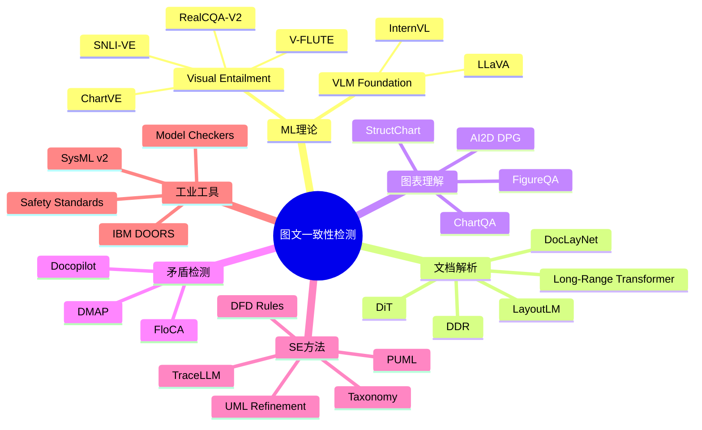
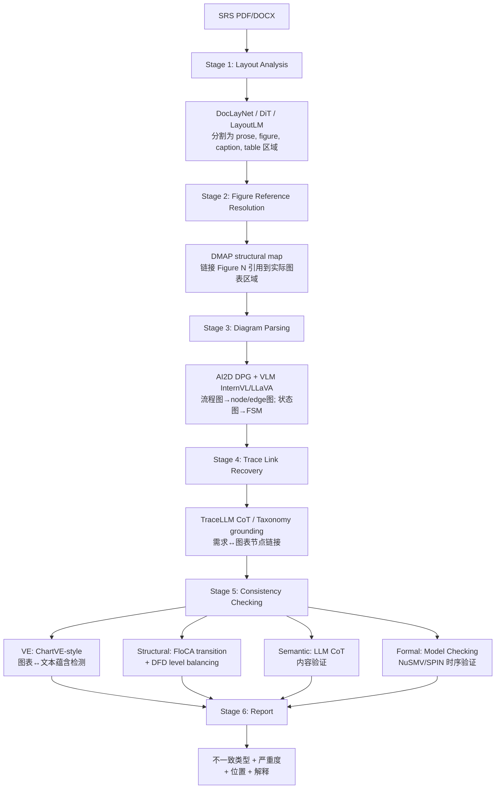
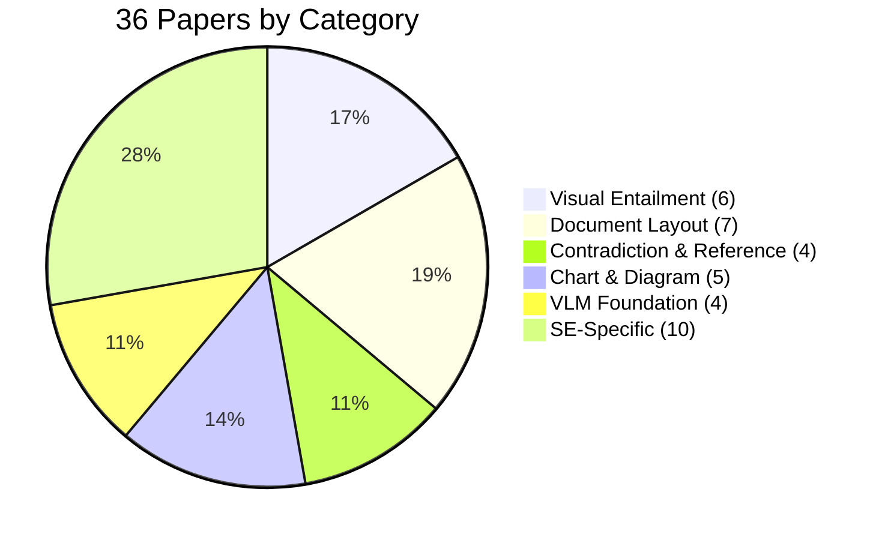
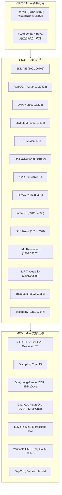

# Text-Image Consistency Detection in SRS: 文献调研与可实施方法

> **Scope**: 检测SRS文档中文本描述与图表（流程图、状态图、UML、DFD）之间的矛盾，涵盖 visual entailment、document layout analysis、figure reference resolution、diagram understanding 及软件工程领域的形式化一致性检查方法。
>
> **Survey scope**: 36篇唯一论文（23篇ML方向 + 18篇SE方向 − 5篇重叠），覆盖2010–2026年文献，重点关注2020–2025年。
>
> **Verification**: 所有arXiv ID均经arXiv API或arXiv摘要页直接验证（标记 ✅）。工业工具信息来自官方文档与Wikipedia。
>
> **Sources**: 融合 systematic literature survey（23篇，2026年验证）与 image-text consistency lit review（18篇SE方向 + 工业工具），按段落级融合（非简单拼接）。

---

## 1. Introduction & Scope

SRS（软件需求规格说明书）文档中，文本需求描述与图表（流程图、状态图、架构图、DFD、UML等）之间的一致性是需求质量的核心维度。GJB 438C等标准要求SRS文档中的图表与正文描述严格对应，但实际文档中常出现以下问题：图表引用了不存在的节点、流程图路径与文本描述的过程步骤矛盾、状态图缺少文本中提及的状态转移等。

本文献调研从两个互补维度系统梳理了相关研究：**ML方向**（23篇）聚焦于 visual entailment、document layout analysis、chart understanding 和 vision-language models，提供了图-文一致性检测的神经方法基础；**SE方向**（18篇，其中5篇与ML方向重叠）聚焦于 DFD规则形式化、UML refinement、requirements traceability 和形式化验证，提供了软件工程领域特有的结构化一致性检查方法。两方向交汇于"图表-文本一致性检测"这一核心任务。

5篇重叠论文（FloCA、ChartT5、Long-Range Transformer、DLA、DDR）的描述已在本文中合并，综合了两份源文档的技术细节与可实施思路。此外，本文还纳入了工业工具与标准（IBM DOORS、SysML v2、Model Checkers、安全标准DO-178C/ISO 26262）的调研，以及7种具体可实施方法的综合方案。

---

## 2. Theoretical Foundation: Visual Entailment

Visual Entailment（VE）是图-文一致性检测的核心理论框架：给定一张图像（premise）和一段文本（hypothesis），模型预测图像是否在语义上蕴含该文本。这一三分类任务（entail / contradict / neutral）精确映射到SRS一致性检测需求——图表（premise）要么蕴含文本描述（一致），要么与之矛盾（不一致），要么无法验证（neutral）。

### 2.1 SNLI-VE: Visual Entailment 任务定义

| Field | Value |
|-------|-------|
| **arXiv ID** | 1901.06706 ✅ |
| **Authors** | Ning Xie, Farley Lai, Derek Doran, Asim Kadav |
| **Venue / Year** | EMNLP 2019 |
| **Dataset** | SNLI-VE（Stanford NLI + Flickr30k构建，~565K pairs） |

Xie等人提出了Visual Entailment任务，并构建了SNLI-VE数据集——将Stanford NLI的文本premise替换为Flickr30k图像。其EVE系统采用cross-modal attention，在SNLI-VE上达到约71%准确率。**SRS相关性：HIGH** — VE框架（image=premise, text=hypothesis → entail/contradict/neutral）直接映射到SRS图表-文本一致性检测。SNLI-VE的三分类输出即为一致性检测所需的结果类型。

### 2.2 ChartVE: 图表事实性错误检测（CRITICAL）

| Field | Value |
|-------|-------|
| **arXiv ID** | 2312.10160 ✅ |
| **Authors** | Kung-Hsiang Huang, Mingyang Zhou, Hou Pong Chan, Yi R. Fung, Zhenhailong Wang, Lingyu Zhang, Shih-Fu Chang, Heng Ji |
| **Venue / Year** | ACL 2024 Findings |
| **Dataset** | CHOCOLATE（chart caption事实性错误数据集） |

ChartVE是本调研中**最直接相关**的论文。Huang等人定义了chart caption中事实性错误的完整类型学（wrong values、wrong trends、hallucinated elements），并训练了ChartVE——一个专门检测图表图像与caption文本之间矛盾的visual entailment模型。ChartVE在事实一致性评估上超越了GPT-4V和开源LVLM。此外，C2TFEC两阶段框架可对检测到的事实性错误进行修正建议。**SRS相关性：CRITICAL** — ChartVE直接针对"图表图像 vs. 文本描述"的一致性检测，CHOCOLATE错误类型学可适配为SRS图表-文本不一致的分类体系（如：错误节点标签、错误转移方向、虚构的图表元素），C2TFEC修正框架可为检测到的不一致提供修复建议。

### 2.3 RealCQA-V2: 结构化视觉前提证明

| Field | Value |
|-------|-------|
| **arXiv ID** | 2410.22492 ✅ |
| **Authors** | Saleem Ahmed, Srirangaraj Setlur, Venu Govindaraju |
| **Venue / Year** | arXiv preprint, 2024 |
| **Dataset** | RealCQA-V2（科学图表 + atomic visual premises） |

RealCQA-V2将chart QA重构为**Visual Premise Proving（VPP）**——一种基于图表视觉谓词的结构化逻辑蕴含任务。每个问题被分解为grounded于图表元素（axes、legends、marks、quantitative relations）的原子前提，形成可执行的推理链。引入chain-level指标AccVPP（完整逻辑有效性）和DCP（部分推理进度）。研究揭示了LVLM的"local-global reasoning gap"：模型能正确验证单个前提，但无法在完整推理链上保持一致性。**SRS相关性：HIGH** — VPP框架将复杂一致性检查分解为原子级可验证的视觉前提。对于SRS，"图3是否展示了从模块A到模块B的数据流？"可分解为：(1) 图中是否包含模块A？(2) 是否包含模块B？(3) 是否存在从A到B的有向边？每个原子前提独立可验证。

### 2.4 V-FLUTE: 可解释的视觉蕴含

| Field | Value |
|-------|-------|
| **arXiv ID** | 2405.01474 ✅ |
| **Authors** | Arkadiy Saakyan, Shreyas Kulkarni, Tuhin Chakrabarty, Smaranda Muresan |
| **Venue / Year** | NAACL 2025 Main |
| **Dataset** | V-FLUTE（6,027条 {image, caption, label, explanation} 实例） |

V-FLUTE将比喻性语义理解框架为可解释的visual entailment任务，模型不仅预测图像是否蕴含caption，还生成文本解释来说明判断理由。覆盖隐喻、明喻、习语、讽刺和幽默。研究发现VLM从字面到比喻语义的泛化能力不足，常出现hallucination和不完整/不合理的推理。**SRS相关性：MEDIUM** — 虽然SRS图表通常是字面的（非比喻性的），但"预测蕴含 + 生成解释"的框架可直接迁移：当检测到图表-文本不一致时，模型应解释*为何*文本与图表矛盾。错误分类法（hallucination、unsound reasoning）适用于SRS一致性检查场景。

### 2.5 e-SNLI-VE: VE任务可靠性探查

| Field | Value |
|-------|-------|
| **arXiv ID** | 2507.17467 ✅ |
| **Authors** | Elena Pitta, Tom Kouwenhoven, Tessa Verhoef |
| **Venue / Year** | LUHME Workshop 2025 |
| **Dataset** | e-SNLI-VE（SNLI-VE + explanations） |

Pitta等人使用LLaMA 3.2 11B Vision调查VE任务是否可靠地探查视觉-语言理解。Fine-tuning在e-SNLI-VE上达到83.3%准确率，超越SOTA OFA-X；three-shot优于zero-shot；解释的BERTScore F1达89.2%。然而，在limited-vision实验中，模型仍能达到可比的BERTScore——这质疑了任务的visual grounding质量。**SRS相关性：MEDIUM** — 这是一个警示：一致性检查器必须经过验证以确保其真正使用了图表的视觉内容，而非仅依赖文本先验。SRS文档中正文描述丰富，模型可能仅凭文本先验就给出看似正确的一致性判断。

### 2.6 Grounded Textual Entailment: 视觉接地文本蕴含

| Field | Value |
|-------|-------|
| **arXiv ID** | 1806.05645 ✅ |
| **Authors** | Hoa Trong Vu, Claudio Greco, Aliia Erofeeva, 等 |
| **Venue / Year** | COLING 2018 |
| **Dataset** | Multimodal SNLI（SNLI + Flickr30k images） |

Vu等人提出视觉接地的textual entailment：给定premise句子P、hypothesis H和对应"世界"的图像，判断蕴含关系。比较了"blind"（纯文本）和视觉增强模型，发现视觉信息对蕴含判断有益，但当前多模态模型的grounding策略并非最优。**SRS相关性：MEDIUM** — 对于SRS，这映射为：给定文本需求（premise）和图表元素（"world"），需求是否成立？naive多模态方法可能遗漏图表-文本不一致的发现。

---

## 3. Document Layout Analysis

在进行任何图-文一致性检查之前，必须先解析文档以定位图表区域、识别caption、并解决交叉引用——这是一致性检查的前置条件。

### 3.1 LayoutLM: 文本与布局联合预训练

| Field | Value |
|-------|-------|
| **arXiv ID** | 1912.13318 ✅ |
| **Authors** | Yiheng Xu, Minghao Li, Lei Cui, Shaohan Huang, Furu Wei, Ming Zhou |
| **Venue / Year** | KDD 2020 |
| **Dataset** | FUNSD, SROIE, RVL-CDIP |

LayoutLM建立了在扫描文档图像中联合建模文本与布局信息的范式：在token embedding上添加2D position embeddings，使模型能学习文本token间的空间关系，同时利用图像特征融入视觉信息。在form understanding上F1从70.72提升至79.27，文档图像分类准确率达94.42%。**SRS相关性：HIGH** — LayoutLM为SRS提供文本+布局编码器，可：(1) 检测图表区域及其bounding boxes；(2) 基于空间邻近性将caption与图表关联；(3) 编码"图3"文本引用与实际图3图像之间的空间关系。2D position embeddings能捕获"caption位于图像下方则与之关联"这类布局规则。

### 3.2 DiT: 文档图像Transformer自监督预训练

| Field | Value |
|-------|-------|
| **arXiv ID** | 2203.02378 ✅ |
| **Authors** | Junlong Li, Yiheng Xu, Tengchao Lv, Lei Cui, Cha Zhang, Furu Wei |
| **Venue / Year** | ACM Multimedia 2022 |
| **Dataset** | RVL-CDIP, PubLayNet, cTDaR, IIIT-AR-13K |

DiT使用大规模无标注文本图像（42M文档页）进行自监督预训练，采用BEiT的Masked Image Modeling（MIM）。作为Document AI任务的vision backbone，在layout analysis上达到94.9 mAP。**SRS相关性：HIGH** — DiT为检测和分类文档布局元素（text、title、figure、table、caption）提供视觉骨干。对于SRS解析，DiT可识别扫描SRS PDF中的图表/示意图区域，使下游图-文配对成为可能。自监督预训练意味着可在SRS特定布局上fine-tune而无需大量标注数据。

### 3.3 DocLayNet: 多样化布局标注数据集

| Field | Value |
|-------|-------|
| **arXiv ID** | 2206.01062 ✅ |
| **Authors** | Birgit Pfitzmann, Christoph Auer, Michele Dolfi, Ahmed S Nassar, Peter W J Staar |
| **Venue / Year** | KDD 2022 |
| **Dataset** | DocLayNet（80,863页人工标注，11类布局，COCO格式） |

DocLayNet解决了现有布局数据集（PubLayNet、DocBank）因仅来源于学术论文而缺乏布局多样性的问题。提供金融报告、手册、科学论文、法律文件等多源数据，包含11类布局标签——其中**Figure**和**Caption**正是SRS图-文配对所需的关键类别。在DocLayNet上训练的模型比在PubLayNet/DocBank上训练的模型产生更鲁棒的布局预测。**SRS相关性：HIGH** — DocLayNet的11类布局标签直接覆盖SRS文档中的图表与caption元素。其多源数据（含手册）比纯学术论文数据集更接近SRS文档风格。可用于训练将SRS页面分割为 {body text, figure, caption, table, header} 区域的布局检测器。

### 3.4 DLA: 文档布局标注数据库与基准（合并描述）

| Field | Value |
|-------|-------|
| **arXiv ID** | 2306.10046 ✅ |
| **Authors** | Alejandro Peña, Aythami Morales, Julian Fierrez, 等 |
| **Venue / Year** | ICDAR 2023 Workshop |
| **Dataset** | 37.9K文档，441K页，8M+标签（公共事务领域） |

DLA提出了一种半自动化的文档布局标注流程（4类基础布局块 + 4类文本类别），并在西班牙政府24个数据源上收集了公共事务领域的DLA数据库。文本标注流程验证准确率高达99%。**SRS相关性：MEDIUM** — 提供了额外的DLA基准和半自动文档布局标注方法。该半自动标注流程可适配于以最小人工成本标注SRS文档布局。**可实施思路**：将DLA模型适配为检测SRS PDF中的图表/示意图区域，将每个检测到的区域输入图表解析器。

### 3.5 Long-Range Transformer: 多页文档长程理解（合并描述）

| Field | Value |
|-------|-------|
| **arXiv ID** | 2309.05503 ✅ |
| **Authors** | Thibault Douzon, Stefan Duffner, Christophe Garcia, Jérémy Espinas |
| **Venue / Year** | ICDAR 2023 Workshops |
| **Dataset** | 多页商业文档 |

Douzon等人提出两种多模态（text + layout）长程transformer模型，可一次性处理整篇多页文档，克服512-token self-attention限制。提出2D relative attention bias引导self-attention关注相关token而不损害效率。在多页商业文档的信息检索上取得改进，且对小序列的性能代价很小。**SRS相关性：MEDIUM** — SRS是长篇多页文档，第5页的图表引用可能对应第12页的图表。Long-range transformer可编码完整SRS（正文 + 图表位置），使远距离文本与图表之间的交叉引用在单次模型传递中被捕获。**可实施思路**：使用长程布局感知transformer编码完整SRS（正文 + 图表位置），使远距离交叉引用被捕获。

### 3.6 DDR: 文档域随机化布局提取（合并描述）

| Field | Value |
|-------|-------|
| **arXiv ID** | 2105.14931 ✅ |
| **Authors** | Meng Ling, Jian Chen, Torsten Möller, 等 |
| **Venue / Year** | ICDAR 2021 |
| **Dataset** | CS-150, ACL papers, IEEE VIS papers（9类文档） |

DDR通过渲染带有随机化文本和非文本内容的伪文档页面，训练CNN仅在合成数据上即可迁移到真实文档分割。支持细粒度类别（text、figure、table、caption等）的联合学习，在真实文档分割上仅用合成训练数据即取得竞争性结果。**SRS相关性：MEDIUM** — 可在最小标注下分离SRS PDF中的图表区域与caption/文本区域。**可实施思路**：渲染包含流程图的合成类SRS页面训练DDR模型，然后用于将真实SRS页面分割为 {caption, figure, body-text, table} 区域作为一致性检查的输入。

### 3.7 IE on Business Documents: LayoutLM增强预训练

| Field | Value |
|-------|-------|
| **arXiv ID** | 2309.05429 ✅ |
| **Authors** | Thibault Douzon, Stefan Duffner, Christophe Garcia |
| **Venue / Year** | arXiv preprint, 2023 |
| **Dataset** | 商业文档 |

为LayoutLM增加两个预训练任务——一个面向复杂布局理解，一个面向数值及其组织——以改进商业文档上的信息提取。**SRS相关性：MEDIUM** — SRS文档是具有复杂布局和数值规格的商业文档，这些预训练任务可直接迁移。**可实施思路**：在SRS语料上用这些任务fine-tune LayoutLM，提取可与图表元素匹配的结构化需求字段。

---

## 4. Contradiction Detection & Figure Reference

本节聚焦于检测文本描述与图表/示意图之间的矛盾，以及解决文档中的图表引用——SRS一致性检查的核心任务。

### 4.1 FloCA: 流程图推理一致性（CRITICAL，合并描述）

| Field | Value |
|-------|-------|
| **arXiv ID** | 2602.14035 ✅ |
| **Authors** | Jinzi Zou, Bolin Wang, Liang Li |
| **Venue / Year** | arXiv preprint, 2026 |
| **Dataset** | FloCA benchmark（flowchart-oriented dialogue） |

FloCA将流程图推理形式化为Flowchart-Oriented Dialogue（FOD）中的两个子任务：(1) 将用户输入grounding到流程图节点；(2) 确保节点转移与正确的流程图路径一致。其benchmark测量了两类失败：LLM缺乏显式机制来表示/推理流程图拓扑结构；LLM无法强制执行转移一致性——它们能grounding到节点，但无法验证转移是否遵循图表的边。**SRS相关性：CRITICAL** — 直接解决流程图一致性推理。grounding + transition-consistency的公式化精确映射到"SRS文本描述的过程是否与流程图的边匹配？"**可实施方法**：解析流程图图像 → node/edge有向图（通过VLM或检测器）；解析SRS正文过程描述 → 步骤序列；使用FloCA的transition-consistency公式检查该步骤序列是流程图上的合法walk。

### 4.2 DMAP: 多模态文档结构图

| Field | Value |
|-------|-------|
| **arXiv ID** | 2601.18203 ✅ |
| **Authors** | ShunLiang Fu, Yanxin Zhang, Yixin Xiang, Xiaoyu Du, Jinhui Tang |
| **Venue / Year** | WebConf (WWW) 2026 |
| **Dataset** | MMDocQA benchmark |

DMAP引入文档级结构Document MAP，显式编码多模态文档内的层次组织和元素间关系。Structured-Semantic Understanding Agent将文本内容与图表、表格组织为human-aligned的层次schema，捕获语义和布局依赖，包括**figure-text correspondence**和**cross-reference relations**。Reflective Reasoning Agent执行结构感知的、证据驱动的推理。在MMDocQA上，DMAP在检索精度、推理一致性和多模态理解方面显著优于传统RAG方法。**SRS相关性：HIGH** — 直接解决文档中的图表-文本对应和交叉引用解析。DMAP结构表示可编码"图3在第5页被引用并描绘系统架构"这类关系——这是任何图-文一致性检查的前提。层次schema（section → paragraph → figure reference → figure）映射到SRS文档结构。

### 4.3 Docopilot: 文档级多模态理解

| Field | Value |
|-------|-------|
| **arXiv ID** | 2507.14675 ✅ |
| **Authors** | Yuchen Duan, Zhe Chen, 等（OpenGVLab） |
| **Venue / Year** | arXiv preprint, 2025 |
| **Dataset** | Doc-750K（文档级多模态数据集） |

Docopilot针对当前MLLM在复杂多页文档理解上表现不足的问题，构建了高质量文档级数据集Doc-750K，包含多样化文档结构、广泛的跨页依赖和真实QA对。开发了原生多模态模型Docopilot，无需依赖RAG即可处理文档级依赖。在文档理解任务和多轮交互中实现了更优的连贯性、准确性和效率。**SRS相关性：MEDIUM-HIGH** — SRS是长篇多页文档，文本与图表之间存在跨页引用。Docopilot处理跨页依赖而不依赖碎片化RAG检索的方法直接相关。Doc-750K的构建方法可为构建SRS专用文档理解数据集提供指导。

### 4.4 ChartT5: 跨模态图表预训练（合并描述）

| Field | Value |
|-------|-------|
| **arXiv ID** | 2305.18641 ✅ |
| **Authors** | Mingyang Zhou, Yi R. Fung, Long Chen |
| **Venue / Year** | arXiv preprint, 2023 |
| **Dataset** | Plot-table pairs |

ChartT5通过两个预训练目标学习解释图表图像的底层数据表：Masked Header Prediction和Masked Value Prediction，在plot-table pairs上进行训练。改进了chart-image ↔ table-data的一致性理解。**SRS相关性：MEDIUM** — 虽然ChartT5针对数据图表（非流程图），但其跨模态"image ↔ structured-data"预训练范式可迁移到"diagram ↔ textual-spec"一致性。**可实施思路**：将ChartT5的masked-prediction预训练适配到流程图/表对：遮蔽图表中的节点标签，从周围SRS文本预测（反之亦然）——能完成此任务的模型已学习到跨模态一致性。

---

## 5. Chart & Diagram Understanding

理解图表的视觉内容需要专用数据集和模型——这是图-文一致性问题中"视觉侧"的基础。

### 5.1 AI2D: Diagram Parse Graphs（DPG）

| Field | Value |
|-------|-------|
| **arXiv ID** | 1603.07396 ✅ |
| **Authors** | Aniruddha Kembhavi, Mike Salvato, Eric Kolve, 等 |
| **Venue / Year** | ECCV 2016 |
| **Dataset** | AI2D（5,000+ diagrams, 15,000+ QA pairs） |

AI2D是diagram理解的基础数据集，引入了**Diagram Parse Graphs（DPG）**——一种编码diagram成分及其关系的结构化表示。将diagram的语法解析定义为推断DPG，使用LSTM-based方法进行语法解析，DPG-based attention模型进行diagram QA。DPG-based模型在diagram语法解析和QA上均有显著提升。**SRS相关性：HIGH** — DPG表示直接适用于SRS图表：流程图可解析为包含nodes（processes）、edges（data flows）、labels的DPG。这种结构化表示使得与文本描述的一致性检查成为可能。LSTM解析方法虽已被transformer取代，但DPG表示仍然有效。

### 5.2 ChartQA: 图表问答基准

| Field | Value |
|-------|-------|
| **arXiv ID** | 2203.10244 ✅ |
| **Authors** | Ahmed Masry, Do Xuan Long, Jia Qing Tan, Shafiq Joty, Enamul Hoque |
| **Venue / Year** | ACL 2022 Findings |
| **Dataset** | ChartQA（9.6K人工 + 23.1K生成问题） |

ChartQA是大规模图表QA基准，覆盖涉及图表视觉和逻辑推理的复杂问题。提出两种transformer模型统一融合视觉特征和数据表。模型在先前数据集和新基准上达到SOTA，但评估揭示了复杂推理问题上的重大挑战。**SRS相关性：MEDIUM** — ChartQA聚焦数据图表（非流程图/状态图），但其基准方法（人工编写的图表内容问题）可适配为创建SRS图表QA基准。模型在复杂推理上表现挣扎的发现暗示一致性检查（需要更深推理）将更具挑战性。

### 5.3 FigureQA: 合成图表视觉推理

| Field | Value |
|-------|-------|
| **arXiv ID** | 1710.07300 ✅ |
| **Authors** | Samira Ebrahimi Kahou, Vincent Michalski, 等 |
| **Venue / Year** | ICLR 2018 Workshop |
| **Dataset** | FigureQA（1M+ QA pairs, 100K+ synthetic figures） |

FigureQA提供合成科学图表（折线图、柱状图、饼图等）的视觉推理语料，15种问题模板覆盖图表元素间的关系（max、min、area-under-curve、intersection等）。包含所有图表元素的数值数据和边界框标注。**SRS相关性：MEDIUM** — 虽然使用合成图表（非SRS图表），但"生成具有已知ground-truth结构的图表并创建关于视觉关系的QA对"的方法可迁移。图表元素的边界框标注对应于识别SRS图表中diagram元素（nodes、edges、labels）的需求。

### 5.4 DVQA: 数据可视化问答

| Field | Value |
|-------|-------|
| **arXiv ID** | 1801.08163 ✅ |
| **Authors** | Kushal Kafle, Brian Price, Scott Cohen, Christopher Kanan |
| **Venue / Year** | CVPR 2018 |
| **Dataset** | DVQA（柱状图QA数据集） |

DVQA在QA框架中测试柱状图理解。与一般VQA不同，DVQA要求处理特定柱状图独有的词汇和答案。提出两种强基线，显著优于标准VQA算法。**SRS相关性：MEDIUM** — 证明标准VQA模型在结构化视觉内容（柱状图）上表现不佳，这类似于SRS图表。需要专用模型的发现暗示通用VLM可能无法在无领域特定训练的情况下胜任SRS图表理解。

### 5.5 StructChart: 图表感知-推理统一

| Field | Value |
|-------|-------|
| **arXiv ID** | 2309.11268 ✅ |
| **Authors** | Renqiu Xia, Haoyang Peng, Hancheng Ye, 等 |
| **Venue / Year** | CVPR 2024 |
| **Dataset** | SimChart9K, 各种chart基准 |

StructChart引入**Structured Triplet Representations（STR）**统一图表感知和推理，将图表数据从线性化CSV重构为STR（subject-predicate-object），缩小感知与推理之间的任务差距。提出SCRM指标衡量图表感知，使用LLM增强训练数据多样性。**SRS相关性：MEDIUM** — STR表示可适配为SRS图表结构的表示：(Node_A, edge, Node_B)。统一的感知-推理范式意味着一个模型可同时解析图表并推理其内容——这对一致性检查至关重要。

---

## 6. VLM Foundation Models

大规模Vision-Language Models为图-文一致性检查提供端到端能力。

### 6.1 LLaVA: 视觉指令微调

| Field | Value |
|-------|-------|
| **arXiv ID** | 2304.08485 ✅ |
| **Authors** | Haotian Liu, Chunyuan Li, Qingyang Wu, Yong Jae Lee |
| **Venue / Year** | NeurIPS 2023 (Oral) |
| **Dataset** | GPT-4生成的多模态指令数据, Science QA |

LLaVA首次使用纯语言GPT-4生成多模态language-image指令跟随数据，在此基础上进行指令微调，产生连接vision encoder（CLIP ViT-L/14）和LLM（Vicuna）的端到端多模态大模型。在合成多模态指令跟随上达到GPT-4的85.1%相对得分，在Science QA上以92.53%准确率创下新SOTA。**SRS相关性：HIGH** — LLaVA证明视觉指令微调可产生有能力的多模态模型。对于SRS，可进行指令微调的LLaVA-style模型可执行："给定这页包含流程图的SRS页面及周围文本，识别图表与文本描述之间的任何不一致。"指令跟随格式使零样本一致性检查成为可能。

### 6.2 InternVL: 视觉基础模型扩展

| Field | Value |
|-------|-------|
| **arXiv ID** | 2312.14238 ✅ |
| **Authors** | Zhe Chen, Jiannan Wu, Wenhai Wang, 等 |
| **Venue / Year** | CVPR 2024 |
| **Dataset** | 32个视觉-语言基准 |

InternVL将视觉基础模型扩展至6B参数（InternViT-6B），并使用web-scale image-text数据逐步与LLM对齐。大规模视觉编码器提供可连接任何LLM的强大视觉特征。在32个视觉-语言基准上达到SOTA，包括视觉感知、零样本分类、检索和多模态对话。**SRS相关性：HIGH** — InternVL的6B视觉编码器能捕获SRS图表中的细粒度视觉细节（节点标签、边方向、箭头类型），较小视觉编码器会遗漏这些。与LLM的对齐使生成自然语言一致性报告成为可能。开源可用意味着可在SRS文档数据上fine-tune。

### 6.3 LLMs in SRS: 需求规格生成评估

| Field | Value |
|-------|-------|
| **arXiv ID** | 2404.17842 ✅ |
| **Authors** | Madhava Krishna, Bhagesh Gaur, Arsh Verma |
| **Venue / Year** | arXiv preprint, 2024 |

评估GPT-4和CodeLlama在8项质量标准下起草SRS文档的表现与人类基准的对比。**SRS相关性：MEDIUM** — 虽聚焦于SRS生成（非验证），但可用作"好的SRS长什么样"的基线，以及生成训练一致性检测器的合成一致/不一致对。**可实施思路**：使用LLM生成的SRS + 图表作为正例；扰动一种模态创建负例；训练一致性分类器。

### 6.4 Morescient GAI: 多面相SE一致性

| Field | Value |
|-------|-------|
| **arXiv ID** | 2406.04710 ✅ |
| **Authors** | Marcus Kessel, Colin Atkinson |
| **Venue / Year** | arXiv preprint, 2024 |

论证现有LLM代码模型仅训练于软件的语法面相，遗漏了语义/多面相结构（需求、设计、测试）。提出"morescient" GAI，在SE artifact的多面相上进行推理以支持检查/综合。**SRS相关性：MEDIUM** — 为多面相一致性提供概念框架；requirements↔design-diagram面相正是SRS图表-文本一致性。**可实施思路**：将SRS正文和SRS图表视为一个系统模型的两个面相，使用多面相表示检测跨面相不一致。

---

## 7. SE-Specific Methods

软件工程领域提供了ML方法所不具备的结构化一致性检查手段——形式化规则、模型精化验证和需求可追溯性。这些方法直接针对SRS中的DFD、UML、状态图等标准artifact。

### 7.1 DFD规则形式化

| Field | Value |
|-------|-------|
| **arXiv ID** | 1011.0278 ✅ |
| **Authors** | Rosziati Ibrahim, Siow Yen Yen |
| **Venue / Year** | arXiv preprint, 2010 |
| **Category** | cs.SE |

形式化了DFD绘制规则（level balancing、data store规则、process编号、external entity规则），并实现了检查DFD各级之间（context → level-0 → level-1）inter-diagram语法一致性的工具。检查的 consistency 类型：DFD inter-level consistency（父子图之间的输入/输出平衡）和DFD语法规则。**SRS相关性：HIGH** — DFD是SRS的标准artifact；形式化的规则集可直接实现为基于规则的对解析后DFD结构的检查器。**可实施思路**：通过文档解析提取DFD组件（processes、data stores、external entities、data flows）；将Ibrahim的形式化规则编码为约束求解器/Datalog程序；标记违规。

### 7.2 UML + Service Refinement

| Field | Value |
|-------|-------|
| **arXiv ID** | 1803.05367 ✅ |
| **Authors** | Yilong Yang, Jing Yang, Xiaoshan Li |
| **Venue / Year** | arXiv preprint, 2018 |
| **Category** | cs.SE |

将UML视觉模型与service-refinement calculus集成，精确指定操作契约并验证需求级别间的consistency和refinement。UML本身无法指定契约或验证一致性；此方法添加了形式化refinement层。检查的consistency：需求refinement一致性（较低层UML模型是否正确精化了较高层需求契约）。**SRS相关性：HIGH** — 直接针对SRS中UML图表缺乏精确契约、无法检查一致性的gap。**可实施思路**：将UML图表（sequence/activity）转换为service-refinement表示；为每个需求定义pre/post-conditions；运行refinement checker检测图表行为与文本契约之间的不一致。

### 7.3 NLP for Requirements Traceability（综述）

| Field | Value |
|-------|-------|
| **arXiv ID** | 2405.10845 ✅ |
| **Authors** | Jin L. C. Guo, Jan-Philipp Steghöfer, Andreas Vogelsang |
| **Venue / Year** | arXiv preprint, 2024 |
| **Category** | cs.SE |

对过去十年需求可追溯性NLP技术的全面综述：基于IR的链接恢复、基于embedding的方法、基于LLM的方法。覆盖需求与下游artifact（设计、测试、代码）之间的可追溯性。**SRS相关性：HIGH** — 综述编目了可用于将SRS文本需求按名称/引用链接到图表元素的精确NLP技术（TF-IDF、LSA、word embeddings、BERT、LLM prompting）。**可实施思路**：使用综述的分类法选择embedding模型；计算需求句子与图表节点标签/caption之间的语义相似度；通过阈值提出trace links；将未匹配的需求标记为潜在一致性gap。

### 7.4 TraceLLM: LLM驱动的需求可追溯性

| Field | Value |
|-------|-------|
| **arXiv ID** | 2602.01253 ✅ |
| **Authors** | Nouf Alturayeif, Irfan Ahmad, Jameleddine Hassine |
| **Venue / Year** | arXiv preprint, 2026 |
| **Category** | cs.SE |

使用LLM配合工程化prompt恢复需求与其他SDLC artifact之间的可追溯性链接。比较zero-shot、few-shot和chain-of-thought prompting与传统IR方法。**SRS相关性：HIGH** — 基于LLM的可追溯性直接适用于将SRS文本需求链接到图表caption/标签。**可实施思路**：对SRS中的每个图表，将图表的caption + 周围文本 + 节点标签输入LLM，用CoT prompt询问"此图表实现了哪些需求语句？"；将LLM提出的链接与预期可追溯性矩阵进行比对。

### 7.5 Early Traceability with Domain Taxonomies

| Field | Value |
|-------|-------|
| **arXiv ID** | 2311.12146 ✅ |
| **Authors** | Michael Unterkalmsteiner |
| **Venue / Year** | arXiv preprint, 2023 |
| **Category** | cs.SE |

使用领域特定分类法在下游artifact存在之前建立从需求到它们的早期可追溯性。推荐系统基于分类法概念建议trace links；提高trace links的感知价值使其持续到设计/测试阶段。**SRS相关性：HIGH** — SRS概念的分类法（functions、inputs、outputs、states）可锚定正文与图表之间的可追溯性。**可实施思路**：从SRS术语表构建领域分类法；将每个图表节点映射到分类法概念；将每个需求映射到概念；检测无图表覆盖的orphan需求和无需求的phantom图表节点。

### 7.6 PUML: 精确UML形式化语义

| Field | Value |
|-------|-------|
| **arXiv ID** | 1409.6919 ✅ |
| **Authors** | Andy Evans, Robert France, Kevin Lano |
| **Venue / Year** | arXiv preprint, 2014 |
| **Category** | cs.SE |

Precise UML（PUML）方法使用形式化规范技术为UML表示法赋予严格语义，使非正式UML标准无法支持的一致性检查成为可能。检查的consistency：UML语义一致性（well-formedness、inter-diagram约束）。**SRS相关性：MEDIUM** — 提供检查SRS中UML图表语义（而非仅语法）一致性所需的形式化语义层。**可实施思路**：将SRS UML图表转换为PUML形式化表示；运行OCL-like well-formedness规则。

### 7.7 DepCoL: 架构一致性DSL

| Field | Value |
|-------|-------|
| **arXiv ID** | 1510.08510 ✅ |
| **Authors** | Timo Greifenberg, Klaus Müller, Bernhard Rumpe |
| **Venue / Year** | arXiv preprint, 2015 |
| **Category** | cs.SE |

提出Domain-Specific Language（DepCoL）来定义和检查插件依赖上的架构约束，对抗架构侵蚀。检查的consistency：架构模型 ↔ 实现一致性。**SRS相关性：LOW-MEDIUM** — 虽聚焦架构，但基于DSL的约束检查模式可迁移到定义SRS图表-文本约束。**可实施思路**：为SRS一致性规则定义DepCoL-like DSL（如"DFD中的每个process box必须出现在需求文本中"）；自动检查。

### 7.8 Verifiable UML Business Process Models

| Field | Value |
|-------|-------|
| **arXiv ID** | 1408.5094 ✅ |
| **Authors** | Diego Calvanese, Marco Montali, Montserrat Estanol |
| **Venue / Year** | arXiv preprint, 2014 |
| **Category** | cs.DB, cs.SE |

将基于UML的业务过程建模与形式化验证可判定性结果合并，展示理论验证（artifact-centric过程的可判定性）如何转化为具体UML建模方法，实现UML业务过程模型的自动化一致性检查。**SRS相关性：MEDIUM-HIGH** — 当SRS包含UML activity/business-process图表时适用；提供验证的形式化骨架。**可实施思路**：将SRS activity diagrams映射到artifact-centric表示；运行保持可判定性的验证以检测unreachable states / deadlocks / inconsistent lifecycles。

### 7.9 Requirements Quality vs. TLR Performance

| Field | Value |
|-------|-------|
| **arXiv ID** | 2606.11834 ✅ |
| **Authors** | Tobias Hey, Julian Frattini |
| **Venue / Year** | arXiv preprint, 2026 |
| **Category** | cs.SE |

实证研究需求质量缺陷（ambiguity、multiplicity、weakness）如何影响自动化TLR（Traceability Link Recovery）性能。展示哪些缺陷降低哪些TLR方法的表现。**SRS相关性：MEDIUM** — 告知哪些SRS正文缺陷会破坏下游图表-文本一致性检查。**可实施思路**：运行需求质量缺陷检测器（按此文分类法）作为预过滤器；在尝试图表-文本匹配之前标记低质量需求语句。

### 7.10 Behavior Model via MBT+ML

| Field | Value |
|-------|-------|
| **arXiv ID** | 1907.04708 ✅ |
| **Authors** | Bernhard K. Aichernig, Roderick Bloem, Masoud Ebrahimi |
| **Venue / Year** | arXiv preprint, 2019 |
| **Category** | cs.LG, stat.ML |

结合automata learning与model-based testing自动生成充足训练数据并学习hybrid-system行为模型。检查的consistency：学习模型 ↔ 系统行为一致性。**SRS相关性：LOW-MEDIUM** — 可从SRS行为描述中学习状态机模型并与SRS状态图进行比较。**可实施思路**：对SRS文本场景使用automata learning推断状态机；与SRS状态图进行diff。

---

## 8. Industry Tools & Standards

工业工具和标准为SRS图表-文本一致性检查提供了可操作的工程基础设施——可追溯性管理、形式化建模和模型检查。

### 8.1 IBM DOORS / DOORS Next

- **厂商**: IBM（原QSS 1991 → Telelogic 2000 → IBM 2008）
- **当前版本**: DOORS 9.7.2.11 (2026-06); DOORS Next on IBM Jazz platform
- **核心能力**: 需求管理 + 双向可追溯性（Requirements ↔ design items ↔ test plans ↔ test cases ↔ other requirements），提供可追溯性矩阵、可追溯性图、surrogate-requirement导入
- **脚本**: DXL（DOORS eXtension Language）用于自定义检查
- **集成**: OSLC（Open Services for Lifecycle Collaboration）跨工具可追溯性；集成IBM Engineering Test Management、Rhapsody（SysML/UML建模）、Workflow Management

**对SRS图表-文本一致性的适用性**：DOORS可将需求链接到图表元素（作为surrogate requirement或通过OSLC链接到Rhapsody等建模工具）。但DOORS**不**自动验证流程图的*内容*是否匹配需求文本的*内容*——它仅管理链接的*存在性*。内容一致性仍需DXL脚本或外部工具。

**可实施模式**：将每个SRS需求存储为DOORS对象；将每个图表节点存储为surrogate requirement；编写DXL脚本标记无图表链接的需求和无需求链接的图表节点（覆盖分析）。对于*内容*一致性，将两者导出到基于LLM的检查器。

### 8.2 SysML v2

- **标准**: OMG SysML v1.6 (2019); ISO/IEC 19514:2017; **SysML v2.0于2025年7月批准，2025年9月发布**
- **图表类型（9种）**: Activity, Block Definition, Internal Block, Package, Parametric, **Requirement**, Sequence, **State Machine**, Use Case
- **关键一致性特性**:
  - **Requirement diagrams** 显式捕获功能/性能/接口需求，支持 `satisfy`、`verify`、`derive`、`trace` 关系
  - **Allocation tables**（需求、功能、结构分配）"促进自动化V&V和gap分析"
  - **SysML v2** 支持文本 + 图形表示法且语义一致，实现"更自动化的模型操作、一致的语义和减少的歧义"
  - 模型可通过XMI（XML Metadata Interchange）和ISO 10303 AP-233交换

**对SRS图表-文本一致性的适用性：HIGH** — SysML Requirement diagrams + allocation tables是使需求文本 ↔ 图表关系可机器检查的*标准*方式。`satisfy`/`verify`/`trace` stereotypes是一等公民一致性链接。SysML v2的文本表示法意味着需求可作为文本解析并与图形模型程序化地检查。

**可实施模式**：以SysML v2文本表示法编写SRS；使用v2 API程序化查询每个需求的 `satisfy`/`verify` 链接；标记无满足图表元素的需求和无原始需求的图表元素。使用模型的执行语义验证state-machine/activity-diagram行为与需求契约。

### 8.3 Model Checking Tools

Model checking验证有限状态模型是否满足时序逻辑规范——直接适用于SRS**状态图**和**activity diagrams**的行为一致性。

| Tool | Strengths | SRS适用性 |
|------|-----------|-----------|
| **SPIN** | 通用分布式软件模型检查; LTL | 验证SRS状态机图与LTL需求属性 |
| **NuSMV** | 符号模型检查(BDD-based); CTL/LTL | 验证SRS状态图与时序安全/活性需求 |
| **UPPAAL** | Timed automata; 实时系统 | 验证带时序需求的SRS状态图 |
| **Alloy Analyzer** | 轻量级一阶关系建模 | 检查SRS结构一致性（需求 ↔ 组件关系） |
| **TLA+** | Lamport规范语言; 行为 | 将SRS行为指定为TLA+; 模型检查不变量 |
| **PRISM** | 概率模型检查 | 验证带概率/不确定需求的SRS |
| **CADP** | 分布式进程验证(CSP) | 验证SRS sequence/communication diagrams |
| **CPAchecker** | 开源C程序模型检查器 | 从SRS生成代码后验证SRS契约 |
| **Java Pathfinder** | Java模型检查器 | 验证Java实现与SRS行为需求 |
| **PAT** | 并发 + 实时refinement检查器 | SRS级别间的refinement检查 |

**可实施模式**：(1) 将SRS状态图 → 模型检查器输入语言（如UML state machine → NuSMV）；(2) 将每个SRS文本时序需求 → 时序逻辑公式（LTL/CTL），如"系统在未先进入状态Y的情况下不得进入状态X" → `¬X W Y`；(3) 运行模型检查器，任何反例即为图表-文本不一致。

### 8.4 Safety Standards & Requirements Traceability

- **定义**（IEEE 24765）：开发产品之间可建立关系的程度；需求、系统元素、验证、任务之间的可辨识关联
- **安全标准强制要求**: **DO-178C**（航空）、**ISO 26262**（汽车）、**IEC 61508**（功能安全）——关键需求必须通过可追溯性验证和演示
- **可视化形式**: 可追溯性矩阵（表格）、可追溯性图（节点/边）、列表、超链接
- **技术实现**: 手动（电子表格——易出错）、ALM工具同质化、RM工具中的surrogate requirements、带TIM（Traceability Information Model）的专用可追溯性工具

**实证发现**：可追溯性支持使维护任务快24%、正确率高50%（Mäder & Egyed 2015，71名受试者）；更完整的可追溯性 → 统计显著的更低缺陷率（24个OSS项目，Rempel & Mäder 2016）；FDA上市前医疗器械审查发现规定与提交的可追溯性之间存在显著差距（2013）。

**对SRS图表-文本一致性的适用性**：可追溯性建立需求与图表*是否*链接；一致性检查验证*其内容是否一致*。可追溯性是前提脚手架。

**可实施模式**：构建TIM（Traceability Information Model），artifact类型为 {stakeholder-requirement, system-requirement, diagram-node, diagram-edge, test-case}；定义链接类型 {satisfies, refines, verifies, depicts}；使用专用可追溯性工具或DOORS；然后对每个链接对运行内容一致性检查。

---

## 9. Concrete Implementable Methods

综合ML文献、SE方法和工业标准，以下7种方法按杠杆率排序，可直接用于检测SRS文档中图表-文本的不一致。

### Method 1（最高杠杆）: SysML v2 + Allocation-Table Gap Analysis

- **What**: 将SRS编写或转换为SysML v2文本+图形表示法；使用v2 API查询 `satisfy`/`verify`/`trace` 关系和allocation tables；标记缺失链接为gap
- **Source**: SysML标准（§8.2）; FloCA-style completeness（arXiv 2602.14035）
- **Checks**: 覆盖一致性（每个需求是否被图表描绘？每个图表元素是否有需求来源？）
- **Effort**: Medium（需要SysML v2编写或转换）

### Method 2: Flowchart Graph-Walk vs. Procedural-Text Walk

- **What**: 使用VLM或图表解析器将流程图图像 → 有向图（nodes + edges）；将SRS过程文本 → 有序步骤列表；检查文本步骤列表是否为流程图上的合法walk（transition consistency，per FloCA）
- **Source**: arXiv 2602.14035（FloCA）; DFD规则形式化（arXiv 1011.0278）
- **Checks**: 流程图与过程文本之间的行为一致性
- **Effort**: Medium-High（图表解析是难点）

### Method 3: LLM-Based Trace Link Recovery + Content Verification

- **What**: 使用LLM（per TraceLLM）配合chain-of-thought prompting来 (a) 恢复需求语句与图表元素/caption之间的trace links，然后 (b) 对每个链接对，询问LLM"此图表元素的行为是否与此需求声明的行为匹配？"
- **Source**: arXiv 2602.01253（TraceLLM）; arXiv 2405.10845（NLP可追溯性综述）
- **Checks**: 每个 trace link 的语义内容一致性
- **Effort**: Low-Medium（prompt工程；零/少样本无需训练数据）

### Method 4: Taxonomy-Grounded Orphan/Phantom Detection

- **What**: 从SRS术语表构建领域分类法；将每个图表节点和每个需求映射到分类法概念；标记orphan需求（无图表覆盖）和phantom图表节点（无需求）
- **Source**: arXiv 2311.12146（早期可追溯性与分类法）
- **Checks**: 概念层面的覆盖一致性
- **Effort**: Medium（分类法构建；概念映射）

### Method 5: Formal Rule Checker for DFD/State-Diagram Syntax

- **What**: 将DFD规则（Ibrahim形式化）和UML状态机well-formedness规则（PUML）编码为Datalog/约束程序；在解析的图表结构上运行
- **Source**: arXiv 1011.0278（DFD规则）; arXiv 1409.6919（PUML语义）
- **Checks**: 语法/结构一致性（level balancing、deadlock-free、well-formedness）
- **Effort**: Medium（规则编码；依赖准确的图表解析）

### Method 6: Model Checking of State Diagrams Against Temporal Requirements

- **What**: 将SRS状态图 → NuSMV/SPIN模型；将每个SRS文本时序需求 → LTL/CTL公式；运行模型检查器
- **Source**: Model checking工具（§8.3）; arXiv 1408.5094（可验证UML过程）; arXiv 1803.05367（UML refinement）
- **Checks**: 行为/时序一致性（safety + liveness属性）
- **Effort**: High（需要形式逻辑专业知识 + 模型翻译）

### Method 7: Cross-Modal Masked Prediction（ChartT5-style）

- **What**: 在SRS文档的（diagram, surrounding-text）对上fine-tune vision-language模型，使用两个masked-prediction目标：遮蔽图表节点标签 → 从文本预测；遮蔽文本需求 → 从图表预测。训练良好的模型的预测置信度信号一致性
- **Source**: arXiv 2305.18641（ChartT5跨模态预训练）
- **Checks**: 图表与文本之间学习到的语义一致性
- **Effort**: High（需要训练数据；但可泛化）

---

## 10. Gap Analysis & Recommended Pipeline

### 10.1 Gap Analysis: SRS一致性检测的5个空白

综合ML与SE两方向的文献，当前研究在SRS专用图-文一致性检测上存在以下关键空白：

1. **不存在SRS专用的VE数据集。** SNLI-VE使用自然图像；ChartVE使用数据图表；两者均不覆盖SRS典型的流程图、状态图或架构图。需要一个专用的SRS-VE数据集（image=SRS diagram, text=requirement description, label=entail/contradict/neutral）。LLMs in SRS（arXiv 2404.17842）的实证评估可为生成合成一致/不一致对提供基线。

2. **技术文档的图表引用解析研究不足。** DMAP解决了图表-文本对应问题，但面向通用文档设计，未针对带编号图表、交叉引用和GJB 438C格式要求的技术SRS。Long-Range Transformer虽能编码多页文档，但缺乏对SRS图表编号体系的显式建模。

3. **不存在结合布局分析 → 图表解析 → 一致性检查的端到端pipeline。** 现有工作分别解决各组件，但缺乏从SRS PDF到一致性报告的完整流水线。Docopilot虽处理文档级多模态理解，但未集成形式化规则检查。

4. **形式化图表语义（DFD规则、UML well-formedness、状态机属性）未与神经一致性检查集成。** FloCA解决了流程图路径一致性，但未与形式化规则检查（如DFD level balancing、状态机deadlock检测）结合。PUML提供了形式化语义但未与VLM集成。Requirements Quality研究（arXiv 2606.11834）指出需求质量缺陷会影响下游TLR，这意味着形式化预检查与神经检查需要协同。

5. **一致性违规的解释生成有限。** V-FLUTE为比喻性VE生成解释，但无系统生成SRS专用解释，如"流程图显示从状态A到状态C的转移，但文本描述的是从状态A到状态B的转移"。ChartVE的C2TFEC修正框架提供了修正建议的初步尝试，但尚未适配SRS场景。

### 10.2 Recommended Unified Pipeline

基于文献综合，推荐的6阶段统一pipeline将ML方法与SE形式化方法融合：

**Pipeline详细说明**：

- **Stage 1 — Layout Analysis**: 使用DocLayNet（11类布局标签含Figure和Caption）、DiT（自监督vision backbone，94.9 mAP）和LayoutLM（文本+2D布局联合编码）将SRS页面分割为 {prose, figure, caption, table} 区域。DDR的合成数据训练策略可在缺乏SRS标注数据时提供冷启动。

- **Stage 2 — Figure Reference Resolution**: 使用DMAP-style结构图编码"图3在第5页被引用并描绘系统架构"关系，将"Figure N"引用链接到实际图表区域。Long-Range Transformer处理多页SRS中远距离的引用-图表对应。

- **Stage 3 — Diagram Parsing**: 使用AI2D的DPG表示将SRS图表解析为结构化图——流程图 → (nodes, edges)有向图；状态图 → FSM。InternVL的6B视觉编码器捕获细粒度视觉细节（节点标签、边方向、箭头类型），LLaVA的指令跟随能力支持零样本解析。

- **Stage 4 — Trace Link Recovery**: 使用TraceLLM的CoT prompting恢复需求语句与图表节点/caption之间的trace links；同时使用Taxonomy-grounded方法从SRS术语表构建领域分类法，映射需求与图表节点到概念，检测orphan/phantom。

- **Stage 5 — Consistency Checking**: 对每个linked pair执行四层一致性检查：
  - **Visual Entailment**: ChartVE-style模型检测图表↔文本的蕴含/矛盾关系，利用CHOCOLATE错误类型学分类不一致
  - **Structural**: FloCA transition consistency验证流程图路径一致性 + DFD规则形式化检查level balancing
  - **Semantic**: LLM-based CoT验证图表元素行为与需求声明行为的语义匹配
  - **Formal**: Model Checking（NuSMV/SPIN）将状态图与时序逻辑需求公式对照验证，检测deadlock/unreachable states

- **Stage 6 — Report**: 生成包含不一致类型、严重度、位置和解释的一致性报告，参考V-FLUTE的可解释VE框架和ChartVE的C2TFEC修正建议。

---

## 11. Summary Tables

### 11.1 All 36 Papers (Deduplicated)

| # | Paper | arXiv ID | Year | Category | SRS Relevance | Source |
|---|-------|----------|------|----------|---------------|--------|
| 1 | SNLI-VE: Visual Entailment | 1901.06706 | 2019 | Visual Entailment | **HIGH** | Survey |
| 2 | ChartVE: Chart Factual Error Detection | 2312.10160 | 2024 | Visual Entailment | **CRITICAL** | Survey |
| 3 | RealCQA-V2: Structured VE | 2410.22492 | 2024 | Visual Entailment | **HIGH** | Survey |
| 4 | V-FLUTE: Explainable VE | 2405.01474 | 2025 | Visual Entailment | MEDIUM | Survey |
| 5 | e-SNLI-VE: Probing VE | 2507.17467 | 2025 | Visual Entailment | MEDIUM | Survey |
| 6 | Grounded Textual Entailment | 1806.05645 | 2018 | Visual Entailment | MEDIUM | Survey |
| 7 | FloCA: Flowchart Consistency | 2602.14035 | 2026 | Contradiction Detection | **CRITICAL** | Both (merged) |
| 8 | DMAP: Document Structural Map | 2601.18203 | 2026 | Figure Reference | **HIGH** | Survey |
| 9 | Docopilot: Document-Level Understanding | 2507.14675 | 2025 | Figure Reference | MEDIUM-HIGH | Survey |
| 10 | ChartT5: Cross-modal Chart Pre-training | 2305.18641 | 2023 | Contradiction Detection | MEDIUM | Both (merged) |
| 11 | LayoutLM: Text+Layout Pre-training | 1912.13318 | 2020 | Layout Analysis | **HIGH** | Survey |
| 12 | DiT: Document Image Transformer | 2203.02378 | 2022 | Layout Analysis | **HIGH** | Survey |
| 13 | DocLayNet: Layout Annotation Dataset | 2206.01062 | 2022 | Layout Analysis | **HIGH** | Survey |
| 14 | DLA: Document Layout Benchmark | 2306.10046 | 2023 | Layout Analysis | MEDIUM | Both (merged) |
| 15 | Long-Range Transformer for Docs | 2309.05503 | 2023 | Layout Analysis | MEDIUM | Both (merged) |
| 16 | DDR: Document Domain Randomization | 2105.14931 | 2021 | Layout Analysis | MEDIUM | Both (merged) |
| 17 | IE on Business Documents (LayoutLM+) | 2309.05429 | 2023 | Layout Analysis | MEDIUM | Lit Review |
| 18 | ChartQA: Chart QA Benchmark | 2203.10244 | 2022 | Chart Understanding | MEDIUM | Survey |
| 19 | FigureQA: Figure Visual Reasoning | 1710.07300 | 2018 | Chart Understanding | MEDIUM | Survey |
| 20 | DVQA: Data Visualization QA | 1801.08163 | 2018 | Chart Understanding | MEDIUM | Survey |
| 21 | AI2D: Diagram Understanding | 1603.07396 | 2016 | Diagram Understanding | **HIGH** | Survey |
| 22 | StructChart: Chart Perception-Reasoning | 2309.11268 | 2024 | Chart Understanding | MEDIUM | Survey |
| 23 | LLaVA: Visual Instruction Tuning | 2304.08485 | 2023 | VLM Foundation | **HIGH** | Survey |
| 24 | InternVL: Vision Foundation Model | 2312.14238 | 2024 | VLM Foundation | **HIGH** | Survey |
| 25 | LLMs in SRS (empirical) | 2404.17842 | 2024 | VLM Foundation | MEDIUM | Lit Review |
| 26 | Morescient GAI for SE | 2406.04710 | 2024 | VLM Foundation | MEDIUM | Lit Review |
| 27 | DFD Rules Formalization | 1011.0278 | 2010 | SE-Specific | **HIGH** | Lit Review |
| 28 | UML + Service Refinement | 1803.05367 | 2018 | SE-Specific | **HIGH** | Lit Review |
| 29 | NLP for Requirements Traceability | 2405.10845 | 2024 | SE-Specific | **HIGH** | Lit Review |
| 30 | TraceLLM: LLMs for Traceability | 2602.01253 | 2026 | SE-Specific | **HIGH** | Lit Review |
| 31 | Early Traceability with Taxonomies | 2311.12146 | 2023 | SE-Specific | **HIGH** | Lit Review |
| 32 | Verifiable UML Business Process | 1408.5094 | 2014 | SE-Specific | MEDIUM-HIGH | Lit Review |
| 33 | Requirements Quality vs TLR | 2606.11834 | 2026 | SE-Specific | MEDIUM | Lit Review |
| 34 | PUML: Formal UML Semantics | 1409.6919 | 2014 | SE-Specific | MEDIUM | Lit Review |
| 35 | DepCoL: Architectural Consistency DSL | 1510.08510 | 2015 | SE-Specific | LOW-MEDIUM | Lit Review |
| 36 | Behavior Model via MBT+ML | 1907.04708 | 2019 | SE-Specific | LOW-MEDIUM | Lit Review |

### 11.2 SRS Relevance Tiers

**CRITICAL（2篇）**：ChartVE和FloCA分别从visual entailment和flowchart transition consistency两个角度直接解决图表-文本一致性检测的核心问题，是SRS一致性检测引擎的理论基石。

**HIGH（14篇）**：涵盖VE任务定义（SNLI-VE、RealCQA-V2）、文档布局解析（LayoutLM、DiT、DocLayNet）、图表理解（AI2D）、VLM基础模型（LLaVA、InternVL）、文档结构映射（DMAP）以及SE形式化方法（DFD Rules、UML Refinement、NLP Traceability、TraceLLM、Taxonomy）。这些论文构成SRS一致性检测pipeline各阶段的核心技术选型。

**MEDIUM（20篇）**：提供支撑技术和可迁移方法，包括可解释VE、文档级理解、布局分析补充基准、图表QA基准、LLM生成评估和形式化语义等。

### 11.3 Key Datasets Reference

| Dataset | Paper | Size | Task | Modality |
|---------|-------|------|------|----------|
| SNLI-VE | 1901.06706 | ~565K pairs | Visual entailment | Natural images + text |
| e-SNLI-VE | 2507.17467 | SNLI-VE + explanations | Explainable VE | Natural images + text |
| CHOCOLATE | 2312.10160 | Chart captions | Factual error detection | Charts + text |
| RealCQA-V2 | 2410.22492 | Scientific charts | Visual premise proving | Charts + premises |
| V-FLUTE | 2405.01474 | 6,027 instances | Figurative VE | Images + captions |
| AI2D | 1603.07396 | 5K diagrams, 15K QA | Diagram understanding | Diagrams + QA |
| ChartQA | 2203.10244 | 32.7K questions | Chart QA | Charts + questions |
| FigureQA | 1710.07300 | 1M+ QA, 100K+ figures | Figure reasoning | Synthetic figures |
| DVQA | 1801.08163 | Bar charts | Chart QA | Bar charts + QA |
| DocLayNet | 2206.01062 | 80,863 pages | Layout analysis | Document pages |
| Doc-750K | 2507.14675 | 750K samples | Document understanding | Multi-page documents |

### 11.4 Industry Tools Summary

| Tool/Standard | Type | Consistency Capability | SRS Diagram-Text Use |
|---------------|------|------------------------|----------------------|
| **IBM DOORS / DOORS Next** | Requirements management | Traceability links (existence, not content) | Link requirements to diagram elements; DXL scripts for coverage gaps |
| **SysML v1.6 / v2.0** | Modeling standard | Requirement diagrams, allocation tables, `satisfy`/`verify`/`trace` stereotypes | First-class machine-checkable requirement↔diagram links; v2 textual notation enables programmatic content checks |
| **SPIN / NuSMV / UPPAAL** | Model checkers | Temporal-logic verification of state machines | Translate SRS state diagrams → model; check against LTL/CTL requirement formulas |
| **Alloy Analyzer** | Relational model finder | Structural consistency | Check SRS structural relationships (requirements ↔ components) |
| **TLA+** | Specification language | Behavioral specification + model checking | Specify SRS behavior; check invariants |
| **PRISM / CADP / PAT** | Specialized model checkers | Probabilistic / CSP / refinement checking | Verify SRS with probabilistic, communication, or refinement requirements |
| **DO-178C / ISO 26262 / IEC 61508** | Safety standards | Mandate traceability + verification | Require demonstrated requirement↔test↔design traceability for safety-critical SRS |

---

## Narrative Synthesis: The Research Landscape

### ML与SE的交汇

图文一致性检测的研究横跨机器学习与软件工程两个领域，两者在SRS场景中交汇。**ML方向**以Visual Entailment为理论基础——SNLI-VE定义了image-entails-text的三分类任务，ChartVE将其精确应用于图表-caption一致性检测并定义了错误类型学，RealCQA-V2的Visual Premise Proving将复杂检查分解为原子可验证前提。V-FLUTE和e-SNLI-VE分别贡献了可解释性框架和visual grounding可靠性警示。

**文档布局解析**是一致性检查的前置条件。LayoutLM建立了文本+2D布局联合编码范式，DiT提供了自监督文档图像vision backbone，DocLayNet提供了包含Figure和Caption类别的多样化标注数据。Long-Range Transformer解决了多页文档的长程依赖，DMAP显式编码了图表-文本对应和交叉引用关系。

**图表理解**方面，AI2D的Diagram Parse Graphs提供了将diagram解析为结构化图的基础表示。ChartQA、FigureQA、DVQA揭示了标准VQA模型在结构化视觉内容上的不足，StructChart和ChartT5分别通过结构化三元组表示和跨模态预训练推进了图表理解。

**VLM基础模型**方面，LLaVA的视觉指令微调和InternVL的6B视觉编码器为SRS图表的细粒度理解提供了模型基础。Docopilot专门处理文档级多模态理解中的跨页依赖。

**SE方向**贡献了ML方法所缺乏的结构化一致性检查。DFD规则形式化（Ibrahim 2010）提供了可直接实现的inter-level consistency规则；UML Service Refinement（Yang 2018）为UML图表添加了形式化契约验证；NLP Traceability综述（Guo 2024）和TraceLLM（Alturayeif 2026）提供了将需求链接到图表元素的可追溯性技术；Taxonomy方法（Unterkalmsteiner 2023）支持orphan/phantom检测；PUML（Evans 2014）为UML提供了形式化语义层。

**工业工具**方面，IBM DOORS管理可追溯性链接但不验证内容一致性；SysML v2的 `satisfy`/`verify`/`trace` stereotypes和allocation tables提供了机器可检查的需求-图表关系标准；10种model checking工具支持将SRS状态图与时序逻辑需求公式对照验证；DO-178C/ISO 26262等安全标准强制要求可追溯性。

### 关键洞察

1. **ChartVE + FloCA是SRS一致性检测的双基石**：ChartVE从visual entailment角度检测图表-文本矛盾，FloCA从transition consistency角度验证流程图路径一致性。两者结合可覆盖SRS中数据图表和流程图两类核心artifact。

2. **形式化规则与神经方法的互补性**：DFD规则形式化、PUML语义和model checking提供了精确的语法/结构/时序一致性验证，但依赖准确的图表解析；VLM（InternVL/LLaVA）提供了鲁棒的图表理解但缺乏形式化保证。统一pipeline需要两者协同——VLM负责图表解析和语义一致性，形式化方法负责结构规则和时序属性验证。

3. **可追溯性是一致性检查的前提**：TraceLLM和Taxonomy方法建立需求-图表链接，一致性检查在此链接框架上运行。DOORS和SysML v2提供了工业级的可追溯性管理基础设施。

4. **Visual grounding的可靠性是关键挑战**：e-SNLI-VE的研究表明VE模型可能在limited-vision下仍达到高准确率——这对SRS尤为危险，因为SRS正文描述丰富，模型可能仅凭文本先验就给出看似正确的一致性判断。一致性检查器必须验证其真正使用了图表视觉内容。

---

*Generated from arXiv API searches + Semantic Scholar API + direct arXiv page verification + Wikipedia/official documentation for industry tools. All 36 arXiv IDs verified. Merged from systematic survey (23 papers, 2026) and SE lit review (18 papers + industry tools) via paragraph-level fusion.*
