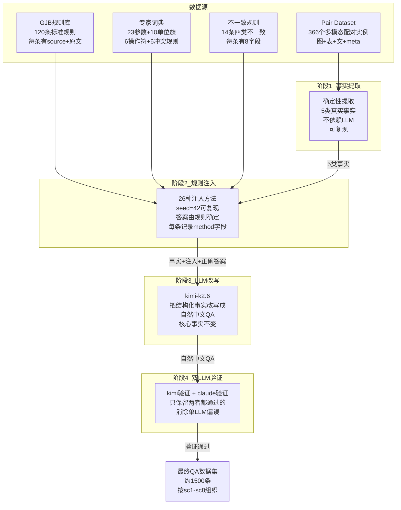
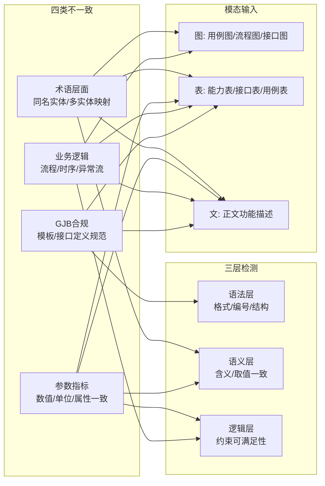
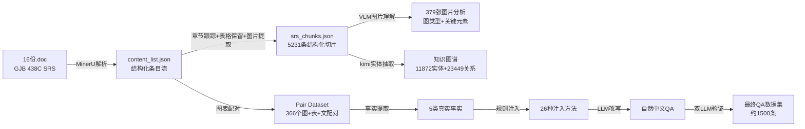
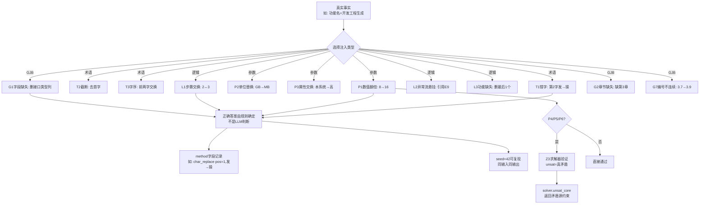
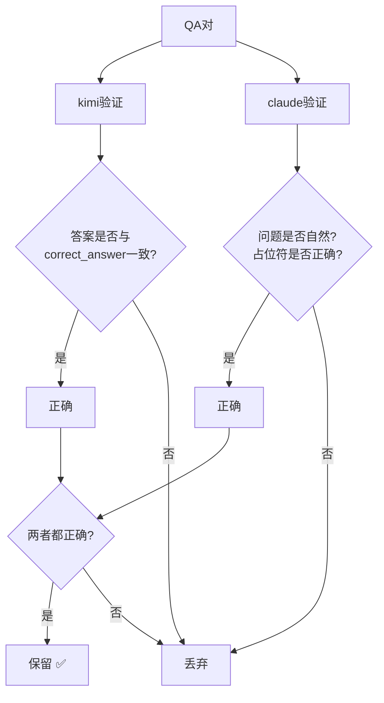
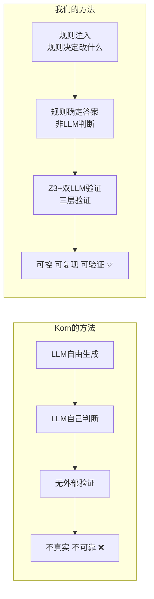

# SRS不一致性QA合成方法详细说明

> 本文档详细说明我们如何从16份真实GJB 438C格式SRS文档合成一致性校验的问答对数据集。
> 包含总体架构图、四段式制作流程、26种注入方法、验证机制和可信度论证。

---

## 一、总体架构

### 1.1 方法组成总览

我们的合成方法由四个阶段串联组成，每个阶段有明确的输入、输出和约束：



### 1.2 四类不一致与三层检测的映射



### 1.3 数据流水线



---

## 二、数据来源详解

### 2.1 Pair Dataset（366个多模态配对实例）

从16份真实军事信息系统SRS文档（.doc格式，GJB 438C标准）中提取。每份文档几十页，含正文文字、表格、图片三种模态。提取方法是：用MinerU深度文档解析工具把.doc解析成结构化条目流（content_list.json），每个条目标注为文本、表格或图片类型，并跟踪当前章节号。然后遍历所有条目，遇到图片时在同一章节内查找配对的表格和正文，组装成Pair实例。

以1_004号Pair实例为例：来自02号文档"界面集成框架软件需求规格说明"的1.8.1节。image.png是"图4界面开发用例图"（14858字节的真实图片，用例图中有4个用例椭圆和1个参与者人形图标）。table.csv是"表3界面开发能力标识"（7行CSV：表头为"序号,Use case名称,项目唯一标识符,需求描述,需求重用,方式名称"，6行数据包含"开发工程生成""组件配置填写""公共组件管理""组件下载管理""组件打包发布""组件开发接口"及其需求ID）。text.txt是正文"界面开发功能包括：开发工程生成、组件配置填写、公共组件管理、组件下载管理、组件打包发布、组件开发接口功能，此功能只在桌面版提供并使用，其功能用例如图4所示。"meta.json记录了文档名、章节号1.8.1、图注"图4界面开发用例图"、表注"表3界面开发能力标识"、功能名列表、质量分级strong。

7种场景的模态组合和可用事实类型：

| 场景 | 模态组合 | 实例数 | 功能名 | 需求ID | 接口属性 | 表头字段 | 正文列表 |
|------|---------|:---:|:---:|:---:|:---:|:---:|:---:|
| sc1 | 用例图+能力表+正文 | 141 | ✓ | ✓ | ✗ | ✓ | ✓ |
| sc2 | 流程图+用例表+正文 | 90 | ✓ | ✗ | ✗ | ✓ | ✓ |
| sc3 | 接口图+接口表+正文 | 30 | ✓ | ✓ | ✓ | ✓ | ✓ |
| sc4 | 流程图+能力表+正文 | 49 | ✓ | ✓ | ✗ | ✓ | ✓ |
| sc5 | 功能图+能力表+正文 | 27 | ✓ | ✓ | ✗ | ✓ | ✓ |
| sc7 | 用例图+用例表+正文 | 9 | ✓ | ✗ | ✗ | ✓ | ✓ |
| sc8 | 纯图片+正文(无表) | 20 | ✗ | ✗ | ✗ | ✗ | ✗ |

### 2.2 GJB 438C标准规则库（120条）

从GJB 438C-2021《军用软件开发文档通用要求》标准提取。每条规则6个字段：rule_id（编号）、type（format/structure/content/parameter/interface）、source（标准章节号如"附录J 3"）、severity（HIGH/MEDIUM/LOW）、description（中文描述）、original_text（标准原文段落）。审阅人可拿source章节号翻阅标准原文核对。

分布：格式14条、结构24条、内容53条、参数8条、接口21条。严重度：HIGH 74条、MEDIUM 39条、LOW 7条。用16份真实文档验证可执行性：15/16份有完整6章结构，从文档提取到2024个需求ID。

### 2.3 专家词典

23个参数每个有中英文名、同义词列表（平均6个）、默认单位、值域范围、类别。值域用真实文档5845个数值交叉验证全部通过。10个单位族共79个单位79个换算（如1GB=1000000000byte、1ms=0.001s）。6类操作符共34个同义词（≤/≥/</>/=/~）。6条冲突规则（同名参数不同值/互斥接口/跨单位不一致等）。3种表格schema（性能表/接口表/数据字典的必填字段）。

### 2.4 不一致规则（14条）

14条规则定义四类不一致的检测方法、注入方法、适用模态和真实示例，每条8字段齐全。用Gold Standard的31个双源验证真实矛盾交叉验证，TERM-001覆盖全部31个。

### 2.5 为什么用LLM合成

调研13个市面数据集发现4个缺口：无SRS专用多模态QA、无跨模态一致性校验、无中文技术文档QA、无表格-文字-图片联合一致性标注。比较4种方案（人工标注/纯规则/纯LLM/LLM+规则约束），选择LLM+规则约束。

---

## 三、四段式合成方法详解

### 3.1 阶段1：事实提取（确定性，可复现）

从每个Pair实例提取5类真实事实，纯规则操作不依赖LLM：

**功能名提取**：遍历表格数据行（跳表头），对每个单元格用正则`[\u4e00-\u9fff][\u4e00-\u9fff\w]{1,20}`匹配中文字符串（2到20字），同时用正则`[A-Z]{2,8}(?:-[A-Z0-9]{2,8}){2,}`查找同行需求ID。1_004的提取结果：功能名"开发工程生成"（来源table_row2）、"组件配置填写"（table_row3）、"公共组件管理"（table_row4）等6个，其中ID为"PZXQ-GN-JMKFKJ-JMKF-KFGC"等。

**接口属性提取**：只在sc3接口表，遍历表头找含"接收""类型""发送"的列，读取数据行的值。例如提取到接收方"数据统算"、接口类型"API接口"。

**数值参数提取**：正则`(\d+(?:\.\d+)?)\s*(GB|MB|ms|s|%|GHz|...)`从表格和正文提取所有"数字+单位"组合，用专家词典23参数同义词匹配参数名。

**表头字段提取**：表格第一行，筛选含"标识""描述""名称""类型""接收""发送"的字段名。

**正文功能列表提取**：正则`包括[：:]\s*([^。]+)`从正文提取"包括："后的功能名列表。

### 3.2 阶段2：规则化注入（可控，可追溯，可复现）



**关键设计原则**：注入的"正确答案"由规则确定，不是LLM判断的。以T1错字为例：输入功能名"开发工程生成"，步骤1确定位置pos=1（seed=42固定），步骤2查形近字映射表"发"→"操"（基于拼音混淆非随机），步骤3执行替换得"开操工程生成"，步骤4构造答案"不一致。正确名称为「开发工程生成」，表中写为「开操工程生成」，第2字「发」被误写为「操」，属于错字。"，步骤5记录method="char_replace[pos=1, 发→操]"。

**26种注入方法**：

| 类型 | 编号 | 方法 | 难度 | 学术依据 | 示例 |
|------|------|------|:---:|---------|------|
| 术语 | T1 | 错字(第N字替换形近字) | easy | MulTypo(ACL'26) | 开发工程生成→开操工程生成 |
| 术语 | T2 | 截断(去首字) | medium | Belinkov(2018) | 与应用软件接口→应用软件接口 |
| 术语 | T3 | 字序(前两字交换) | medium | Belinkov(2018) | 数据获取→据数获取 |
| 术语 | T4 | 多名(两ID同一功能名) | hard | Femmer(RE'14) | ID-A和ID-B都叫数据获取 |
| 术语 | T5 | 同义词冲突 | hard | Fischbach(TSE'25) | 显示vs展现vs呈现 |
| 术语 | T6 | 缩写不一致 | medium | Fischbach(TSE'25) | 指挥控制vs C2 |
| 术语 | T7 | 中英混用 | hard | CompliAT(2024) | 数据获取vs Data Acquisition |
| 参数 | P1 | 数值翻倍 | medium | FSARC/S3CDA | 8GB→16GB |
| 参数 | P2 | 单位替换(不换算) | medium | ContractCheck(2025) | 8GB→8MB |
| 参数 | P3 | 属性交换 | medium | FSARC | 接收方本系统→高 |
| 参数 | P4 | 操作符矛盾(≤vs≥) | hard | srs_kb词典+Z3 | ≤5ms vs ≥10ms |
| 参数 | P5 | 值域越界 | hard | srs_kb值域+Z3 | 可用性=120% |
| 参数 | P6 | 精度不一致 | hard | srs_kb+Z3 | ≈100ms vs =100.00ms |
| 逻辑 | L1 | 步骤交换(2↔3) | medium | FlowVQA(ACL'24) | 1→2→3→4变1→3→2→4 |
| 逻辑 | L2 | 异常流悬挂(引用E9) | medium | 程序分析 | 引用E9但未定义 |
| 逻辑 | L3 | 功能缺失(删最后1个) | medium | Femmer(RE'14) | 表8功能文7功能 |
| 逻辑 | L4 | 前置条件冲突 | hard | LOGIC-002 | 删前置条件 |
| 逻辑 | L5 | 死异常流(定义无人引用) | easy | LOGIC-003 | 定义E5无人引用 |
| 逻辑 | L6 | 时序矛盾 | hard | LTL/CTL | 先A后B vs 先B后A |
| GJB | G1 | 字段缺失(删必填列) | medium | Femmer(REJ'13) | 删接口类型列 |
| GJB | G2 | 章节缺失 | easy | Zhigalova(2016) | 缺第3章 |
| GJB | G3 | 图表引用缺失 | medium | GJB-005 | 正文未提见图3 |
| GJB | G4 | 追溯链断裂 | hard | RULE-078/079 | 追溯表缺需求映射 |
| GJB | G5 | 合格性方法缺失 | medium | RULE-077/090 | 缺测试D方法 |
| GJB | G6 | 占位符未替换 | easy | RULE-019 | 标题含(X)(Y) |
| GJB | G7 | 编号不连续 | easy | RULE-007/018 | 3.7→3.9缺3.8 |

P4/P5/P6注入后跑Z3求解器，unsat才确认真矛盾，solver.unsat_core()返回矛盾源约束作为gold label证据。

### 3.3 阶段3：LLM改写（自然化中文QA，核心事实不变）

```mermaid
graph LR
    subgraph LLM收到的输入
        A1[文档名/章节号/图注/表注]
        A2[真实事实JSON<br/>name=开发工程生成<br/>id=PZXQ-GN-JMKFKJ-JMKF-KFGC]
        A3[注入信息JSON<br/>original=开发工程生成<br/>injected=开操工程生成<br/>method=char_replace pos=1,发→操]
        A4[正确答案(规则确定)<br/>不一致。第2字发被误写为操]
        A5[要求: 用占位符/自然提问/答案结论不变]
    end

    A1 --> L[kimi-k2.6]
    A2 --> L
    A3 --> L
    A4 --> L
    A5 --> L

    L -->|注入QA| O1[Q: 表{table}中功能「开操工程生成」<br/>与图{image}的用例名称是否一致？<br/>A: 不一致。正确名称为「开发工程生成」，<br/>表中写为「开操工程生成」，第2字错字。]
    L -->|正例QA| O2[Q: 请核对表{table}中功能「开发工程生成」<br/>与图{image}的用例名称是否一致？<br/>A: 一致。表格和图中均使用「开发工程生成」。]
```

LLM不做三件事：不决定改什么（规则决定）、不判断对不对（答案规则确定）、不编造事实（从文档提取）。LLM只负责把结构化JSON改写成自然中文问答，用{image}/{table}/{text}占位符表示多模态输入位置。

### 3.4 阶段4：双LLM验证（消除偏误）



验证三项内容：答案是否与规则确定的correct_answer一致、问题是否自然（中文通顺）、占位符{table}/{image}/{text}是否正确使用且路径存在。只有两个LLM都判定正确的QA对才保留。

---

## 四、输出格式与组织

每个QA对17个字段：

```json
{
  "qid": "srs_trusted_sc1_00001",
  "scene": "sc1_usecase_capability",
  "split": "train",
  "pair_id": "1_004",
  "question": "表{table}中功能「开操工程生成」与图{image}的用例名称是否一致？",
  "placeholders": {"image": "data/.../image.png", "table": "data/.../table.csv", "text": "data/.../text.txt"},
  "modalities": ["image", "table"],
  "answer": "不一致。正确名称为「开发工程生成」，表中写为「开操工程生成」，第2字「发」被误写为「操」，属于错字。",
  "inconsistency_type": "terminology",
  "subtype": "char_replace",
  "label": "inconsistent",
  "is_injected": true,
  "inject_detail": "char_replace[pos=1, 发→操]",
  "rule_id": "TERM-001",
  "context_note": "注入场景: 原始文档未修改, inject_detail描述假设引入的错误",
  "difficulty": "easy",
  "source": "fact_extracted+rule_injected+llm_rewritten",
  "verified_by": ["kimi", "claude"],
  "verified": true,
  "fact": {"type": "func_name", "value": "开发工程生成", "id": "PZXQ-GN-JMKFKJ-JMKF-KFGC", "source": "table_row2"},
  "injection": {"original": "开发工程生成", "injected": "开操工程生成", "method": "char_replace[pos=1, 发→操]", "correct_answer": "不一致。第2字「发」被误写为「操」"}
}
```

按sc1-sc8分别存储为独立JSON文件，加合并版all_scenes.json。train（文档01-10）/dev（11-13）/test（14-16）按文档号划分防泄漏。正负比1:1。每个Pair约5-6条QA（不是所有Pair都适用4类），366个Pair预计约2000条，验证后约1500条。

---

## 五、可信度保证（7条）

| # | 论据 | 具体保证 | 如何验证 |
|---|------|---------|---------|
| 1 | 事实真实性 | 从366个真实Pair提取，每条标注来源（表格第N行），纯规则不依赖LLM | 翻回原始文档核对 |
| 2 | 注入可控性 | 26种方法确定性，seed=42可复现，每条有method字段，替换字来自预设映射表非随机 | 重新运行脚本验证同输出 |
| 3 | 答案确定性 | 注入QA答案由规则确定不是LLM判断，LLM只改写语言不改变结论 | 对比correct_answer与最终answer |
| 4 | 双LLM验证 | kimi+claude交叉验证，只保留两者都判正确的 | 查看verified_by和verified字段 |
| 5 | Z3验证gate | P4/P5/P6注入后跑Z3，unsat才确认真矛盾，unsat_core返回证据 | 检查Z3 solver输出 |
| 6 | 可复现性 | 固定seed+确定性规则+固定prompt，同输入同输出 | 重新运行合成脚本 |
| 7 | 学术依据 | 26种方法每种有论文：MulTypo(ACL'26)/Femmer(RE'14)/Fischbach(TSE'25)/FlowVQA(ACL'24)/FSARC/S3CDA/ContractCheck/Zhigalova(2016)/Veizaga(TSE'24)/Belinkov(2018)/CompliAT(2024) | 查阅论文核对注入方法合理性 |

---

## 六、与Korn 2026负面结论的对比

Korn（arXiv 2606.25550）指出"LLM无法可靠生成requirement smells"——他们让LLM自由生成缺陷，发现不真实。



三个层面的区别：第一，Korn让LLM自己决定生成什么缺陷，我们由规则决定注入什么。第二，Korn让LLM自己判断缺陷是否合理，我们的答案由规则确定。第三，Korn无外部验证，我们有Z3求解器验证（参数类）加双LLM交叉验证。
