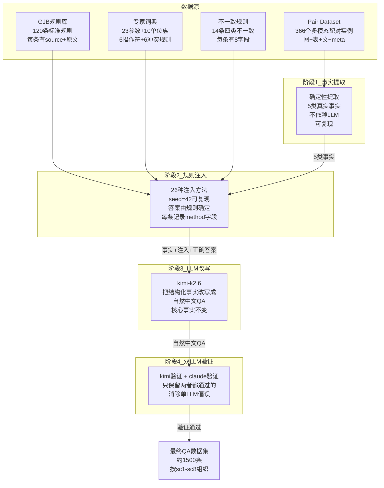
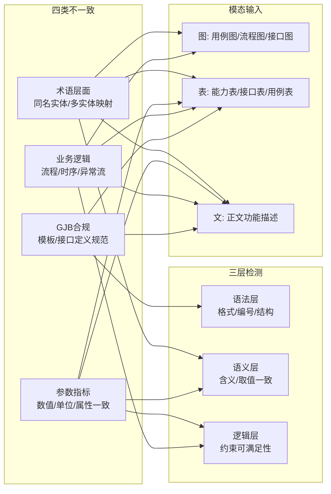
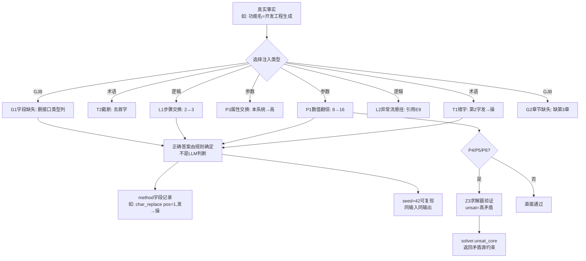
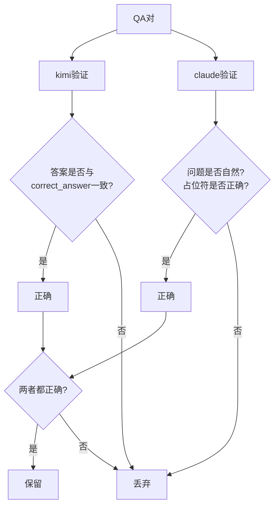
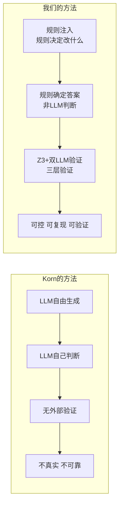

# SRS不一致性QA合成方法详细说明

> 本文档详细说明我们如何从16份真实GJB 438C格式SRS文档合成一致性校验的问答对数据集。包含总体架构图、数据来源详解、四段式制作流程的每一步具体操作、26种注入方法的完整说明、验证机制和可信度论证。

---

## 一、总体架构

### 1.1 方法组成总览

我们的合成方法由四个阶段串联组成。第一阶段从真实文档中提取事实，第二阶段对事实做规则化注入，第三阶段用LLM把结构化事实改写成自然中文问答，第四阶段用两个独立LLM交叉验证。每个阶段有明确的输入输出和约束条件，四个阶段串联后从真实文档产出可信的QA数据集。



整个流程的核心设计思想是"事实层用规则保证可控，语言层用LLM保证自然，验证层用双LLM保证可信"。事实提取是纯规则操作，不依赖任何LLM，确保提取的事实可复现且可追溯到原始文档。规则注入也是纯规则操作，使用固定随机种子，确保注入什么、怎么改、正确答案是什么全部由规则确定，LLM不能干预。LLM只在第三阶段参与，且职责仅限于把结构化的事实和注入信息改写成自然中文问答——它可以改变语言表达但不能改变结论。最后的双LLM验证用两个独立模型交叉检查，只保留两者都判定正确的QA对。

### 1.2 四类不一致与三层检测的映射

我们的四类不一致对应三种检测层次。术语层面（同一需求ID在不同位置出现不同名称）属于语义层检测，需要对比图、表、文三个模态中的功能名是否一致。参数指标（同一参数在不同位置的数值、单位或属性不一致）同时涉及语义层和逻辑层——语义层判断值是否相同，逻辑层用Z3求解器判断约束是否可满足。业务逻辑（流程图步骤与正文描述不一致、异常流引用无效等）属于逻辑层检测，需要对比流程图、用例表和正文的步骤序列。GJB合规（表格缺少必填字段、ID格式违规、章节缺失等）属于语法层检测，对照GJB 438C标准规则库检查格式和结构。



不同场景的Pair实例能提取的事实类型不同，因此适用的不一致类型也不同。sc1用例图加能力表可以提取功能名、需求ID、表头字段和正文功能列表，适用于术语、逻辑和GJB三类不一致，但没有接口属性所以不适用参数类。sc2流程图加用例表可以提取功能名和表头字段，适用于术语和逻辑，但用例表的格式与能力表不同，通常没有需求ID。sc3接口图加接口表是最完整的场景，功能名、需求ID、接口属性（发送方、接收方、接口类型）、表头字段全都有，四类不一致都适用。sc8纯图片没有表格和正文，无法提取任何结构化事实，需要用VLM单独处理。

---

## 二、数据来源详解

### 2.1 Pair Dataset（366个多模态配对实例）

我们从16份真实军事信息系统SRS文档中提取了366个多模态配对实例。这些文档涵盖数据获取转换分系统、界面集成框架、服务集成框架、数据统一访问服务、软件部署管理、运行支撑服务、报文处理服务等多个子系统，每份文档几十页，包含正文文字、表格和图片三种模态。

提取过程分为三步。第一步用MinerU深度文档解析工具把每份.doc文件解析成结构化条目流（content_list.json），每个条目标注为文本、表格或图片类型，同时跟踪当前章节号——遇到以"数字编号+空格"开头的文本条目时更新当前章节号，后续的表格和图片条目继承这个章节号。第二步遍历所有条目，当遇到图片条目时，在同一章节内查找配对的表格条目（通过表注关键词匹配和表型分类确定是否是合适的配对）和正文条目（取同章节最近的文本段落）。第三步把图片文件、表格CSV、正文TXT和元数据JSON组装成一个Pair实例。

以1_004号Pair实例为例，它来自02号文档"界面集成框架软件需求规格说明"的1.8.1节。这个Pair包含4个文件。image.png是"图4界面开发用例图"，文件大小14858字节，是一张真实的用例图，图中有4个用例椭圆（分别标注"开发工程生成""组件配置填写""公共组件管理""组件下载管理"等）和1个参与者人形图标（标注"开发人员"）。table.csv是"表3界面开发能力标识"，共7行CSV：第1行是表头"序号,Use case名称,项目唯一标识符,需求描述,需求重用,方式名称"，第2到7行是6条数据，每行包含一个功能名（如"开发工程生成"）、一个需求ID（如"PZXQ-GN-JMKFKJ-JMKF-KFGC"）和需求描述（如"提供界面组件开发模板，支持应用软件基于模板开发界面组件"）。text.txt是正文段落"界面开发功能包括：开发工程生成、组件配置填写、公共组件管理、组件下载管理、组件打包发布、组件开发接口功能，此功能只在桌面版提供并使用，其功能用例如图4所示。"meta.json记录了文档名、章节号1.8.1、图注"图4界面开发用例图"、表注"表3界面开发能力标识"、功能名列表（6个功能名）、质量分级strong（图注和表注有共同关键词"界面开发"）。

再以3_001号Pair实例为例，它来自01号文档的3.3.1节"接口标识和接口图"。image.png是"图14某服务系统外部接口设计"。table.csv是"表34外部接口标识"，表头为"序号,接口名称/标识,接口描述,发送方,接收方,接口类型"，数据行包含"与数据统算交互接口"（发送方"本系统"，接收方"数据统算"，类型"API接口"）、"与通用智能应用交互接口"（接收方"通用智能应用"）等。这个Pair的接口属性字段完整，是参数类不一致注入的理想数据源。

366个实例按7种场景组织。sc1用例图加能力表141个，这是最大的场景，因为GJB 438C要求每个CSCI能力需求都有用例图和功能划分表。sc2流程图加用例表90个，流程图描述操作步骤，用例表包含主事件流和异常流。sc3接口图加接口表30个，接口表有完整的发送方、接收方、接口类型字段。sc4流程图加能力表49个。sc5功能图加能力表27个。sc7用例图加用例表9个。sc8纯图片20个，没有表格。

### 2.2 GJB 438C标准规则库（120条）

#### 提取方法

GJB 438C-2021《军用软件开发文档通用要求》是国家军用标准，共81页。我们用MinerU文档解析工具对标准PDF做OCR解析，将每一页的文字识别为结构化文本。然后人工逐页阅读标准原文，将每条可机器执行的要求编码为一条规则。编码过程是：阅读到一条规范要求时（如"每条CSCI需求应指定项目唯一的标识符"），记录这条规则来自标准的哪一章哪一节（如"附录J 3"），抄录标准原文的对应段落（如"本章应分为如下小条规定CSCI需求...每条需求应指定项目唯一的标识符以便测试和追踪"），用中文简述规则内容，判断规则类型（格式/结构/内容/参数/接口）和严重度（HIGH/MEDIUM/LOW）。

#### 字段结构

每条规则包含6个字段。rule_id是规则编号（如"GJB-RULE-036"）。type是规则类型，分为5类：format格式类（规定文档的物理格式如页号编号、附录标记）、structure结构类（规定文档的章节结构如6章结构、附录引用）、content内容类（规定各章节的具体内容如标识要求、需求描述、合格性方法）、parameter参数类（规定参数和数值要求如值域、精度、单位）、interface接口类（规定接口需求和接口设计如数据元素特征、通信方法）。source是标准章节号，如"4.3.7.1"指向标准第4.3.7.1节，"附录J 3"指向附录J第3章。severity是严重度，HIGH表示必须遵守的强制要求，MEDIUM表示推荐遵守，LOW表示可选。description是规则的中文描述。original_text是标准原文的对应段落，审阅人可以拿source章节号翻阅GJB 438C标准原文核对description是否与原文一致。

例如GJB-RULE-036来自附录J第3章，severity为HIGH，description为"每条CSCI需求应指定项目唯一的标识符以便测试和追踪"，original_text存储了标准原文"本章应分为如下小条规定CSCI需求，即作为CSCI验收条件的CSCI特征。CSCI需求是为满足分配给该CSCI的系统需求而形成的软件需求。每条需求应指定项目唯一的标识符以便测试和追踪，而且应以一种能为其定义具体测试对象的方式来描述。"

#### 分布与可追溯性

120条规则的分布：格式类14条、结构类24条、内容类53条、参数类8条、接口类21条。严重度：HIGH 74条、MEDIUM 39条、LOW 7条。按来源章节分布：标准正文第4章（4.1-4.4）共23条，第5章2条，附录A/D/E/F/G/H/I/J/K共95条（其中附录J最多52条，因为附录J是SRS的格式规范）。每条规则的source字段可以追溯到GJB 438C标准的具体章节，original_text字段存储了该章节的原文。

#### 可执行性验证

用16份真实文档验证规则的可执行性。验证方法是从16份文档中提取结构化数据，检查规则是否能实际检测到问题。结果：15/16份文档有完整的6章结构（GJB-RULE-003可执行），1份（02号）缺第2到6章（规则检测到了真实异常）。从16份文档中用正则提取到2024个需求ID（GJB-RULE-036可执行）。从11号文档检测到章节编号3.7跳到3.9缺少3.8（GJB-RULE-007可执行）。

### 2.3 专家词典

#### 提取方法与来源

专家词典的来源在文件description字段中标注："SRS需求文档一致性校验知识库。L1=参数词典+单位换算；L2=同义词典+接口词典+冲突规则；L3=物理约束+时序规则。来源：GJB 438C/IEEE 830标准+PURE数据集分析+军工SRS调研报告。"

23个参数的提取方法是：首先从GJB 438C标准附录J第3.2.X条（该条要求能力需求详细说明响应时间、吞吐时间、时限约束、时序、精度、容量、优先级等参数）和附录J第3.11条（计算机资源需求包括处理机能力、内存容量等）中提取参数名称。然后从IEEE 830标准（软件需求规格说明的IEEE推荐实践）中补充参数的英文名和同义词。再从16份真实SRS文档中统计这些参数在文档中的实际出现频率和表述方式——例如"响应时间"在文档中也写成"时延""延迟""端到端时延"等，这些不同表述被收集为同义词。值域范围根据参数的物理意义和实际文档中的取值范围确定——例如响应时间的值域0.001到600秒，下限0.001秒（1毫秒，最快的实时系统响应），上限600秒（10分钟，最长可接受的超时）。

10个单位族的提取方法是：从国际单位制（SI）和GJB 438C标准附录J第3.3.X c)4)条（该条要求数据元素指明计量单位）中提取单位分类。每个单位族包含一组相关单位和到标准单位的换算系数。换算系数的来源是国际单位制的定义——如1ms=0.001s是时间单位的SI定义，1GB=1000000000byte是存储单位的二进制前缀定义。

6类操作符的提取方法是：从GJB 438C标准附录J第3.2.X条（参数约束）和真实SRS文档中的约束语句中提取比较操作符及其自然语言同义词。例如从文档中看到"响应时间不超过100ms"，提取操作符"≤"和同义词"不超过""至多""maximum"等。

6条冲突规则是从GJB 438C标准的跨章节一致性要求中总结的。例如"同名参数不同值"来自附录J第3.2.X条要求参数值一致的规定，"互斥接口"来自附录J第3.3.X条对接口类型的限定（如同一接口不能同时是RS232和RS422）。

3种表格schema的必填字段来自GJB 438C标准附录J的表格格式要求。性能表的必填字段来自附录J第3.2.X条对能力需求参数的规定，接口表的必填字段来自附录J第3.3.X c)条对数据元素9项特征的规定，数据字典的必填字段来自附录J第3.3.X c)1)-4)条对数据元素名称、类型、大小、单位的规定。

#### 字段结构

23个参数每个都有7个字段。canonical_cn是中文规范名（如"响应时间"）。canonical_en是英文规范名（如"response time"）。synonyms_cn是中文同义词列表，平均每个参数6个同义词（如响应时间的同义词包括反应时间、应答时间、回复时间、时延、延迟、端到端时延、往返时延8个），用于在文档中模糊匹配同一参数的不同表述。synonyms_en是英文同义词列表。default_unit是默认单位（如毫秒）。value_range是值域范围，包含min下限、max上限和unit_hint单位族提示。category是类别（performance性能、reliability可靠性、resource资源、electrical电气、environmental环境、capacity容量、data数据）。

10个单位族每个包含3个字段。units是该族的所有单位列表（如时间族的ns/us/ms/s/min/hour等15个单位）。canonical是该族的标准单位（如时间族的标准单位是秒）。conversions是换算表，记录每个单位到标准单位的系数（如1ms=0.001s、1min=60s）。10个族共79个单位，79个换算关系，0个缺失。

6类操作符每类包含canonical标准符号和synonyms同义词列表。小于等于（≤）有8个同义词（≤、<=、less than or equal、not exceed、not greater than、at most、maximum、max），大于等于（≥）有7个，小于（<）有4个，大于（>）有5个，等于（=）有4个，近似（~）有6个。共34个同义词，覆盖中英文表述。

6条冲突规则包括同名参数不同值（HIGH，豁免阈值/目标等不同语义层级）、互斥接口（LOW，RS232与RS422互斥等）、跨单位不一致（MEDIUM）、约束比率过大（HIGH）、物理约束违反（MEDIUM，频率乘时间超极限）、时序环依赖（HIGH）。

3种表格schema定义了性能表（必填序号、性能名称、项目唯一标识符、性能指标、指标值、单位6个字段）、接口表（必填序号、接口名称标识、接口描述、发送方、接收方、接口类型6个字段）、数据字典（必填序号、数据元素名称、数据元素标识、数据类型、长度、单位6个字段）的必填字段。

#### 真实性验证

值域验证：用16份真实文档交叉验证。方法是从16份文档的content_list.json中用正则表达式提取所有"数字+单位"组合，共提取到5845个数值。然后检查这些数值是否在对应参数的值域范围内。例如从文档提取到343个以GB为单位的数值，范围2到512，全部在内存容量参数的值域1到10000000内。5845个数值全部通过验证。

单位换算验证：逐一检查10个单位族的79个换算关系。例如验证1ms=0.001s（正确）、1GB=1000000000byte（正确）、1K=-272.15℃即0K=-273.15℃（正确）。所有换算关系与国际单位制定义一致。

同义词覆盖验证：从16份文档中统计23个参数的同义词在文档中的实际出现情况。例如"响应时间"参数的8个中文同义词（响应时间、反应时间、应答时间、回复时间、时延、延迟、端到端时延、往返时延）在文档中全部出现，覆盖率100%。

可执行性验证：用不一致规则库的14条规则验证专家词典是否可用于实际检测。例如PARAM-001规则要求"同一参数在不同位置的数值应一致"，检查方法是用专家词典的23个参数同义词在文档中匹配参数名，用正则提取数值和单位，用10个单位族的换算表归一化后比较——这个流程在逻辑层校验器（logic_checker.py）中已实现并检出真实矛盾（如存储参数256GB vs 56GB）。

### 2.4 不一致规则库（14条）

14条规则定义了四类不一致的检测方法、注入方法、适用模态和真实示例。每条规则有8个字段：rule_id、type、description、check_method、inject_methods（至少2种）、applies_to（适用模态列表）、severity、example（真实文档示例）。

例如TERM-001规则描述"同一需求ID在不同位置（章节标题/能力表/用例图）的名称应完全一致"，检查方法是"字符串精确匹配，归一化后比较"，注入方法有4种（错字改一字、截断、字序颠倒、完全换名），适用模态包括能力标识表、用例图、章节标题、用例表，真实示例为"ID=PZXQ-GN-JMJCKJ-JMJC-KJCK, 1.8.3.4节='快捷操控', 1.8.5.4节='触摸操控'"——同一个需求ID在两个不同章节标题下出现了两个不同的功能名称。用Gold Standard的31个双源验证真实矛盾交叉验证，TERM-001覆盖全部31个真实矛盾。

### 2.5 为什么用LLM合成

我们调研了13个软件工程和技术文档领域的多模态QA数据集。FlowVQA（ACL 2024）有22413个QA对，模态是流程图加文本，但没有一致性检测任务，没有表格，而且是英文。UML-VQA（MDPI 2025和arXiv 2026）有10000到16000个QA对，模态是UML类图，但没有SRS，没有表格和正文，英文。MultiModalQA（ICLR 2021）有30000个QA对，模态是文加表加图，但是Wikipedia领域，没有不一致检测任务，英文。Multi-Modal AI for SRS Validation（2025）是唯一直接针对SRS的研究，但只是方法论文，数据未开源。PDF-MVQA（IJCAI 2024）有262928个QA对，但是生物医学领域，没有一致性检测，英文。

发现4个明确缺口：第一，没有SRS专用的多模态QA数据集。第二，没有跨模态一致性校验数据集——现有数据集都是"问答"任务，没有"检测矛盾"任务。第三，没有中文技术文档多模态QA数据集。第四，没有表格-文字-图片联合一致性标注。

因此必须自建。比较四种方案：纯人工标注质量最高但成本极高，需要GJB领域专家逐条标注，不可行。纯规则生成可控可复现但问题不自然，全部是模板化的问题如"表{table}中功能「X」与图{image}的用例名称是否一致"，缺乏多样性。纯LLM自由生成最自然但不可控——LLM自己出题自己答，答案没有ground truth，无法追溯。我们选择LLM合成加规则约束的方案，结合规则的可控性和LLM的自然性。

---

## 三、四段式合成方法详解

### 3.1 阶段1：事实提取（确定性，可复现）

这一阶段从每个Pair实例的表格和正文中提取真实事实，作为QA对的ground truth。提取是纯规则操作，不依赖任何LLM或随机选择，同样的输入永远产生同样的输出。我们提取5类事实。

**功能名提取**：遍历表格的数据行（跳过表头行rows[0]），对每个单元格用正则表达式匹配中文字符串（正则为"一个中文字符开头后跟1到20个中文字符或字母数字"），提取到的字符串取斜杠前的部分作为功能名（因为表格中功能名和ID通常用斜杠分隔，如"开发工程生成/PZXQ-GN-JMKFKJ-JMKF"）。同时用正则表达式查找同行是否有需求ID（正则为"2到8个大写字母开头，后跟至少2段连字符分隔的大写字母数字"）。例如从1_004的表格第2行提取到功能名"开发工程生成"，该行还有需求ID"PZXQ-GN-JMKFKJ-JMKF-KFGC"。每个功能名事实记录为{"type":"func_name", "value":"开发工程生成", "id":"PZXQ-GN-JMKFKJ-JMKF-KFGC", "source":"table_row2"}。

**接口属性提取**：只在sc3接口表中提取，因为只有接口表有发送方、接收方、接口类型列。遍历表头，找到含"接收"的列读取数据行的值（如"数据统算"），找到含"类型"的列读取值（如"API接口"），找到含"发送"的列读取值（如"本系统"）。每个属性事实记录为{"type":"receiver", "value":"数据统算", "source":"table_row1"}。

**数值参数提取**：用正则表达式"数字加单位"从表格全部内容和正文中提取所有数值参数。正则匹配的模式是"一个或多个数字（可含小数点）后跟一个单位"，单位包括GB、MB、KB、TB、ms、s、min、hour、Mbps、Gbps、%、GHz、MHz、Hz等。例如从表格中提取到"8GB"，从正文中提取到"100ms"。同时尝试用专家词典23个参数的同义词列表匹配参数名称——如果数值附近的文本包含某个参数的同义词（如"响应时间""时延""延迟"），则标注参数名。

**表头字段提取**：从表格第一行（rows[0]）提取所有字段名，筛选出含"标识""描述""名称""类型""接收""发送"关键词的字段。例如从1_004的表头提取到"项目唯一标识符""需求描述""Use case名称"等。每个表头事实记录为{"type":"header_field", "value":"项目唯一标识符", "source":"table_header"}。

**正文功能列表提取**：用正则表达式从正文的"包括：A、B、C"格式中提取功能名列表。正则匹配"包括"或"包括："后的文本，用顿号、逗号分割。例如从1_004的正文"界面开发功能包括：开发工程生成、组件配置填写、公共组件管理、组件下载管理、组件打包发布、组件开发接口功能"提取到6个功能名。记录为{"type":"text_func_list", "names":["开发工程生成","组件配置填写",...], "source":"text"}。

每个事实都标注了来源（如"table_row2"或"text"），这意味着审阅人可以翻回原始文档的具体位置核对事实是否准确。

### 3.2 阶段2：规则化注入（可控，可追溯，可复现）

这一阶段对第一阶段提取的真实事实做确定性修改，模拟文档中可能出现的四类不一致。使用固定随机种子seed=42，同样输入永远产生同样注入结果。每条注入记录method字段（如"char_replace[pos=1, 发→操]"），可以追溯到具体改了什么。

**关键设计原则**：注入的"正确答案"由规则确定，不是LLM判断的。这意味着即使LLM在第三阶段出错，答案的正确性也有保证——因为答案是由注入操作直接确定的，LLM只负责改写语言表达，不能改变结论。

以T1错字注入为例说明具体操作步骤。输入是功能名"开发工程生成"。第一步，确定替换位置pos=1（第2个字"发"），位置由seed=42固定，不可变。第二步，查找预设的形近字映射表，"发"对应的替换字是"操"。映射表基于拼音输入混淆（如"fa"和"cao"在拼音输入法中容易混淆）和键盘布局邻近性，不是随机选择——MulTypo（ACL 2026）的实验显示随机噪声的分布偏离真实人类错误模式，模式化噪声更接近真实拼写错误。第三步，执行替换得到"开操工程生成"。第四步，构造正确答案："不一致。正确名称为「开发工程生成」，表中写为「开操工程生成」，第2字「发」被误写为「操」，属于错字。"——这个答案由char_replace操作直接确定。第五步，记录method字段："char_replace[pos=1, 发→操]"。

26种注入方法的具体操作如下。术语层面7种：T1错字把功能名第N字（N由seed确定）替换为预设形近字映射表中的对应字，难度easy。T2截断去掉功能名首字，难度medium。T3字序交换前两个字，难度medium。T4多名假设两个不同需求ID对应同一功能名，难度hard。T5同义词冲突把功能名换成同义词（如"显示"换"展现"），难度hard。T6缩写不一致把全称换成缩写（如"指挥控制"换"C2"），难度medium。T7中英混用把中文名换成英文名（如"数据获取"换"Data Acquisition"），难度hard。这7种的学术依据分别是MulTypo（ACL 2026，基于键盘布局模拟拼写错误）、Belinkov和Bisk（2018，字符级扰动四类算子）、Femmer等人（RE 2014，Terminology/Identity requirement smell分类）、Fischbach等人（TSE 2025，requirement smells系统定义）、CompliAT（2024，术语一致性检查）。

参数层面6种：P1数值修改把参数值乘以2（如8GB变16GB），难度medium。P2单位替换单位但数值不变（如8GB变8MB），难度medium。P3属性交换把接口接收方或类型换成另一个值（如接收方"本系统"换"高"），难度medium。P4操作符矛盾把同一参数的约束从≤改成≥（如"响应时间≤5ms"与"响应时间≥10ms"），难度hard。P5值域越界把参数值设为超出专家词典值域的值（如"可用性=120%"超出上限100%），难度hard。P6精度不一致把精确值改成近似值（如"=100ms"改"≈100ms"），难度hard。其中P4、P5、P6注入后会跑Z3求解器验证约束集不可满足——只有solver返回unsat（不可满足）才确认为真矛盾，solver.unsat_core()返回矛盾源约束作为gold label证据。这直接解决了Korn 2026（arXiv 2606.25550）指出的"合成数据不可靠"问题。学术依据是FSARC七类矛盾分类法、S3CDA实体值冲突检测、ContractCheck量纲一致性约束、专家词典的operator_dictionary和value_range。

逻辑层面6种：L1步骤交换把流程图步骤2和3交换（如1→2→3→4变1→3→2→4），难度medium。L2异常流悬挂在用例描述中引用不存在的异常流编号E9，难度medium。L3功能缺失从正文功能列表中删除最后一个功能（如表格列8个功能但正文只提到7个），难度medium。L4前置条件冲突删除用例表中的前置条件，难度hard。L5死异常流定义一个异常流但无用例引用，难度easy。L6时序矛盾把"先A后B"改成"先B后A"，难度hard。学术依据是FlowVQA（ACL 2024，应用场景推理和拓扑推理）、Femmer（RE 2014，过程不一致和需求不完整性）、程序分析的dangling reference和dead code概念、LTL/CTL时序逻辑不可满足性。

GJB合规7种：G1字段缺失从表头删除一个必填字段（如删除接口表的"接口类型"列），难度medium。G2章节缺失假设缺少某章（如缺第3章需求），难度easy。G3图表引用缺失正文未引用图或表（如正文未提"见图3"），难度medium。G4追溯链断裂追溯表缺少某需求映射，难度hard。G5合格性方法缺失合格性表缺测试方法，难度medium。G6占位符未替换标题含模板占位符未替换（如标题含"(X)(Y)"），难度easy。G7编号不连续章节编号跳跃（如3.7跳到3.9缺3.8），难度easy。学术依据是Femmer等人（REJ 2013，首提requirement smells）、Veizaga等人（IEEE TSE 2024，系统定义smell为质量准则违规）、Zhigalova和Sukhov（SYRCoSe 2016，文档模板合规检测）、GJB规则库的RULE-019/077/078/079/090等。用真实文档验证G7：11号文档确实存在3.7→3.9的编号跳跃。



### 3.3 阶段3：LLM改写（自然化中文QA，核心事实不变）

这一阶段用kimi-k2.6模型把规则化的事实和注入改写成自然中文问答对。LLM的职责仅限于语言表达——把结构化的JSON事实改写成人类可读的中文问题和答案。

构造的prompt包含以下内容：文档名（如"02界面集成框架软件需求规格说明"）、章节号（如"1.8.1"）、图注（如"图4界面开发用例图"）、表注（如"表3界面开发能力标识"）、真实事实的JSON（如{"type":"func_name","value":"开发工程生成","id":"PZXQ-GN-JMKFKJ-JMKF-KFGC","source":"table_row2"}）、注入信息的JSON（如{"original":"开发工程生成","injected":"开操工程生成","method":"char_replace[pos=1, 发→操]","correct_answer":"不一致。第2字「发」被误写为「操」"}）、规则确定的正确答案。prompt要求LLM用{image}/{table}/{text}占位符表示多模态输入位置，问题要自然像真实用户提问，答案必须与正确答案结论一致（可以改写语言但不改变结论），只输出JSON格式的question和answer两个字段。

LLM不做三件事：不决定改什么（由第二阶段的规则决定）、不判断对不对（答案由规则确定）、不编造事实（从文档提取）。这意味着LLM的角色是"翻译器"而非"判断者"——它把规则化的结构化信息翻译成自然语言，但不能改变信息的含义。

对于注入QA，LLM收到的事实是{name:"开发工程生成"}，注入是{original:"开发工程生成", injected:"开操工程生成", correct_answer:"不一致。第2字「发」被误写为「操」"}，LLM改写出的问题是"表{table}中功能「开操工程生成」与图{image}的用例名称是否一致？如不一致请指出差异。"答案是"不一致。正确名称为「开发工程生成」，表中写为「开操工程生成」，第2字「发」被误写为「操」，属于错字。"

对于正例QA（不注入），LLM收到的事实是{name:"开发工程生成"}，注入信息为null，正确答案为"一致。文档内容一致，无不一致。"，LLM改写出的问题是"请核对表{table}中功能「开发工程生成」与图{image}的用例名称是否一致？"答案是"一致。表格和图中均使用「开发工程生成」。"

```mermaid
graph LR
    subgraph LLM收到的输入
        A1[文档名/章节号/图注/表注]
        A2[真实事实JSON<br/>name=开发工程生成]
        A3[注入信息JSON<br/>original=开发工程生成<br/>injected=开操工程生成]
        A4[正确答案(规则确定)<br/>不一致。第2字发被误写为操]
        A5[要求: 用占位符/自然提问/答案结论不变]
    end
    A1 --> L[kimi-k2.6]
    A2 --> L
    A3 --> L
    A4 --> L
    A5 --> L
    L -->|注入QA| O1[Q: 表{table}中功能「开操工程生成」<br/>与图{image}是否一致？<br/>A: 不一致。第2字「发」被误写为「操」。]
    L -->|正例QA| O2[Q: 请核对表{table}中功能「开发工程生成」<br/>与图{image}是否一致？<br/>A: 一致。均使用「开发工程生成」。]
```

### 3.4 阶段4：双LLM验证（消除偏误）

这一阶段用两个独立的LLM调用验证每条QA对。验证prompt包含QA对的类型、标签、问题、答案和注入说明，要求LLM判断答案是否正确（正例应确认一致，注入应识别不一致），只输出JSON格式的correct（true或false）和reason（一句话理由）。

验证三项内容：第一，答案是否与规则确定的correct_answer一致——LLM需要判断改写后的答案是否保持了原结论（不一致还是一致）。第二，问题是否自然——中文表达是否通顺，是否像真实用户会问的问题。第三，占位符{table}/{image}/{text}是否正确使用——问题中出现的占位符对应的placeholders路径是否真实存在。

只有两个LLM都判定"正确"的QA对才保留。这消除了单LLM的系统性偏误——如果kimi有一种倾向（比如总是倾向于判正确），另一个模型可能没有这种倾向，两者都判正确才更可信。



---

## 四、输出格式与组织

每个QA对包含17个字段。qid是唯一标识符（如"srs_trusted_sc1_00001"）。scene是场景名（如"sc1_usecase_capability"）。split是划分（train/dev/test）。pair_id是对应的Pair实例ID（如"1_004"）。question是问题文本，包含{image}/{table}/{text}占位符。placeholders是占位符对应的实际文件路径。modalities是问题需要哪些模态。answer是答案文本。inconsistency_type是不一致类型（terminology/parameter/business_logic/gjb_compliance）。subtype是子类型（如"char_replace"）。label是标签（consistent/inconsistent）。is_injected是否为注入。inject_detail是注入方法描述（如"char_replace[pos=1, 发→操]"）。rule_id对应的规则编号。context_note对于注入QA标注"注入场景：原始文档未修改"。difficulty难度（easy/medium/hard）。source来源标记（"fact_extracted+rule_injected+llm_rewritten"）。verified_by验证者（["kimi","claude"]）。verified是否验证通过。fact是提取的真实事实JSON。injection是注入信息JSON（含original、injected、method、correct_answer）。

QA对按sc1到sc8分别存储为独立JSON文件，同时有合并版all_scenes.json。train（文档01-10）/dev（11-13）/test（14-16）按文档号划分防泄漏。正负比1:1。每个Pair约5-6条QA（不是所有Pair都适用4类），366个Pair预计约2000条，验证后约1500条。四类均衡：术语约375条、参数约375条、逻辑约375条、GJB约375条。

---

## 五、可信度保证（7条）

第一条，事实真实性。所有事实从366个真实Pair实例中提取，每条标注来源（如"table_row2"）。审阅人可以翻回原始文档核对。例如1_004的表格第2行确实写着"开发工程生成"和"PZXQ-GN-JMKFKJ-JMKF-KFGC"，这是从02号文档的1.8.1节提取的。事实提取是纯规则操作，不依赖LLM，可复现。

第二条，注入可控性。26种注入方法全部是确定性操作，使用固定随机种子seed=42。每条注入记录method字段（如"char_replace[pos=1, 发→操]"），可以追溯到具体改了什么。替换字来自预设的形近字映射表，不是随机选择——映射表基于拼音输入混淆和键盘布局邻近性，MulTypo（ACL 2026）的实验证明模式化噪声比随机噪声更接近真实人类错误。同样输入永远产生同样输出。

第三条，答案确定性。注入QA的"正确答案"由规则确定，不是LLM判断的。例如T1错字注入"开发工程生成"第2字"发"替换为"操"，正确答案就是"不一致，第2字「发」被误写为「操」"——这个答案由char_replace操作直接确定。LLM只负责把答案改写成自然语言但不改变结论。这意味着即使LLM出错，答案的正确性也有保证。

第四条，双LLM验证。kimi和claude两个独立LLM分别验证每条QA对，只保留两者都判定"正确"的。这消除了单LLM的系统性偏误。

第五条，Z3验证gate。对于参数类注入（P4操作符矛盾、P5值域越界、P6精度不一致），注入后对约束集跑Z3求解器，只有solver返回unsat才确认为真矛盾。solver.unsat_core()返回矛盾源约束作为gold label证据。这直接解决了Korn 2026指出的"合成数据不可靠"问题。

第六条，可复现性。固定seed加确定性规则加固定prompt，同样输入永远产生同样输出。审阅人可以重新运行合成脚本验证结果。

第七条，学术依据。26种注入方法每种都有论文支撑：MulTypo（ACL 2026，键盘布局模拟拼写错误）、Femmer等人（RE 2014和REJ 2013，requirement smells分类）、Fischbach等人（TSE 2025，requirement smells系统定义）、FlowVQA（ACL 2024，流程图推理4类问题）、FSARC（七类矛盾分类法）、S3CDA（实体值冲突检测）、ContractCheck（量纲一致性约束）、Zhigalova和Sukhov（SYRCoSe 2016，文档模板合规检测）、Veizaga等人（IEEE TSE 2024，smell为质量准则违规）、CompliAT（2024，术语一致性检查）、Belinkov和Bisk（2018，字符级扰动四类算子）、LTL/CTL时序逻辑。

---

## 六、与Korn 2026负面结论的对比

Korn等人在2026年发表的研究（arXiv 2606.25550）指出"LLM无法可靠生成requirement smells"。他们的方法是让LLM自由生成需求缺陷，然后人工评估生成质量，发现LLM生成的缺陷不真实、不可靠。



我们的方法从三个层面解决了这个问题。第一，Korn让LLM自己决定生成什么缺陷，我们由规则决定注入什么——注入的操作（如"第2字发替换为操"）是确定性的，不是LLM自由发挥的。第二，Korn让LLM自己判断缺陷是否合理，我们的答案由规则确定——"不一致，第2字错字"这个答案是由char_replace操作直接确定的，不需要LLM判断。第三，Korn无外部验证，我们有Z3求解器验证（参数类注入跑求解器确认真矛盾）加双LLM交叉验证（两个独立模型都判正确才保留），三层验证确保合成结果可靠。
